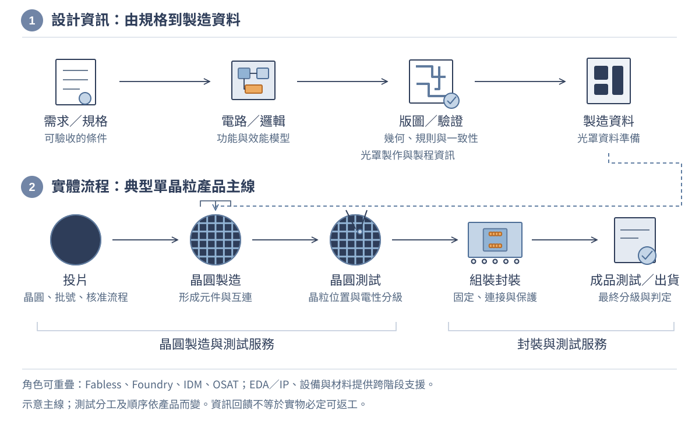

# 第 01 章　從需求到晶片：建立工程學科地圖

## 學習目標與先備知識

一顆裝在產品裡的積體電路，同時是物理結構、電路功能、製造流程的成果，也是整個系統的一部分。本章先建立全景，再用能親手計算的例子，把「聽過名詞」變成「能提出問題與檢查答案」。讀完應能：

- 說明設計、晶圓製造、封裝與測試的交付物，以及不同產業角色如何協作。
- 區分晶圓、裸晶與封裝元件，以及兩種不同層級的「前段／後段」。
- 用 Lot、Route、Recipe 和量測履歷描述一批產品，而不是只背製程名稱。
- 把產品要求連到材料、元件、電路、韌體與驗證，找到對應的學科。
- 計算簡化的平均功耗、良率成本與生產循環時間，說明模型不能保證什麼。
- 將系統需求分配到候選 IC 與外部電路，檢查訊號、資料與時間介面是否相容。
- 辨認類比／數位設計產物，區分設計驗證、簽核交付、製造測試及矽後系統證據。

先備知識是高中代數、面積、比例、能量與單位換算。不必先懂電晶體方程式；遇到新名詞先問「它是物件、加工動作、參數，還是驗收證據？」本章主要以典型矽積體電路為主線。功率元件、化合物半導體、MEMS 與先進多晶粒整合有不同細節，後續章節再展開；不能把所有晶片都想成同一種大型處理器。

本章會一路跟著這個問題走：**怎麼把「想記錄溫度」變成能驗收、能生產的產品？** 先釐清需求與手上的物件，再追一筆訊號、一顆 IC 和一批晶圓，最後用三個算例回頭找出需要的學科。各段的補充說明都留在原地展開；第一次讀先掌握基本模型，再讀緊接著的適用範圍。

這張學科地圖以**半導體產業的工程交付**為主軸：第 3 節先把功能分給晶片與系統，第 4 節放大晶片設計、驗證及投片前後的工作，第 5 節再走進製造，第 6–7 節把成本、性能與量測回饋到原需求。這不是單向流水線；封裝、測試及系統限制需要提早進入設計。本章完成的是辨認交付與證據的入門能力，不是完整 IC 流片實作訓練。

### 理工讀者的使用方式與能力檢核

本書面向電機、電子、半導體、材料、物理、機械及其他理工相關科系讀者。預期能處理代數、函數與基本物理量，但不預設已修過半導體製程或電路學。熟悉的單位與位元可快速複習；跨科系最需要對齊的是物件邊界、模型假設與證據種類。

| 本章完成後應能交出的成果 | 對應示範 | 自我檢核 |
|---|---|---|
| 一項有條件、有判定方法的需求 | 第 1 節需求表、第 7.3 節工程任務 | 練習 1；能否區分模型支持與實測證據？ |
| 一條從訊號、交付物到分析層級的追溯 | 圖 1-2、1-3、1-7 | 第 7.3 節任務；不只背名詞，要指出誰交什麼證據 |
| 一份帶有單位、分母與適用範圍的計算 | 第 6 節三個算例 | 練習 4、6、7；答案改變時，能說明原因嗎？ |
| 一項能區分候選原因的檢查 | 第 5.2 節薄膜案例 | 第 7.3 節任務 2；練習 3、8 補充追溯與證據界線 |
| 一份晶片邊界與介面預算 | 第 3.4 節、圖 1-2A | 練習 9、10；整機需求是否被錯當成單顆 IC 規格？ |
| 一份能指出缺少證據的設計交接判讀 | 第 4.1 節設計放大檢視、圖 1-3A | 練習 11、12；版圖、實物與整機證據能否互相取代？ |

本章要求能**辨認、計算與判讀**，不要求現在就設計電晶體或編寫製程配方。PDK、Chiplet、互連與可靠度等名詞先掌握用途和限制，細部模型留到後章；現有補充內容保留，供有相關背景者延伸閱讀。

## 1. 先問產品需要什麼，不要先選最先進的製程

手機裡的處理器、充電器的控制晶片與工業溫度感測器，都使用半導體技術，但它們追求的電壓、速度、精度、成本與可靠度並不相同。電晶體數量多、製程節點名稱小，不代表對每個任務都較適合。工程設計的起點是可驗收的需求，而非單一排行榜。

「做一個精準又省電的感測器」還不能指導設計。以自設的室內溫度記錄器為例，至少要寫出量測範圍、允許誤差、回報週期、反應時間、供電方式、使用環境和預期成本。每秒記錄一次室溫，與每微秒偵測一次光脈衝，所需頻寬、電源、儲存與測試設備都不同。

| 需求面向 | 可檢查的問題 | 缺少條件會造成什麼問題 |
|---|---|---|
| 量測 | 在哪個範圍內，與什麼參考比較？ | 「精準」無法被驗收 |
| 時間 | 多久更新一次？輸入改變後多久反應？ | 把取樣週期當成感測器反應時間 |
| 能源 | 電源電壓、可用容量與運作模式為何？ | 只看工作電流，漏掉睡眠與啟動耗能 |
| 環境 | 溫度、濕度、干擾與安裝方式為何？ | 室溫桌上結果被誤當全環境保證 |
| 製造 | 預期數量、測試時間、可接受不良率為何？ | 原型能工作，量產卻無法經濟地驗證 |

規格還要區分四種證據：理想模型預測、資料表典型值、指定條件下的保證限值，以及本次實際量測。典型值不是每顆元件都必須達到的限值；一次量測也不能代表所有批次。好的需求書會同時寫「要達到什麼」與「如何判定達到」，並保留測試條件、版本及不確定度。

**從問題表到一份可追蹤的規格。** 下面把原型的三項需求填上自設數值，供本章比較方案。任務是量測並儲存一筆新資料，無線回報關閉；這是需求子集，不是完整產品規格或實驗程序。

三項需求須對應同一候選硬體、韌體版本與量測／儲存模式。T01 亦維持每秒完成一次新讀值，溫度依各項指定條件設定；不能用快速模式測耗電，換成另一個較慢模式測精度，再合併宣告同一方案符合。

| 需求 ID | 自設要求與條件 | 對應方法與應留下的證據 | 本章目前掌握的狀態 |
|---|---|---|---|
| P01：平均耗電 | 3.0 V、25 °C，每秒完成指定任務；穩態連續 300 s 的平均電流不超過 40 µA，即平均功率不超過 120 µW | 量到完整供電電流，包含喚醒、工作與睡眠；保存積分區間、儀器設定與程式版本 | 第 6.1 節可作模型比較，尚無實測 |
| S01：資料更新 | 同一供電、環境與任務下，連續 300 筆有效新讀值的相鄰完成間隔為 0.99–1.01 s | 保存讀值與時間戳；確認不是重複舊值，也不只檢查排程觸發時間 | 尚無時序與有效資料紀錄 |
| T01：指定點位比較 | 3.0 V、固定安裝，在 10、25、40 °C 三個穩態點各取 30 筆；每筆與校正參考的絕對差不超過 0.5 °C | 保存成對原始資料、穩態判準、參考校正及量測不確定度；另須約定不確定度如何納入允收決策 | 尚無比較資料，不能宣告真實溫度準確度 |

T01 只涵蓋指定點位和條件，不保證整段溫度範圍、動態響應或其他環境；P01 是平均限制，也沒有給出電源尖峰電流限值。需求 ID 的用途是讓設計、測試與修訂能互相追溯；NASA 系統工程手冊的需求與驗證矩陣提供這種紀錄思路，但表中數值是本書自設，並非 NASA 的產品要求。[18]

需求列好了，但這項需求是在描述一顆裸晶、一個封裝元件，還是整台記錄器？先把這些物件分清，下一節才能把需求放到正確的對象上。

## 2. 先認物件：晶圓、裸晶、封裝與系統

圖 1-1　重新繪製的物件層級圖：**1** 晶圓、**2** 裸晶、**3** 單晶粒打線式球柵陣列（BGA）封裝；細部標註為 **4** 切割道、**5** 封膠、**6** 打線、**7** 封裝基板、**8** 焊球。晶圓上橘色位置只表示被選來放大的晶粒，不代表不良品。虛線是局部放大關係，不是加工步驟；三圖非等比例。封膠填覆晶粒與打線，並非空腔；省略基板內部走線與細部層次，不能作為實際製造剖面或接線圖。

**晶圓（wafer）** 是圓片狀基材，在本章的典型情境中是矽晶圓；表面經加工形成許多晶粒位置。**晶粒（die）** 是一個晶粒區域或分離後的晶粒；要強調尚未封裝的實體時稱為裸晶。**封裝元件（packaged IC）** 則包括晶粒與支撐、連接、散熱、保護等結構。日常的 chip 或「晶片」可能指裸晶，也可能指封裝產品，討論規格時應先約定指哪一層。

本章常見的單晶矽晶圓通常由近圓柱狀晶棒切片而來；晶粒則多採便於版圖排列與分離的矩形，兩者形狀不需要相同。[15] 晶圓上的矩形排版通常保留切割道；圓周附近可能出現不完整位置，邊緣也可能有不能納入正常產品的排除區。圖 1-1 的格子只是示意，不能拿來數實際產量。同一晶圓也不必永遠只包含同一種設計，例如多專案晶圓就需要不同的理解方式。

**系統**則是為了完成任務，把元件、電路板、供電、韌體及必要的感測與連接組合起來的整體。溫度記錄器是系統，板上可有多顆封裝元件；一顆 IC 可以負責部分功能，也可以整合多個功能，但不能因此把 IC 的規格直接當作整台產品的保證。

圖 1-1 先用單晶粒封裝讓物件關係容易辨認；但在把這張圖套到實際產品之前，還要釐清一件事：一個封裝的邊界，是否一定對應一顆晶粒？

### 補充理解：一個封裝不一定只有一顆晶粒

一個封裝可以包含一顆，也可以包含多顆晶粒。多晶粒封裝內可能整合不同功能、不同製程的晶粒；「封裝數」因此不能直接當成「晶粒數」。Chiplet 是用於整合的晶粒／功能分割概念，不是某一種封裝外形的名稱。當資料表談腳位、焊球、散熱焊墊與板級安裝時，通常已在討論封裝到系統的介面。[7]

為什麼不把晶粒做得愈大愈好？晶粒變大會改變單片可排數量、缺陷暴露、製造成本及良率；變小也可能需要更多外部連接或封裝整合。較大直徑晶圓可能提供更多位置，但設備、材料、流程及利用率仍影響經濟性，不能只用圓面積比例宣告成本必定下降。

知道物件之間的關係後，接著暫時不看它們怎麼製造，先看它們怎麼合作：室溫如何變成記錄器裡的一筆資料？

## 3. 跟著一筆溫度資料走：訊號鏈與 ADC

### 3.1 每個功能方塊做什麼？

感測元件先把溫度變化轉成電訊號；類比前端提供合適的偏壓、保護、增益或濾波，讓後面的轉換器收到可處理的輸入。類比數位轉換器（ADC）在指定時刻取樣，並把幅度轉成有限位元的數位碼。[16] 微控制器（MCU）執行韌體，安排取樣、處理、儲存與睡眠；若需要無線回報，再由射頻（RF）收發器連到天線。此處的「先、後」是訊號處理關係，不是晶片的製造順序。

圖 1-2　同一個產品的功能訊號鏈。ADC 前是連續電訊號，後是數位碼；選配 RF 收發器到天線的介面則是類比射頻訊號。圖中框線是功能分解，不代表每一塊都必須是獨立晶片；電源、時脈、熱與接地會同時影響多個方塊。

**讀圖檢核。** 若 ADC 前的電壓已經超出可處理範圍，應先追哪個介面，而不是直接改 MCU 演算法？請在圖 1-2 指出位置與理由。

**判讀。** 先比較感測元件輸出、類比前端輸出與 ADC 允許輸入範圍，再量實際訊號，區分感測輸出過高、前端增益過大或範圍設定不合。功能框不一定各是一顆 IC，但介面條件仍須成立。

沿著訊號鏈，我們已找到類比訊號轉成數位碼的位置。但「轉成數位」究竟保留了多少可區分的等級？要回答這個問題，先把位元、碼數與輸入範圍連起來。

### 3.2 先備小步驟：位元、輸出碼與量化間隔

N 位元表示有 N 個二進位位置，每一位可以是 0 或 1，因此共有 $2^N$ 種輸出碼。例如 3 位元從 000 到 111，共 8 碼，也就是十進位的 0 到 7，不是只有 3 碼。量化則是把連續輸入對應到這些有限的碼。

在理想均勻量化模型中，若輸入範圍的寬度為 $V_{span}=V_{max}-V_{min}$，標稱量化間隔（1 LSB）為：

$$
\Delta V=\frac{V_{span}}{2^N}.
$$

例如 3 位元、範圍寬度 8 V，間隔就是 $8/8=1\,\mathrm{V}$；最大碼雖為 7，分母仍是 8。這是分級間隔，不是「每次量測一定準到 1 V」。實際誤差還受雜訊、偏移、增益、非線性與參考電壓影響，因此解析度不能直接當成系統準確度。這裡沒有指定各碼的精確端點、四捨五入或截斷慣例；實際轉換點與飽和方式須看所選模型或資料表，也不能一概把輸入範圍寬度當成參考電壓。[16][17]

假如有用訊號只用到 ADC 輸入範圍的一小段，它就只跨過部分量化間隔。這是需要先檢查前端增益與輸入範圍的原因；章末練習 5 會用 12 位元、3.3 V 與 10 mV 實際算一次。

量化間隔說明轉換器如何分級，卻還沒有回答進入轉換器的訊號是否完整。接著沿訊號鏈往前檢查，看看哪些問題不能靠後面的數位處理補回。

### 3.3 數位處理不能無條件補救前端

沿著這條訊號鏈檢查資訊是否仍被保留。感測器輸出先經偏壓、保護及類比調理，再送進 ADC，最後由演算法與通訊處理。如果前端已飽和，後端增加位元數不能恢復遺失的資訊；若取樣前未充分抑制不符合取樣條件的帶外成分，取樣後可能發生混疊，只靠平滑曲線通常不能唯一重建原訊號。數位處理很有用，但不能無條件補救前端失去的資訊。

### 3.4 從功能方塊到晶片架構：邊界與介面先約定

圖 1-2 回答的是「需要哪些功能」，尚未決定「由幾顆 IC 實現」。**架構**要進一步分配責任：哪些功能放在同一晶粒，哪些留給外部感測器、MCU 或板級電路；介面則要約定彼此交換訊號、命令及資料的條件。只把功能框圈在一起，還不是可執行的 IC 規格。

為了追蹤一顆 IC，本章自設一個候選邊界：將**類比前端（AFE）、ADC 與數位控制／介面**整合，感測元件、MCU、儲存與選配 RF 保留在外部。這只是教學分割，不表示其成本、功耗或製程可行性已證明，也不是要求讀者先自製晶片才能做記錄器。系統開發可選現成 IC；此處是在理解晶片供應端必須完成的工作。

圖 1-2A　從功能訊號鏈進一步約定晶片邊界。上圖實線箭頭是訊號／命令方向，虛線框是候選 IC 的功能邊界，不是封裝剖面或實際版圖。下圖只畫自設的依序時間預算，寬度按時間比例，不是實測波形；橘色是尚未分配的工作時間，不能當成已證明可用的安全裕量。未畫出的供電、時脈、參考、保護及測試資源仍需設計。

| 系統要求 | 分配給候選 IC 的問題 | 仍由外部系統共同承擔的部分 |
|---|---|---|
| P01：整機平均電流不超過 40 µA | 各模式電流、啟動能量、可關閉的功能與喚醒條件 | 感測器、MCU、儲存及電源損失；不能每顆都各拿 40 µA |
| S01：每秒完成有效新讀值 | 就緒、轉換啟動、結果有效及介面傳輸的時間 | MCU 排程、讀取、儲存完成與時間戳 |
| T01：指定點位比較 | 輸入範圍、雜訊、偏移、增益及參考的允許條件 | 感測器、安裝、校正參考、演算法及量測不確定度 |

這張表是責任分配，不是把整機規格複製成 IC 規格。例如 IC 本身低於 40 µA，並不能推出整機通過 P01；ADC 的量化間隔也不能直接當成 T01 的溫度誤差。每一筆分配還要有相容的工作模式、單位、容差及驗證方法。需求分配與介面紀錄的方法可對照 NASA 手冊附錄 I、L；數值與產品架構由本教材自設。[19]

**介面檢查：三個方塊各自通過，整合為什麼仍可能錯？** 為評估第 6.1 節的 2 ms 工作候選方案，先提出下列內部時間分配。它們是待驗證的上限，不是已量到的晶片性能。

| 依序活動 | 自設時間上限 | 上限成立的前提 |
|---|---:|---|
| 喚醒前端及參考，到達就緒條件 | 0.8 ms | 就緒包含約定的建立誤差、輸入範圍及參考條件，不只是電源已開 |
| 有效啟動 ADC，到新結果有效 | 0.5 ms | 取樣所需期間內，輸入、參考及時脈均符合約定 |
| MCU 讀取新結果並完成儲存 | 0.2 ms | 讀到的是本次轉換，且儲存完成可被確認；相關喚醒成本已納入或另列 |

假設上述上限在同一候選配置及指定條件下都成立，且依序執行，總時間上界是 $0.8+0.5+0.2=1.5\,\mathrm{ms}$；距 2 ms 尚有 $2-1.5=0.5\,\mathrm{ms}$ 未分配。未列入的通訊、喚醒或重試必須從這份預算扣除；若活動重疊，則應重新分析相依關係，不能照樣相加後當成精確完成時間。

現在故意放入一個錯誤：類比團隊只承諾最晚 0.8 ms 就緒，ADC 團隊用穩定輸入測試，控制器卻在喚醒後固定 0.2 ms 啟動 ADC。若此時尚未就緒，三個方塊各自的測試都可能通過，整合結果仍不可信。每秒出現一個時間戳，也不能證明每秒量到一筆有效新資料。

修訂重點不是先把 ADC 位元數加大，而是共同定義**就緒、啟動、結果有效、逾時**的條件。控制器可等待經確認的就緒指示，或使用具有依據的保守等待時間；整合測試要包含接近最慢就緒的情境，並排除誤用上一筆結果。時間預算成立仍不能取代 P01 電流量測、S01 新資料紀錄及 T01 比較量測。

「有效新資料」表示本次取樣與轉換已完成，不要求碼值與上一筆不同；穩定溫度下，連續的新結果本來就可能相同。資料新鮮度須由完成事件、序號或其他可追溯紀錄確認，不能只比較數字是否變動。

**先停一下。** 若前端尚未就緒，控制器應把這次結果標成有效新資料嗎？不應；應按規格等待、報錯或標示無效，不能用舊值偽裝成更新。能寫出這個行為，才把模糊的方塊箭頭變成可驗證的介面要求。

到這裡，我們知道記錄器「要做什麼」及「訊號怎麼走」。接下來把視角縮到其中一顆 IC：它怎麼從設計資料變成能焊上電路板的封裝元件？設計記錄器通常可以選用現成 IC，並不表示每做一台產品都要自行設計晶片；下一節是在追溯所用 IC 的來源。

## 4. 跟著一顆 IC 走：從設計資料到出貨

### 4.1 先看流程：每一站要交出什麼？

圖 1-3　典型積體電路的教學主線。資訊流與實物流在投片前後銜接；實際產品可能有額外驗證、外包交接與不同的測試順序。圖中的單向主線不代表開發沒有回饋迭代。

先用圖 1-3 看全程。接下來先讀需求與設計的摘要，再把圖中製造前的一段放大，最後沿同一條主線接回光罩、晶圓、封裝測試與系統；不要把放大檢視誤認成多出另一條生產線。

**需求與架構。** 先決定功能、介面與效能預算。例如資料轉換器需要多少輸入範圍、取樣速度與雜訊裕量；電源是否足以供應尖峰電流。這一站應產出可追蹤的規格及驗收方法，而不是只有「高速、低功耗」等形容詞。

**電路、邏輯、版圖與驗證。** 把功能變成電路或硬體描述，再實作成可製造幾何。邏輯功能正確、版圖符合設計規則、版圖與原電路相符，是不同的檢查；通過其中一項不能取代其餘項目。時序、供電完整性、寄生效應及可測試性也要納入。設計資料送交製造的里程碑常稱為 tape-out，但不是成品出貨日。JKU 的積體電路課程把 tape-out 資料與後續晶圓測試、切割、封裝及最終測試分開介紹，適合接著閱讀。[12]

#### 設計放大檢視一：先確定使用哪些模型與規則

候選 IC 的邊界已經有了，但「把 AFE 和 ADC 整合」還不能直接交給晶圓廠。前端要決定偏壓、增益、頻寬與電源條件；控制邏輯要定義狀態、命令、資料有效與錯誤處置。能否做到，取決於所用製程提供的元件、互連與 I/O 條件，而不只是程式有沒有執行完。

| 設計資源 | 在本例回答的問題 | 不能誤當成什麼 |
|---|---|---|
| 製程設計套件 PDK | 可用哪些元件與層？如何模擬、繪製及檢查？ | 不是完整晶片設計，也不是設備 Recipe |
| 標準元件／I/O 等元件庫 | 哪些邏輯閘、暫存器、輸入輸出單元可用？其模型與限制為何？ | 不是只靠邏輯功能相同就可跨製程替換 |
| 可重用 IP | 是否重用某個轉換器、控制器或介面模組？ | 舊環境通過不等於新產品整合必然通過 |
| EDA 工具 | 如何描述、模擬、合成、實作與檢查設計？ | 工具成功結束不是產品符合規格的保證 |

PDK 與配套庫的提供方式依供應者而異，模型、規則、工具設定與版本應一併受控。公開 SKY130 文件可用來看元件模型、標準元件與 I/O 庫如何分開描述；所讀公開版另有 experimental preview 限制，不能因能下載就視為已取得量產保證。[20] IP 的重用仍需檢查版本、介面、授權與適用製程，不能省略整合驗證。[14]

#### 設計放大檢視二：類比與數位不是同一份檔案

候選 IC 包含兩條相互約束的路徑。**類比部分**由元件電路與模型出發，檢查工作點、增益、雜訊、建立時間等；**數位部分**可以用暫存器傳輸層描述（RTL）表達狀態、資料搬移與控制行為。RTL 描述硬體，不是燒進外部 MCU 的韌體；同一個「等待就緒」需求，可能分配在 IC 控制邏輯，也可能由 MCU 韌體負責，責任必須先約定。

圖 1-3A　製造之前的設計表示與證據。藍色實線表示資料依賴，不是實物輸送；橘色虛線表示發現問題後修訂設計，並非可以忽略重新驗證。這是典型類比／數位路徑的教學整理，混合訊號整合需共同檢查介面；各框不是某套工具的完整操作步驟，簽核也不是只靠圖內列出的幾項檢查。原圖 1-3 的生命週期仍然適用。

數位 RTL 經**合成**轉成邏輯元件的連接描述，再經佈局、時脈與繞線等實體工作；類比部分則把元件與連接實作為版圖，評估匹配、寄生與電性。**網表**描述元件實例及連接；**版圖**描述實體幾何及層次。兩者不能當成同一資料換副檔名。實體實作會改變延遲、負載與耦合，因此常須回修，並非一次畫完就往下交。[21][22]

例如第 3.4 節要求 ADC 只在前端就緒後啟動：數位功能驗證可檢查控制器是否遵守這個條件；類比模擬則要檢查就緒所代表的電壓誤差是否真的收斂。若測試平台把就緒固定為真，就可能漏掉真正的整合錯誤。驗證計畫必須把需求 ID 連到刺激條件、觀察量與判據，而不只是保存一張「模擬有波形」的截圖。

#### 設計放大檢視三：不同檢查回答不同問題

| 設計產物／檢查 | 能回答的問題 | 單獨不能證明的事 |
|---|---|---|
| 功能與介面驗證 | 指定情境下，命令、狀態、新資料與錯誤行為是否符合需求？ | 未覆蓋情境、實際製程變異或整機環境全部合格 |
| 電路性能與角落分析 | 在所選模型及製程／電壓／溫度條件下，增益、電流、時間是否達標？ | 模型涵蓋所有製造差異，或等同實測可靠度 |
| 幾何設計規則檢查 DRC | 版圖是否符合所用規則，例如寬度與間距？ | 電路功能、連接及全部性能正確 |
| 版圖與電路一致性檢查 LVS | 依比對設定，萃取出的元件與連接是否符合預期電路？ | 增益、雜訊或建立時間符合要求 |
| 寄生萃取 PEX 與後續驗證 | 把配線等寄生加入後，性能或時序是否仍成立？ | 某次模擬收斂就等於所有條件均通過 |
| 受控簽核與資料交付 | 約定檢查是否針對同一版設計完成，交付物可否被接受？ | 晶圓已製成、已出貨，或整機 P01／S01／T01 通過 |

DRC、LVS 與寄生後性能必須分開看：版圖合法但接錯線，或連接相同但寄生使讀值太慢，都可能失敗。Virginia Tech 的類比版圖教材分別示範連接比對與萃取後重模擬；修改版圖後，相關檢查也要重新執行。[23] 角落分析中的製程、電壓、溫度常縮寫為 PVT；它不是自動涵蓋所有隨機失配與使用情況的保證。

**判讀停靠點。** 功能模擬和 DRC 通過，LVS 卻不符，能直接交付嗎？不能；必須找出差異及其意義，確認交付電路是預期版本，再完成約定的其餘檢查。反過來，即使 DRC、LVS 都通過，寄生後建立時間不符仍然是未解問題，不能要求製造端任意改 Recipe 來補救。

**簽核（signoff）**是依專案和製程約定判據完成交付前的檢查與核准，不是通用的一個按鈕。需保留適用版本、模型與約束、檢查結果，以及經權責確認的例外；最終版圖／網表、報告與封裝連接資料不能各自來自不相容的版本。[21] OpenROAD 範例能產生 GDS 版圖檔，但其時序報告仍可能有未滿足的條件，說明「檔案產生」不等於「簽核完成」。[22]

在交付之前，還要預想如何測到實際晶片。**可測試性設計 DFT**是在設計時安排觀察與控制能力，並評估其功能、面積及時序影響；不是晶片做完後單靠測試程式就能補上任何內部觀測點。[24] 同樣，封裝腳位、晶粒接點、供電、熱與板級介面也要提早規劃，不是最後隨便找一個外殼裝起來。[25] 本例至少要知道如何辨認前端就緒與本次結果有效；實作可依成本、干擾及可觀測需求選擇，不代表每個內部節點都拉到外部腳位。

現在可以清楚區分三個事件：**tape-out** 是設計資料交付的里程碑；**晶圓投產**是按受控產品及流程投入製造；**成品交付**還需後續加工、封裝與測試。口語「投片」有時混用前兩者，討論交期時必須說清楚，不能把設計資料送出日直接當成晶圓開工日或出貨日。

#### 回到實體產品：設計資料如何接到製造

剛才的放大檢視建立了「交什麼、檢查什麼、哪個版本」；以下接回圖 1-3。設計規則和模型提供製造前的約束，但仍要靠實際製造與量測證明產品狀態。

**光罩資料與製作。** 版圖資料還需要對應製程所需的圖形化工作。入門時可先把光罩想成提供圖形資訊的工具，但不能把「一個功能層」永遠等同「一片光罩」：圖形拆分、修正與實際製程會改變對應關係。這裡先掌握設計幾何必須轉成可在設備上實現的圖形，不必先背特定光罩數。

**投片與晶圓製造。** 投片是讓晶圓以指定產品及流程進入製造。晶圓反覆經過成膜、圖形定義、材料移除、摻雜、熱處理、清洗、平坦化與量測等模組，逐步形成元件及互連。加工、排隊、搬運與異常處置都會佔用時間，不能把少數設備的加工分鐘數相加就當成整批交期。

**晶圓測試。** 在仍能識別晶圓上各位置時量測電性，依測試結果建立晶粒分級與位置資料。測試可協助避免把已知不合格晶粒繼續送進昂貴的後續步驟，但「通過此階段」只代表滿足這個測試條件與涵蓋範圍。測試接觸、速度與可觀測性本身也有限制。

**組裝封裝。** 典型單晶粒流程包含分離晶粒、固定、建立電氣連接與保護結構。封裝還需要把熱帶走，並承受材料膨脹與機械應力。晶圓級封裝、多晶粒與先進整合可能改變切割、組裝及測試的相對次序，因此本圖不是所有封裝的操作清單。

**最終測試與出貨判定。** 檢查封裝後的功能及電性，依產品需求分級與判定。可靠度還需要設計、製程控制、資格驗證及持續監控；逐顆最終測試不是「保證任何使用環境下都能使用十年」。TI 的公開可靠度資料明確把可靠度評估連到元件資格驗證、失效機制與使用條件，而不是只靠最後一次量測。[5][6]

**矽後特性量測、除錯與系統整合。** 開發團隊取得實際晶片後，要確認供電、時脈、重置與介面是否正確，再逐步啟用功能、量測性能並對照設計模型。此處按工作種類補充，不表示發生在量產出貨之後；初期特性量測與除錯會回饋產品測試及出貨準備。回到記錄器，就要把候選 IC 接上感測器、MCU 與儲存，核對真正的新結果、時間戳及完整供電電流。首顆樣品能讀到數字，不等於三項整機需求都通過；量產測試、特性量測、資格驗證與系統使用目的確認不能互相取代。[19][21]

如果實際讀值異常，應同步看輸入／參考、控制事件與結果有效，而不是只看一個最終碼值。設計期預留的測試模式或觀察方式，正是為這類問題準備。此處的「矽後」表示已有實體晶片，不把「驗證」一詞限定為製造前，也不把所有矽後活動都稱作量產篩檢。

若測試發現問題，回饋的目的通常是找出設計、製程或測試條件的原因，改善後續產品；不代表已經完成且受損的晶粒都能沿箭頭倒退恢復。分清「知識回饋」與「實物可返工」，是理解工廠的重要第一步。

### 4.2 再看分工：誰負責這些交付物？

先知道工作內容，再看產業角色，比先背公司分類更容易理解。下表是在剛才的生命週期上分配責任，不是另一條與它無關的流程。

半導體產業可以用工作分工理解，而不是把公司永久放進互斥的格子。同一家公司可能兼具多種業務，也可能對不同產品採用不同供應鏈。

| 角色 | 核心工作與交付物 | 初學者常漏掉的界線 |
|---|---|---|
| 無晶圓廠設計業者（Fabless） | 定義產品、完成設計與驗證，協調外部製造及測試 | 沒有自營晶圓廠不等於不懂製造；設計仍受製程規則約束 |
| 晶圓代工服務（Foundry） | 依核准製程製造晶圓，提供設計規則、模型與製造服務 | 服務可能延伸到設計支援與封裝；不能簡化成「只接收圖檔」 |
| 整合元件製造商（IDM） | 結合自有產品設計與自有製造能力 | 仍可能外包部分晶圓製造或封測，不代表每一步都自行完成 |
| 專業封裝測試服務（OSAT） | 組裝、封裝、測試及相關整合服務 | 晶圓測試、封裝與最終測試的分工可依合約改變 |
| EDA、IP 與設計服務 | 設計工具、可重用功能模組、驗證與實作支援 | IP 的介面與適用製程仍需確認，不能直接保證系統成功 |
| 設備與材料供應商 | 曝光、沉積、蝕刻、量測等設備；晶圓、氣體、化學品、光阻等材料 | 純度、均勻度、污染控制及維護會影響整條流程 |

例如設計業者要交給製造端的，不只是電路功能說明，還包括符合製程設計套件（PDK）與設計規則的實作資料。製造端交回的也不只是「完成的晶圓」，還有製程、量測、分級與追溯資料。這種資訊介面與實物介面同樣重要。Intel 曾公開說明同時使用內部製造與外部代工，其代工服務資料也包括晶圓製造、封裝及設計支援，可用來理解角色並非企業間的絕對分界。[3][4] EDA 與可重用 IP 的功能則可對照 Synopsys 的公開說明。[14]

生命週期交代了外部交付，分工交代了誰負責。現在把鏡頭停在「晶圓製造」這一站：裡面形成哪些結構、反覆做哪些加工，又如何知道這批晶圓真的走對流程？

## 5. 走進晶圓廠：結構、加工與追溯

### 5.1 先看加工的位置：兩種「前段／後段」

圖 1-4　上半部區分產業前後段與晶圓內 FEOL／MOL／BEOL；下半部用平面電晶體、接點及三層金屬互連示意功能位置。橘色接點突出 MOL 的銜接作用。剖面非等比例，省略隔離、阻障等細節，也不是完整電路連線圖；不同技術對局部互連與模組邊界可能有不同劃分。

從產業流程看，前段製造常指晶圓加工，後段製造常指組裝封裝及相關測試；ST 的製造價值鏈資料採用這個區分。[11] 從晶圓製程內部看，FEOL（front end of line）主要形成電晶體等元件，MOL（middle of line）處理元件接觸與局部連接，BEOL（back end of line）建立金屬與介電層互連。imec 的邏輯晶片技術說明進一步區分這三者的位置與功能。[8]

因此「BEOL 金屬線電阻偏高」與「後段封裝接點失效」不是同一個位置的問題。第一個通常需要晶圓內互連的幾何、材料與量測資料；第二個還可能需要封裝結構、板級應力或接合品質的證據。聽見「後段」時，先問對方指的是工廠分工，還是晶圓內製程段落，比急著猜設備名稱更有效。

後續互連工程、封裝與散熱章節會接著處理這些問題。先讀懂層級，再進入電阻、寄生電容與熱阻的模型。

把它接回候選 IC：設計中的元件與配線，必須在製程中形成相應結構；圖 1-4 仍是通用示意，並不是已完成該 IC 的真實剖面。設計階段的規則檢查與製造階段的膜厚、線寬及電性量測是前後相接的證據，不能互相代替。

### 5.2 再看加工的動作：製程會重複，但不是每層同一個食譜

知道 FEOL、MOL、BEOL 分別要形成什麼後，接著看形成它們所用的基本動作。下圖只選一種薄膜圖案轉移作例子，不把它當成所有元件的完整製程。

圖 1-5　上半部只選「薄膜圖案化蝕刻」作具體例子：薄膜形成、微影後遮罩、開口處蝕刻、去除光阻。橘色為光阻，假設理想選擇性與近垂直側壁，下方基板未被蝕刻；不能把這個剖面直接當成摻雜流程。下半部是量測與品質處置，橘色路徑表示需暫停處理的異常。量測站及抽樣依控制計畫安排，不是所有模組都有相同步驟；返工必須有被驗證且核准的條件，不能把任何不合格品直接送回起點。

可以先用五個動詞理解許多模組：增加材料、定義圖形、選擇性改變材料、清理表面、確認結果。增加材料可能是沉積或成長；圖形定義通常涉及微影；選擇性改變可以是蝕刻移除，也可以是導入摻雜。兩者的物理目的不同，不能當作可任意互換的加工。

清洗並不是只有最後才做的「打掃」。表面殘留、顆粒與污染會影響後續附著、介面或電性，因此清洗可穿插在多個位置。量測也不是只在成品出廠時出現；膜厚、線寬、套刻、電性等資訊要在適當階段取得，否則等到最終測試才發現問題，可能已經付出許多後續成本。

這些模組還會共用設備與量測站，形成重複進站的製造流程。某一層完成後，晶圓可能再次回到同類設備做另一層，而不是從一條單向流水線一路走到底。設備排程、維護與瓶頸因此會影響交期。Siemens 的製造執行系統說明也討論重複進站、路徑變更與設備程序（Recipe，下一小節說明）追蹤；這是理解管理問題的例子，不代表所有工廠都採用相同軟體或配置。[13]

遇到量測超規，第一步不是立即調參數，而是確認產品身分、量測方法、儀器狀態與資料是否對應正確。之後才判斷是測試問題、設備漂移、材料差異還是上游累積效應。若蝕刻已傷及下層，重新沉積或重跑一次未必能恢復原結構；若某階段允許去除光阻後重作，也仍有材料與次數限制。

**小案例：同樣叫「膜厚偏高」，原因可能不同。** 單一測點偏高，可能先檢查量測位置、表面狀態與量測重複性；整片都偏高，要再看批次趨勢與設備紀錄；中心與邊緣差異增加，則要區分平均值與均勻性。這些是診斷方向，不是特定設備的故障結論。有效的下一步應是一項能區分假說的量測，而不是同時改動所有參數。

### 5.3 最後看如何管好流程：Lot、Route、Recipe

剛才的診斷需要批次趨勢、設備紀錄與量測證據。要取得這些資料，就必須同時記住「哪一批」、「應走哪條路」與「每一步應用哪組條件」，以下三個名詞正是為了回答這些問題。

延續剛才的薄膜量測超規案例，只寫「沉積有問題」無法追查。工程師需要知道哪些晶圓、經過哪個步驟版本、使用哪台設備與條件，以及量測是否可信。

| 名詞 | 回答的問題 | 自設的記錄例子 |
|---|---|---|
| Lot（批次） | 這是哪一批受共同管理的產品？ | 批號 L-101，另保留各片晶圓識別與拆批紀錄 |
| Route（流程路徑） | 應按什麼次序，經過哪些步驟與檢查？ | 路徑 R3：加工、量測、判定，再進入下一模組 |
| Recipe（設備程序／配方） | 這一步在設備上執行哪一套核准條件？ | 程序 P7 第 2 版；參數、步序與適用設備均受控 |
| 製程履歷 | 實際上發生了什麼？ | 設備／腔體、時間、版本、警報、量測及處置結果 |

SEMI 術語彙編將 lot、recipe、cycle time 與 throughput 分別定義，適合用來避免把不同概念混成一個「批次設定」。Lot 不以 25 片為普遍定義；載具可容納多少片、某設備一次處理多少片、管理批次實際有多少片，是三個不同問題。[9]

Route 不是每一步的所有機台參數；Recipe 也不能取代整條 Route。路徑可能包含分支、工程暫停、抽樣量測與核准的返工步驟，版本控制因此很重要。即使兩批產品使用同一個 Recipe 名稱，也仍要確認版本與設備適用範圍。

追溯系統還需要處理拆批與併批：拆開後不能丟掉原始關聯，合併管理也不能抹去不同的加工歷史。對初學者而言，重點是把「規定要做什麼」與「實際做了什麼」分開保存。這一習慣也適用於電路實驗：電路圖版本、元件批次、韌體版本與量測儀器設定都應留下紀錄。

因此，追溯鏈不應到工廠門口才開始：設計版本與核准交付資料要能連到製造批次、晶圓／晶粒位置、封裝識別及測試版本。若晶片或韌體更新，要能分清「原設計條件改了」與「同設計下製造狀態變了」，否則系統異常容易被歸給錯誤環節。

本章不提供可直接操作危險設備的 Recipe。涉及高溫、真空、高壓、雷射、毒性或易燃氣體及化學品時，概念教材不能取代設備訓練、核准程序與安全規範。

我們已經走過需求、功能、IC 來源與晶圓廠。接著不再增加製程名詞，而是用前面建立的邊界算三個問題：產品能用多久、IC 每顆成本多少，以及工廠多久交得出來。

## 6. 回到工程決策：續航、成本與交期

三個算例使用不同模型，都是自設數值。先認清各自的對象，再代入公式；它們不是可以把每個答案一路相乘的同一份工廠資料。

| 要回答的問題 | 本例計算對象與邊界 | 先保留的簡化 |
|---|---|---|
| 能用多久？ | 整台記錄器的一個工作／睡眠週期 | 固定供電、兩種電流狀態，忽略啟動過衝與轉換損失 |
| 每顆成本多少？ | 一片晶圓對應的單晶粒 IC 製造及封裝投入 | 採題目給定排版與分段良率，並非整台記錄器成本 |
| 多久交得出來？ | 另一個已達穩態的晶圓流程邊界 | 忽略報廢，不沿用上一例的 80%／95% 良率 |

### 6.1 算例一：低功耗不只看工作電流

回到記錄器的供電需求。第 3 節的 MCU 可以安排工作與睡眠，但電池要供應的是所有狀態累積的電荷，而不只是工作時的電流。

以下是自設情境，不是特定產品規格。記錄器每秒工作一次，工作電流 $I_a=12\,\mathrm{mA}$、工作時間 $t_a=4\,\mathrm{ms}$；其餘時間睡眠電流 $I_s=8\,\mathrm{\mu A}$。固定供電 $V=3\,\mathrm{V}$，週期 $T=1\,\mathrm{s}$，忽略啟動過衝與電源轉換損失。

圖 1-6　算例一的時間分配。上方完整週期按時間比例繪製，橘色工作區只占 0.4%；下方另放大前 10 ms，不能把兩列的寬度直接相比。色塊只表示狀態與持續時間，高度不是電流值；這不是實測電流波形。雖然工作時間很短，仍須把工作與睡眠的電荷都算進去。

先把每種狀態的電荷加總，再除以週期，得到平均電流：

$$
I_{avg}=\frac{I_a t_a+I_s(T-t_a)}{T}
=48\,\mathrm{\mu A}+7.968\,\mathrm{\mu A}
=55.968\,\mathrm{\mu A}.
$$

平均功率為 $VI_{avg}=167.904\,\mathrm{\mu W}$；一日能耗約 $14.507\,\mathrm{J}$。若理想可用電池容量為 $200\,\mathrm{mAh}$，則

$$
t_{battery}=\frac{200\,\mathrm{mAh}}{0.055968\,\mathrm{mA}}
\approx3573.5\,\mathrm{h}\approx149\,\mathrm{day}.
$$

這是電荷收支模型，不是實測續航保證。電池容量的量測條件、截止電壓、自放電、溫度、穩壓器靜態電流及轉換損失都可能改變結果；若電池電壓與負載電壓不同，更不能不加區分地直接套用負載電流。

比較兩個修改：把工作時間縮短為 2 ms，平均電流變成 $31.984\,\mathrm{\mu A}$；只把睡眠電流減半為 4 µA、工作時間仍是 4 ms，平均電流則為 $51.984\,\mathrm{\mu A}$。這組數值下，縮短工作時間的效果較大。原因不是「韌體一定比元件重要」，而是工作狀態原本佔每週期電荷的大宗。

若實測高一倍，先量到完整喚醒週期，查看啟動、重試、外接電阻、感測器供電及電源管理，不要先把每個元件都換掉。量測儀器的頻寬、取樣與插入造成的壓降也可能影響結果。模型的價值在於幫你選下一個能驗證原因的實驗。

**把計算接回 P01，而不只比較誰的數字小。** 同一個兩狀態模型可整理成下表；功率均以 3.0 V 計算。

| 候選方案 | 平均電流 | 平均功率 | 相對 P01 的模型判斷 |
|---|---:|---:|---|
| 原方案：工作 4 ms、睡眠 8 µA | 55.968 µA | 167.904 µW | 超過 40 µA，模型不支持採用 |
| 工作縮為 2 ms，睡眠仍 8 µA | 31.984 µA | 95.952 µW | 低於平均限制，但 S01、T01 仍無證據 |
| 工作仍 4 ms、睡眠降為 4 µA | 51.984 µA | 155.952 µW | 仍超過平均限制 |

縮為 2 ms 的前提是**同一項量測與儲存任務確實完成**。提早關閉感測器、讀到尚未建立的電壓，或重複回報上一筆資料，都不是等價的省電方案。下一步要同時取得完整電流波形、新讀值時間戳與指定點位比較；模型支持候選方案，不等於原型已通過驗收。第二章將拆出「讀值前需等待多久」這一個子問題。

第 3.4 節的 1.5 ms 依序預算，正好提供一份應驗證的活動清單；它沒有證明這顆 IC 已做得出來，也沒有證明各活動都維持本例假設的 12 mA。縮短工作時間不能直接等同提高時脈，更不能省略就緒條件。至於下一例的晶粒尺寸與價格，仍是獨立成本教具，不是這顆候選 IC 的版圖結果或報價。

### 6.2 算例二：面積、良率與每顆可出貨成本

現在把對象從整台記錄器縮到一種單晶粒 IC，追問它的製造投入如何分攤到合格產品。請回想第 2 節的晶圓與裸晶，以及第 4 節先測試、再封裝的典型流程；下列 15.26 元是這個簡化 IC 模型的結果，不是記錄器售價或整機成本。

以下全部是自設數值，不代表實際工廠報價。直徑 200 mm 的晶圓，扣除邊緣限制後，可用區域直徑為 190 mm；每顆晶粒為 $10\times10\,\mathrm{mm}$，先忽略切割道。可用面積是

$$
A_{usable}=\pi(95\,\mathrm{mm})^2\approx28\,352.874\,\mathrm{mm^2}.
$$

面積除以 $100\,\mathrm{mm^2}$ 得到約 283.529，只能提供面積上的上界，不能當成實際排版結果。矩形要完整落在圓內，還要考慮排列、切割道及其他排除條件。本例另外**給定**實際排版有 240 個完整位置，並不是用面積商推導出 240。

若晶圓測試合格率為 80%，且後續封裝與最終測試對送入的合格裸晶有 95% 的條件合格率，則長期平均可出貨數為

$$
N_{good}=240\times0.80\times0.95=182.4.
$$

小數表示許多批次的平均期望，不是一片晶圓能出貨 0.4 顆元件。良率能相乘，是因為分母沿著流程銜接：第一段分母是晶粒位置，第二段分母是進入封裝的合格裸晶。本例採一顆裸晶對應一個封裝，沒有改變統計單位；多晶粒封裝不能原封不動套用。

假設一片晶圓的製造成本為 2,400 元，每顆送封裝的裸晶另花 2 元。平均送封裝數為 $240\times0.8=192$，簡化總成本與每顆可出貨成本是

$$
C_{total}=2400+192\times2=2784\,\mathrm{元},\qquad
C_{good}=\frac{2784}{182.4}\approx15.26\,\mathrm{元/顆}.
$$

本模型未列出的測試、報廢處置、運輸、管理與研發等費用，不能假裝已被包含。它要說明的是：即使晶圓價格不變，良率、封裝投入與可出貨分母也會影響單位成本。只比較「一片晶圓多少錢」不足以比較兩種方案。量產良率章將再討論缺陷模型與統計條件。

### 6.3 算例三：為什麼多投片不會立即增加出貨？

知道成本還不等於知道交期。這次把邊界移到另一個晶圓生產流程，單位改用「片」，且另行假設忽略報廢；先前算例的晶粒數與良率不帶進來。第 5 節提到的重複進站與等待，正是不能只加總設備加工時間的原因。

先分清三個量：在製品（WIP）是某個邊界內尚未完成的數量；吞吐量（throughput）是單位時間完成的數量；循環時間（cycle time）是同一邊界內從進入到離開的經過時間，包含加工，也可能包含等待、搬運、量測與處置。設備的單步加工時間不是整個工廠的循環時間。[9]

在流量守恆、長期平均具有代表性且系統沒有持續無界累積的條件下，Little's law 將三者連接：

$$
L=\lambda W.
$$

其中 $L$ 是平均在製數量，$\lambda$ 是平均流量，$W$ 是平均停留時間。三者必須使用同一系統邊界、同一物件單位及相容的統計期間；不是把今天的瞬間庫存與另一個月份的出貨數隨便相除。[10]

自設一個忽略報廢、已達穩態的晶圓流程：平均完工 40 片／日，平均循環時間 30 日，則平均 WIP 為 $40\times30=1200$ 片。若真能在 WIP 維持 1200 片時達到 50 片／日，對應循環時間是 $1200/50=24$ 日。

這個算式是流量關係，不是增加產能的方法。多投片可能只是讓瓶頸前排更長的隊；要提高出貨，還需看瓶頸設備可用率、產品組合、重工、良率與排程。若報廢不可忽略，也不能拿只計良品的出貨量，直接配上包含所有產品的 WIP 與停留時間；必須重新定義流入、流出與報廢分支。

「需求增加」和「明天能交貨」因此是不同問題。增加設備可能還需要安裝、資格驗證、材料供應與人員訓練；既有在製品也必須完成剩餘步驟。這是工程、製造管理與商業決策真正相遇的地方。

**平均值不是單批交期承諾。** 算出的 30 日是長期平均停留時間，不是「今天投片的每一批都會在 30 日後完成」。承諾特定批次的交期，還需查剩餘流程、瓶頸排程、變異、優先規則及異常處置條件；平均流量關係本身沒有提供這些資訊。

現在手上有續航、成本與交期三種答案，對象和單位各不相同。它們仍有共同的驗證方法：先不急著採用數字，而是回頭檢查計算是否符合原先的模型邊界。

### 6.4 三個答案都要接受同樣的檢查

先做三種檢查。**單位檢查**：電流乘時間是電荷，電荷除時間才回到電流；片／日乘日才得到片。**極限檢查**：工作時間趨近零時，平均電流應趨近睡眠電流；後段合格率趨近零時，可出貨成本不能仍維持有限而不變。**量級檢查**：平均電流應落在兩個狀態電流之間，實際可排晶粒數不會超過相容的可用面積上界。

接著問「參數從哪裡來？」題目給定、供應商保證、抽樣估計及實際量測，可信範圍不同。再問「哪些因素尚未建模？」簡化不等於錯誤；沒有說明簡化，卻把結果當成無條件保證，才會導致錯用。

最後寫出能推翻模型的觀察。例如平均耗電預測與量測不符，就看是否出現模型沒有的額外狀態；預期良率與實際差很多，就查分母、產品組合與測試條件是否一致。不要用更多小數位掩蓋不確定度，也不要為了讓答案吻合而事後任意改假設。

這三個算例各用了少量數學，卻已需要供電、韌體、材料幾何、測試、統計與生產管理一起配合。最後再把視角拉遠：它們分別位於哪個分析層級，下一步該學哪些學科？

## 7. 回看整張地圖：分析層級與學習路徑

### 7.1 五個層級不是五個互不相干的科目

前面曾沿著訊號方向走，也沿著製造時間順序走；下面換成「解釋問題所用的模型」。這不是第三條生產線：同一個耗電或良率問題，可能要在數個層級之間來回尋找證據。

圖 1-7　同一個產品的跨層分析。圖示是分析層級，不是製造次序或實測波形；方格連接圖只代表抽象材料模型，不是矽的真實晶體結構。模型、製造限制與不確定度向產品傳遞，需求與驗證回饋則向各層分配。

材料層處理晶格、缺陷、能帶與介面；元件層把這些性質整理成電流、電壓、電容及雜訊的關係；電路層利用元件實現放大、開關、振盪、記憶與轉換；架構與韌體層決定資料怎麼流、何時運算與睡眠；產品層則驗證整體是否在使用條件下達標。

| 分析層級 | 典型問題 | 傳給其他層級的資訊 |
|---|---|---|
| 材料與製程 | 缺陷、膜厚、摻雜與介面如何控制？ | 材料常數、幾何、變異與製造限制 |
| 元件 | 電壓改變時，電流與電荷如何反應？ | 電性模型、寄生、雜訊與安全範圍 |
| 電路 | 能否得到指定增益、速度與精度？ | 功耗、延遲、誤差及輸入輸出條件 |
| 架構與韌體 | 何時取樣、運算、睡眠與通訊？ | 吞吐量、時序、資源及故障行為 |
| 產品與驗證 | 是否在環境與負載變化下仍然達標？ | 驗收證據、可靠度限制與修訂需求 |

層級不是互不相通的抽屜。閘極介電層改變會影響電容與漏電，進而影響速度及待機功率；封裝熱阻會影響接面溫度，溫度又改變漏電與可靠度。高階模型中的參數應能追溯到低階物理、供應商資料或量測，而不是為了讓模擬通過就任意調整。

把它套回算例一：睡眠電流可能牽涉元件漏電與電源電路，工作時間則牽涉轉換、運算與韌體排程。這樣才看得出「縮短工作時間較有效」是那組數值下的結論，不是某一個學科永遠比另一個重要。

### 7.2 電機、電子與半導體科系，應該怎麼接著學？

有了實際問題與分析層級，課程表就不再只是一串名稱。下面各學科是用來回答前面遇到的問題，也會在後續章節逐步接上。

各校科系名稱、必修與專業分流不同，不能把下表當成固定學制。MIT 與清大的官方課程資料可用來對照數理、電路、系統及實驗的連接，但本書不是任一校課程表的複製，也不宣稱完成本書就等同取得完整學位訓練。[1][2]

| 學科群 | 為什麼需要 | 在本書接到哪裡 |
|---|---|---|
| 微積分、微分方程、線性代數 | 描述變化、暫態、耦合方程與小訊號近似 | 數學工具、電路暫態、控制與模型 |
| 機率、統計與數值方法 | 分辨雜訊、變異、不確定度與可重現趨勢 | 量測、DOE、良率及可靠度 |
| 電路學與電子學 | 守恆、偏壓、放大、回授及訊號轉換 | 基礎電路、類比與混合訊號 |
| 電磁、訊號與系統 | 場、波、頻率、取樣與互連效應 | 傳輸線、濾波、ADC、通訊 |
| 固態、材料與半導體元件 | 理解能帶、載子、接面及電晶體模型 | 元件物理、MOS、短通道與功率元件 |
| 製程、量測與整合 | 把幾何和材料做出來，並證明可重複 | 晶圓、微影、薄膜、蝕刻、互連與品質 |
| 數位邏輯、程式與計算機架構 | 描述狀態、時序、資料流及軟硬體互動 | 數位電路、韌體、測試與系統專題 |
| 控制、電力電子與能源 | 管理動態、能量轉換、穩定性與負載 | 回授、電源、能源相關延伸 |
| 實驗、專題與工程溝通 | 把假說變成量測，記錄他人能重現的證據 | 儀器、除錯、跨域專題及技術報告 |

電機領域通常涵蓋電路、訊號、電磁、控制、能源與計算等多個方向；電子相關學程常深入元件與積體電路；半導體學程則常加重固態、材料、製程、量測與整合。但真正應比較的是課綱與先備關係，而不是只用名稱替學生決定能力。

例如設計低雜訊放大器，需要用微積分理解小訊號，用機率描述雜訊，用電子學建立偏壓與增益模型，用電磁與版圖知識處理高頻互連，再用製程與統計理解尺寸、匹配及變異。只會公式可以完成紙上題目；讓成品可測試、可量產，還要補上驗證與工程紀錄。

適合自學的路徑是反覆回訪，而不是等所有物理都學完才碰電路：先用簡化元件做計算與低風險量測，再學材料與元件物理，最後回來檢查原模型省略了什麼。每一階段都保留「我使用的假設、可能失效的條件、下一項驗證」三行筆記。

### 7.3 工程任務：把方案選擇接到可查核的證據

現在可以把各節接成一次簡短設計審查。工作縮為 2 ms 是值得測試的候選方案；它還不是 P01、S01、T01 全部通過的產品。請用下圖分開記錄「模型說什麼」與「原型量到什麼」。

圖 1-8　自繪的需求—證據追溯圖。實線表示資訊如何支援下一步，橘色虛線表示結果不符時返回檢查；不是製造流程。模型預測與量測證據分開列，不能把算得出來直接改寫成已通過。P01、S01、T01 是第 1 節自設需求。

**任務。** 先不看下面的判讀，交出一頁紀錄：

1. 選出一個耗電候選方案，逐項列出 P01、S01、T01 的證據狀態與缺少的資料。
2. 假設原型同時出現 ADC 碼頂到上限、平均電流超過預測。對每項現象各列兩個候選原因，再提出一項能區分原因的量測。使用圖 1-2 和圖 1-7，不要先假定兩個現象一定同源。
3. 回看圖 1-3，寫出「設計到製造」「晶圓測試到封裝」「最終測試到出貨」各應保留什麼交付資料，讓後續異常能追到版本與物件。
4. 對照圖 1-3A，假設功能模擬與 DRC 通過、LVS 尚未一致、寄生後性能未檢查。列出不能交付的理由，以及下一項應補的證據；不要直接把狀態寫成「設計完成」。

**參考判讀。** 2 ms 方案只在目前耗電模型中低於 P01 限制；三項需求都還需要各自的量測證據。ADC 上限碼可能來自前端輸出過大，也可能是輸入範圍／參考設定不合；先對照實際輸入、參考及設定。額外耗電可能來自喚醒過衝、重試或沒有關閉的負載；同步比對電流波形與韌體時間戳，比單看平均值更能區分原因。這些是候選原因，不是僅憑現象就下的診斷。

交接資料則應包括：核准版本的設計與製造資料；可對應晶圓位置、測試條件及分級的結果；以及出貨物件識別、測試版本和判定紀錄。不同產品有不同資料格式，重點是下一站能確認接到哪個物件、哪個版本、在哪些條件下通過。

任務 4 則應先處理 LVS 的不一致，確認設計意圖及資料版本，再完成受影響的功能、性能與寄生後檢查；不能用 DRC 通過替代連接及性能證據。這與原型量測任務不同：一個在判斷設計能否交付，另一個在判斷實際系統是否符合需求。

**自我評量。** 一份合格紀錄應做到四件事：邊界一致、計算與單位正確、模型與實測狀態分明、下一項檢查能區分原因。還要分清「符合寫下的要求」與「要求是否真的滿足使用目的」：即使逐條測試通過，也要回到實際使用情境確認需求沒有漏列。[18]

接著用十二題練習檢查能否把需求、物件、流程及模型連起來。前八題保留需求與製造判讀，新增四題檢查架構介面、設計交付及矽後證據。遇到不確定的地方，回到相應小節看假設與圖說，不必靠背誦縮寫猜答案。

## 練習與參考解答

**練習 1：可驗收的需求。** 把「做一個精準、省電的室內溫度記錄器」改成可測試的要求，至少寫出四項條件。

**解答。** 一個自設版本是：在 10–40 °C、指定供電與穩態安裝條件下，每 10 秒記錄一次；相對校正參考的誤差不超過 ±0.5 °C；另外指定平均功耗上限及量測完整週期的方法。這是規格範例，不表示已證明可達成。若只寫解析度而沒有誤差與參考條件，仍不完整。

**練習 2：角色與術語。** 甲設計產品並委託晶圓製造；乙有自己的產品與晶圓廠，也接外部訂單；丙承接封裝測試。如何描述三者？「後段金屬互連」和「後段打線封裝」是否相同？

**解答。** 甲此項業務符合 Fabless 模式；乙可同時有 IDM 與 Foundry 業務；丙提供 OSAT 服務。不能只憑公司標籤推斷每個產品流程。金屬互連通常指晶圓內 BEOL，打線封裝屬組裝封測，位置與技術問題不同。

**練習 3：異常追溯。** 一批晶圓量測超規，發現設備使用錯誤版本的條件。Lot、Route、Recipe 各有什麼作用？可以直接把所有晶圓送回上一步嗎？

**解答。** Lot 識別受影響批次及晶圓，Route 查應有的步序與檢查，Recipe 查該步核准的設備條件及版本。還需實際設備、時間及量測履歷。不能一律回上一步；先隔離及判定可返工性，尤其不可逆的材料移除或損傷未必能恢復。

**練習 4：改變回報週期。** 沿用算例一，週期改成 2 秒，工作時間仍 4 ms，平均電流是多少？

**解答。** 工作部分為 $12\,\mathrm{mA}\times0.004/2=24\,\mathrm{\mu A}$；睡眠部分為 $8\times1.996/2=7.984\,\mathrm{\mu A}$，總和 $31.984\,\mathrm{\mu A}$。它與 2 ms／1 s 方案有相同占空比，但更新能力不同，實際喚醒次數也可能帶來額外差異。

**練習 5：ADC 位元數。** 理想單極性 12 位元 ADC 的滿刻度跨度為 3.3 V，輸入有用跨度只有 10 mV。忽略雜訊時，它跨越多少量化間隔？能否宣稱有 12 位元的有用輸入資訊？

**解答。** 採理想均勻量化模型，間隔 $3.3/4096\approx0.8057\,\mathrm{mV}$，有用跨度約 12.4 個間隔。不能宣稱有 4096 個可區分的有用輸入等級；應檢查增益、偏移、雜訊及飽和。實際碼轉換還要依 ADC 的定義與傳輸特性判讀。

**練習 6：良率分母。** 沿用算例二，若後續封裝與最終測試的條件合格率提高到 100%，其他數值不變，每片平均可出貨幾顆？簡化單位成本是多少？

**解答。** 可出貨數為 192 顆，成本仍為 2,784 元，單位成本 $2784/192=14.50$ 元／顆。這裡假設改善不增加額外費用，且送封裝數不變；若改善需要更昂貴設備或測試，必須重寫成本模型。

**練習 7：WIP 與交期。** 同一穩態邊界內平均 WIP 為 1,200 片、平均完工為 40 片／日，忽略報廢。平均循環時間為何？把 WIP 增至 1,600 片但完工量不變，能否說交期更短？

**解答。** 原本為 $1200/40=30$ 日。如果新的長期平均確實是 1,600 片與 40 片／日，則為 40 日，不是更短。若只是某天瞬間增加庫存，不能立刻把瞬間值當成新穩態平均。

**練習 8：測試與可靠度。** 一顆晶片通過最終測試，是否就能保證在任何溫度、供電及負載下運作十年？請列出還需要的證據。

**解答。** 不能。通過只對應指定測試條件及涵蓋範圍。還需適用規格、使用環境、失效機制與資格驗證、製程監控及相應可靠度證據；超出額定條件不能以原測試結果背書。失效機率或壽命估計也不是對每一顆元件的無條件承諾。

**練習 9：整機與晶片邊界。** 候選 IC 在其測試模式下平均電流為 30 µA。能否因此宣告記錄器通過 P01？還應索取哪些資料？

**解答。** 不能；P01 是整台記錄器在指定模式與 300 s 區間內的平均限制，IC 的 30 µA 既未包含外部感測器、MCU、儲存及電源損失，也未證明模式相同。應先核對電壓、溫度、工作／睡眠與更新條件，再取得整機完整電流紀錄。若只是把 40−30=10 µA 當作外部預算，也仍須先證明計算邊界與條件相容。

**練習 10：時間分配與有效資料。** 在另一組自設但相容的條件下，前端最晚 1.0 ms 就緒、ADC 轉換最多 0.6 ms、讀取儲存最多 0.3 ms，按順序執行。相對 2 ms 工作預算剩多少？若另有未計入且不重疊的 0.2 ms 喚醒工作，還符合嗎？

**解答。** 原上界為 1.0+0.6+0.3=1.9 ms，未分配 0.1 ms；另加 0.2 ms 後為 2.1 ms，超過這份內部工作預算 0.1 ms。這份上界無法保證 2 ms，不代表每次實測都需 2.1 ms。不能提早取尚未就緒的輸入來「省」時間；應修改架構、排程或預算並重新驗證。這不直接證明每秒更新的 S01 或平均耗電的 P01 失敗，兩者仍需各自條件與證據。

**練習 11：產生版圖檔就是設計完成嗎？** 某次工具成功輸出 GDS，功能模擬與 DRC 通過，但 LVS 不一致，且寄生後性能尚未驗證。可以把此檔案當成已簽核版本交付製造嗎？

**解答。** 不能。GDS 是幾何資料，工具成功只是產出狀態；DRC 不證明連接正確。先查清 LVS 差異是否來自設計、版圖、模型或比對設定，修正後重跑相關檢查，再完成約定的寄生後性能、時序及其他交付要求。各報告必須對應同一核准版本；即使簽核完成，也不表示晶圓已製成。

**練習 12：首顆矽與整機驗收。** 首顆封裝樣品能回傳數位碼，生產測試也通過。接到記錄器卻偶爾重複前一筆資料，應直接判定 ADC 解析度不足嗎？哪些證據仍缺少？

**解答。** 不應直接歸因。相鄰的新轉換可能因輸入穩定而得到相同碼值；「新資料」指有本次有效取樣／轉換的依據，不是數字每次都必須改變。先同步核對就緒、轉換啟動、結果有效、讀取／儲存及時間戳，確認是否真的重讀舊結果，再區分控制時序、通訊、韌體或類比尚未就緒等候選原因。生產測試只支持其指定涵蓋範圍；仍缺 S01 有效新資料、P01 完整供電電流及 T01 指定點位比較等整機證據，還要確認實際使用目的。增加位元數不會自動修正讀到舊資料的問題。

## 單元回顧與下一步

前面的練習把需求判定、術語辨識、追溯與計算分開檢查；回到實際產品時，這些判斷卻要一起使用。把它們重新接回記錄器的旅程，便能看見本章各節為何需要彼此。

現在應能沿著「需求與驗證 → 設計資料 → 製造與追溯 → 封裝測試 → 產品使用」說出每一站的輸入與證據。看見晶片時，先辨認是在談裸晶、封裝還是系統；聽見後段時，先界定晶圓內或產業分工；看到數值時，先檢查單位、分母與適用條件。

會讀製程新聞不等於能分析元件，會解電路不等於已完成量產驗證，模擬收斂也不等於模型有效。本書要把這些能力連起來。接下來先讀數學、單位與電路基礎，再逐步走進元件、製程與系統；不必今天就把所有縮寫背完，但應能說明每個問題該到哪一層尋找答案。

例如，功耗算例用「各段電流乘時間」求累積電荷，訊號鏈則留下「輸入改變後，何時才適合讀值」的問題。第二章就從這裡接手：把單位、變化率與累積量整理成工具，再用一個簡化電容節點算出等待時間，讓學科地圖開始變成可操作的解題方法。

沿原章序讀，第二章會替第 3.4 節「多久才算就緒」補上建模工具；依產業路線選讀，則可帶著需求與介面問題回查所需基礎。兩種讀法不矛盾，也不要求先背完整個學科清單。後續設計實作仍有待逐章深化，本章沒有把入門交付地圖當成完整投片資格。

## 參考資料與延伸閱讀

以下資料用於相應概念的查證與延伸；章內算例、流程編排與圖解為本教材重新設計。官方文件與課程頁仍由各權利人持有，引用不代表背書。

1. [MIT Course 6 官方課程目錄](https://catalog.mit.edu/subjects/6/)：學科範圍與課程先備關係，不作為本章所有公式的共同出處。
2. [國立清華大學電機工程學系學士班課程表](https://web.ee.nthu.edu.tw/p/405-1175-41227,c527.php?Lang=zh-tw)：數理、專業與實驗課程對照；實際修課依各校當年規定。
3. [Intel：Expanding Foundry Partnerships](https://www.intel.com/content/www/us/en/newsroom/opinion/expanding-foundry-partnerships-critical-piece.html)：內部製造與外部代工合作的業務例子，不將企業角色視為互斥分類。
4. [Intel Foundry Fact Sheet](https://www.intel.com/content/www/us/en/foundry/library/fact-sheet.html)：晶圓製造、封裝及設計支援服務範圍。
5. [Texas Instruments：Manufacturing terminology](https://www.ti.com/about-ti/worldwide-manufacturing/manufacturing-terminology.html)：晶圓製造與組裝測試的分工及交付。
6. [Texas Instruments：Reliability](https://www.ti.com/quality-reliability/reliability.html)：資格驗證、失效機制與可靠度評估，區別於逐顆最終測試。
7. [IEEE Electronics Packaging Society：Chiplet Definition](https://eps.ieee.org/technology/definitions/)：chiplet 的功能分割及整合概念，並明確區別於封裝種類。
8. [imec：A view on the logic technology roadmap](https://www.imec-int.com/en/articles/view-logic-technology-roadmap)：Key parts of the logic chip 段落的 FEOL／MOL／BEOL 定義；本章不把文內歷史路線圖當成目前量產清單。
9. [SEMI International Standards：Compilation of Terms，Updated 1023](https://www.semi.org/sites/semi.org/files/2023-12/CompilationTerms1023.pdf)：lot（印刷頁 185）、process flow（240）、recipe（250–251）、cycle time（96）、throughput rate（305）及 average WIP（53）。使用明列版本作術語查證，不宣稱其為最新標準全文。
10. [MIT 2.810：Manufacturing Processes and Systems，2019 年導論](https://web.mit.edu/2.810/www/files/lectures/lec1-intro-2019.pdf)：投影片 56 的系統邊界、平均在製量、平均流率與停留時間；本章數字另行設計。
11. [STMicroelectronics：Semiconductor value chain](https://www.st.com/content/st_com/en/about/manufacturing-at-st/semiconductor-value-chain.html)：IDM 模式，以及產業層級的晶圓製造與組裝封測。
12. [Harald Pretl（JKU）：Design of Complex Integrated Circuits](https://iic-jku.github.io/design-complex-ic/dcic.html)：第 4.1 節 Files and Tapeout、第 6.1 節 Post-Silicon Production Flow；流程依產品而變，晶圓測試並非所有產品的必經相同配置。
13. [Siemens：Master yield and speed in semiconductor manufacturing](https://blogs.sw.siemens.com/opcenter/master-yield-and-speed-in-semiconductor-manufacturing/)：2026 年 2 月 19 日製造管理說明，涵蓋重複進站、路徑及程序追蹤；供應商案例不作全產業普遍實施的證明。
14. [Synopsys：What Is Electronic Design Automation?](https://www.synopsys.com/glossary/what-is-electronic-design-automation.html)：EDA、設計驗證、製造準備與可重用 IP 的角色。
15. [SUMCO：Production Processes](https://www.sumcosi.com/english/products/process/)：單晶晶棒形成與切片製成晶圓；不將廠商的示例條件當成設備操作規範。
16. [Analog Devices University：Chapter 20 — Analog to Digital Conversion](https://wiki.analog.com/university/courses/electronics/text/chapter-20)：第 20.2–20.3 節的取樣與量化、N 位元輸出碼數及理想均勻量化間隔；不是整機訊號鏈配置的唯一標準。
17. [Texas Instruments：AN-156 Specifying A/D and D/A Converters](https://www.ti.com/lit/an/snaa077c/snaa077c.pdf)：印刷第 2–3 頁，解析度與準確度／線性度的區別，以及量化誤差與所採轉換慣例的關係。
18. [NASA Systems Engineering Handbook：附錄 B–D](https://www.nasa.gov/reference/system-engineering-handbook-appendix/)：需求可追溯性、驗證與使用目的確認，以及需求驗證矩陣；本章借用紀錄方法，不宣稱產品符合 NASA 標準或已獲認證。
19. [NASA Systems Engineering Handbook：附錄 I、L](https://www.nasa.gov/reference/system-engineering-handbook-appendix/)：本輪另查需求分配、系統整合、介面責任、單位容差及訊號／資料介面；用於第 3.4 節的方法，不是例中時間數值的來源。
20. [SkyWater SKY130 PDK：Libraries](https://skywater-pdk.readthedocs.io/en/main/contents/libraries.html)、[Device Details](https://skywater-pdk.readthedocs.io/en/main/rules/device-details.html)與[公開版狀態](https://skywater-pdk.readthedocs.io/en/main/)：元件模型、標準元件與 I/O 庫的角色及版本限制；不把公開預覽當成量產保證。
21. [JKU：Design of Complex Integrated Circuits，設計與矽後章節](https://iic-jku.github.io/design-complex-ic/dcic.html)：本輪在原 [12] 範圍外另查第 8.4、8.5、10.5、12.9 節的數位／類比流程、首顆矽除錯及投片檢查；不採課程清單作所有產品的通用簽核規範。
22. [OpenROAD Flow Scripts Tutorial](https://openroad-flow-scripts.readthedocs.io/en/latest/tutorials/FlowTutorial.html)：設計輸入、約束、RTL-to-GDS 與 Timing 報告；特定數位流程，不代表完整功能驗證或類比設計。
23. [Virginia Tech：Layout Versus Schematic](https://www.mics.ece.vt.edu/ICDesign/Tutorials/AnalogIC/lvs.html)及[Parasitic Extraction and Post-Layout Simulation](https://www.mics.ece.vt.edu/ICDesign/Tutorials/AnalogIC/pex.html)：連接比對與寄生後性能分開檢查、修改後重新驗證；只引用公開概念，不使用保密 PDK 資料。
24. [Siemens：Tessent RTL Pro](https://static.sw.cdn.siemens.com/siemens-disw-assets/public/3rHm3xBoSaKSeJzgIedAte/en-US/Siemens-SW-Tessent-RTL-Pro-85605-FINAL.pdf)：第 1–3 頁，數位 DFT 前移；不代表所有測試結構都在 RTL 插入，也不涵蓋所有類比測試。
25. [Siemens：Next Generation IC Packaging，Part 1](https://static.sw.cdn.siemens.com/siemens-disw-assets/public/5s0l7Xkc2wqROYOYdxWyQ/en-US/82672_Siemens%20SW%20Next%20Generation%20IC%20Packaging%20Part%201%20WP%2082672%20C1.pdf)：第 3–6 頁，封裝、I/O、供電、熱與測試的共同規劃；先進整合範例，不指定本記錄器必須採其工具或封裝。
