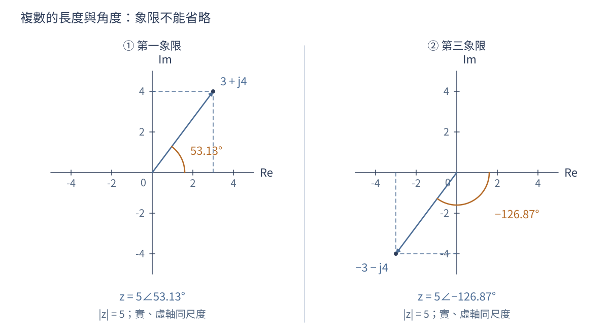
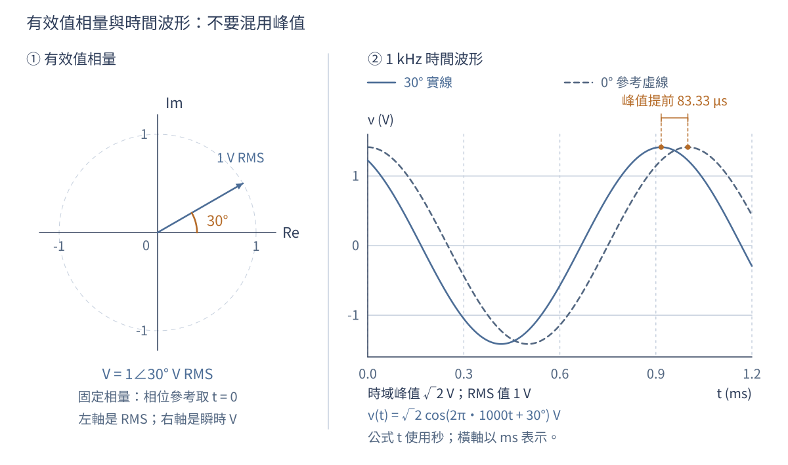
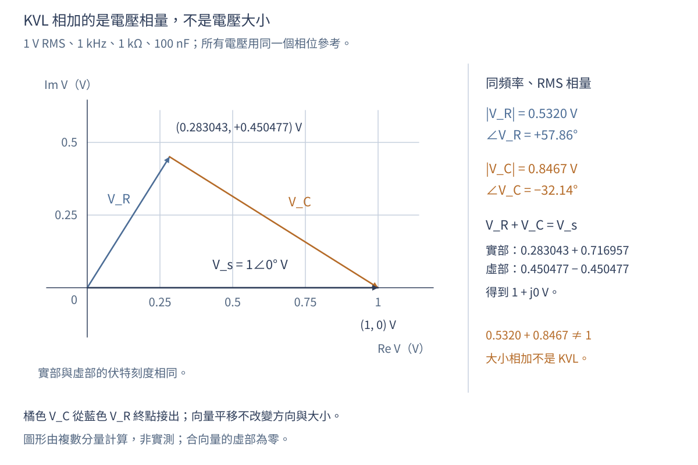
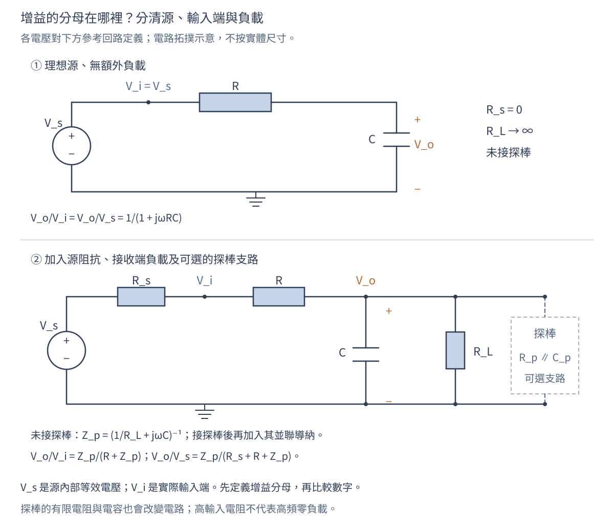

# 第 03 章　複數、相量與頻域

## 學習目標與先備知識

本章讓你能把正弦訊號轉成相量，使用複數阻抗解交流電路，區分峰值、有效值與平均功率，並閱讀振幅和相位響應。先備知識是三角函數、微分，以及第02章的單位觀念。全章採工程慣例 $j^2=-1$，避免與電流 $i$ 混淆。

第02章從「接上電源後要等多久」出發，練習把變化率、守恆與容差放進同一個模型。本章換一個問題：如果輸入不是只跳一次，而是不斷振盪，輸出會縮小多少、落後多少？我們仍用同一個 RC 電路，改看它對不同頻率的穩態反應。第02章算例的 $RC=1\ \mathrm{ms}$；本章主例採 $RC=100\ \mathrm{\mu s}$，請勿把兩章數字混用。

讀完後，不只要會按計算機，也要能交出下列可檢查的成果。

| 能力 | 本章檢核證據 |
|---|---|
| 把時間波形與相量互換 | 寫出頻率、峰值／有效值、相位基準與重建式 |
| 從物理定律建立阻抗 | 解釋正負虛部，而不只背誦三個式子 |
| 核對電壓、電流與功率 | 同時通過相量 KVL、單位及能量檢查 |
| 讀懂頻率響應 | 區分振幅比、功率比、相位與時間延遲 |
| 提出有限度的工程選擇 | 比較候選、容差角落、量測方法與尚缺證據 |

## 1. 先把「訊號要留下來」寫成規格

### 1.1 同一個電路，兩個頻率要求

假設感測前端在 $1\ \mathrm{kHz}$ 有需要保留的正弦分量，同時在 $10\ \mathrm{kHz}$ 有要壓低的干擾。先研究最簡單的串聯 RC：輸出取電容兩端，電阻固定 $R=1\ \mathrm{k\Omega}$，電容候選為 $47$、$100$、$220\ \mathrm{nF}$。這是自設教學案例，不是某產品的公開規格或實測結果。

| 需求編號 | 本次要判定的量 | 門檻與條件 |
|---|---|---|
| F01 | $1\ \mathrm{kHz}$ 的電壓振幅比 $|V_o/V_i|$ | 至少 $0.80$ |
| F02 | $10\ \mathrm{kHz}$ 的電壓振幅比 $|V_o/V_i|$ | 至多 $0.20$ |
| M01 | 初始計算模型 | 理想電壓源、理想 R/C、輸出沒有額外負載、正弦穩態 |
| T01 | 後續容差檢查 | $R$ 為標稱值的 $\pm5\%$，$C$ 為 $\pm10\%$，允許各自極端同時出現 |

這裡的「留下八成」是電壓振幅，不是功率，也沒有指定相位上限；若應用還在意波形形狀或控制迴路穩定性，就必須增加相應規格。只檢查兩個頻率點，也不能直接宣布整個通帶與阻帶都合格。

### 1.2 先約定符號，才開始計算

| 符號／慣例 | 本章意思 | 容易混淆之處 |
|---|---|---|
| $v(t),i(t)$ | 實際瞬時電壓、電流 | 可以為正或負，不等於振幅 |
| $V_p,I_p$ | 純正弦的非負峰值 | 不直接代入有效值功率式 |
| $\widetilde V,\widetilde I$ | 有效值相量 | 隱含指定的共同頻率 |
| $\omega=2\pi f$ | 角頻率，rad/s | 代入元件式不能漏掉 $2\pi$ |
| $e^{j\omega t}$ | 全章時間慣例 | 相位為正表示相對餘弦基準超前 |
| 被動符號慣例 | 電流流入標示為正的電壓端 | 負載吸收功率為正 |
| $H(j\omega)=\widetilde V_o/\widetilde V_i$ | 該頻率的複數電壓增益 | 大小與角度都要保留 |

目前還無法比較三顆電容，因為「振幅加上相位」需要兩個數字。接下來先把它們收進一個複數；這不是額外增加數學負擔，而是避免在每條電路方程重寫三角函數。

## 2. 複數先解決幾何，再解決運算

### 2.1 直角座標、極座標與象限

複數保留兩個互相垂直的分量。$z=a+jb$ 的大小為 $|z|=\sqrt{a^2+b^2}$，角度為 $\arg z=\operatorname{atan2}(b,a)$。必須用能判斷象限的方法求角度，因為只用 $\tan^{-1}(b/a)$ 會把第三象限誤當第一象限。直角形式適合加減，極座標形式 $|z|e^{j\phi}$ 適合乘除。

例如 $3+j4=5\angle53.13^\circ$，但 $-3-j4=5\angle(-126.87^\circ)$；兩者的 $b/a$ 同為 $4/3$，方向卻相反。角度可以加減整數倍的 $360^\circ$ 而不改變同一向量。零複數的大小是零，但角度沒有唯一意義。程式的 atan2 常回傳弧度，轉成度數要乘 $180/\pi$。[1]

圖 3-1　以相同座標尺度比較 $3+j4$ 與 $-3-j4$。橫、縱分量共同決定方向，不能只靠兩者的比值。這是數學幾何圖，座標不代表電路實體的位置。

### 2.2 共軛、乘除與不該相加的大小

複共軛把虛部反號：$z^*=a-jb$，因此 $zz^*=a^2+b^2=|z|^2$。這個關係讓複數除法可以回到實數分母。例如

$$
\frac{1}{1+jx}=\frac{1-jx}{1+x^2},\qquad x\in\mathbb R.
$$

乘法在極座標中是大小相乘、角度相加；除法是大小相除、角度相減，分母不得為零。加法則應先回到直角形式：$3+j4$ 的大小是 $5$，不是 $3+4=7$。除非兩個向量同方向，通常不能把大小直接相加當作和的大小。

**短判讀。** $1/(1+j)$ 的角度應是正還是負？因為取倒數要把角度反號，答案為 $-45^\circ$；直角形式 $(1-j)/2$ 也證實虛部為負。這正是稍後 RC 輸出落後的代數來源。

幾何與運算已齊備，但向量本身還不是電壓。下一節指定旋轉速度和取實部的方法，才把複數連回示波器上可見的波形。

## 3. 從時間波形到有效值相量

### 3.1 把共同的時間變化提出來

Euler 關係 $e^{j\theta}=\cos\theta+j\sin\theta$ 把正弦訊號寫成旋轉向量的實部。對 $v(t)=V_p\cos(\omega t+\phi)$，微分只需乘 $j\omega$，不用反覆展開三角恆等式。複數並不表示儀器會讀到「虛構電壓」，實際波形仍是實數。[MIT 18.03：複數與複指數](https://ocw.mit.edu/courses/18-03-differential-equations-spring-2010/pages/lecture-notes/)

更完整地說，令 $\widehat V=V_pe^{j\phi}$ 為峰值複振幅，則

$$
v(t)=\operatorname{Re}\{\widehat V e^{j\omega t}\},\qquad
\frac{dv}{dt}=\operatorname{Re}\{j\omega\widehat V e^{j\omega t}\}.
$$

微分對複振幅的作用是乘上 $j\omega$：大小乘 $\omega$，相位增加 $90^\circ$。真正的時間微分仍發生在 $e^{j\omega t}$；不是說一個不隨時間改變的相量常數，其普通微分不為零。MIT 的微分方程教材以複指數建立正弦特解，並另外處理齊次解；這也是穩態和暫態不能混為一談的原因。[2]

### 3.2 有效值相量如何重建波形

有效值（RMS）是把瞬時值平方、取平均後再開平方；本節先使用純正弦的「峰值除以根號二」，第5.1節再推導它與熱功率的關係。

本章以有效值定義相量：$\widetilde V=(V_p/\sqrt2)e^{j\phi}$，重建波形為 $v(t)=\sqrt2\operatorname{Re}\{\widetilde V e^{j\omega t}\}$。峰值相量也能使用，但平均功率公式會多一個 $1/2$。解題前寫明慣例，遠比事後猜測是否差一倍可靠。

例如 $\widetilde V=1\angle30^\circ\ \mathrm V$、$f=1\ \mathrm{kHz}$，代表

$$
v(t)=\sqrt2\cos(2\pi\,1000t+30^\circ)\ \mathrm V.
$$

其峰值為 $1.4142\ \mathrm V$，週期為 $1\ \mathrm{ms}$，且 $v(0)=\sqrt2\cos30^\circ=1.2247\ \mathrm V$。相對於同頻率零相位餘弦，波峰提前 $30^\circ/360^\circ$ 個週期，即 $83.33\ \mathrm{\mu s}$。相量長度為 $1\ \mathrm V$，圖中時間波形的峰值卻是 $\sqrt2\ \mathrm V$，這個差別必須明寫。

圖 3-2　左圖使用有效值相量，右圖使用瞬時電壓，不能把兩者的長度刻度直接等同。波形由明示公式計算；藍色訊號相對虛線基準超前 $30^\circ$，不是實測截圖。

### 3.3 哪些訊號可以共用一個相量

同頻率訊號相加時，共同的 $e^{j\omega t}$ 可以提出，所以相量能直接相加。例如 $3\sqrt2\cos\omega t+4\sqrt2\cos(\omega t+90^\circ)$ 對應 $3+j4=5\angle53.13^\circ$，合成波形的有效值為 $5$，不是 $7$。

若第二項變成 $4\sqrt2\cos(2\omega t)$，就沒有共同的旋轉速度，不能再用 $3+j4$ 表示整個波形。在整數個基頻週期內，這兩項的交叉積平均為零，因此總有效值仍可算為 $\sqrt{3^2+4^2}=5$；這是頻率分量的正交性，不是它們能合成同一相量。分頻疊加的原理見[7]；此例可自行用積化和差驗算 $T=2\pi/\omega$ 時，$T^{-1}\int_0^T\cos\omega t\cos2\omega t\,dt=0$。

我們現在能把「微分」轉成「乘 $j\omega$」。因此下一步不用憑空記住阻抗，而是把第02章已用過的元件定律逐一轉換。

## 4. 從元件定律建立阻抗模型

### 4.1 R、L、C 的相位從哪裡來

電阻滿足 $v=Ri$，所以 $Z_R=R$。電感滿足 $v=Ldi/dt$，故 $Z_L=j\omega L$；電容滿足 $i=Cdv/dt$，因此

$$
Z_C=\frac{1}{j\omega C}=-\frac{j}{\omega C}.
$$

電感的正虛部表示電壓超前電流，電容的負虛部表示電流超前電壓。負虛部不代表負電阻或產生能量；理想電抗元件只是週期性儲存與交還能量。阻抗單位為歐姆，導納 $Y=1/Z$ 的單位為西門子。[MIT 6.002：正弦穩態與阻抗模型](https://ocw.mit.edu/courses/6-002-circuits-and-electronics-spring-2007/pages/lecture-notes/)

| 理想元件 | 時間域定律 | 相量域阻抗，$\omega>0$ | 以電流作參考 |
|---|---|---|---|
| 電阻 | $v=Ri$ | $R$ | 電壓與電流同相 |
| 電感 | $v=L\,di/dt$ | $j\omega L$ | 電壓超前 $90^\circ$ |
| 電容 | $i=C\,dv/dt$ | $-j/(\omega C)$ | 電壓落後 $90^\circ$ |

以電容為例，$\widetilde I=j\omega C\widetilde V$，故電流先比電壓超前 $90^\circ$；反過來求 $Z=\widetilde V/\widetilde I$，角度就是 $-90^\circ$。若換用 $e^{-j\omega t}$，整套符號要一致改寫，不能只改其中一個元件。[3]

**算例 A：先檢查量級。** $L=10\ \mathrm{mH}$、$f=1\ \mathrm{kHz}$ 時，$Z_L=j62.83\ \Omega$；$C=100\ \mathrm{nF}$ 在同頻率時，$Z_C=-j1591.55\ \Omega$。兩者虛部不是同號，且相同頻率不代表阻抗大小接近。$\omega L$ 與 $1/(\omega C)$ 的單位都必須是 $\Omega$。

### 4.2 阻抗不是每一種情況都能直接代入

相量法描述線性、時不變系統的單頻正弦穩態，通常省略開機暫態。非線性元件若產生諧波，就需要小訊號線性化、諧波平衡或時間域分析。高頻下寄生效應會改變阻抗；電容未必永遠呈電容性，超過自諧振頻率可能呈電感性。

還要確認有界的正弦穩態確實存在，且暫態已衰減或已另行處理。理想無損 LC 在共振激勵下可能沒有有界穩態，不能把出現無限大或零分母的相量結果當作可量測的有限電壓。對非線性元件，小訊號線性化只適用於指定工作點附近、振幅足夠小的擾動；大幅切換不能直接套同一個線性模型。

$\omega=0$ 的直流需另看穩態與初始條件：理想電容在直流穩態不持續導通，理想電感的穩態壓降為零；這不代表剛接電時可以忽略電容原有電壓或電感原有電流。導納適合並聯相加，阻抗適合串聯相加，但「串聯／並聯」必須先由真正的節點連接判斷，不能只看圖形排在一起。

### 4.3 虛部和儲能，實部和損耗

理想電感儲能 $W_L=Li^2/2$，理想電容儲能 $W_C=Cv^2/2$。瞬時功率可以一段時間流入、一段時間流出；完整週期平均為零，不表示每個時刻都沒有能量交換。真實電感的繞線電阻、電容的介電損耗或等效串聯電阻，會讓平均損耗不再為零。

因此，光知道阻抗的角度還不足以選電源或導線。下一節把剛才的電壓、電流相量轉成能量與負擔，釐清「電流很大但平均做功不多」如何同時成立。

## 5. 有效值、平均功率與複功率

### 5.1 為什麼先平方，再平均

有效值定義為一個週期內平方平均的平方根。對純正弦波，它等於峰值除以 $\sqrt2$；對方波、脈衝或有直流偏壓的訊號，不能直接套這個比例。負載平均功率是瞬時功率 $v(t)i(t)$ 的平均，和電壓平均值乘電流平均值通常不同。

對週期為 $T$ 的實數電壓，定義

$$
V_{\mathrm{rms}}=\sqrt{\frac1T\int_{t_0}^{t_0+T}v^2(t)\,dt},\qquad
P=\frac1T\int_{t_0}^{t_0+T}v(t)i(t)\,dt.
$$

純電阻的平均熱功率為 $V_{\mathrm{rms}}^2/R$，因此 RMS 是與熱效應直接相連的量。對正弦波，$\cos^2$ 的週期平均為 $1/2$，才得到 $V_p/\sqrt2$；以零為中心、峰值為 $V_p$ 的理想方波，平方後恆為 $V_p^2$，故 RMS 等於 $V_p$。

**算例 B：直流加交流。** $v(t)=2+\sqrt2\cos\omega t\ \mathrm V$ 加在 $1\ \mathrm{k\Omega}$ 電阻上。平方展開後，交叉項平均為零，故 $V_{\mathrm{rms}}=\sqrt{4+1}=\sqrt5\ \mathrm V$，平均功率為 $5\ \mathrm{mW}$。其中直流貢獻 $4\ \mathrm{mW}$，交流貢獻 $1\ \mathrm{mW}$。若儀器能正確量測此頻率的正弦有效值，且 AC 耦合對該交流分量的衰減可忽略，則顯示約 $1\ \mathrm V$，而不是包含直流的總 RMS。

### 5.2 相位差如何留下平均功率

令電壓和電流相位差 $\phi=\phi_v-\phi_i$。用 $\cos A\cos B=[\cos(A-B)+\cos(A+B)]/2$ 展開，可得

$$
p(t)=V_{\mathrm{rms}}I_{\mathrm{rms}}
\left[\cos\phi+\cos(2\omega t+\phi_v+\phi_i)\right].
$$

第二項在完整週期的平均為零，第一項留下 $P=VI\cos\phi$。共軛正好負責取相位差，因此可把有功與無功放進同一個複數。[5]

以有效值相量，複功率為

$$
S=\widetilde V\widetilde I^{*}=P+jQ,\qquad P=V_{\mathrm{rms}}I_{\mathrm{rms}}\cos\phi.
$$

$P$ 是有功功率，單位 W；$Q$ 是無功功率，單位 var；$|S|$ 是視在功率，單位 VA。星號表示複共軛，使相位差成為電壓角度減電流角度。在被動符號慣例下，正 $P$ 表示負載吸收平均能量。理想電容與電感的 $P=0$，但仍可能讓電源和導線承受很大的有效值電流。

同時有 $Q=V_{\mathrm{rms}}I_{\mathrm{rms}}\sin\phi$，在此正弦條件下 $|S|=\sqrt{P^2+Q^2}$。感性負載電流落後，$Q>0$；容性負載電流超前，$Q<0$。把電流參考方向反轉卻不改電壓符號，會改變功率符號，不能再用原本的「吸收」敘述。

圖 3-3　自設 $10\ \mathrm{V_{rms}}$、$2\ \mathrm{A_{rms}}$、電流落後 $60^\circ$ 的計算圖。瞬時功率從 $-10$ 到 $30\ \mathrm W$，平均為 $10\ \mathrm W$；負值區間代表能量交還。右圖是複功率幾何，不是把 var 當成每秒淨耗能。

### 5.3 工程上為什麼不能只看瓦數

此例 $|S|=20\ \mathrm{VA}$，功率因數 $P/|S|=0.5$。即使平均負載功率只有 $10\ \mathrm W$，供電路徑仍需承受 $2\ \mathrm{A_{rms}}$；有電阻的導線會產生 $I_{\mathrm{rms}}^2R_{\mathrm{wire}}$ 損耗。單憑低瓦數不能判定導線、電源容量與溫升必然足夠。

對畸變波形，總功率因數仍可定義成 $P/(V_{\mathrm{rms}}I_{\mathrm{rms}})$，但通常不能只用單一相位角的餘弦表示；各諧波與量測定義需要分別處理。本章的 $S=P+jQ$ 相量運算限於共同頻率的正弦狀態，不把它擴充成未定義的全波形無功算法。

有了幅相與能量的雙重檢查，現在回到開章電路。下一節以開章的 $100\ \mathrm{nF}$ 候選，驗算 $1\ \mathrm{kHz}$ 時的電流、元件電壓與功率，讓各工具在同一問題會合。

## 6. 逐步例題：串聯 RC 的交流電流與輸出

### 6.1 先解100 nF候選，再檢查物理方向

$1\ \mathrm{V_{rms}}$、$1\ \mathrm{kHz}$ 電源驅動 $1\ \mathrm{k\Omega}$ 與 $100\ \mathrm{nF}$ 串聯。求電流和電阻消耗功率。

以電源為相位參考，$\widetilde V_s=1\angle0^\circ\ \mathrm V$；電流由電源經電阻流向電容，兩個被動元件採壓降正方向。

圖 3-4　左圖定義本例題的端點、電流與元件；右圖將 $R$ 與 $-X_C$ 相加。阻抗平面的刻度是 $\Omega$，不是電壓或電流。電路布局為示意，元件不按實體大小繪製。

1. $\omega=2\pi(1000)=6283\ \mathrm{rad/s}$，$X_C=1/(\omega C)=1591.55\ \Omega$。
2. 總阻抗 $Z=1000-j1591.55\ \Omega$，大小 $1879.64\ \Omega$，相位 $-57.86^\circ$。
3. $\widetilde I=1/Z=0.5320\angle57.86^\circ\ \mathrm{mA}$；電流超前電源電壓，與電容性負載一致。
4. $P=I_{\mathrm{rms}}^2R=0.2830\ \mathrm{mW}$。也可用 $VI\cos57.86^\circ$ 驗算。電流峰值為 $0.7524\ \mathrm{mA}$，不應再拿峰值直接代入 $I^2R$ 求平均功率。

先看方向再看小數：總阻抗虛部為負，電流角度為正，與電流超前電壓一致。若算成 $-57.86^\circ$，最先查倒數的角度符號；若電流大到安培量級，先查 $\mathrm{nF}$ 和 $\mathrm{k\Omega}$ 的換算。

### 6.2 電壓必須用向量相加

把電流寫成直角形式：

$$
\widetilde I=(0.283043+j0.450477)\ \mathrm{mA}.
$$

因此 $\widetilde V_R=(0.283043+j0.450477)\ \mathrm V=0.532018\angle57.858^\circ\ \mathrm V$；而

$$
\widetilde V_C=(0.716957-j0.450477)\ \mathrm V
=0.846733\angle(-32.142^\circ)\ \mathrm V.
$$

兩者相加為 $1+j0\ \mathrm V$，符合電壓迴路定律。可是大小相加為 $0.532018+0.846733=1.378751\ \mathrm V$，不等於電源的 $1\ \mathrm V$；差異不是能量不守恆，而是把不同方向向量錯當成同一直線長度。

圖 3-5　電壓相量首尾相接。橘色電容電壓從藍色電阻電壓的終點出發；向量可以平移，方向和大小不變。合向量在實軸上，不能把兩個幅值直接相加。

功率也可獨立驗算：電源供給此負載的複功率為 $\widetilde V_s\widetilde I^*=(0.283043-j0.450477)\ \mathrm{mVA}$。實部和電阻耗散一致，負無功則和電容性負載一致。理想電容吸收的平均功率為零，不應把 $0.450477$ 當成另一項熱損耗。

### 6.3 從一組輸出，整理出對所有頻率的公式

相量電路仍可使用節點法和分壓法。例如串聯 RC、輸出取電容時，$H(j\omega)=1/(1+j\omega RC)$。頻率低時電容阻抗大，輸出接近輸入；頻率高時電容阻抗小，輸出被壓低。這個物理檢查應在算數字以前完成。

分壓式的推導是 $\widetilde V_C/\widetilde V_s=Z_C/(R+Z_C)$，分子分母同乘 $j\omega C$ 後得到 $1/(1+j\omega RC)$。令 $x=\omega RC$，用第2節的共軛技巧即可拆成

$$
H(j\omega)=\frac{1-jx}{1+x^2},\quad
|H|=\frac1{\sqrt{1+x^2}},\quad
\arg H=-\tan^{-1}x,\qquad x\ge0.
$$

電流超前電源 $57.858^\circ$，但輸出電容電壓落後電源 $32.142^\circ$，兩者並不矛盾：電容電壓還比電流落後 $90^\circ$。寫「電路相位」太含糊，應寫出比較的兩個量。

單一頻率已驗算完畢，現在只要改變 $x=\omega RC$，便能追蹤不同頻率的輸出。下一節用這個無因次量建立頻率響應，再回到三顆電容的選擇。

## 7. 把單頻算例展開成頻率響應

### 7.1 截止頻率、分貝與相位各回答什麼

改變輸入頻率，每次計算增益與相位，就得到頻率響應。分貝振幅增益為 $20\log_{10}|H|$；功率比則使用 $10\log_{10}(P_o/P_i)$。若兩端阻抗不同，電壓比的20倍對數不能直接解讀成傳輸功率增益，必須先把電壓換算為功率。

令 $\omega RC=1$，得到 $f_c=1/(2\pi RC)$。對這個無負載一階低通，$|H(f_c)|=1/\sqrt2$，電壓增益為 $-3.0103\ \mathrm{dB}$，相位為 $-45^\circ$。本章 $R=1\ \mathrm{k\Omega}$、$C=100\ \mathrm{nF}$ 的 $f_c=1591.55\ \mathrm{Hz}$。這是相對低頻電壓增益的截止定義；不能不看端點阻抗就說電源輸入功率有一半送到電容。[4][6]

| 無因次頻率 $x=f/f_c$ | $|H|$ | $20\log_{10}|H|$ | 相位 |
|---|---:|---:|---:|
| $0.1$ | $0.995037$ | $-0.0432\ \mathrm{dB}$ | $-5.7106^\circ$ |
| $1$ | $0.707107$ | $-3.0103\ \mathrm{dB}$ | $-45^\circ$ |
| $10$ | $0.099504$ | $-20.0432\ \mathrm{dB}$ | $-84.2894^\circ$ |

當 $x\gg1$，$|H|\approx1/x$，頻率乘十約多衰減 $20\ \mathrm{dB}$；這是高頻漸近趨勢，不是全頻段都恰好符合的直線。對純電阻端點 $R_i,R_o$，以兩端有效值大小計算，功率比為 $(V_{o,\mathrm{rms}}/V_{i,\mathrm{rms}})^2R_i/R_o=|H|^2R_i/R_o$，因此功率增益須在電壓增益 $20\log_{10}|H|$ 上再加 $10\log_{10}(R_i/R_o)$。[6]

圖 3-6　固定 $R=1\ \mathrm{k\Omega}$，比較 $C=47/100/220\ \mathrm{nF}$ 的理想無負載模型。上圖是電壓增益 dB，下圖是相位；線型與標籤共同區分候選。規格符號只代表 $1$ 和 $10\ \mathrm{kHz}$ 的兩點要求，曲線不是實測，也未包含容差區間。

### 7.2 相位落後不一定是整個波形延後

相位不能只看正負號。$-90^\circ$ 代表在所採時間慣例下落後四分之一週期；將 $-180^\circ$ 顯示成 $180^\circ$ 只是角度包覆。多頻率訊號可在線性、時不變系統的穩態響應中分解，分別乘各自的 $H(j\omega)$ 再相加，但不能把所有頻率塞進同一個相量。

採 $e^{j\omega t}$，令該頻率的輸出相對輸入之相位差為 $\phi_H=\arg H=\arg\widetilde V_o-\arg\widetilde V_i$，其等效相位延遲可寫成

$$
\tau_\phi(\omega)=-\frac{\phi_H(\omega)}{\omega}.
$$

這裡 $\phi_H$ 必須用弧度，而且僅由單頻相位只能決定到整數個週期的歧義。以 $100\ \mathrm{nF}$ 案例，$1\ \mathrm{kHz}$ 的 $-32.142^\circ$ 對應約 $89.28\ \mathrm{\mu s}$；$10\ \mathrm{kHz}$ 的 $-80.957^\circ$ 卻對應約 $22.49\ \mathrm{\mu s}$。兩個分量沒有共同的時間位移，不能把整個寬頻輸入簡稱為「延遲 $89.28\ \mathrm{\mu s}$」。

若希望一個頻帶內的波形近似不失真地平移，需要該頻帶增益近似固定，且相位近似 $\phi_H=-\omega\tau$。進一步描述窄頻包絡時會用群延遲 $\tau_g=-d\phi_H/d\omega$，需對連續展開的相位微分；它與 $\tau_\phi$ 不必相同。只有群延遲平坦，也不能補救明顯的幅度失真。[8]

### 7.3 多頻率逐項處理，不是選一個代表頻率

**算例 C：想留下來的訊號和干擾。** 令輸入為

$$
v_i(t)=\sqrt2\cos(2\pi\,1000t)+0.2\sqrt2\cos(2\pi\,10000t)\ \mathrm V.
$$

前者為 $1\ \mathrm{V_{rms}}$，後者為 $0.2\ \mathrm{V_{rms}}$。對 $100\ \mathrm{nF}$ 案例，穩態輸出為

$$
v_o(t)=0.846733\sqrt2\cos(2\pi\,1000t-32.142^\circ)
+0.0314353\sqrt2\cos(2\pi\,10000t-80.957^\circ)\ \mathrm V.
$$

干擾振幅變小，但有用訊號也被衰減且移相。輸出兩項有效值的比為約 $0.03713$，不能把 $|H(10\ \mathrm{kHz})|=0.15718$ 誤稱為輸出總干擾比例，因為還要納入輸入比例和有用訊號的增益。任意多頻率不一定有共同有限週期；本例頻率是整數倍，才方便用 $1\ \mathrm{ms}$ 的整數倍視窗計算週期平均。[7]

現在已知如何同時閱讀振幅與相位。最後一節把曲線壓縮成可簽名核對的方案表，並檢查元件偏差和量測接法會不會推翻結論。

## 8. 從標稱解答走向工程判斷

### 8.1 先比較候選，再檢查最不利角落

| 電容候選 | $|H(1\ \mathrm{kHz})|$ | $|H(10\ \mathrm{kHz})|$ | 標稱判定 |
|---|---:|---:|---|
| $47\ \mathrm{nF}$ | $0.95906$ | $0.32074$ | F01通過；F02不通過 |
| $100\ \mathrm{nF}$ | $0.84673$ | $0.15718$ | 兩點均通過 |
| $220\ \mathrm{nF}$ | $0.58613$ | $0.07215$ | F01不通過；F02通過 |

電容變大，對所有非零頻率的衰減都變強；不是越大就越好。令 $\tau=RC$，直接把兩個門檻代入 $|H|$，也可得到可行區間：

$$
\frac{\sqrt{0.20^{-2}-1}}{2\pi\,10000}\le\tau
\le\frac{\sqrt{0.80^{-2}-1}}{2\pi\,1000},
$$

也就是 $77.97\le\tau/(\mathrm{\mu s})\le119.37$。三個標稱值分別為 $47$、$100$、$220\ \mathrm{\mu s}$，只有中間候選落在區間內。

對 $100\ \mathrm{nF}$ 候選，容差給出 $\tau_{\min}=(100\ \mathrm{\mu s})(0.95)(0.90)=85.5\ \mathrm{\mu s}$，$\tau_{\max}=(100\ \mathrm{\mu s})(1.05)(1.10)=115.5\ \mathrm{\mu s}$。固定頻率下，$|H|$ 隨 $\tau$ 增加而下降，所以：

| 需求 | 最不利角落 | 計算結果 | 與門檻的關係 |
|---|---|---:|---|
| F01，保留訊號 | $\tau_{\max}$ | $|H(1\ \mathrm{kHz})|=0.80934$ | 仍高於 $0.80$ |
| F02，壓低干擾 | $\tau_{\min}$ | $|H(10\ \mathrm{kHz})|=0.18300$ | 仍低於 $0.20$ |

這是參數有界且角落允許同時發生的最不利分析，不是常態分布、蒙地卡羅良率或 $95\%$ 信賴區間。此模型下可以選 $100\ \mathrm{nF}$ 進入量測；但 F01 留給模型外效應的餘裕只有約 $0.00934$，還不能宣布實體產品驗收通過。

### 8.2 源阻抗、負載與量測基準要一起畫出來

圖 3-7　上圖為本章標稱模型；下圖加入訊號源電阻 $R_s$ 與負載 $R_L$。$V_s$ 是源內部理想電壓，$V_i$ 是實際輸入端，$V_o$ 是輸出端。示波器探棒也可能加入電阻與電容負載；「高輸入阻抗」不等於全頻率完全不影響電路。

若負載可先近似為純電阻，令 $Z_p=(1/R_L+j\omega C)^{-1}$，則

$$
\frac{\widetilde V_o}{\widetilde V_s}=\frac{Z_p}{R_s+R+Z_p},
\qquad
\frac{\widetilde V_o}{\widetilde V_i}=\frac{Z_p}{R+Z_p}.
$$

兩個增益的分母不同。訊號源面板設定不一定等於負載實際得到的電壓，因此宜量取實際輸入、輸出端點，不先把面板值當成 $\widetilde V_i$。輸出探棒的電容可在簡化模型中和 $C$ 並聯；輸入端探棒、接線寄生或頻率相依的源阻抗，則需把其實際接法納入模型，不能一概只加在輸出。

### 8.3 量測是檢查模型，不是把數字填進答案

| 工作 | 要記錄的證據 | 判讀重點 |
|---|---|---|
| 定義測試 | 頻率、輸入振幅、R/C實測值、接地與端點 | 是否仍在假設範圍，是否改變待測電路 |
| 取得穩態 | 等待與擷取視窗、週期數 | 不把啟動暫態混入振幅與相位 |
| 同時量兩端 | $V_{i,\mathrm{rms}}$、$V_{o,\mathrm{rms}}$、相位差 | 同一頻率、同一振幅慣例、相同時間基準 |
| 查量測鏈 | 探棒倍率、輸入阻抗、頻寬、通道時延 | 確認量到的是電路，而非通道差異 |
| 對照規格 | F01/F02結果及不確定度 | 門檻附近應定義決策規則，不只看顯示末位 |
| 留存異常 | 原始波形與接法、重測條件 | 不能只刪除不符合預期的點 |

**判讀活動：只改電容能解釋嗎？** 假設同一頻率量到 $|H|=0.81$、相位 $-10^\circ$，量測誤差小到不足以解釋下列差距。對本章理想單極、低頻增益為1的 RC 模型，$\phi=-\tan^{-1}x$，所以必有 $|H|=\cos\phi$。$-10^\circ$ 預測的大小應為 $0.98481$，不是 $0.81$；反過來，$0.81$ 預測相位約 $-35.90^\circ$。只改 $\tau$ 不能同時吻合兩者。

下一步不是立即宣布元件壞了，而是檢查源／負載造成的低頻增益、量測基準、通道時延與額外極點，再增加頻率點辨識原因。一個不符合的點能否定這個理想模型與誤差假設的組合，卻不能唯一指出哪個元件故障。

### 8.4 本章決策與下一章的入口

本次可提交的結論是：「在 M01 與 T01 的假設內，$100\ \mathrm{nF}$ 候選滿足 F01/F02；應量取實際輸入輸出與相位，確認源、負載及量測不確定度是否耗盡餘裕。」這句話同時交代選擇、依據和限制，比單寫「答案是100 nF」完整。

到了真正多節點網路，分壓法不一定夠用，但本章的 $Z_R,Z_L,Z_C$ 不必重學。第04章將用節點法、迴路法及等效電路，把這些阻抗放進可系統求解的網路；第05章再把暫態與濾波規格放回同一幅圖。

## 練習與完整參考解答

先自行解題，再用單位、極限、符號及守恆逐項驗算。練習1、2保留原題；3–12依序補上表示法、能量、頻率與工程判斷。

**練習1。** $z_1=3+j4$、$z_2=1-j2$，求和與乘積。

**解答。** 和為 $4+j2$。乘積展開為 $3-j6+j4-8j^2=11-j2$。$|z_1|=5$、$|z_2|=\sqrt5$，乘積大小應為 $5\sqrt5$；$\sqrt{11^2+(-2)^2}=\sqrt{125}$ 相符。

**練習2。** 正弦電壓為 $10\ \mathrm{V_{rms}}$，電流 $2\ \mathrm{A_{rms}}$ 並落後 $60^\circ$。求有功、無功及視在功率。

**解答。** $P=10(2)\cos60^\circ=10\ \mathrm{W}$；$Q=20\sin60^\circ=17.32\ \mathrm{var}$，為感性正值；$|S|=20\ \mathrm{VA}$。驗算 $P^2+Q^2=|S|^2$。功率因數為0.5，並不表示電壓只剩一半。

**練習3。** 將 $-3-j4$ 化為極座標，並求其共軛與倒數。

**解答。** 大小為 $5$，角度為 $-126.870^\circ$，也可寫 $233.130^\circ$。共軛是 $-3+j4$；倒數為 $(-3+j4)/25=-0.12+j0.16=0.2\angle126.870^\circ$。乘回原數應得1。若用普通反正切得到 $53.130^\circ$，即漏判第三象限。

**練習4。** $\widetilde V=1\angle30^\circ\ \mathrm V$、$f=1\ \mathrm{kHz}$，寫出時間波形、$v(0)$、峰值與相對零相位餘弦的波峰提前量。

**解答。** $v(t)=\sqrt2\cos(2\pi1000t+30^\circ)\ \mathrm V$；$v(0)=1.224745\ \mathrm V$，峰值 $1.414214\ \mathrm V$。週期1 ms，波峰提前 $(30/360)(1\ \mathrm{ms})=83.333\ \mathrm{\mu s}$。這是同頻率參考間的比較，不表示訊號超越因果性。

**練習5。** 比較 $3\sqrt2\cos\omega t+4\sqrt2\cos(\omega t+90^\circ)$ 與 $3\sqrt2\cos\omega t+4\sqrt2\cos2\omega t$。各自 RMS 為何？能否都用 $5\angle53.13^\circ$ 表示？

**解答。** 第一式同頻，可用相量 $3+j4=5\angle53.13^\circ$，RMS為5。第二式在完整基頻週期內兩頻率正交，均方值 $9+16=25$，RMS同為5；但不是單一正弦，不能用該相量表示。RMS相同不代表時間波形相同。

**練習6。** $f=1\ \mathrm{kHz}$ 時，$L=10\ \mathrm{mH}$ 與 $C=100\ \mathrm{nF}$ 的阻抗各為何？若分別接上 $1\angle0^\circ\ \mathrm{V_{rms}}$，電流相位如何？

**解答。** $\omega=6283.185\ \mathrm{rad/s}$，$Z_L=j62.8319\ \Omega$、$Z_C=-j1591.549\ \Omega$。電感電流為 $15.9155\angle(-90^\circ)\ \mathrm{mA}$；電容電流為 $0.628319\angle90^\circ\ \mathrm{mA}$。兩元件是分別接電源，不是先串接；理想元件平均功率皆零，但 RMS電流不為零。

**練習7。** $v(t)=2+\sqrt2\cos\omega t\ \mathrm V$ 驅動 $1\ \mathrm{k\Omega}$，求總 RMS、平均功率及 AC耦合 RMS讀值；為何不能用電壓平均值計算全部熱功率？

**解答。** $v^2=4+4\sqrt2\cos\omega t+2\cos^2\omega t$，平均為5，故總 RMS為 $\sqrt5=2.236068\ \mathrm V$、功率5 mW。理想AC耦合只保留交流，RMS為1 V。平均電壓為2 V，只算 $2^2/R$ 會得到4 mW，漏掉交流的1 mW。

**練習8。** 重算第6節的 $\widetilde V_R$、$\widetilde V_C$ 與負載複功率，並列出兩項獨立驗算。

**解答。** $\widetilde I=(0.283043+j0.450477)\ \mathrm{mA}$。乘 $R$ 得 $\widetilde V_R=0.283043+j0.450477\ \mathrm V$；乘 $Z_C$ 得 $\widetilde V_C=0.716957-j0.450477\ \mathrm V$。第一項驗算是兩電壓相加為 $1+j0\ \mathrm V$。第二項是 $S=\widetilde V_s\widetilde I^*=0.283043-j0.450477\ \mathrm{mVA}$ 的實部等於 $I_{\mathrm{rms}}^2R=0.283043\ \mathrm{mW}$，且負無功符合容性負載。

**練習9。** 某兩個純電阻端點，電壓 RMS比 $V_o/V_i=2$，$R_i=50\ \Omega$、$R_o=200\ \Omega$。電壓增益與功率比各為多少 dB？

**解答。** 電壓增益為 $20\log_{10}2=6.0206\ \mathrm{dB}$；功率比為 $4(50/200)=1$，所以功率比為 $0\ \mathrm{dB}$。電壓放大不必然代表同數值的功率增益。題目只描述兩個純電阻端點的電壓與耗散比，不主張這是一個無源電壓放大器。

**練習10。** $1\ \mathrm{kHz}$ 的相位差為 $-30^\circ$，求等效相位延遲。若另一頻率的延遲不同，還能否把整個波形說成固定延後？

**解答。** $\tau_\phi=-(-\pi/6)/(2\pi1000)=83.333\ \mathrm{\mu s}$，單頻相位仍有整數倍1 ms的歧義。若頻帶內各頻率不對應共同的線性相位，不能宣稱整體固定平移；還須檢查振幅在該頻帶是否近似固定，才能討論近似無失真。

**練習11。** 對開章三顆候選電容完成標稱篩選，再檢查 $R\pm5\%$、$C\pm10\%$ 下的 $100\ \mathrm{nF}$。列出最不利方向與驗收限制。

**解答。** 代入 $|H|=[1+(2\pi fRC)^2]^{-1/2}$，三顆在1 kHz分別為 $0.95906/0.84673/0.58613$，在10 kHz為 $0.32074/0.15718/0.07215$；僅100 nF標稱兩點通過。其 $\tau$ 範圍為85.5–115.5 μs。F01取最大 $\tau$，最小增益 $0.80934\ge0.80$；F02取最小 $\tau$，最大增益 $0.18300\le0.20$。這只是理想無負載模型加上指定參數界限的通過，不包含源阻抗、探棒、寄生、溫漂及量測不確定度，也不是良率估計。

**練習12。** 已知量測誤差不足以解釋差距，$|H|=0.81$、$\arg H=-10^\circ$ 能否只調整理想 RC 的 $\tau$ 同時吻合？提出下一個有辨識力的測試。

**解答。** 理想單極、低頻增益1的模型滿足 $|H|=\cos\phi$；相位 $-10^\circ$ 應對應 $0.984808$，而大小0.81應對應約 $-35.90^\circ$。因此單改 $\tau$ 不足。可同時量取實際輸入輸出，先測低頻增益是否接近1，再掃描多個頻率的幅相，並交換或校正量測通道檢查通道差異。這些測試用來區分負載分壓、額外動態和量測偏差，不是直接把偏差歸罪於電容。

## 常見誤解與工程連結

相量角度是相對參考，不是時間本身；在本章時間慣例下，等效相位延遲為相位的負值除以角頻率（弧度／rad·s⁻¹），而且需注意整週期歧義。有效值也不是所有波形都等於峰值除以根號二。阻抗量測、射頻匹配、電源功率因數與晶片交流小訊號分析，都依賴同一組數學工具。

本章的自我檢查順序可以濃縮成六問：頻率相同嗎？峰值與RMS一致嗎？角度的參考相同嗎？元件模型有效嗎？向量及功率能守恆嗎？規格與量測是否比較同一端點？這六問將跟著我們進入第04章，從簡單分壓走向完整電路網路。

## 參考資料與延伸閱讀

以下資料支持物理與數學原理；本章工程需求、數值案例、表格與七張向量圖另行設計。不同教材可能使用峰值相量、$i$ 作虛數符號或正的「落後角」；本文已統一成有效值、$j$ 與 $e^{j\omega t}$，不能直接混接公式。

1. MIT 18.03, *Class 6: Complex Exponential*, 2010，PDF頁1–4。複數、Euler關係及共軛。[公開講義](https://ocw.mit.edu/courses/18-03-differential-equations-spring-2010/863ef679a1924d20a267d6dec8251250_MIT18_03S10_c06.pdf)
2. MIT 18.03, *Class 7: Exponential and Sinusoidal Input and Output*, 2010，PDF頁1–4。正弦特解、相位與時間及暫態區分。[公開講義](https://ocw.mit.edu/courses/18-03-differential-equations-spring-2010/79c78a34f2f1b8b0470b6426de9c34f0_MIT18_03S10_c07.pdf)
3. Anant Agarwal、Jeffrey Lang，MIT 6.002, *Lecture 17: The Impedance Model*，講義標示Fall 2000，收錄於Spring 2007課程，PDF頁2–9。相量與阻抗；來源複振幅非本文RMS慣例。[公開講義](https://ocw.mit.edu/courses/6-002-circuits-and-electronics-spring-2007/66adf4d4611a57b949efa1b00a842a46_6002_l17.pdf)
4. MIT 6.002, *Lecture 18: Filters*，講義標示Fall 2000，收錄於Spring 2007課程，PDF頁2–10、13。RC頻率響應與濾波觀念。[公開講義](https://ocw.mit.edu/courses/6-002-circuits-and-electronics-spring-2007/d4e136975654a01f7fc2c9b49196d376_6002_l18.pdf)
5. James L. Kirtley Jr., *AC Power Flow in Linear Networks*，2007，MIT 6.061 Spring 2011公開版，PDF頁2–7、10–15、17。峰值複功率公式及RMS換算。[公開講義](https://ocw.mit.edu/courses/6-061-introduction-to-electric-power-systems-spring-2011/9cf8de165233601f547b284cee5c2131_MIT6_061S11_ch2.pdf)
6. Keysight, *Useful Formulas, Conversions, and Reference Information*，查閱2026-10-25，*Concepts → Understanding Decibels* 正文公式節。電壓與功率dB及不同電阻端點的修正，不使用其快速數值表。[官方說明](https://helpfiles.keysight.com/csg/89600B/Webhelp/Subsystems/gettingstarted/content/concepts_decibels.htm)
7. Alan V. Oppenheim，MIT RES.6-007, *Lecture 7: Continuous-Time Fourier Series*，Spring 2011公開課程，講義頁7-1–7-4。LTI複指數特性與分頻疊加。[公開講義](https://ocw.mit.edu/courses/res-6-007-signals-and-systems-spring-2011/24eca8c9c36bf5931c022e17fd44dbfc_MITRES_6_007S11_lec07.pdf)
8. P. Bruschi，University of Pisa, *Analog Filter Design: Introduction*，2018課程目錄版本，PDF頁37–38。相位、波形延遲與群延遲的條件。[大學講義](https://docenti.ing.unipi.it/~a008309/mat_stud/AIF/2018/lecture_notes/Part_1.pdf)
