# 第 01 章　從需求到晶片：建立工程學科地圖

## 學習目標與先備知識

一顆裝在產品裡的積體電路，同時是物理結構、電路功能、製造流程的成果，也是整個系統的一部分。本章先建立全景，再用能親手計算的例子，把「聽過名詞」變成「能提出問題與檢查答案」。讀完應能：

- 說明設計、晶圓製造、封裝與測試的交付物，以及不同產業角色如何協作。
- 區分晶圓、裸晶與封裝元件，以及兩種不同層級的「前段／後段」。
- 用 Lot、Route、Recipe 和量測履歷描述一批產品，而不是只背製程名稱。
- 把產品要求連到材料、元件、電路、韌體與驗證，找到對應的學科。
- 計算簡化的平均功耗、良率成本與生產循環時間，說明模型不能保證什麼。
- 將系統需求分配到候選 IC 與外部電路，檢查訊號、資料與時間介面是否相容。
- 辨認類比／數位設計產物，區分設計驗證、簽核交付、製造測試及矽後系統證據。

先備知識是高中代數、面積、比例、能量與單位換算。不必先懂電晶體方程式；遇到新名詞先問「它是物件、加工動作、參數，還是驗收證據？」本章主要以典型矽積體電路為主線。功率元件、化合物半導體、MEMS 與先進多晶粒整合有不同細節，後續章節再展開；不能把所有晶片都想成同一種大型處理器。

本章會一路跟著這個問題走：**怎麼把「想記錄溫度」變成能驗收、能生產的產品？** 先釐清需求與手上的物件，再追一筆訊號、一顆 IC 和一批晶圓，最後用三個算例回頭找出需要的學科。各段的補充說明都留在原地展開；第一次讀先掌握基本模型，再讀緊接著的適用範圍。

這張學科地圖以**半導體產業的工程交付**為主軸：第 3 節先把功能分給晶片與系統，第 4 節放大晶片設計、驗證及投片前後的工作，第 5 節再走進製造，第 6–7 節把成本、性能與量測回饋到原需求。這不是單向流水線；封裝、測試及系統限制需要提早進入設計。本章完成的是辨認交付與證據的入門能力，不是完整 IC 流片實作訓練。

### 理工讀者的使用方式與能力檢核

本書面向電機、電子、半導體、材料、物理、機械及其他理工相關科系讀者。預期能處理代數、函數與基本物理量，但不預設已修過半導體製程或電路學。熟悉的單位與位元可快速複習；跨科系最需要對齊的是物件邊界、模型假設與證據種類。

| 本章完成後應能交出的成果 | 對應示範 | 自我檢核 |
|---|---|---|
| 一項有條件、有判定方法的需求 | 第 1 節需求表、第 7.3 節工程任務 | 練習 1；能否區分模型支持與實測證據？ |
| 一條從訊號、交付物到分析層級的追溯 | 圖 1-2、1-3、1-7 | 第 7.3 節任務；不只背名詞，要指出誰交什麼證據 |
| 一份帶有單位、分母與適用範圍的計算 | 第 6 節三個算例 | 練習 4、6、7；答案改變時，能說明原因嗎？ |
| 一項能區分候選原因的檢查 | 第 5.2 節薄膜案例 | 第 7.3 節任務 2；練習 3、8 補充追溯與證據界線 |
| 一份晶片邊界與介面預算 | 第 3.4 節、圖 1-2A | 練習 9、10；整機需求是否被錯當成單顆 IC 規格？ |
| 一份能指出缺少證據的設計交接判讀 | 第 4.1 節設計放大檢視、圖 1-3A | 練習 11、12；版圖、實物與整機證據能否互相取代？ |

本章要求能**辨認、計算與判讀**，不要求現在就設計電晶體或編寫製程配方。PDK、Chiplet、互連與可靠度等名詞先掌握用途和限制，細部模型留到後章；現有補充內容保留，供有相關背景者延伸閱讀。

## 1. 先問產品需要什麼，不要先選最先進的製程

手機裡的處理器、充電器的控制晶片與工業溫度感測器，都使用半導體技術，但它們追求的電壓、速度、精度、成本與可靠度並不相同。電晶體數量多、製程節點名稱小，不代表對每個任務都較適合。工程設計的起點是可驗收的需求，而非單一排行榜。

「做一個精準又省電的感測器」還不能指導設計。以自設的室內溫度記錄器為例，至少要寫出量測範圍、允許誤差、回報週期、反應時間、供電方式、使用環境和預期成本。每秒記錄一次室溫，與每微秒偵測一次光脈衝，所需頻寬、電源、儲存與測試設備都不同。

| 需求面向 | 可檢查的問題 | 缺少條件會造成什麼問題 |
|---|---|---|
| 量測 | 在哪個範圍內，與什麼參考比較？ | 「精準」無法被驗收 |
| 時間 | 多久更新一次？輸入改變後多久反應？ | 把取樣週期當成感測器反應時間 |
| 能源 | 電源電壓、可用容量與運作模式為何？ | 只看工作電流，漏掉睡眠與啟動耗能 |
| 環境 | 溫度、濕度、干擾與安裝方式為何？ | 室溫桌上結果被誤當全環境保證 |
| 製造 | 預期數量、測試時間、可接受不良率為何？ | 原型能工作，量產卻無法經濟地驗證 |

規格還要區分四種證據：理想模型預測、資料表典型值、指定條件下的保證限值，以及本次實際量測。典型值不是每顆元件都必須達到的限值；一次量測也不能代表所有批次。好的需求書會同時寫「要達到什麼」與「如何判定達到」，並保留測試條件、版本及不確定度。

**從問題表到一份可追蹤的規格。** 下面把原型的三項需求填上自設數值，供本章比較方案。任務是量測並儲存一筆新資料，無線回報關閉；這是需求子集，不是完整產品規格或實驗程序。

三項需求須對應同一候選硬體、韌體版本與量測／儲存模式。T01 亦維持每秒完成一次新讀值，溫度依各項指定條件設定；不能用快速模式測耗電，換成另一個較慢模式測精度，再合併宣告同一方案符合。

| 需求 ID | 自設要求與條件 | 對應方法與應留下的證據 | 本章目前掌握的狀態 |
|---|---|---|---|
| P01：平均耗電 | 3.0 V、25 °C，每秒完成指定任務；穩態連續 300 s 的平均電流不超過 40 µA，即平均功率不超過 120 µW | 量到完整供電電流，包含喚醒、工作與睡眠；保存積分區間、儀器設定與程式版本 | 第 6.1 節可作模型比較，尚無實測 |
| S01：資料更新 | 同一供電、環境與任務下，連續 300 筆有效新讀值的相鄰完成間隔為 0.99–1.01 s | 保存讀值與時間戳；確認不是重複舊值，也不只檢查排程觸發時間 | 尚無時序與有效資料紀錄 |
| T01：指定點位比較 | 3.0 V、固定安裝，在 10、25、40 °C 三個穩態點各取 30 筆；每筆與校正參考的絕對差不超過 0.5 °C | 保存成對原始資料、穩態判準、參考校正及量測不確定度；另須約定不確定度如何納入允收決策 | 尚無比較資料，不能宣告真實溫度準確度 |

T01 只涵蓋指定點位和條件，不保證整段溫度範圍、動態響應或其他環境；P01 是平均限制，也沒有給出電源尖峰電流限值。需求 ID 的用途是讓設計、測試與修訂能互相追溯；NASA 系統工程手冊的需求與驗證矩陣提供這種紀錄思路，但表中數值是本書自設，並非 NASA 的產品要求。[18]

需求列好了，但這項需求是在描述一顆裸晶、一個封裝元件，還是整台記錄器？先把這些物件分清，下一節才能把需求放到正確的對象上。

## 2. 先認物件：晶圓、裸晶、封裝與系統

圖 1-1　重新繪製的物件層級圖：**1** 晶圓、**2** 裸晶、**3** 單晶粒打線式球柵陣列（BGA）封裝；細部標註為 **4** 切割道、**5** 封膠、**6** 打線、**7** 封裝基板、**8** 焊球。晶圓上橘色位置只表示被選來放大的晶粒，不代表不良品。虛線是局部放大關係，不是加工步驟；三圖非等比例。封膠填覆晶粒與打線，並非空腔；省略基板內部走線與細部層次，不能作為實際製造剖面或接線圖。

**晶圓（wafer）** 是圓片狀基材，在本章的典型情境中是矽晶圓；表面經加工形成許多晶粒位置。**晶粒（die）** 是一個晶粒區域或分離後的晶粒；要強調尚未封裝的實體時稱為裸晶。**封裝元件（packaged IC）** 則包括晶粒與支撐、連接、散熱、保護等結構。日常的 chip 或「晶片」可能指裸晶，也可能指封裝產品，討論規格時應先約定指哪一層。

本章常見的單晶矽晶圓通常由近圓柱狀晶棒切片而來；晶粒則多採便於版圖排列與分離的矩形，兩者形狀不需要相同。[15] 晶圓上的矩形排版通常保留切割道；圓周附近可能出現不完整位置，邊緣也可能有不能納入正常產品的排除區。圖 1-1 的格子只是示意，不能拿來數實際產量。同一晶圓也不必永遠只包含同一種設計，例如多專案晶圓就需要不同的理解方式。

**系統**則是為了完成任務，把元件、電路板、供電、韌體及必要的感測與連接組合起來的整體。溫度記錄器是系統，板上可有多顆封裝元件；一顆 IC 可以負責部分功能，也可以整合多個功能，但不能因此把 IC 的規格直接當作整台產品的保證。

圖 1-1 先用單晶粒封裝讓物件關係容易辨認；但在把這張圖套到實際產品之前，還要釐清一件事：一個封裝的邊界，是否一定對應一顆晶粒？

### 補充理解：一個封裝不一定只有一顆晶粒

一個封裝可以包含一顆，也可以包含多顆晶粒。多晶粒封裝內可能整合不同功能、不同製程的晶粒；「封裝數」因此不能直接當成「晶粒數」。Chiplet 是用於整合的晶粒／功能分割概念，不是某一種封裝外形的名稱。當資料表談腳位、焊球、散熱焊墊與板級安裝時，通常已在討論封裝到系統的介面。[7]

為什麼不把晶粒做得愈大愈好？晶粒變大會改變單片可排數量、缺陷暴露、製造成本及良率；變小也可能需要更多外部連接或封裝整合。較大直徑晶圓可能提供更多位置，但設備、材料、流程及利用率仍影響經濟性，不能只用圓面積比例宣告成本必定下降。

知道物件之間的關係後，接著暫時不看它們怎麼製造，先看它們怎麼合作：室溫如何變成記錄器裡的一筆資料？

## 3. 跟著一筆溫度資料走：訊號鏈與 ADC

### 3.1 每個功能方塊做什麼？

感測元件先把溫度變化轉成電訊號；類比前端提供合適的偏壓、保護、增益或濾波，讓後面的轉換器收到可處理的輸入。類比數位轉換器（ADC）在指定時刻取樣，並把幅度轉成有限位元的數位碼。[16] 微控制器（MCU）執行韌體，安排取樣、處理、儲存與睡眠；若需要無線回報，再由射頻（RF）收發器連到天線。此處的「先、後」是訊號處理關係，不是晶片的製造順序。

圖 1-2　同一個產品的功能訊號鏈。ADC 前是連續電訊號，後是數位碼；選配 RF 收發器到天線的介面則是類比射頻訊號。圖中框線是功能分解，不代表每一塊都必須是獨立晶片；電源、時脈、熱與接地會同時影響多個方塊。

**讀圖檢核。** 若 ADC 前的電壓已經超出可處理範圍，應先追哪個介面，而不是直接改 MCU 演算法？請在圖 1-2 指出位置與理由。

**判讀。** 先比較感測元件輸出、類比前端輸出與 ADC 允許輸入範圍，再量實際訊號，區分感測輸出過高、前端增益過大或範圍設定不合。功能框不一定各是一顆 IC，但介面條件仍須成立。

沿著訊號鏈，我們已找到類比訊號轉成數位碼的位置。但「轉成數位」究竟保留了多少可區分的等級？要回答這個問題，先把位元、碼數與輸入範圍連起來。

### 3.2 先備小步驟：位元、輸出碼與量化間隔

N 位元表示有 N 個二進位位置，每一位可以是 0 或 1，因此共有 $2^N$ 種輸出碼。例如 3 位元從 000 到 111，共 8 碼，也就是十進位的 0 到 7，不是只有 3 碼。量化則是把連續輸入對應到這些有限的碼。

在理想均勻量化模型中，若輸入範圍的寬度為 $V_{span}=V_{max}-V_{min}$，標稱量化間隔（1 LSB）為：

$$
\Delta V=\frac{V_{span}}{2^N}.
$$

例如 3 位元、範圍寬度 8 V，間隔就是 $8/8=1\,\mathrm{V}$；最大碼雖為 7，分母仍是 8。這是分級間隔，不是「每次量測一定準到 1 V」。實際誤差還受雜訊、偏移、增益、非線性與參考電壓影響，因此解析度不能直接當成系統準確度。這裡沒有指定各碼的精確端點、四捨五入或截斷慣例；實際轉換點與飽和方式須看所選模型或資料表，也不能一概把輸入範圍寬度當成參考電壓。[16][17]

假如有用訊號只用到 ADC 輸入範圍的一小段，它就只跨過部分量化間隔。這是需要先檢查前端增益與輸入範圍的原因；章末練習 5 會用 12 位元、3.3 V 與 10 mV 實際算一次。

量化間隔說明轉換器如何分級，卻還沒有回答進入轉換器的訊號是否完整。接著沿訊號鏈往前檢查，看看哪些問題不能靠後面的數位處理補回。

### 3.3 數位處理不能無條件補救前端

沿著這條訊號鏈檢查資訊是否仍被保留。感測器輸出先經偏壓、保護及類比調理，再送進 ADC，最後由演算法與通訊處理。如果前端已飽和，後端增加位元數不能恢復遺失的資訊；若取樣前未充分抑制不符合取樣條件的帶外成分，取樣後可能發生混疊，只靠平滑曲線通常不能唯一重建原訊號。數位處理很有用，但不能無條件補救前端失去的資訊。

### 3.4 從功能方塊到晶片架構：邊界與介面先約定

圖 1-2 回答的是「需要哪些功能」，尚未決定「由幾顆 IC 實現」。**架構**要進一步分配責任：哪些功能放在同一晶粒，哪些留給外部感測器、MCU 或板級電路；介面則要約定彼此交換訊號、命令及資料的條件。只把功能框圈在一起，還不是可執行的 IC 規格。

為了追蹤一顆 IC，本章自設一個候選邊界：將**類比前端（AFE）、ADC 與數位控制／介面**整合，感測元件、MCU、儲存與選配 RF 保留在外部。這只是教學分割，不表示其成本、功耗或製程可行性已證明，也不是要求讀者先自製晶片才能做記錄器。系統開發可選現成 IC；此處是在理解晶片供應端必須完成的工作。

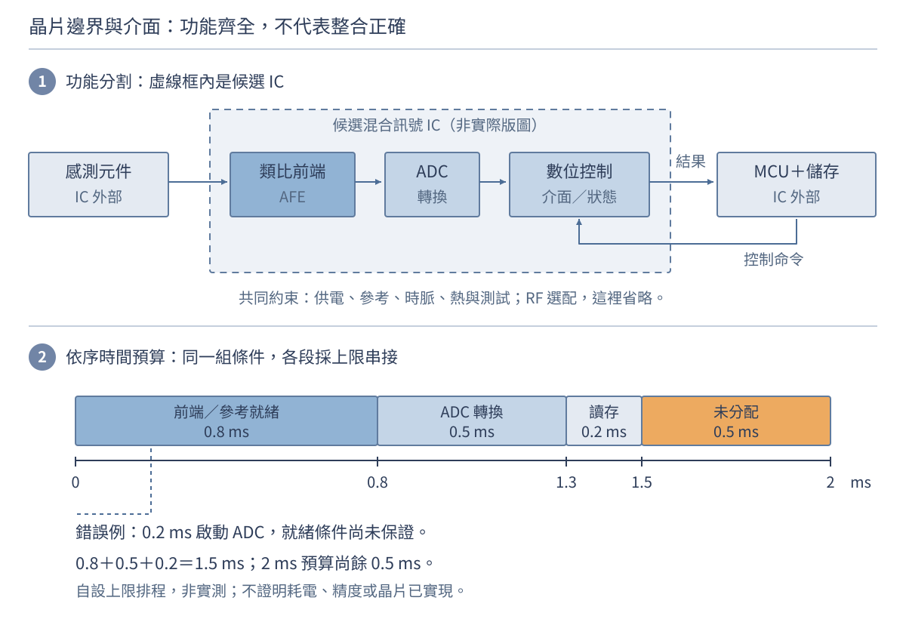

圖 1-2A　從功能訊號鏈進一步約定晶片邊界。上圖實線箭頭是訊號／命令方向，虛線框是候選 IC 的功能邊界，不是封裝剖面或實際版圖。下圖只畫自設的依序時間預算，寬度按時間比例，不是實測波形；橘色是尚未分配的工作時間，不能當成已證明可用的安全裕量。未畫出的供電、時脈、參考、保護及測試資源仍需設計。

| 系統要求 | 分配給候選 IC 的問題 | 仍由外部系統共同承擔的部分 |
|---|---|---|
| P01：整機平均電流不超過 40 µA | 各模式電流、啟動能量、可關閉的功能與喚醒條件 | 感測器、MCU、儲存及電源損失；不能每顆都各拿 40 µA |
| S01：每秒完成有效新讀值 | 就緒、轉換啟動、結果有效及介面傳輸的時間 | MCU 排程、讀取、儲存完成與時間戳 |
| T01：指定點位比較 | 輸入範圍、雜訊、偏移、增益及參考的允許條件 | 感測器、安裝、校正參考、演算法及量測不確定度 |

這張表是責任分配，不是把整機規格複製成 IC 規格。例如 IC 本身低於 40 µA，並不能推出整機通過 P01；ADC 的量化間隔也不能直接當成 T01 的溫度誤差。每一筆分配還要有相容的工作模式、單位、容差及驗證方法。需求分配與介面紀錄的方法可對照 NASA 手冊附錄 I、L；數值與產品架構由本教材自設。[19]

**介面檢查：三個方塊各自通過，整合為什麼仍可能錯？** 為評估第 6.1 節的 2 ms 工作候選方案，先提出下列內部時間分配。它們是待驗證的上限，不是已量到的晶片性能。

| 依序活動 | 自設時間上限 | 上限成立的前提 |
|---|---:|---|
| 喚醒前端及參考，到達就緒條件 | 0.8 ms | 就緒包含約定的建立誤差、輸入範圍及參考條件，不只是電源已開 |
| 有效啟動 ADC，到新結果有效 | 0.5 ms | 取樣所需期間內，輸入、參考及時脈均符合約定 |
| MCU 讀取新結果並完成儲存 | 0.2 ms | 讀到的是本次轉換，且儲存完成可被確認；相關喚醒成本已納入或另列 |

假設上述上限在同一候選配置及指定條件下都成立，且依序執行，總時間上界是 $0.8+0.5+0.2=1.5\,\mathrm{ms}$；距 2 ms 尚有 $2-1.5=0.5\,\mathrm{ms}$ 未分配。未列入的通訊、喚醒或重試必須從這份預算扣除；若活動重疊，則應重新分析相依關係，不能照樣相加後當成精確完成時間。

現在故意放入一個錯誤：類比團隊只承諾最晚 0.8 ms 就緒，ADC 團隊用穩定輸入測試，控制器卻在喚醒後固定 0.2 ms 啟動 ADC。若此時尚未就緒，三個方塊各自的測試都可能通過，整合結果仍不可信。每秒出現一個時間戳，也不能證明每秒量到一筆有效新資料。

修訂重點不是先把 ADC 位元數加大，而是共同定義**就緒、啟動、結果有效、逾時**的條件。控制器可等待經確認的就緒指示，或使用具有依據的保守等待時間；整合測試要包含接近最慢就緒的情境，並排除誤用上一筆結果。時間預算成立仍不能取代 P01 電流量測、S01 新資料紀錄及 T01 比較量測。

「有效新資料」表示本次取樣與轉換已完成，不要求碼值與上一筆不同；穩定溫度下，連續的新結果本來就可能相同。資料新鮮度須由完成事件、序號或其他可追溯紀錄確認，不能只比較數字是否變動。

**先停一下。** 若前端尚未就緒，控制器應把這次結果標成有效新資料嗎？不應；應按規格等待、報錯或標示無效，不能用舊值偽裝成更新。能寫出這個行為，才把模糊的方塊箭頭變成可驗證的介面要求。

到這裡，我們知道記錄器「要做什麼」及「訊號怎麼走」。接下來把視角縮到其中一顆 IC：它怎麼從設計資料變成能焊上電路板的封裝元件？設計記錄器通常可以選用現成 IC，並不表示每做一台產品都要自行設計晶片；下一節是在追溯所用 IC 的來源。

## 4. 跟著一顆 IC 走：從設計資料到出貨

### 4.1 先看流程：每一站要交出什麼？

圖 1-3　典型積體電路的教學主線。資訊流與實物流在投片前後銜接；實際產品可能有額外驗證、外包交接與不同的測試順序。圖中的單向主線不代表開發沒有回饋迭代。

先用圖 1-3 看全程。接下來先讀需求與設計的摘要，再把圖中製造前的一段放大，最後沿同一條主線接回光罩、晶圓、封裝測試與系統；不要把放大檢視誤認成多出另一條生產線。

**需求與架構。** 先決定功能、介面與效能預算。例如資料轉換器需要多少輸入範圍、取樣速度與雜訊裕量；電源是否足以供應尖峰電流。這一站應產出可追蹤的規格及驗收方法，而不是只有「高速、低功耗」等形容詞。

**電路、邏輯、版圖與驗證。** 把功能變成電路或硬體描述，再實作成可製造幾何。邏輯功能正確、版圖符合設計規則、版圖與原電路相符，是不同的檢查；通過其中一項不能取代其餘項目。時序、供電完整性、寄生效應及可測試性也要納入。設計資料送交製造的里程碑常稱為 tape-out，但不是成品出貨日。JKU 的積體電路課程把 tape-out 資料與後續晶圓測試、切割、封裝及最終測試分開介紹，適合接著閱讀。[12]

#### 設計放大檢視一：先確定使用哪些模型與規則

候選 IC 的邊界已經有了，但「把 AFE 和 ADC 整合」還不能直接交給晶圓廠。前端要決定偏壓、增益、頻寬與電源條件；控制邏輯要定義狀態、命令、資料有效與錯誤處置。能否做到，取決於所用製程提供的元件、互連與 I/O 條件，而不只是程式有沒有執行完。

| 設計資源 | 在本例回答的問題 | 不能誤當成什麼 |
|---|---|---|
| 製程設計套件 PDK | 可用哪些元件與層？如何模擬、繪製及檢查？ | 不是完整晶片設計，也不是設備 Recipe |
| 標準元件／I/O 等元件庫 | 哪些邏輯閘、暫存器、輸入輸出單元可用？其模型與限制為何？ | 不是只靠邏輯功能相同就可跨製程替換 |
| 可重用 IP | 是否重用某個轉換器、控制器或介面模組？ | 舊環境通過不等於新產品整合必然通過 |
| EDA 工具 | 如何描述、模擬、合成、實作與檢查設計？ | 工具成功結束不是產品符合規格的保證 |

PDK 與配套庫的提供方式依供應者而異，模型、規則、工具設定與版本應一併受控。公開 SKY130 文件可用來看元件模型、標準元件與 I/O 庫如何分開描述；所讀公開版另有 experimental preview 限制，不能因能下載就視為已取得量產保證。[20] IP 的重用仍需檢查版本、介面、授權與適用製程，不能省略整合驗證。[14]

#### 設計放大檢視二：類比與數位不是同一份檔案

候選 IC 包含兩條相互約束的路徑。**類比部分**由元件電路與模型出發，檢查工作點、增益、雜訊、建立時間等；**數位部分**可以用暫存器傳輸層描述（RTL）表達狀態、資料搬移與控制行為。RTL 描述硬體，不是燒進外部 MCU 的韌體；同一個「等待就緒」需求，可能分配在 IC 控制邏輯，也可能由 MCU 韌體負責，責任必須先約定。

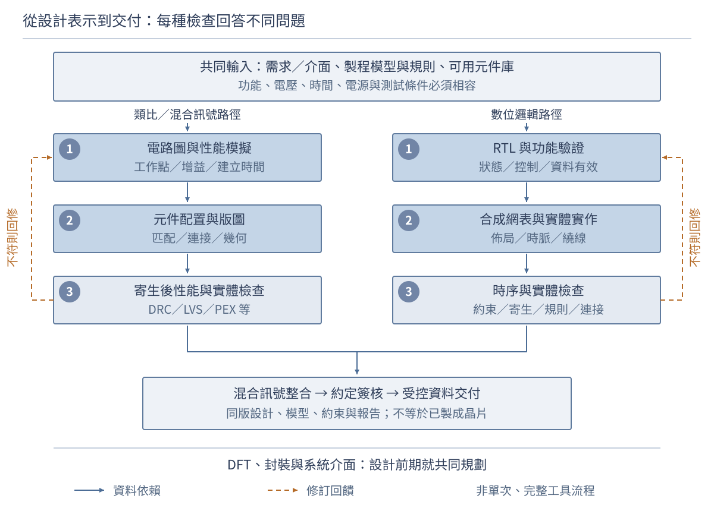

圖 1-3A　製造之前的設計表示與證據。藍色實線表示資料依賴，不是實物輸送；橘色虛線表示發現問題後修訂設計，並非可以忽略重新驗證。這是典型類比／數位路徑的教學整理，混合訊號整合需共同檢查介面；各框不是某套工具的完整操作步驟，簽核也不是只靠圖內列出的幾項檢查。原圖 1-3 的生命週期仍然適用。

數位 RTL 經**合成**轉成邏輯元件的連接描述，再經佈局、時脈與繞線等實體工作；類比部分則把元件與連接實作為版圖，評估匹配、寄生與電性。**網表**描述元件實例及連接；**版圖**描述實體幾何及層次。兩者不能當成同一資料換副檔名。實體實作會改變延遲、負載與耦合，因此常須回修，並非一次畫完就往下交。[21][22]

例如第 3.4 節要求 ADC 只在前端就緒後啟動：數位功能驗證可檢查控制器是否遵守這個條件；類比模擬則要檢查就緒所代表的電壓誤差是否真的收斂。若測試平台把就緒固定為真，就可能漏掉真正的整合錯誤。驗證計畫必須把需求 ID 連到刺激條件、觀察量與判據，而不只是保存一張「模擬有波形」的截圖。

#### 設計放大檢視三：不同檢查回答不同問題

| 設計產物／檢查 | 能回答的問題 | 單獨不能證明的事 |
|---|---|---|
| 功能與介面驗證 | 指定情境下，命令、狀態、新資料與錯誤行為是否符合需求？ | 未覆蓋情境、實際製程變異或整機環境全部合格 |
| 電路性能與角落分析 | 在所選模型及製程／電壓／溫度條件下，增益、電流、時間是否達標？ | 模型涵蓋所有製造差異，或等同實測可靠度 |
| 幾何設計規則檢查 DRC | 版圖是否符合所用規則，例如寬度與間距？ | 電路功能、連接及全部性能正確 |
| 版圖與電路一致性檢查 LVS | 依比對設定，萃取出的元件與連接是否符合預期電路？ | 增益、雜訊或建立時間符合要求 |
| 寄生萃取 PEX 與後續驗證 | 把配線等寄生加入後，性能或時序是否仍成立？ | 某次模擬收斂就等於所有條件均通過 |
| 受控簽核與資料交付 | 約定檢查是否針對同一版設計完成，交付物可否被接受？ | 晶圓已製成、已出貨，或整機 P01／S01／T01 通過 |

DRC、LVS 與寄生後性能必須分開看：版圖合法但接錯線，或連接相同但寄生使讀值太慢，都可能失敗。Virginia Tech 的類比版圖教材分別示範連接比對與萃取後重模擬；修改版圖後，相關檢查也要重新執行。[23] 角落分析中的製程、電壓、溫度常縮寫為 PVT；它不是自動涵蓋所有隨機失配與使用情況的保證。

**判讀停靠點。** 功能模擬和 DRC 通過，LVS 卻不符，能直接交付嗎？不能；必須找出差異及其意義，確認交付電路是預期版本，再完成約定的其餘檢查。反過來，即使 DRC、LVS 都通過，寄生後建立時間不符仍然是未解問題，不能要求製造端任意改 Recipe 來補救。

**簽核（signoff）**是依專案和製程約定判據完成交付前的檢查與核准，不是通用的一個按鈕。需保留適用版本、模型與約束、檢查結果，以及經權責確認的例外；最終版圖／網表、報告與封裝連接資料不能各自來自不相容的版本。[21] OpenROAD 範例能產生 GDS 版圖檔，但其時序報告仍可能有未滿足的條件，說明「檔案產生」不等於「簽核完成」。[22]

在交付之前，還要預想如何測到實際晶片。**可測試性設計 DFT**是在設計時安排觀察與控制能力，並評估其功能、面積及時序影響；不是晶片做完後單靠測試程式就能補上任何內部觀測點。[24] 同樣，封裝腳位、晶粒接點、供電、熱與板級介面也要提早規劃，不是最後隨便找一個外殼裝起來。[25] 本例至少要知道如何辨認前端就緒與本次結果有效；實作可依成本、干擾及可觀測需求選擇，不代表每個內部節點都拉到外部腳位。

現在可以清楚區分三個事件：**tape-out** 是設計資料交付的里程碑；**晶圓投產**是按受控產品及流程投入製造；**成品交付**還需後續加工、封裝與測試。口語「投片」有時混用前兩者，討論交期時必須說清楚，不能把設計資料送出日直接當成晶圓開工日或出貨日。

#### 回到實體產品：設計資料如何接到製造

剛才的放大檢視建立了「交什麼、檢查什麼、哪個版本」；以下接回圖 1-3。設計規則和模型提供製造前的約束，但仍要靠實際製造與量測證明產品狀態。

**光罩資料與製作。** 版圖資料還需要對應製程所需的圖形化工作。入門時可先把光罩想成提供圖形資訊的工具，但不能把「一個功能層」永遠等同「一片光罩」：圖形拆分、修正與實際製程會改變對應關係。這裡先掌握設計幾何必須轉成可在設備上實現的圖形，不必先背特定光罩數。

**投片與晶圓製造。** 投片是讓晶圓以指定產品及流程進入製造。晶圓反覆經過成膜、圖形定義、材料移除、摻雜、熱處理、清洗、平坦化與量測等模組，逐步形成元件及互連。加工、排隊、搬運與異常處置都會佔用時間，不能把少數設備的加工分鐘數相加就當成整批交期。

**晶圓測試。** 在仍能識別晶圓上各位置時量測電性，依測試結果建立晶粒分級與位置資料。測試可協助避免把已知不合格晶粒繼續送進昂貴的後續步驟，但「通過此階段」只代表滿足這個測試條件與涵蓋範圍。測試接觸、速度與可觀測性本身也有限制。

**組裝封裝。** 典型單晶粒流程包含分離晶粒、固定、建立電氣連接與保護結構。封裝還需要把熱帶走，並承受材料膨脹與機械應力。晶圓級封裝、多晶粒與先進整合可能改變切割、組裝及測試的相對次序，因此本圖不是所有封裝的操作清單。

**最終測試與出貨判定。** 檢查封裝後的功能及電性，依產品需求分級與判定。可靠度還需要設計、製程控制、資格驗證及持續監控；逐顆最終測試不是「保證任何使用環境下都能使用十年」。TI 的公開可靠度資料明確把可靠度評估連到元件資格驗證、失效機制與使用條件，而不是只靠最後一次量測。[5][6]

**矽後特性量測、除錯與系統整合。** 開發團隊取得實際晶片後，要確認供電、時脈、重置與介面是否正確，再逐步啟用功能、量測性能並對照設計模型。此處按工作種類補充，不表示發生在量產出貨之後；初期特性量測與除錯會回饋產品測試及出貨準備。回到記錄器，就要把候選 IC 接上感測器、MCU 與儲存，核對真正的新結果、時間戳及完整供電電流。首顆樣品能讀到數字，不等於三項整機需求都通過；量產測試、特性量測、資格驗證與系統使用目的確認不能互相取代。[19][21]

如果實際讀值異常，應同步看輸入／參考、控制事件與結果有效，而不是只看一個最終碼值。設計期預留的測試模式或觀察方式，正是為這類問題準備。此處的「矽後」表示已有實體晶片，不把「驗證」一詞限定為製造前，也不把所有矽後活動都稱作量產篩檢。

若測試發現問題，回饋的目的通常是找出設計、製程或測試條件的原因，改善後續產品；不代表已經完成且受損的晶粒都能沿箭頭倒退恢復。分清「知識回饋」與「實物可返工」，是理解工廠的重要第一步。

### 4.2 再看分工：誰負責這些交付物？

先知道工作內容，再看產業角色，比先背公司分類更容易理解。下表是在剛才的生命週期上分配責任，不是另一條與它無關的流程。

半導體產業可以用工作分工理解，而不是把公司永久放進互斥的格子。同一家公司可能兼具多種業務，也可能對不同產品採用不同供應鏈。

| 角色 | 核心工作與交付物 | 初學者常漏掉的界線 |
|---|---|---|
| 無晶圓廠設計業者（Fabless） | 定義產品、完成設計與驗證，協調外部製造及測試 | 沒有自營晶圓廠不等於不懂製造；設計仍受製程規則約束 |
| 晶圓代工服務（Foundry） | 依核准製程製造晶圓，提供設計規則、模型與製造服務 | 服務可能延伸到設計支援與封裝；不能簡化成「只接收圖檔」 |
| 整合元件製造商（IDM） | 結合自有產品設計與自有製造能力 | 仍可能外包部分晶圓製造或封測，不代表每一步都自行完成 |
| 專業封裝測試服務（OSAT） | 組裝、封裝、測試及相關整合服務 | 晶圓測試、封裝與最終測試的分工可依合約改變 |
| EDA、IP 與設計服務 | 設計工具、可重用功能模組、驗證與實作支援 | IP 的介面與適用製程仍需確認，不能直接保證系統成功 |
| 設備與材料供應商 | 曝光、沉積、蝕刻、量測等設備；晶圓、氣體、化學品、光阻等材料 | 純度、均勻度、污染控制及維護會影響整條流程 |

例如設計業者要交給製造端的，不只是電路功能說明，還包括符合製程設計套件（PDK）與設計規則的實作資料。製造端交回的也不只是「完成的晶圓」，還有製程、量測、分級與追溯資料。這種資訊介面與實物介面同樣重要。Intel 曾公開說明同時使用內部製造與外部代工，其代工服務資料也包括晶圓製造、封裝及設計支援，可用來理解角色並非企業間的絕對分界。[3][4] EDA 與可重用 IP 的功能則可對照 Synopsys 的公開說明。[14]

生命週期交代了外部交付，分工交代了誰負責。現在把鏡頭停在「晶圓製造」這一站：裡面形成哪些結構、反覆做哪些加工，又如何知道這批晶圓真的走對流程？

## 5. 走進晶圓廠：結構、加工與追溯

### 5.1 先看加工的位置：兩種「前段／後段」

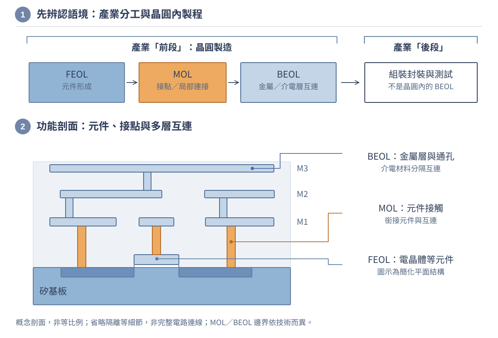

圖 1-4　上半部區分產業前後段與晶圓內 FEOL／MOL／BEOL；下半部用平面電晶體、接點及三層金屬互連示意功能位置。橘色接點突出 MOL 的銜接作用。剖面非等比例，省略隔離、阻障等細節，也不是完整電路連線圖；不同技術對局部互連與模組邊界可能有不同劃分。

從產業流程看，前段製造常指晶圓加工，後段製造常指組裝封裝及相關測試；ST 的製造價值鏈資料採用這個區分。[11] 從晶圓製程內部看，FEOL（front end of line）主要形成電晶體等元件，MOL（middle of line）處理元件接觸與局部連接，BEOL（back end of line）建立金屬與介電層互連。imec 的邏輯晶片技術說明進一步區分這三者的位置與功能。[8]

因此「BEOL 金屬線電阻偏高」與「後段封裝接點失效」不是同一個位置的問題。第一個通常需要晶圓內互連的幾何、材料與量測資料；第二個還可能需要封裝結構、板級應力或接合品質的證據。聽見「後段」時，先問對方指的是工廠分工，還是晶圓內製程段落，比急著猜設備名稱更有效。

後續互連工程、封裝與散熱章節會接著處理這些問題。先讀懂層級，再進入電阻、寄生電容與熱阻的模型。

把它接回候選 IC：設計中的元件與配線，必須在製程中形成相應結構；圖 1-4 仍是通用示意，並不是已完成該 IC 的真實剖面。設計階段的規則檢查與製造階段的膜厚、線寬及電性量測是前後相接的證據，不能互相代替。

### 5.2 再看加工的動作：製程會重複，但不是每層同一個食譜

知道 FEOL、MOL、BEOL 分別要形成什麼後，接著看形成它們所用的基本動作。下圖只選一種薄膜圖案轉移作例子，不把它當成所有元件的完整製程。

圖 1-5　上半部只選「薄膜圖案化蝕刻」作具體例子：薄膜形成、微影後遮罩、開口處蝕刻、去除光阻。橘色為光阻，假設理想選擇性與近垂直側壁，下方基板未被蝕刻；不能把這個剖面直接當成摻雜流程。下半部是量測與品質處置，橘色路徑表示需暫停處理的異常。量測站及抽樣依控制計畫安排，不是所有模組都有相同步驟；返工必須有被驗證且核准的條件，不能把任何不合格品直接送回起點。

可以先用五個動詞理解許多模組：增加材料、定義圖形、選擇性改變材料、清理表面、確認結果。增加材料可能是沉積或成長；圖形定義通常涉及微影；選擇性改變可以是蝕刻移除，也可以是導入摻雜。兩者的物理目的不同，不能當作可任意互換的加工。

清洗並不是只有最後才做的「打掃」。表面殘留、顆粒與污染會影響後續附著、介面或電性，因此清洗可穿插在多個位置。量測也不是只在成品出廠時出現；膜厚、線寬、套刻、電性等資訊要在適當階段取得，否則等到最終測試才發現問題，可能已經付出許多後續成本。

這些模組還會共用設備與量測站，形成重複進站的製造流程。某一層完成後，晶圓可能再次回到同類設備做另一層，而不是從一條單向流水線一路走到底。設備排程、維護與瓶頸因此會影響交期。Siemens 的製造執行系統說明也討論重複進站、路徑變更與設備程序（Recipe，下一小節說明）追蹤；這是理解管理問題的例子，不代表所有工廠都採用相同軟體或配置。[13]

遇到量測超規，第一步不是立即調參數，而是確認產品身分、量測方法、儀器狀態與資料是否對應正確。之後才判斷是測試問題、設備漂移、材料差異還是上游累積效應。若蝕刻已傷及下層，重新沉積或重跑一次未必能恢復原結構；若某階段允許去除光阻後重作，也仍有材料與次數限制。

**小案例：同樣叫「膜厚偏高」，原因可能不同。** 單一測點偏高，可能先檢查量測位置、表面狀態與量測重複性；整片都偏高，要再看批次趨勢與設備紀錄；中心與邊緣差異增加，則要區分平均值與均勻性。這些是診斷方向，不是特定設備的故障結論。有效的下一步應是一項能區分假說的量測，而不是同時改動所有參數。

### 5.3 最後看如何管好流程：Lot、Route、Recipe

剛才的診斷需要批次趨勢、設備紀錄與量測證據。要取得這些資料，就必須同時記住「哪一批」、「應走哪條路」與「每一步應用哪組條件」，以下三個名詞正是為了回答這些問題。

延續剛才的薄膜量測超規案例，只寫「沉積有問題」無法追查。工程師需要知道哪些晶圓、經過哪個步驟版本、使用哪台設備與條件，以及量測是否可信。

| 名詞 | 回答的問題 | 自設的記錄例子 |
|---|---|---|
| Lot（批次） | 這是哪一批受共同管理的產品？ | 批號 L-101，另保留各片晶圓識別與拆批紀錄 |
| Route（流程路徑） | 應按什麼次序，經過哪些步驟與檢查？ | 路徑 R3：加工、量測、判定，再進入下一模組 |
| Recipe（設備程序／配方） | 這一步在設備上執行哪一套核准條件？ | 程序 P7 第 2 版；參數、步序與適用設備均受控 |
| 製程履歷 | 實際上發生了什麼？ | 設備／腔體、時間、版本、警報、量測及處置結果 |

SEMI 術語彙編將 lot、recipe、cycle time 與 throughput 分別定義，適合用來避免把不同概念混成一個「批次設定」。Lot 不以 25 片為普遍定義；載具可容納多少片、某設備一次處理多少片、管理批次實際有多少片，是三個不同問題。[9]

Route 不是每一步的所有機台參數；Recipe 也不能取代整條 Route。路徑可能包含分支、工程暫停、抽樣量測與核准的返工步驟，版本控制因此很重要。即使兩批產品使用同一個 Recipe 名稱，也仍要確認版本與設備適用範圍。

追溯系統還需要處理拆批與併批：拆開後不能丟掉原始關聯，合併管理也不能抹去不同的加工歷史。對初學者而言，重點是把「規定要做什麼」與「實際做了什麼」分開保存。這一習慣也適用於電路實驗：電路圖版本、元件批次、韌體版本與量測儀器設定都應留下紀錄。

因此，追溯鏈不應到工廠門口才開始：設計版本與核准交付資料要能連到製造批次、晶圓／晶粒位置、封裝識別及測試版本。若晶片或韌體更新，要能分清「原設計條件改了」與「同設計下製造狀態變了」，否則系統異常容易被歸給錯誤環節。

本章不提供可直接操作危險設備的 Recipe。涉及高溫、真空、高壓、雷射、毒性或易燃氣體及化學品時，概念教材不能取代設備訓練、核准程序與安全規範。

我們已經走過需求、功能、IC 來源與晶圓廠。接著不再增加製程名詞，而是用前面建立的邊界算三個問題：產品能用多久、IC 每顆成本多少，以及工廠多久交得出來。

## 6. 回到工程決策：續航、成本與交期

三個算例使用不同模型，都是自設數值。先認清各自的對象，再代入公式；它們不是可以把每個答案一路相乘的同一份工廠資料。

| 要回答的問題 | 本例計算對象與邊界 | 先保留的簡化 |
|---|---|---|
| 能用多久？ | 整台記錄器的一個工作／睡眠週期 | 固定供電、兩種電流狀態，忽略啟動過衝與轉換損失 |
| 每顆成本多少？ | 一片晶圓對應的單晶粒 IC 製造及封裝投入 | 採題目給定排版與分段良率，並非整台記錄器成本 |
| 多久交得出來？ | 另一個已達穩態的晶圓流程邊界 | 忽略報廢，不沿用上一例的 80%／95% 良率 |

### 6.1 算例一：低功耗不只看工作電流

回到記錄器的供電需求。第 3 節的 MCU 可以安排工作與睡眠，但電池要供應的是所有狀態累積的電荷，而不只是工作時的電流。

以下是自設情境，不是特定產品規格。記錄器每秒工作一次，工作電流 $I_a=12\,\mathrm{mA}$、工作時間 $t_a=4\,\mathrm{ms}$；其餘時間睡眠電流 $I_s=8\,\mathrm{\mu A}$。固定供電 $V=3\,\mathrm{V}$，週期 $T=1\,\mathrm{s}$，忽略啟動過衝與電源轉換損失。

圖 1-6　算例一的時間分配。上方完整週期按時間比例繪製，橘色工作區只占 0.4%；下方另放大前 10 ms，不能把兩列的寬度直接相比。色塊只表示狀態與持續時間，高度不是電流值；這不是實測電流波形。雖然工作時間很短，仍須把工作與睡眠的電荷都算進去。

先把每種狀態的電荷加總，再除以週期，得到平均電流：

$$
I_{avg}=\frac{I_a t_a+I_s(T-t_a)}{T}
=48\,\mathrm{\mu A}+7.968\,\mathrm{\mu A}
=55.968\,\mathrm{\mu A}.
$$

平均功率為 $VI_{avg}=167.904\,\mathrm{\mu W}$；一日能耗約 $14.507\,\mathrm{J}$。若理想可用電池容量為 $200\,\mathrm{mAh}$，則

$$
t_{battery}=\frac{200\,\mathrm{mAh}}{0.055968\,\mathrm{mA}}
\approx3573.5\,\mathrm{h}\approx149\,\mathrm{day}.
$$

這是電荷收支模型，不是實測續航保證。電池容量的量測條件、截止電壓、自放電、溫度、穩壓器靜態電流及轉換損失都可能改變結果；若電池電壓與負載電壓不同，更不能不加區分地直接套用負載電流。

比較兩個修改：把工作時間縮短為 2 ms，平均電流變成 $31.984\,\mathrm{\mu A}$；只把睡眠電流減半為 4 µA、工作時間仍是 4 ms，平均電流則為 $51.984\,\mathrm{\mu A}$。這組數值下，縮短工作時間的效果較大。原因不是「韌體一定比元件重要」，而是工作狀態原本佔每週期電荷的大宗。

若實測高一倍，先量到完整喚醒週期，查看啟動、重試、外接電阻、感測器供電及電源管理，不要先把每個元件都換掉。量測儀器的頻寬、取樣與插入造成的壓降也可能影響結果。模型的價值在於幫你選下一個能驗證原因的實驗。

**把計算接回 P01，而不只比較誰的數字小。** 同一個兩狀態模型可整理成下表；功率均以 3.0 V 計算。

| 候選方案 | 平均電流 | 平均功率 | 相對 P01 的模型判斷 |
|---|---:|---:|---|
| 原方案：工作 4 ms、睡眠 8 µA | 55.968 µA | 167.904 µW | 超過 40 µA，模型不支持採用 |
| 工作縮為 2 ms，睡眠仍 8 µA | 31.984 µA | 95.952 µW | 低於平均限制，但 S01、T01 仍無證據 |
| 工作仍 4 ms、睡眠降為 4 µA | 51.984 µA | 155.952 µW | 仍超過平均限制 |

縮為 2 ms 的前提是**同一項量測與儲存任務確實完成**。提早關閉感測器、讀到尚未建立的電壓，或重複回報上一筆資料，都不是等價的省電方案。下一步要同時取得完整電流波形、新讀值時間戳與指定點位比較；模型支持候選方案，不等於原型已通過驗收。第二章將拆出「讀值前需等待多久」這一個子問題。

第 3.4 節的 1.5 ms 依序預算，正好提供一份應驗證的活動清單；它沒有證明這顆 IC 已做得出來，也沒有證明各活動都維持本例假設的 12 mA。縮短工作時間不能直接等同提高時脈，更不能省略就緒條件。至於下一例的晶粒尺寸與價格，仍是獨立成本教具，不是這顆候選 IC 的版圖結果或報價。

### 6.2 算例二：面積、良率與每顆可出貨成本

現在把對象從整台記錄器縮到一種單晶粒 IC，追問它的製造投入如何分攤到合格產品。請回想第 2 節的晶圓與裸晶，以及第 4 節先測試、再封裝的典型流程；下列 15.26 元是這個簡化 IC 模型的結果，不是記錄器售價或整機成本。

以下全部是自設數值，不代表實際工廠報價。直徑 200 mm 的晶圓，扣除邊緣限制後，可用區域直徑為 190 mm；每顆晶粒為 $10\times10\,\mathrm{mm}$，先忽略切割道。可用面積是

$$
A_{usable}=\pi(95\,\mathrm{mm})^2\approx28\,352.874\,\mathrm{mm^2}.
$$

面積除以 $100\,\mathrm{mm^2}$ 得到約 283.529，只能提供面積上的上界，不能當成實際排版結果。矩形要完整落在圓內，還要考慮排列、切割道及其他排除條件。本例另外**給定**實際排版有 240 個完整位置，並不是用面積商推導出 240。

若晶圓測試合格率為 80%，且後續封裝與最終測試對送入的合格裸晶有 95% 的條件合格率，則長期平均可出貨數為

$$
N_{good}=240\times0.80\times0.95=182.4.
$$

小數表示許多批次的平均期望，不是一片晶圓能出貨 0.4 顆元件。良率能相乘，是因為分母沿著流程銜接：第一段分母是晶粒位置，第二段分母是進入封裝的合格裸晶。本例採一顆裸晶對應一個封裝，沒有改變統計單位；多晶粒封裝不能原封不動套用。

假設一片晶圓的製造成本為 2,400 元，每顆送封裝的裸晶另花 2 元。平均送封裝數為 $240\times0.8=192$，簡化總成本與每顆可出貨成本是

$$
C_{total}=2400+192\times2=2784\,\mathrm{元},\qquad
C_{good}=\frac{2784}{182.4}\approx15.26\,\mathrm{元/顆}.
$$

本模型未列出的測試、報廢處置、運輸、管理與研發等費用，不能假裝已被包含。它要說明的是：即使晶圓價格不變，良率、封裝投入與可出貨分母也會影響單位成本。只比較「一片晶圓多少錢」不足以比較兩種方案。量產良率章將再討論缺陷模型與統計條件。

### 6.3 算例三：為什麼多投片不會立即增加出貨？

知道成本還不等於知道交期。這次把邊界移到另一個晶圓生產流程，單位改用「片」，且另行假設忽略報廢；先前算例的晶粒數與良率不帶進來。第 5 節提到的重複進站與等待，正是不能只加總設備加工時間的原因。

先分清三個量：在製品（WIP）是某個邊界內尚未完成的數量；吞吐量（throughput）是單位時間完成的數量；循環時間（cycle time）是同一邊界內從進入到離開的經過時間，包含加工，也可能包含等待、搬運、量測與處置。設備的單步加工時間不是整個工廠的循環時間。[9]

在流量守恆、長期平均具有代表性且系統沒有持續無界累積的條件下，Little's law 將三者連接：

$$
L=\lambda W.
$$

其中 $L$ 是平均在製數量，$\lambda$ 是平均流量，$W$ 是平均停留時間。三者必須使用同一系統邊界、同一物件單位及相容的統計期間；不是把今天的瞬間庫存與另一個月份的出貨數隨便相除。[10]

自設一個忽略報廢、已達穩態的晶圓流程：平均完工 40 片／日，平均循環時間 30 日，則平均 WIP 為 $40\times30=1200$ 片。若真能在 WIP 維持 1200 片時達到 50 片／日，對應循環時間是 $1200/50=24$ 日。

這個算式是流量關係，不是增加產能的方法。多投片可能只是讓瓶頸前排更長的隊；要提高出貨，還需看瓶頸設備可用率、產品組合、重工、良率與排程。若報廢不可忽略，也不能拿只計良品的出貨量，直接配上包含所有產品的 WIP 與停留時間；必須重新定義流入、流出與報廢分支。

「需求增加」和「明天能交貨」因此是不同問題。增加設備可能還需要安裝、資格驗證、材料供應與人員訓練；既有在製品也必須完成剩餘步驟。這是工程、製造管理與商業決策真正相遇的地方。

**平均值不是單批交期承諾。** 算出的 30 日是長期平均停留時間，不是「今天投片的每一批都會在 30 日後完成」。承諾特定批次的交期，還需查剩餘流程、瓶頸排程、變異、優先規則及異常處置條件；平均流量關係本身沒有提供這些資訊。

現在手上有續航、成本與交期三種答案，對象和單位各不相同。它們仍有共同的驗證方法：先不急著採用數字，而是回頭檢查計算是否符合原先的模型邊界。

### 6.4 三個答案都要接受同樣的檢查

先做三種檢查。**單位檢查**：電流乘時間是電荷，電荷除時間才回到電流；片／日乘日才得到片。**極限檢查**：工作時間趨近零時，平均電流應趨近睡眠電流；後段合格率趨近零時，可出貨成本不能仍維持有限而不變。**量級檢查**：平均電流應落在兩個狀態電流之間，實際可排晶粒數不會超過相容的可用面積上界。

接著問「參數從哪裡來？」題目給定、供應商保證、抽樣估計及實際量測，可信範圍不同。再問「哪些因素尚未建模？」簡化不等於錯誤；沒有說明簡化，卻把結果當成無條件保證，才會導致錯用。

最後寫出能推翻模型的觀察。例如平均耗電預測與量測不符，就看是否出現模型沒有的額外狀態；預期良率與實際差很多，就查分母、產品組合與測試條件是否一致。不要用更多小數位掩蓋不確定度，也不要為了讓答案吻合而事後任意改假設。

這三個算例各用了少量數學，卻已需要供電、韌體、材料幾何、測試、統計與生產管理一起配合。最後再把視角拉遠：它們分別位於哪個分析層級，下一步該學哪些學科？

## 7. 回看整張地圖：分析層級與學習路徑

### 7.1 五個層級不是五個互不相干的科目

前面曾沿著訊號方向走，也沿著製造時間順序走；下面換成「解釋問題所用的模型」。這不是第三條生產線：同一個耗電或良率問題，可能要在數個層級之間來回尋找證據。

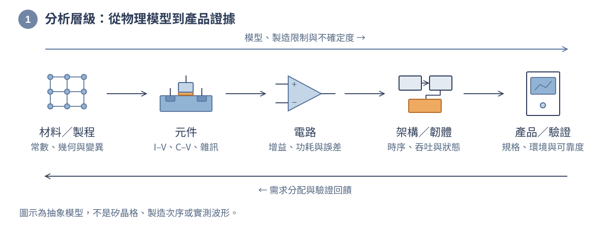

圖 1-7　同一個產品的跨層分析。圖示是分析層級，不是製造次序或實測波形；方格連接圖只代表抽象材料模型，不是矽的真實晶體結構。模型、製造限制與不確定度向產品傳遞，需求與驗證回饋則向各層分配。

材料層處理晶格、缺陷、能帶與介面；元件層把這些性質整理成電流、電壓、電容及雜訊的關係；電路層利用元件實現放大、開關、振盪、記憶與轉換；架構與韌體層決定資料怎麼流、何時運算與睡眠；產品層則驗證整體是否在使用條件下達標。

| 分析層級 | 典型問題 | 傳給其他層級的資訊 |
|---|---|---|
| 材料與製程 | 缺陷、膜厚、摻雜與介面如何控制？ | 材料常數、幾何、變異與製造限制 |
| 元件 | 電壓改變時，電流與電荷如何反應？ | 電性模型、寄生、雜訊與安全範圍 |
| 電路 | 能否得到指定增益、速度與精度？ | 功耗、延遲、誤差及輸入輸出條件 |
| 架構與韌體 | 何時取樣、運算、睡眠與通訊？ | 吞吐量、時序、資源及故障行為 |
| 產品與驗證 | 是否在環境與負載變化下仍然達標？ | 驗收證據、可靠度限制與修訂需求 |

層級不是互不相通的抽屜。閘極介電層改變會影響電容與漏電，進而影響速度及待機功率；封裝熱阻會影響接面溫度，溫度又改變漏電與可靠度。高階模型中的參數應能追溯到低階物理、供應商資料或量測，而不是為了讓模擬通過就任意調整。

把它套回算例一：睡眠電流可能牽涉元件漏電與電源電路，工作時間則牽涉轉換、運算與韌體排程。這樣才看得出「縮短工作時間較有效」是那組數值下的結論，不是某一個學科永遠比另一個重要。

### 7.2 電機、電子與半導體科系，應該怎麼接著學？

有了實際問題與分析層級，課程表就不再只是一串名稱。下面各學科是用來回答前面遇到的問題，也會在後續章節逐步接上。

各校科系名稱、必修與專業分流不同，不能把下表當成固定學制。MIT 與清大的官方課程資料可用來對照數理、電路、系統及實驗的連接，但本書不是任一校課程表的複製，也不宣稱完成本書就等同取得完整學位訓練。[1][2]

| 學科群 | 為什麼需要 | 在本書接到哪裡 |
|---|---|---|
| 微積分、微分方程、線性代數 | 描述變化、暫態、耦合方程與小訊號近似 | 數學工具、電路暫態、控制與模型 |
| 機率、統計與數值方法 | 分辨雜訊、變異、不確定度與可重現趨勢 | 量測、DOE、良率及可靠度 |
| 電路學與電子學 | 守恆、偏壓、放大、回授及訊號轉換 | 基礎電路、類比與混合訊號 |
| 電磁、訊號與系統 | 場、波、頻率、取樣與互連效應 | 傳輸線、濾波、ADC、通訊 |
| 固態、材料與半導體元件 | 理解能帶、載子、接面及電晶體模型 | 元件物理、MOS、短通道與功率元件 |
| 製程、量測與整合 | 把幾何和材料做出來，並證明可重複 | 晶圓、微影、薄膜、蝕刻、互連與品質 |
| 數位邏輯、程式與計算機架構 | 描述狀態、時序、資料流及軟硬體互動 | 數位電路、韌體、測試與系統專題 |
| 控制、電力電子與能源 | 管理動態、能量轉換、穩定性與負載 | 回授、電源、能源相關延伸 |
| 實驗、專題與工程溝通 | 把假說變成量測，記錄他人能重現的證據 | 儀器、除錯、跨域專題及技術報告 |

電機領域通常涵蓋電路、訊號、電磁、控制、能源與計算等多個方向；電子相關學程常深入元件與積體電路；半導體學程則常加重固態、材料、製程、量測與整合。但真正應比較的是課綱與先備關係，而不是只用名稱替學生決定能力。

例如設計低雜訊放大器，需要用微積分理解小訊號，用機率描述雜訊，用電子學建立偏壓與增益模型，用電磁與版圖知識處理高頻互連，再用製程與統計理解尺寸、匹配及變異。只會公式可以完成紙上題目；讓成品可測試、可量產，還要補上驗證與工程紀錄。

適合自學的路徑是反覆回訪，而不是等所有物理都學完才碰電路：先用簡化元件做計算與低風險量測，再學材料與元件物理，最後回來檢查原模型省略了什麼。每一階段都保留「我使用的假設、可能失效的條件、下一項驗證」三行筆記。

### 7.3 工程任務：把方案選擇接到可查核的證據

現在可以把各節接成一次簡短設計審查。工作縮為 2 ms 是值得測試的候選方案；它還不是 P01、S01、T01 全部通過的產品。請用下圖分開記錄「模型說什麼」與「原型量到什麼」。

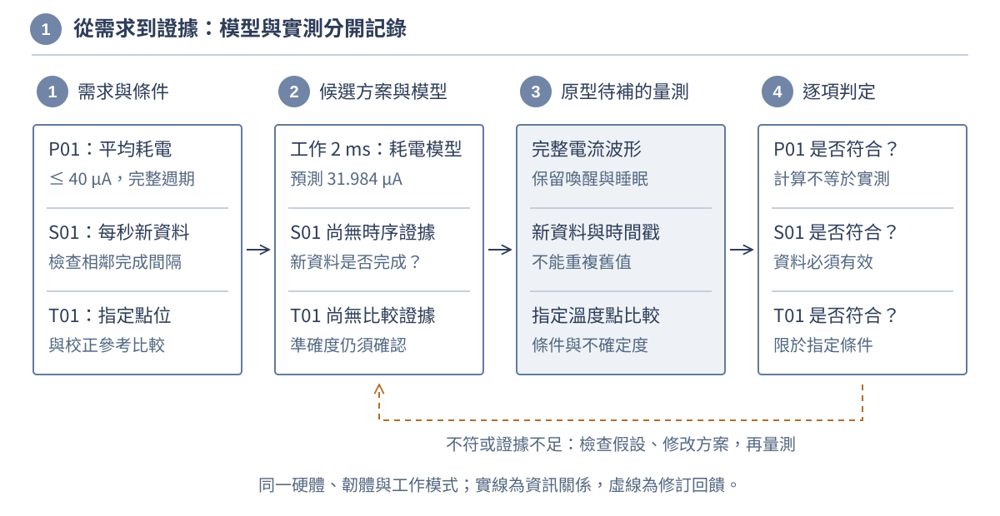

圖 1-8　自繪的需求—證據追溯圖。實線表示資訊如何支援下一步，橘色虛線表示結果不符時返回檢查；不是製造流程。模型預測與量測證據分開列，不能把算得出來直接改寫成已通過。P01、S01、T01 是第 1 節自設需求。

**任務。** 先不看下面的判讀，交出一頁紀錄：

1. 選出一個耗電候選方案，逐項列出 P01、S01、T01 的證據狀態與缺少的資料。
2. 假設原型同時出現 ADC 碼頂到上限、平均電流超過預測。對每項現象各列兩個候選原因，再提出一項能區分原因的量測。使用圖 1-2 和圖 1-7，不要先假定兩個現象一定同源。
3. 回看圖 1-3，寫出「設計到製造」「晶圓測試到封裝」「最終測試到出貨」各應保留什麼交付資料，讓後續異常能追到版本與物件。
4. 對照圖 1-3A，假設功能模擬與 DRC 通過、LVS 尚未一致、寄生後性能未檢查。列出不能交付的理由，以及下一項應補的證據；不要直接把狀態寫成「設計完成」。

**參考判讀。** 2 ms 方案只在目前耗電模型中低於 P01 限制；三項需求都還需要各自的量測證據。ADC 上限碼可能來自前端輸出過大，也可能是輸入範圍／參考設定不合；先對照實際輸入、參考及設定。額外耗電可能來自喚醒過衝、重試或沒有關閉的負載；同步比對電流波形與韌體時間戳，比單看平均值更能區分原因。這些是候選原因，不是僅憑現象就下的診斷。

交接資料則應包括：核准版本的設計與製造資料；可對應晶圓位置、測試條件及分級的結果；以及出貨物件識別、測試版本和判定紀錄。不同產品有不同資料格式，重點是下一站能確認接到哪個物件、哪個版本、在哪些條件下通過。

任務 4 則應先處理 LVS 的不一致，確認設計意圖及資料版本，再完成受影響的功能、性能與寄生後檢查；不能用 DRC 通過替代連接及性能證據。這與原型量測任務不同：一個在判斷設計能否交付，另一個在判斷實際系統是否符合需求。

**自我評量。** 一份合格紀錄應做到四件事：邊界一致、計算與單位正確、模型與實測狀態分明、下一項檢查能區分原因。還要分清「符合寫下的要求」與「要求是否真的滿足使用目的」：即使逐條測試通過，也要回到實際使用情境確認需求沒有漏列。[18]

接著用十二題練習檢查能否把需求、物件、流程及模型連起來。前八題保留需求與製造判讀，新增四題檢查架構介面、設計交付及矽後證據。遇到不確定的地方，回到相應小節看假設與圖說，不必靠背誦縮寫猜答案。

## 練習與參考解答

**練習 1：可驗收的需求。** 把「做一個精準、省電的室內溫度記錄器」改成可測試的要求，至少寫出四項條件。

**解答。** 一個自設版本是：在 10–40 °C、指定供電與穩態安裝條件下，每 10 秒記錄一次；相對校正參考的誤差不超過 ±0.5 °C；另外指定平均功耗上限及量測完整週期的方法。這是規格範例，不表示已證明可達成。若只寫解析度而沒有誤差與參考條件，仍不完整。

**練習 2：角色與術語。** 甲設計產品並委託晶圓製造；乙有自己的產品與晶圓廠，也接外部訂單；丙承接封裝測試。如何描述三者？「後段金屬互連」和「後段打線封裝」是否相同？

**解答。** 甲此項業務符合 Fabless 模式；乙可同時有 IDM 與 Foundry 業務；丙提供 OSAT 服務。不能只憑公司標籤推斷每個產品流程。金屬互連通常指晶圓內 BEOL，打線封裝屬組裝封測，位置與技術問題不同。

**練習 3：異常追溯。** 一批晶圓量測超規，發現設備使用錯誤版本的條件。Lot、Route、Recipe 各有什麼作用？可以直接把所有晶圓送回上一步嗎？

**解答。** Lot 識別受影響批次及晶圓，Route 查應有的步序與檢查，Recipe 查該步核准的設備條件及版本。還需實際設備、時間及量測履歷。不能一律回上一步；先隔離及判定可返工性，尤其不可逆的材料移除或損傷未必能恢復。

**練習 4：改變回報週期。** 沿用算例一，週期改成 2 秒，工作時間仍 4 ms，平均電流是多少？

**解答。** 工作部分為 $12\,\mathrm{mA}\times0.004/2=24\,\mathrm{\mu A}$；睡眠部分為 $8\times1.996/2=7.984\,\mathrm{\mu A}$，總和 $31.984\,\mathrm{\mu A}$。它與 2 ms／1 s 方案有相同占空比，但更新能力不同，實際喚醒次數也可能帶來額外差異。

**練習 5：ADC 位元數。** 理想單極性 12 位元 ADC 的滿刻度跨度為 3.3 V，輸入有用跨度只有 10 mV。忽略雜訊時，它跨越多少量化間隔？能否宣稱有 12 位元的有用輸入資訊？

**解答。** 採理想均勻量化模型，間隔 $3.3/4096\approx0.8057\,\mathrm{mV}$，有用跨度約 12.4 個間隔。不能宣稱有 4096 個可區分的有用輸入等級；應檢查增益、偏移、雜訊及飽和。實際碼轉換還要依 ADC 的定義與傳輸特性判讀。

**練習 6：良率分母。** 沿用算例二，若後續封裝與最終測試的條件合格率提高到 100%，其他數值不變，每片平均可出貨幾顆？簡化單位成本是多少？

**解答。** 可出貨數為 192 顆，成本仍為 2,784 元，單位成本 $2784/192=14.50$ 元／顆。這裡假設改善不增加額外費用，且送封裝數不變；若改善需要更昂貴設備或測試，必須重寫成本模型。

**練習 7：WIP 與交期。** 同一穩態邊界內平均 WIP 為 1,200 片、平均完工為 40 片／日，忽略報廢。平均循環時間為何？把 WIP 增至 1,600 片但完工量不變，能否說交期更短？

**解答。** 原本為 $1200/40=30$ 日。如果新的長期平均確實是 1,600 片與 40 片／日，則為 40 日，不是更短。若只是某天瞬間增加庫存，不能立刻把瞬間值當成新穩態平均。

**練習 8：測試與可靠度。** 一顆晶片通過最終測試，是否就能保證在任何溫度、供電及負載下運作十年？請列出還需要的證據。

**解答。** 不能。通過只對應指定測試條件及涵蓋範圍。還需適用規格、使用環境、失效機制與資格驗證、製程監控及相應可靠度證據；超出額定條件不能以原測試結果背書。失效機率或壽命估計也不是對每一顆元件的無條件承諾。

**練習 9：整機與晶片邊界。** 候選 IC 在其測試模式下平均電流為 30 µA。能否因此宣告記錄器通過 P01？還應索取哪些資料？

**解答。** 不能；P01 是整台記錄器在指定模式與 300 s 區間內的平均限制，IC 的 30 µA 既未包含外部感測器、MCU、儲存及電源損失，也未證明模式相同。應先核對電壓、溫度、工作／睡眠與更新條件，再取得整機完整電流紀錄。若只是把 40−30=10 µA 當作外部預算，也仍須先證明計算邊界與條件相容。

**練習 10：時間分配與有效資料。** 在另一組自設但相容的條件下，前端最晚 1.0 ms 就緒、ADC 轉換最多 0.6 ms、讀取儲存最多 0.3 ms，按順序執行。相對 2 ms 工作預算剩多少？若另有未計入且不重疊的 0.2 ms 喚醒工作，還符合嗎？

**解答。** 原上界為 1.0+0.6+0.3=1.9 ms，未分配 0.1 ms；另加 0.2 ms 後為 2.1 ms，超過這份內部工作預算 0.1 ms。這份上界無法保證 2 ms，不代表每次實測都需 2.1 ms。不能提早取尚未就緒的輸入來「省」時間；應修改架構、排程或預算並重新驗證。這不直接證明每秒更新的 S01 或平均耗電的 P01 失敗，兩者仍需各自條件與證據。

**練習 11：產生版圖檔就是設計完成嗎？** 某次工具成功輸出 GDS，功能模擬與 DRC 通過，但 LVS 不一致，且寄生後性能尚未驗證。可以把此檔案當成已簽核版本交付製造嗎？

**解答。** 不能。GDS 是幾何資料，工具成功只是產出狀態；DRC 不證明連接正確。先查清 LVS 差異是否來自設計、版圖、模型或比對設定，修正後重跑相關檢查，再完成約定的寄生後性能、時序及其他交付要求。各報告必須對應同一核准版本；即使簽核完成，也不表示晶圓已製成。

**練習 12：首顆矽與整機驗收。** 首顆封裝樣品能回傳數位碼，生產測試也通過。接到記錄器卻偶爾重複前一筆資料，應直接判定 ADC 解析度不足嗎？哪些證據仍缺少？

**解答。** 不應直接歸因。相鄰的新轉換可能因輸入穩定而得到相同碼值；「新資料」指有本次有效取樣／轉換的依據，不是數字每次都必須改變。先同步核對就緒、轉換啟動、結果有效、讀取／儲存及時間戳，確認是否真的重讀舊結果，再區分控制時序、通訊、韌體或類比尚未就緒等候選原因。生產測試只支持其指定涵蓋範圍；仍缺 S01 有效新資料、P01 完整供電電流及 T01 指定點位比較等整機證據，還要確認實際使用目的。增加位元數不會自動修正讀到舊資料的問題。

## 單元回顧與下一步

前面的練習把需求判定、術語辨識、追溯與計算分開檢查；回到實際產品時，這些判斷卻要一起使用。把它們重新接回記錄器的旅程，便能看見本章各節為何需要彼此。

現在應能沿著「需求與驗證 → 設計資料 → 製造與追溯 → 封裝測試 → 產品使用」說出每一站的輸入與證據。看見晶片時，先辨認是在談裸晶、封裝還是系統；聽見後段時，先界定晶圓內或產業分工；看到數值時，先檢查單位、分母與適用條件。

會讀製程新聞不等於能分析元件，會解電路不等於已完成量產驗證，模擬收斂也不等於模型有效。本書要把這些能力連起來。接下來先讀數學、單位與電路基礎，再逐步走進元件、製程與系統；不必今天就把所有縮寫背完，但應能說明每個問題該到哪一層尋找答案。

例如，功耗算例用「各段電流乘時間」求累積電荷，訊號鏈則留下「輸入改變後，何時才適合讀值」的問題。第二章就從這裡接手：把單位、變化率與累積量整理成工具，再用一個簡化電容節點算出等待時間，讓學科地圖開始變成可操作的解題方法。

沿原章序讀，第二章會替第 3.4 節「多久才算就緒」補上建模工具；依產業路線選讀，則可帶著需求與介面問題回查所需基礎。兩種讀法不矛盾，也不要求先背完整個學科清單。後續設計實作仍有待逐章深化，本章沒有把入門交付地圖當成完整投片資格。

## 參考資料與延伸閱讀

以下資料用於相應概念的查證與延伸；章內算例、流程編排與圖解為本教材重新設計。官方文件與課程頁仍由各權利人持有，引用不代表背書。

1. [MIT Course 6 官方課程目錄](https://catalog.mit.edu/subjects/6/)：學科範圍與課程先備關係，不作為本章所有公式的共同出處。
2. [國立清華大學電機工程學系學士班課程表](https://web.ee.nthu.edu.tw/p/405-1175-41227,c527.php?Lang=zh-tw)：數理、專業與實驗課程對照；實際修課依各校當年規定。
3. [Intel：Expanding Foundry Partnerships](https://www.intel.com/content/www/us/en/newsroom/opinion/expanding-foundry-partnerships-critical-piece.html)：內部製造與外部代工合作的業務例子，不將企業角色視為互斥分類。
4. [Intel Foundry Fact Sheet](https://www.intel.com/content/www/us/en/foundry/library/fact-sheet.html)：晶圓製造、封裝及設計支援服務範圍。
5. [Texas Instruments：Manufacturing terminology](https://www.ti.com/about-ti/worldwide-manufacturing/manufacturing-terminology.html)：晶圓製造與組裝測試的分工及交付。
6. [Texas Instruments：Reliability](https://www.ti.com/quality-reliability/reliability.html)：資格驗證、失效機制與可靠度評估，區別於逐顆最終測試。
7. [IEEE Electronics Packaging Society：Chiplet Definition](https://eps.ieee.org/technology/definitions/)：chiplet 的功能分割及整合概念，並明確區別於封裝種類。
8. [imec：A view on the logic technology roadmap](https://www.imec-int.com/en/articles/view-logic-technology-roadmap)：Key parts of the logic chip 段落的 FEOL／MOL／BEOL 定義；本章不把文內歷史路線圖當成目前量產清單。
9. [SEMI International Standards：Compilation of Terms，Updated 1023](https://www.semi.org/sites/semi.org/files/2023-12/CompilationTerms1023.pdf)：lot（印刷頁 185）、process flow（240）、recipe（250–251）、cycle time（96）、throughput rate（305）及 average WIP（53）。使用明列版本作術語查證，不宣稱其為最新標準全文。
10. [MIT 2.810：Manufacturing Processes and Systems，2019 年導論](https://web.mit.edu/2.810/www/files/lectures/lec1-intro-2019.pdf)：投影片 56 的系統邊界、平均在製量、平均流率與停留時間；本章數字另行設計。
11. [STMicroelectronics：Semiconductor value chain](https://www.st.com/content/st_com/en/about/manufacturing-at-st/semiconductor-value-chain.html)：IDM 模式，以及產業層級的晶圓製造與組裝封測。
12. [Harald Pretl（JKU）：Design of Complex Integrated Circuits](https://iic-jku.github.io/design-complex-ic/dcic.html)：第 4.1 節 Files and Tapeout、第 6.1 節 Post-Silicon Production Flow；流程依產品而變，晶圓測試並非所有產品的必經相同配置。
13. [Siemens：Master yield and speed in semiconductor manufacturing](https://blogs.sw.siemens.com/opcenter/master-yield-and-speed-in-semiconductor-manufacturing/)：2026 年 2 月 19 日製造管理說明，涵蓋重複進站、路徑及程序追蹤；供應商案例不作全產業普遍實施的證明。
14. [Synopsys：What Is Electronic Design Automation?](https://www.synopsys.com/glossary/what-is-electronic-design-automation.html)：EDA、設計驗證、製造準備與可重用 IP 的角色。
15. [SUMCO：Production Processes](https://www.sumcosi.com/english/products/process/)：單晶晶棒形成與切片製成晶圓；不將廠商的示例條件當成設備操作規範。
16. [Analog Devices University：Chapter 20 — Analog to Digital Conversion](https://wiki.analog.com/university/courses/electronics/text/chapter-20)：第 20.2–20.3 節的取樣與量化、N 位元輸出碼數及理想均勻量化間隔；不是整機訊號鏈配置的唯一標準。
17. [Texas Instruments：AN-156 Specifying A/D and D/A Converters](https://www.ti.com/lit/an/snaa077c/snaa077c.pdf)：印刷第 2–3 頁，解析度與準確度／線性度的區別，以及量化誤差與所採轉換慣例的關係。
18. [NASA Systems Engineering Handbook：附錄 B–D](https://www.nasa.gov/reference/system-engineering-handbook-appendix/)：需求可追溯性、驗證與使用目的確認，以及需求驗證矩陣；本章借用紀錄方法，不宣稱產品符合 NASA 標準或已獲認證。
19. [NASA Systems Engineering Handbook：附錄 I、L](https://www.nasa.gov/reference/system-engineering-handbook-appendix/)：本輪另查需求分配、系統整合、介面責任、單位容差及訊號／資料介面；用於第 3.4 節的方法，不是例中時間數值的來源。
20. [SkyWater SKY130 PDK：Libraries](https://skywater-pdk.readthedocs.io/en/main/contents/libraries.html)、[Device Details](https://skywater-pdk.readthedocs.io/en/main/rules/device-details.html)與[公開版狀態](https://skywater-pdk.readthedocs.io/en/main/)：元件模型、標準元件與 I/O 庫的角色及版本限制；不把公開預覽當成量產保證。
21. [JKU：Design of Complex Integrated Circuits，設計與矽後章節](https://iic-jku.github.io/design-complex-ic/dcic.html)：本輪在原 [12] 範圍外另查第 8.4、8.5、10.5、12.9 節的數位／類比流程、首顆矽除錯及投片檢查；不採課程清單作所有產品的通用簽核規範。
22. [OpenROAD Flow Scripts Tutorial](https://openroad-flow-scripts.readthedocs.io/en/latest/tutorials/FlowTutorial.html)：設計輸入、約束、RTL-to-GDS 與 Timing 報告；特定數位流程，不代表完整功能驗證或類比設計。
23. [Virginia Tech：Layout Versus Schematic](https://www.mics.ece.vt.edu/ICDesign/Tutorials/AnalogIC/lvs.html)及[Parasitic Extraction and Post-Layout Simulation](https://www.mics.ece.vt.edu/ICDesign/Tutorials/AnalogIC/pex.html)：連接比對與寄生後性能分開檢查、修改後重新驗證；只引用公開概念，不使用保密 PDK 資料。
24. [Siemens：Tessent RTL Pro](https://static.sw.cdn.siemens.com/siemens-disw-assets/public/3rHm3xBoSaKSeJzgIedAte/en-US/Siemens-SW-Tessent-RTL-Pro-85605-FINAL.pdf)：第 1–3 頁，數位 DFT 前移；不代表所有測試結構都在 RTL 插入，也不涵蓋所有類比測試。
25. [Siemens：Next Generation IC Packaging，Part 1](https://static.sw.cdn.siemens.com/siemens-disw-assets/public/5s0l7Xkc2wqROYOYdxWyQ/en-US/82672_Siemens%20SW%20Next%20Generation%20IC%20Packaging%20Part%201%20WP%2082672%20C1.pdf)：第 3–6 頁，封裝、I/O、供電、熱與測試的共同規劃；先進整合範例，不指定本記錄器必須採其工具或封裝。

---

# 第 02 章　工程數學與量綱

## 學習目標與先備知識

本章建立三項能力：檢查公式的單位、把變化率轉成累積量，以及把物理守恆律寫成微分或聯立方程。先備知識為高中代數、指數、對數與函數圖形。這是微積分、工程數學和線性代數的銜接章；完整修課仍應練習極限、證明與多變數問題。

接續第一章的溫度記錄器，這一章先問一個小問題：輸入電壓改變後，要等多久，讀值才足夠接近新的穩態？我們先只處理**RC 模型的建立誤差**，不把「等夠久」當成感測器、ADC、參考電壓及雜訊已全部準確的保證。

第一章的 0.8 ms 是分配給前端與參考就緒的待驗證上限，不是已量到的時間常數。本章先用獨立的 $10\,\mathrm{k\Omega}$、$100\,\mathrm{nF}$ 教具練習檢查，再用另一個自設的 ADC 取樣電路示範晶片設計判讀。兩組參數不代表記錄器已選定的硬體，也不能把毫秒與奈秒案例拼成同一份產品預算。

閱讀順序是：先辨認量與單位，再看斜率和累積量；把它們放進守恆式，就得到時間響應。接著增加節點、換成取樣資料，最後檢查近似與不確定度。需要的符號與小技巧會在使用前介紹，不必一開始就背完整本工程數學。

讀完應能用自己的話說明：公式中的量是什麼、哪些條件已知、結果要和哪個尺度比較，以及下一次量測能否推翻目前的模型。

### 理工讀者的任務與閱讀深度

本章面向理工相關科系，保留推導與帶單位的計算，但不預設每個人都修過電路學。已熟悉微積分者可快速通過符號複習，把時間放在建模條件、誤差來源及驗證；尚未修過者先完成單變數例題，完整證明仍需配合正式數學課程。

**本章的工程任務。** 沿用後面的自設 RC 案例，比較「等待 5 ms」與「等待 6 ms」兩個讀值策略。要求剩餘建立差不超過初終值差的 1%；先算名目元件，再納入電阻最多偏高 5%、電容最多偏高 10% 且上界可同時發生的條件。第 6.5 節將交出選擇、計算依據與量測計畫。

| 應能交出的成果 | 主要工具與示範 | 自我檢核 |
|---|---|---|
| 說明物理量與計數邊界 | 第 1 節量綱、算例 A 濃度積分 | 練習 3、4：相同積分不等於相同分布 |
| 從已知條件選出方程 | 第 2–3 節電流、電荷與 RC | 練習 1、5、6：先分清指定電流還是指定源電壓 |
| 判斷解與資料有多可信 | 第 4–6 節矩陣、取樣、靈敏度 | 練習 7–11：代回正確不等於輸入精確 |
| 完成有範圍限制的方案選擇 | 第 6.5 節工程任務 | 能否區分模型通過、量測通過與整機達標？ |
| 把晶片介面規格反推成參數限制 | 第 3.3 節取樣建立示範、第 6.6 節設計判讀 | 練習 13–15：位元數、最短取樣窗與容差是否相容？ |
| 分清設計、製造與量測證據 | 第 3.4、6.1–6.2、6.6 節 | 練習 16：角落、統計與探棒量測是否被錯當成同一件事？ |

基本要求是能建立關係、計算與判讀。矩陣的完整分解法、多變數不確定度推導屬延伸深度；相關內容保留，但先掌握獨立條件、相關性與適用範圍，不必在本章完成整門數值分析。

## 1. 先把問題寫清楚：物理量、單位與尺度

### 1.1 一個讀值問題需要哪些已知量？

假設記錄器內有一個電容節點，經電阻連到訊號源。電容電壓不會在有限電流下瞬間改變；要回答「何時能讀」，至少需要初始電壓、訊號源切換後的值、電阻、電容，以及允許的剩餘誤差。少了誤差規格，「已經穩定」就沒有可檢查的意思。

| 符號 | 代表的量 | 本章常用單位 | 先避免的混淆 |
|---|---|---|---|
| $t,\Delta t$ | 時刻、兩時刻間隔 | s、ms、µs | 時刻不是時間常數 |
| $v(t),V_s$ | 隨時間變的節點電壓、常值源電壓 | V、mV | 電壓值不是電壓變化率 |
| $i(t),Q$ | 電流、電荷 | A、mA、C、nC | 電流是每秒流過多少電荷，不是電荷總量 |
| $R,C,\tau$ | 電阻、電容、時間常數 | Ω、F、s | 同一字母 C 可作電容符號，也可作庫侖單位，需看位置 |
| $\Delta v,dv/dt$ | 電壓變化量、瞬時變化率 | V、V/s | 有限差量與導數不是同一個運算 |

這裡的 $\Delta$ 讀作「變化量」，例如 $\Delta v=v_2-v_1$；$v(t)$ 表示電壓是時間的函數，並不是把 $v$ 和 $t$ 相乘。下標通常用來辨識不同量或位置，例如 $V_s$ 是源電壓。遇到新式子先逐個翻譯符號，往往比立刻代數字有效。

符號已經告訴我們「在算什麼」，接著還要確認數值是用什麼尺度表示。先把單位整理好，後面的代入才有共同的基準。

### 1.2 先換單位，再檢查量綱

常用前綴有 k（$10^3$）、m（$10^{-3}$）、µ（$10^{-6}$）、n（$10^{-9}$）及 p（$10^{-12}$）。大小寫不能互換：M 是 $10^6$，m 是 $10^{-3}$。例如 $10\,\mathrm{k\Omega}=10^4\,\Omega$，$100\,\mathrm{nF}=10^{-7}\,\mathrm F$。前綴連同單位一起乘冪，不能只換名稱。[4]

量綱描述「這是哪一類物理量」，單位則是用哪一個尺度表示它。同一段時間可寫成 $1\,\mathrm{ms}$ 或 $10^{-3}\,\mathrm s$，不會因此變成不同的時間。工程式可以用相容的非基本單位計算，但先換成一致單位最容易檢查錯誤。

量綱檢查要求等號兩側相同，而且能相加的項必須具有相同量綱。$Q=CV$ 合理，因為法拉是庫侖每伏特；$RC$ 的單位為秒，可作時間常數。指數與對數的輸入必須無因次，所以 $e^{-t/\tau}$ 有意義，未定義單位的 $e^{-t}$ 則不完整。頻率 $f$ 與角頻率 $\omega$ 雖都涉及時間倒數，仍有 $\omega=2\pi f$ 的數值差異。[NIST：SI 定義與常數](https://www.nist.gov/pml/special-publication-330/sp-330-section-2)

量綱正確只是必要條件，不是充分條件。把兩個無關電壓相加，單位可能仍正確，物理卻沒有根據。有效的計算應同時具備定義、假設、方程與驗證；最後顯示很多小數位，也不會讓輸入只有兩位有效數字的量測突然變得精準。

例如電容式可寫成 $[\mathrm F][\mathrm V]=[\mathrm C]$；而 $[\Omega][\mathrm F]=[\mathrm{V/A}][\mathrm{C/V}]=[\mathrm{C/A}]=[\mathrm s]$。方括號在這裡表示單位檢查，不是新的元件。相反地，把 $RC$ 和電壓直接相加就不成立，因為時間與電壓不是同類量。

剛才用電容關係練習了單位檢查；現在把同樣的讀法帶到半導體材料，看看「每體積」「每面積」與「總共多少」為什麼要分開問。

### 1.3 半導體中的三個不同問題：每體積、每面積、總共多少？

$10^{16}\ \mathrm{cm^{-3}}$ 表示體積濃度，換成 SI 為 $10^{22}\ \mathrm{m^{-3}}$，因為一立方公尺有一百萬立方公分。相反地，$10^{12}\ \mathrm{cm^{-2}}$ 是面密度；沒有深度分布，不能把它當成摻雜濃度。半導體的劑量、濃度與總粒子數，分別需要面積、體積或積分才能互相換算。

負指數可先改寫成分母來看：

$$
1\,\mathrm{cm^{-3}}=(10^{-2}\,\mathrm m)^{-3}
=10^6\,\mathrm{m^{-3}},\qquad
1\,\mathrm{cm^{-2}}=10^4\,\mathrm{m^{-2}}.
$$

因此「每立方公分」改成「每立方公尺」時，數值會變大，不是變小。先想一立方公尺容納多少小立方體，再算指數，可以防止只憑直覺移動小數點。

**算例 A：從濃度得到面劑量與總數。** 自設一層材料，厚度 $d=0.2\,\mathrm{\mu m}=2\times10^{-5}\,\mathrm{cm}$，在厚度內濃度均勻為 $n_0=2\times10^{17}\,\mathrm{cm^{-3}}$。單位面積下的粒子數為 $D=n_0d=4\times10^{12}\,\mathrm{cm^{-2}}$。若面內也均勻，面積 $A=1\,\mathrm{mm^2}=0.01\,\mathrm{cm^2}$，總數就是 $N=AD=4\times10^{10}$。

圖 2-1　濃度、面劑量與總數需要不同的幾何資訊。左圖是非等比例薄層概念，右圖是自設的理想均勻剖面；橘色面積代表沿深度累積。橫軸為 µm，計算時必須把深度換成 cm，不能直接把圖上數字當成 $\mathrm{cm^{-2}}$。這不是實測摻雜剖面。

如果濃度隨深度改變，就把薄層切成許多小段，各段用「濃度乘厚度」累加；第 2 節會把這種累積寫成積分。此處 $n(z)$ 指正在計數的粒子濃度，不預設它等於自由載子或已活化摻雜濃度。若面內也不均勻，$N=AD$ 中的 $D$ 必須是面積平均，否則還要再對面積積分。實際佈植、擴散或流失會改變剖面，不能用本例的矩形直接代替。

這份濃度與幾何描述屬於製造資料的一部分，還不能直接給出電路的電阻、電容或等待時間。要從材料與結構走到電性，仍需適用的元件模型及工作條件；第 6.1 節會用均勻導體把尺寸變動接到電阻，先示範這種連接，而不把濃度積分當成完整製程模擬。

我們現在知道數字代表什麼。下一步回到電容節點：同樣是 1 V，「一直維持 1 V」和「短時間增加 1 V」，為什麼需要的電流不同？

## 2. 從變化率到累積量：微分與積分

### 2.1 先看有限斜率，再認識導數

兩筆電壓相隔 $\Delta t$，平均變化率是 $\Delta v/\Delta t$，單位 V/s。若曲線不是直線，這個比值描述兩點間的平均斜率；把間隔縮小，且函數在該處可微時，極限才是瞬時斜率 $dv/dt$。導數不是只在原式前面加一個 $d$，它回答的是「在這個工作位置，輸入小變動時，輸出怎樣變」。[5]

電流是電荷的變化率 $i=dQ/dt$。對固定電容 $Q=Cv$，有 $i=C\,dv/dt$，因此改變電壓需要充放電電流。固定的高電壓可以對應零理想電容電流，而幅度很小但變化很快的訊號仍可能產生大電流。這個差別直接影響數位輸出腳的驅動需求。

這個電容關係已選好方向：電流流入電容電壓的正端時，正電流使電壓上升。若把電流箭頭反過來，就要相應改符號。微分得到負值通常代表量正在下降，不代表算壞了；單位、方向與參考點應一起記錄。

方向和斜率的意思釐清後，我們用一段線性升壓把它們算一次，再從注入的電荷回頭核對電壓變化。

### 2.2 算例 B：用同一段線性升壓，看懂斜率與面積

另設一個固定 $C=10\,\mathrm{nF}$ 的電容，電壓在 $20\,\mathrm{\mu s}$ 內由 0.2 V 線性升至 1.2 V。先求 $\Delta v=1.0\,\mathrm V$，再求斜率 $1/(20\times10^{-6})=5.0\times10^4\,\mathrm{V/s}$。因此所需固定電流為 $i=C\,dv/dt=0.5\,\mathrm{mA}$。

反過來看，這段電流注入的電荷是 $\Delta Q=i\Delta t=10\,\mathrm{nC}$，所以 $\Delta v=\Delta Q/C=1.0\,\mathrm V$。初始電荷 $Cv(0)=2\,\mathrm{nC}$，最後為 12 nC；電壓終值也要把初值加回，才是 1.2 V。這兩種算法回答的是同一個物理過程。

圖 2-2　左圖的斜率與右圖的面積互相對應；藍線依自設線性升壓計算，橘色虛線標示斜率的水平／垂直變化，橘色填色代表電荷增加量。固定電流充電造成線性升壓，**不是**第 3.1 節「固定電壓源經電阻充電」的指數曲線。此處只描述 0–20 µs，沒有規定之後的驅動。

剛才的電流固定，可以直接乘上時間得到增加的電荷。若電流隨時間改變，就要把不同小段的貢獻分別加起來；積分正是將這個累積想法寫成一般形式。

### 2.3 積分把每小段的貢獻加起來

已知電流時，積分給出累積電荷：

$$
Q(t)-Q(0)=\int_0^t i(u)\,du.
$$

式中的 $u$ 是積分用的時間變數；上限 $t$ 指累積到哪一刻。把電流分成很窄的時間段，每段「電流乘時間」是電荷，全部相加就得到淨增加量。對連續電流，這個極限就是定積分；有正有負時要按方向相加，不是把所有面積都取正。[6]

回到圖 2-1，濃度沿深度的累積可寫成 $D=\int_0^d n(z)\,dz$。時間積分把 A 變成 C，深度積分把 $\mathrm{cm^{-3}}$ 變成 $\mathrm{cm^{-2}}$；共同點是「局部密度或變化率，乘上小區間，再加總」。物理意義不同，但運算結構相通。

積分面積帶有單位，安培乘秒就是庫侖；初始電荷必須另外保留。若只有取樣資料，可將每段平均電流乘取樣間隔後加總。對資料作差分近似微分時，量測雜訊也會被除以很小的時間間隔而放大，所以較密取樣不保證導數估計更好。

這段提醒先保留；第 5 節會用實際取樣表算一次積分，並說明差分為什麼容易放大雜訊。現在先把連續時間模型完成：如果電流不是事先給定，而會隨電壓升高而減小，該如何求整條曲線？

## 3. 把守恆律寫成方程：RC 如何接近終值

### 3.1 電流由目前的電壓差決定

算例 B 指定固定電流，所以電壓以固定斜率增加。現在改成固定電壓源經電阻接到電容。電阻電流為 $(V_s-v)/R$：電容電壓離源電壓愈遠，電流愈大；愈接近時，電流與上升速度都變小。這個回饋關係就是曲線彎下來的原因。

先借用理想線性電阻與固定電容模型，把「元件關係」「守恆關係」與「初始條件」分開；它們提供不同資訊，合起來才構成可求解的問題。

| 建模步驟 | 本例採用的關係 | 這一步回答什麼？ |
|---|---|---|
| 選未知量 | 電容節點電壓 $v(t)$ | 要預測哪一個量？ |
| 寫元件關係 | $i_R=(V_s-v)/R$、$i_C=C\,dv/dt$ | 元件如何回應目前狀態？ |
| 寫收支關係 | 無其他分流時，$i_R=i_C$ | 哪些關係須同時滿足電荷守恆？ |
| 補初始條件 | 指定 $v(0)$ | 從哪個儲能狀態開始？ |

電阻與電容串聯接到常值電壓 $V_s$，迴路電壓守恆為 $V_s=Ri+v$。代入電容關係即得

$$
RC\frac{dv}{dt}+v=V_s,\qquad v(t)=V_s+[v(0)-V_s]e^{-t/(RC)}.
$$

這裡 $R>0$、$C>0$，以切換完成後為 $t=0$；式中的 $v(0)$ 是該段分析的初始電壓。這不是在任何輸入下都能直接套用的萬用解：若源電壓持續變動，右側就要保留為時間函數。此處先用常值輸入，練習把物理關係接成方程。[7]

我們已把充電過程寫成方程，也列出它的解；下一步先不代入數字，而是看懂解中的指數項在描述什麼。

### 3.2 為什麼出現指數？先追「還差多少」

令剩餘差量 $r(t)=v(t)-V_s$，則 $dr/dt=-r/(RC)$。也就是剩餘差量的變化率與自己成正比，但方向讓差量往零減少。滿足這個關係的函數是 $r(t)=r(0)e^{-t/\tau}$，其中 $\tau=RC$，$e\approx2.71828$ 是自然指數的底數。先看懂「按剩餘比例消退」，再讀指數式，會比直接背函數更容易連到物理。

若想看出指數從哪裡來，可對非零初始差量作分離變數並積分：

$$
\int_{r(0)}^{r(t)}\frac{dr}{r}
=-\int_0^t\frac{du}{\tau}
\quad\Rightarrow\quad
\ln\left|\frac{r(t)}{r(0)}\right|=-\frac{t}{\tau}.
$$

對數裡是同單位差量的比值，沒有量綱；在這個模型中差量保持初始符號並趨近零，因而得到上面的指數解。若 $r(0)=0$，直接有 $r(t)=0$，不能走除以初始差量的推導。

正規化時間 $t/\tau$ 表示「已經過幾個時間常數」。每過一個 $\tau$，尚未消退的差量乘上 $e^{-1}\approx0.3679$；不是每次都減去同樣的電壓。這也說明為什麼電壓不會在有限個時間常數後剛好等於終值。

方程中的一階導數表示系統需要一個初始條件。解的常數項是平衡值，指數項描述初始狀態如何消退。驗算時先代入 $t=0$，再看 $t\to\infty$，最後把導數代回方程。這三個檢查比只核對最後一個數字更可靠。[MIT 18.03：微分方程講義](https://ocw.mit.edu/courses/18-03-differential-equations-spring-2010/pages/lecture-notes/)

可以把第三步真的做一次：對 $v=V_s+[v(0)-V_s]e^{-t/(RC)}$ 微分，得到 $dv/dt=-[v(0)-V_s]e^{-t/(RC)}/(RC)$。乘回 $RC$ 後，正好抵消原式中的指數項，剩下 $V_s$。這是驗證整個函數滿足方程，不只是某一時刻的答案相近。

圖 2-3　左為理想集總 RC；右按 $v/V_s=1-e^{-t/\tau}$ 計算，非實測曲線。圖限定零初值，99% 指已完成初終值差的 99%，仍剩 1%。藍線是電壓響應，橘點標示指定時刻；百分比不能直接當成整個感測系統的準確度。

**讀圖時先選模型。** 圖 2-2 和圖 2-3 都在談電容，但外部條件不同；不能只看曲線外形就套同一個答案。

| 比較項目 | 圖 2-2：算例 B | 圖 2-3：算例 C 的零初值響應 |
|---|---|---|
| 題目固定什麼？ | 充電電流 | 源電壓，經電阻充電 |
| 電壓的斜率 | 指定區間內固定 | 隨電壓接近終值而減小 |
| 先用哪個關係？ | $dv/dt=i/C$ | 電阻與電容電流的收支 |
| 比較設計前還缺什麼？ | 兩例元件值與驅動條件不同，需統一任務和條件 | 不能只憑圖上快慢判斷優劣 |

看懂曲線如何接近終值後，現在把「經過幾個時間常數」換成這個電容節點實際要等多久，並用剛才的方式驗算。

### 3.3 算例 C：電容節點的建立時間

已放電的 $100\ \mathrm{nF}$ 電容經 $10\ \mathrm{k\Omega}$ 接上 $3.3\ \mathrm{V}$。求 $1\ \mathrm{ms}$ 時的電壓，以及達最終值 $90\%$ 的時間。

1. $\tau=(10^4)(100\times10^{-9})=10^{-3}\ \mathrm{s}=1\ \mathrm{ms}$。
2. $v(1\ \mathrm{ms})=3.3(1-e^{-1})=2.086\ \mathrm{V}$。
3. $0.9=1-e^{-t/\tau}$，所以 $t=-\tau\ln0.1=2.303\ \mathrm{ms}$。
4. 初始電流是 $330\ \mathrm{\mu A}$，故初始斜率為 $i/C=3300\ \mathrm{V/s}$，與微分解一致。$\Omega\mathrm{F}=\mathrm{s}$，單位也相符。

為什麼第三步用自然對數 $\ln$？從 $e^{-t/\tau}=0.1$ 出發，兩邊取 $\ln$，得到 $-t/\tau=\ln0.1$；$\ln0.1$ 是負值，所以算出的時間為正。若誤用以 10 為底的對數卻不換底，會得到錯誤的係數。

更一般地，對非零初終值差，定義剩餘比例

$$
\epsilon(t)=\frac{|v(t)-V_s|}{|v(0)-V_s|}=e^{-t/\tau},
\qquad
t_{\epsilon}=-\tau\ln\epsilon,\quad 0<\epsilon<1.
$$

上述算例若要求剩餘差不超過 1%，就要等至少 $\tau\ln100\approx4.605\,\mathrm{ms}$；在這個精確界限，電壓為 3.267 V，離 3.3 V 尚差 33 mV。若初值本來就等於終值，已沒有這個建立過程，不能用零作分母。非零初值時，「完成 90% 的改變」也不一定等於 $0.9V_s$。

如果要求改以伏特表示，令允許建立差為 $E_{allow}$。在 $0<E_{allow}<|v(0)-V_s|$ 時：

$$
|v(t)-V_s|\le E_{allow}
\quad\Longleftrightarrow\quad
t\ge\tau\ln\frac{|v(0)-V_s|}{E_{allow}}.
$$

這次得到的是**時間下限**，不是指定哪一個時刻才可讀。若允許差已不小於初始差，這項建立要求在 $t=0$ 就已滿足；其他取樣與轉換條件仍須另查。

**補充理解：兩種百分比規格。** 從零到 90% 的時間是 $2.303\tau$，但從 10% 到 90% 的上升時間是 $\tau\ln9\approx2.197\tau$。本例問前者，不可因都出現「90%」就互換。後續 ADC 章會把建立誤差接到解析度與取樣窗；這裡不先假定所有轉換器共用相同等待時間。

#### 晶片設計入口：把允許差從百分比改成量化間隔

先用一個小型示範預覽上述連結，完整 ADC 設計仍留到後續章節。逐次逼近式（SAR）ADC 的取樣保持電路，在追蹤期間讓保持電容接近輸入，之後切換到保持／轉換。**取樣建立窗**不是整個更新週期，也不是轉換時間；每秒才讀一次，不表示內部開關就連續導通一秒。實際時序與輸入模型須查所選元件的資料表。[11]

本例只在有效追蹤期間，用固定的等效電阻 $R_{\mathrm{eq}}$ 與保持電容 $C_H$ 建單極點模型。$R_{\mathrm{eq}}$ 包含本模型需要的源及導通開關等效阻抗，不只是外部任選的一顆電阻；$C_H$ 是模型中該節點的電容，不能把不同位置的濾波電容全都直接加上去。先假設輸入已完成切換且保持常值，從此刻起才計算可用的有效建立時間。

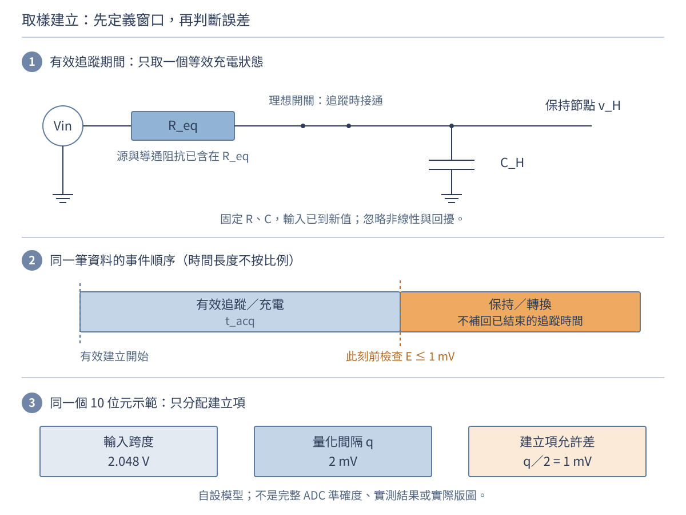

圖 2-3A　上圖是追蹤期間的單極點教學模型，不是完整 SAR 電路或版圖；理想開關只標示通斷，導通阻抗已含在 $R_{\mathrm{eq}}$ 中，不再重複相加。下圖為不按時間比例的事件示意：建立判據在追蹤結束前檢查，後面的保持／轉換不能回頭補足追蹤時間。未畫驅動器動態、參考電路及控制細節。

另設 $N=10$ 位元、輸入跨度 $V_{\mathrm{span}}=2.048\,\mathrm V$。沿第一章理想均勻量化的定義，間隔為 $q=V_{\mathrm{span}}/2^N=2\,\mathrm{mV}$；**本例只給建立項**半個間隔，即 $E_{\mathrm{allow}}=q/2=1\,\mathrm{mV}$。這是指定的誤差分配，不是宣布整個 ADC 的總誤差只有半個 LSB。

若有效追蹤開始時初始差為滿跨度 2.048 V，沿用剛推導的公式：

$$
E(t)=V_{\mathrm{span}}e^{-t/\tau},\qquad
\tau=R_{\mathrm{eq}}C_H,\qquad
t_{\min}=\tau\ln\frac{V_{\mathrm{span}}}{q/2}
=(N+1)\tau\ln2.
$$

最後一步用了 $q=V_{\mathrm{span}}/2^N$；對數內是同單位電壓的比值，仍無量綱。若實際初始差較小，應代入實際差與允許差的比，不必硬套滿跨度。ADI 的前端設計文章也以步階與允許建立差推算所需時間常數；本章數字、電路簡化與候選方案另行設計。[12]

取 $R_{\mathrm{eq}}=2.5\,\mathrm{k\Omega}$、$C_H=20\,\mathrm{pF}$，名目 $\tau=50\,\mathrm{ns}$，因此 $t_{\min}=50\ln2048\approx381.231\,\mathrm{ns}$。若最短實際有效追蹤窗是 $0.4\,\mathrm{\mu s}=400\,\mathrm{ns}$，殘差 $E=2.048e^{-8}\,\mathrm V\approx0.6870\,\mathrm{mV}$，名目模型通過 1 mV 建立判據。第 6.6 節會加入參數範圍，再決定這個窗是否足夠。

**先停一下。** 換成更多位元，但輸入跨度、初始差與 $R_{\mathrm{eq}}C_H$ 不變，仍將新量化間隔的一半分配給建立項，是否會更容易建立？不會；多一位元使允許建立差減半，所需時間增加 $\tau\ln2$。而建立差低於半 LSB，也不保證每次輸出碼與理想碼相同，因為接近碼邊界時，小偏差仍可能改變碼值。

### 3.4 模型假設要留在答案旁邊

上述 RC 解假設元件值固定、電源理想、連線延遲可忽略，且不含漏電和寄生電感。若電阻隨溫度明顯改變、電容隨偏壓改變，就應更新係數或求解非線性方程。局部近似也只適合足夠小的擾動。模型誤差與算術誤差是不同來源，兩者都要檢查。

所以本例的 $R$ 必須是實際模型中電容充放電所經的等效電阻；訊號源輸出電阻、接收端負載或量測探棒都可能改變它。額外負載也可能改變穩態終值，探棒還可能增加等效電容；應重新求等效電路，不能只替換 $R$ 卻沿用原本的終值。存在額外儲能或持續變化的輸入時，不能只因看到一顆電容，就認定整個系統只有這一個時間常數。更完整的電路求解留到第 4、5 章。

在取樣示範中，還省略了開關非線性、電荷注入、切換回擾、驅動器壓擺限制及多極點；若它們不可忽略，就不能把全部響應硬塞進同一個 $RC$。偏移、增益、雜訊、參考、非線性與保持期間誤差也未包含；這個時間式只回答一項建立要求。[12]

| 參數交接階段 | 需要保存什麼？ | 不能混同的證據 |
|---|---|---|
| 設計建模 | 節點邊界、激勵、初值、名目值、允許範圍及模型版本 | 題目給定值不等於實作保證 |
| 製造與實作 | 材料／幾何、適用製程模型，以及實作後須納入的寄生 | 版圖尺寸不等於製成尺寸；自設百分比不是通用製程能力 |
| 系統量測 | 相同偏壓、溫度、負載、探棒與時序條件下的資料 | 量到的等效響應不必只由原先那組 R、C 決定 |

這張表也說明為何要保留第一章的版本追溯：名目電路、寄生後模型與實測可能在回答不同條件。以上兩個 RC 教具不指定為片上元件，尤其不能由 100 nF 的題目值推論某個製程已能實現它。寄生與模型條件的設計檢查可對照 JKU 課程；探棒造成的負載則須納入實際量測配置。[13][16]

剛才的限制提醒我們，套用解之前要認清模型。接著換一個物理情境，看看「先交代初值，再從方程求終值與時間常數」的做法如何沿用。

### 3.5 同一種方程，也能描述簡化的升溫

熱系統也可能滿足 $C_{\mathrm{th}}dT/dt=P-(T-T_a)/R_{\mathrm{th}}$。它的時間常數是熱阻乘熱容；和 RC 電路形式相似，但儲存的是熱能。辨認共同方程，能將電路的解法移用到封裝升溫、感測器響應或控制系統，而不混淆各物理量。

在這個集總熱模型中，$C_{\mathrm{th}}$ 的單位是 J/K、$R_{\mathrm{th}}$ 是 K/W，乘積仍是秒。若環境溫度 $T_a$ 與功率 $P$ 固定，穩態升溫是 $PR_{\mathrm{th}}$；這些條件也和電路的「常值激勵」相呼應。

自設 $R_{\mathrm{th}}=20\,\mathrm{K/W}$、$C_{\mathrm{th}}=0.5\,\mathrm{J/K}$、$P=0.1\,\mathrm W$，且初溫等於環境，則時間常數 10 s、最終升溫 2 K，一個時間常數後升溫約 1.264 K。這只是單一熱節點模型，不是實際封裝內所有位置都同溫，也不是由單一數字就能證明散熱安全。

我們已會算一個狀態如何變化。若同時有兩個互相影響的節點，則還需要一種方式，把每個節點的限制一起保存，而不是只算其中一個。

## 4. 增加節點之後：聯立方程與矩陣

### 4.1 先寫每一條守恆式，再把係數排成表

先看一個只含理想電阻的直流例子，暫時移除時間變化。兩節點各經 $1\,\mathrm{k\Omega}$ 接地，節點間另接 $1\,\mathrm{k\Omega}$，每端有 $1\,\mathrm{mA}$ 從外部注入。以地端為零電位，未知電壓是 $V_1,V_2$。在這個集總穩態模型中，注入節點的電流必須等於經各支路流出的電流。

因此第一節點有 $V_1/(1\,\mathrm{k\Omega})+(V_1-V_2)/(1\,\mathrm{k\Omega})=1\,\mathrm{mA}$，第二節點則交換 1、2 的位置。令 $x=V_1/(1\,\mathrm V)$、$y=V_2/(1\,\mathrm V)$，兩式就成為無因次的 $2x-y=1$ 與 $-x+2y=1$。

矩陣寫法 $A\mathbf{x}=\mathbf{b}$ 把係數、未知量及外部激勵分開。以 $2x-y=1$、$-x+2y=1$ 為例，相加得 $x+y=2$，再代入可得 $x=y=1$。電路中的幾千個節點也遵循同樣邏輯，只是交由數值分解法處理；程式通常求解線性系統，而不先顯式求反矩陣。

圖 2-4　左圖每個電阻均為 1 kΩ，箭頭是外部注入電流的端口，不是完整電源接線圖。右圖的 $x,y$ 已用 1 V 正規化；矩陣中的一列對應一個節點，一欄對應一個未知量。地端提供共同電壓參考，沒有把兩個節點直接短接。

寫成矩陣是

$$
\begin{bmatrix}2&-1\\-1&2\end{bmatrix}
\begin{bmatrix}x\\y\end{bmatrix}
=
\begin{bmatrix}1\\1\end{bmatrix}.
$$

第一列「2 乘 x，再減 y」就是第一式，第二列同理；矩陣不是新的物理定律，而是守恆式的整理方法。若保留有單位的節點電壓，左側係數是電導矩陣：$\mathrm{mS}\times\mathrm V=\mathrm{mA}$，不能任意把單位丟掉。矩陣符號 $A$ 與前面面積 $A$ 也不是同一個物理量，依所在模型辨識。

代回 $x=y=1$，可得兩節點均為 1 V，每個對地電阻流 1 mA；節點間電位差為零，所以耦合電阻沒有電流。這個物理檢查比只看到計算器吐出兩個 1 更完整。

這組節點方程已有答案，也通過電流平衡的檢查。接著要問：這種順利求解的情況是否總會出現，輸入稍有變動時又會如何？

### 4.2 方程夠多，仍可能沒有可靠的唯一答案

方程數與未知數一樣多，不保證有唯一解。若兩條方程相同，它們只提供一個獨立限制；若互相矛盾，可能來自模型或量測錯誤。矩陣接近奇異時，小輸入誤差可能造成大輸出誤差，稱為條件不良。此時增加小數位顯示並不能補救缺少獨立資訊的問題。[MIT 18.06：線性代數](https://ocw.mit.edu/courses/18-06-linear-algebra-spring-2010/)

例如 $x+y=2$ 與 $2x+2y=4$ 是相容而相依的兩式，有無限多解；第二式若改成 $2x+2y=5$，則互相矛盾，沒有解。相依只說明限制重複，不能單靠這個詞判定一定有無限多解。[8]

**算例 D：有唯一解，也可能對小誤差非常敏感。** 考慮 $x+y=2$、$x+1.001y=2.001$，相減得 $0.001y=0.001$，所以 $x=y=1$。若第二式右側只改成 2.002，就變成 $y=2,x=0$。輸入改了約 0.05%，解卻明顯改變；這不是增加顯示小數位就能消除的問題。

這個例子是在固定表示尺度下比較輸入擾動。條件性描述問題對擾動有多敏感，演算法的捨入誤差則描述計算過程；兩者不同。對不同單位或尺度的未知量，還要合理縮放後再解讀敏感程度，不能只看到某個係數很小就斷定模型失敗。[9]

**停一下，先判斷。** 解代回方程後幾乎沒有差，是否足以證明輸入量測的精度已足夠？

**參考判讀。** 不足。代回檢查是否解對這組方程；條件不良時，輸入的小誤差仍可能造成解的大幅變動。數值求解的殘差與實際答案的不確定度不是同一件事。

矩陣能整理同時成立的關係，但量測儀器交來的通常是一列列時間戳與讀值。接著回到資料，看看連續的微分和積分，如何改成可以實作的近似。

## 5. 儀器只有離散樣本：差分與梯形累積

### 5.1 算例 E：用四筆電流估計電荷

以下是自設數據，不是實測。取樣時刻為 0、1、2、3 ms，電流分別為 0、2、2、0 mA。先假設相鄰樣本之間可用直線近似，每個區間的平均電流便是兩端平均；「平均高度乘寬度」就是梯形面積。一般式若共有 $M$ 個區間，就有 $M+1$ 筆樣本，$k$ 是從 0 開始的樣本索引：

$$
\Delta Q\approx\sum_{k=0}^{M-1}
\frac{i_k+i_{k+1}}{2}(t_{k+1}-t_k).
$$

| 區間 | 兩端平均電流 | 區間電荷 |
|---|---|---|
| 0–1 ms | 1 mA | 1 µC |
| 1–2 ms | 2 mA | 2 µC |
| 2–3 ms | 1 mA | 1 µC |
| 合計 | 不把不同區間電流直接當總電流 | 4 µC |

因為 $\mathrm{mA}\times\mathrm{ms}=10^{-6}\,\mathrm C=\mathrm{\mu C}$，這裡不是 4 mC。若這些電荷淨注入固定 $1\,\mathrm{\mu F}$ 電容且忽略漏電，電壓增加 4 V；仍須檢查實際驅動能否維持電流及元件允許電壓，本例不是可直接操作的充電指令。

圖 2-5　左圖藍點是給定樣本、連線是插值假設、橘色區域是梯形累積；4 µC 對這條分段線性插值精確，不表示已知樣本間真實波形。右圖為自設雜訊模型的計算值，與左圖不是同一組量測；須保留相鄰雜訊獨立、同標準差及已知時間間隔的條件。

有取樣點，不代表知道點與點之間發生的所有事情。狹窄尖峰可能落在兩筆樣本之間；若取樣間隔不等，也必須逐段使用各自的 $\Delta t$，不能固定乘一個平均間隔。平滑、插值與積分都應留下使用的方法及假設，才方便他人重算。

**停一下，先判斷。** 四筆樣本算出 4 µC，這是實際波形唯一可能的電荷嗎？

**參考判讀。** 不是。它對所選分段線性插值成立；樣本之間仍可能有未記錄的變化。應交代取樣和插值方法，再檢查儀器是否能捕捉關心的變化。

剛才把離散樣本累加成電荷；如果改用相鄰讀值估計變化率，又該如何分辨取樣近似與量測雜訊的影響？

### 5.2 差分近似會遇到兩種不同誤差

兩點差分 $\widehat{dv/dt}=(v_{k+1}-v_k)/\Delta t$ 是區間平均斜率；把它當某一時刻的瞬時導數時，會有離散近似誤差。如果讀值還含雜訊，減法也把兩個樣本的雜訊帶進來。縮小時間間隔可能減少平滑函數的近似誤差，卻同時放大讀值雜訊，兩件事並不矛盾。

令量測值為 $V_k=v_k+\eta_k$，相鄰樣本的雜訊獨立、標準差同為 $\sigma_v$，時間間隔視為精確已知，則差值的雜訊標準差為 $\sqrt2\,\sigma_v$，差分斜率的雜訊標準差為

$$
\sigma_{\mathrm{slope}}=\frac{\sqrt2\,\sigma_v}{\Delta t}.
$$

若 $\sigma_v=1\,\mathrm{mV}$，$\Delta t=100\,\mathrm{\mu s}$ 時約 14.14 V/s，改成 10 µs 則約 141.42 V/s。這些是標準差，不是每次誤差的固定值或最大值。若相鄰雜訊相關，必須保留協方差；若時戳也不準，還要加入時間的不確定度。上述關係由第 6 節的一階不確定度傳播式推得。[10]

積分也不是自動消除所有誤差的工具：固定電流偏移 $\delta i$ 維持時間 $T$，會累積成 $\delta Q=\delta iT$。因此導數估計要注意雜訊，累積量也要注意偏移、漂移及區間；不能只因曲線看起來平滑就說量測可靠。

把這個提醒帶回晶片介面：韌體紀錄的「開始讀取」時間戳，不一定就是內部取樣開關導通的時刻。要驗證第 3.3 節的建立窗，須先依資料表把控制事件對應到有效追蹤與保持。[11] 再檢查時基、觸發、觀測頻寬及探棒負載。[16] 若元件未提供內部保持節點的測試通道，就不能假設能直接取得其波形；依本模型的節點區分，外部腳位看起來平穩，也不能單獨證明內部已建立。

現在已經有一條能算、也能量的流程。最後一步是面對現實：元件尺寸、材料參數與讀值都不是完全固定，如何判斷小變動對結果影響多大？

## 6. 從理想值走向實際值：近似、靈敏度與驗證

### 6.1 先問「改哪一個量」，再談偏微分

多變數的小量變動可用偏微分處理。例如 $R=\rho L/A$ 在工作點附近滿足 $\Delta R/R\approx\Delta\rho/\rho+\Delta L/L-\Delta A/A$。這是一階近似；若變動很大，應回到原式。若求隨機誤差的標準差，還必須處理各變數的相關性，不能把最壞情況公差直接當成統計標準差相加。

偏微分的意思是：先只改其中一個變數，暫時固定其餘變數，觀察輸出在工作點附近的變化率。例如固定 $\rho,L$ 時，$\partial R/\partial A=-\rho L/A^2$；負號說明截面積增加會使電阻下降。這個幾何模型假設材料與截面可以用均勻等效值描述，奈米尺寸下材料與散射改變時，不能只更改幾何而忽略電阻率本身。

**從製成幾何走到電性。** 若均勻導體截面為寬 $w$ 乘厚 $h$，就有 $R=\rho L/(wh)$。另設 $\rho=3\times10^{-8}\,\Omega\mathrm m$、$L=100\,\mathrm{\mu m}$、$w=2\,\mathrm{\mu m}$、$h=0.2\,\mathrm{\mu m}$，算得 7.5 Ω。若只讓寬減少 5%、厚減少 10%，則精確比值是 $1/(0.95\times0.90)\approx1.16959$，電阻增加約 16.959%；一階估計的 +15% 只是近似。這是自設均勻導體，不是特定製程實測線，也不是前述取樣路徑全部的 $R_{\mathrm{eq}}$。材料與尺寸連到電阻的模型依據見 [13]；實際接觸、尺寸效應與寄生仍須另查。

**算例 F：近似好不好，要回精確式比較。** 固定 $\rho,L$，截面積由 $A_0$ 增加 2%，精確電阻比為 $R/R_0=1/1.02\approx0.980392$；一階式給 $1-0.02=0.98$。若以精確值作分母，相對誤差為 −0.04%。把面積改為增加 20%，精確比值為 $1/1.2\approx0.833333$，一階式為 0.8，相對誤差已是 −4%。

圖 2-6　藍線為精確模型，橘色虛線為同一工作點的一階近似；兩者均依公式計算。橫軸 $a=A/A_0>0$，固定 $\rho,L$，不是量測散點或所有材料的通用曲線。在此範圍內切線低估精確值；「誤差 4%」的分母是精確的 $R/R_0$，不是原電阻 $R_0$。

所以「變動很小」不是固定百分比門檻，而要相對於所允許的輸出誤差判斷。先估計可幫助找主要因素，但對接近規格邊界的結果，仍應回到原式或更合適的模型。

知道一階近似何時值得採用後，還要確認題目中的百分比是在描述實際變動、容許範圍，還是標準不確定度。

### 6.2 有號變動、公差上界與標準不確定度要分開

假設電阻率增加 1%、長度增加 2%、面積增加 3%，一階有號估計為 $1\%+2\%-3\%=0$。這描述同時發生的特定變動方向，不是「電阻沒有不確定度」。精確比值為 $1.01\times1.02/1.03\approx1.000194$，仍有約 +0.0194% 的改變。

若上述 1%、2%、3% 改成各參數的對稱容許界限，不知道方向時，一階最壞情況估計要把絕對影響相加，約 6%；這是近似界限，不是精確保證。若三個最不利端點可同時發生，本模型的精確最大比值是 $1.01\times1.02/0.97\approx1.06206$，即增加約 6.2062%，已稍大於 6% 的一階估計。

若三個百分比改成互不相關輸入量的**標準不確定度**，則一階相對標準不確定度為 $\sqrt{0.01^2+0.02^2+0.03^2}\approx3.742\%$。這不是最壞界限，也不是未加說明的通過機率；規格容許差不能直接當標準差使用。[10]

一般地，$y=f(x_1,\ldots,x_n)$ 的一階傳播式為

$$
u_c^2(y)\approx
\sum_i c_i^2u^2(x_i)
+2\sum_{i<j}c_i c_j\,\operatorname{cov}(x_i,x_j),
\qquad c_i=\frac{\partial f}{\partial x_i}.
$$

$u$ 表示標準不確定度，$c_i$ 是有正負號的靈敏度係數；協方差描述輸入如何共同變動。第一次讀只需掌握：**有關聯的輸入不能直接當成各自獨立**。例如已把面積寫成寬乘厚，就不能把面積、寬、厚再當三個獨立來源重複加入。[10]

**停一下，先判斷。** 資料只寫「誤差 1%」，能立刻決定直接相加或平方和開根號嗎？

**參考判讀。** 不能。先確認它是有號變動、容許界限還是標準不確定度，再確認輸入之間的關聯與採用的近似。運算方法由定義與模型決定，不由百分號決定。

**在 IC 設計裡也要先問：這份變動資料是什麼？** PVT 指製程、供電電壓與溫度；角落分析檢查模型指定的條件組合，局部隨機失配則描述不同元件實例之間的差異。兩者不能互相取代，如何組合須依 PDK 定義，避免漏算或重複計入。TT、SS、FF 等名稱不是機率，也不能直接翻譯成所有電阻／電容的固定百分比；最不利條件還取決於電路與被檢查的指標。[13][14]

| 手上的資料 | 可以先做的分析 | 不可直接推出 |
|---|---|---|
| 明定且相容的參數上下界 | 以單調性或範圍搜尋檢查允許組合 | 晶圓實際分布或通過率 |
| 適用 PDK 的角落／統計模型 | 按模型定義檢查性能與變異 | 所有未建模的版圖、環境與失效效應 |
| 含相關性的標準不確定度 | 使用靈敏度與協方差傳播 | 無條件最大誤差保證 |
| 實際樣品及儀器資料 | 在記錄條件下比較預測與觀察 | 未測條件下每顆晶片都相同 |

本章的容許百分比是題目條件，不是量測標準差。只有另行採用適當分布模型，才能由界限估計標準不確定度；例如對稱半寬 $a$ 在矩形分布假設下為 $a/\sqrt3$，不是看到「±」就一律除以 3。RSS 較小，也不代表可替代最壞界限。[15]

把這些區分帶回本章最初的讀值問題，接著看看電阻與電容的容許範圍該如何放進等待時間的計算。

### 6.3 回到讀值時間：參數容差也會改變等待需求

算例 C 的名目 $\tau=1\,\mathrm{ms}$。若電阻最多偏高 5%、電容最多偏高 10%，且這兩個上界可同時發生，最大時間常數為 $1.05\times1.10=1.155\,\mathrm{ms}$。要讓這個最慢的允許參數組合下，剩餘比例不超過 1%，需至少 $1.155\ln100\approx5.319\,\mathrm{ms}$，不是只等名目值的 4.605 ms。

若只等名目時間，這組最慢參數的剩餘比例約為 $e^{-4.60517/1.155}\approx1.855\%$。這說明精確代入名目值與滿足所有允許參數條件，是不同任務；此處仍只檢查 RC 建立誤差，沒有代替感測器校正、ADC 規格及整體誤差預算。

設計時也可以反過來問：可用等待時間已固定，允許的最大時間常數是多少？對 1% 剩餘差，必須有 $\tau_{\max}\le t_{\mathrm{available}}/\ln100$。5 ms 對應約 1.086 ms，小於目前 1.155 ms 的容差上界；6 ms 則對應約 1.303 ms。這讓計算從「驗算已有元件」變成「交給設計端的參數限制」。更改 R、C 時還要檢查驅動、負載與其他性能，不能只讓這條不等式通過。

等待時間算出來後，還要把單位、假設與適用範圍一起檢查，才能說清楚這個答案能回答什麼。

### 6.4 每一個答案都留下四行驗證

| 檢查 | 可以寫下的證據 | 本章例子 |
|---|---|---|
| 單位與方向 | 每一步單位相容，正負與參考方向一致 | mA × ms = µC；電流注入使電壓上升 |
| 初值、終值與極限 | 特殊情況回到可理解結果 | RC 在零時刻回到初值；等待很久接近源電壓 |
| 代回與守恆 | 解滿足原方程或累積收支 | 每個節點的電流平衡；增加電荷對應電壓變化 |
| 模型與資料界線 | 哪些條件未包含，什麼觀察會推翻它 | 額外慢尾巴、依幅度改變的時間常數或量測偏移 |

若實測建立曲線有兩段明顯不同的快慢，不必先懷疑對數算錯；可能是兩個儲能狀態、探棒負載或模型省略的效應。若一階近似偏差太大，也不是多留幾位小數就能補回二階項。工程數學的目的，是讓假設、計算與下一步驗證彼此對得上。

### 6.5 工程任務結案：5 ms 與 6 ms，如何選？

有了四項檢查，現在可以回到開章的選擇。仍用算例 C 的 $R=10\,\mathrm{k\Omega}$、$C=100\,\mathrm{nF}$、$V_s=3.3\,\mathrm V$、$v(0)=0$；只檢查 RC 建立項。1% 初終值差在本例是 33 mV，名目時間常數為 1 ms，可同時發生的最不利上界給出 1.155 ms。

先自行算出兩個等待策略的剩餘比例，再看下表。百分比均以初終值差為分母，電壓差取絕對值。

| 實際等待時間 | 名目模型的剩餘比例／電壓差 | 最慢允許模型的剩餘比例／電壓差 | 對建立差不超過 1% 的判斷 |
|---|---:|---:|---|
| 5 ms | 0.6738%／22.235 mV | 1.3181%／43.496 mV | 名目通過，不能涵蓋給定容差 |
| 6 ms | 0.2479%／8.180 mV | 0.5545%／18.299 mV | 在給定模型與容差條件下通過 |

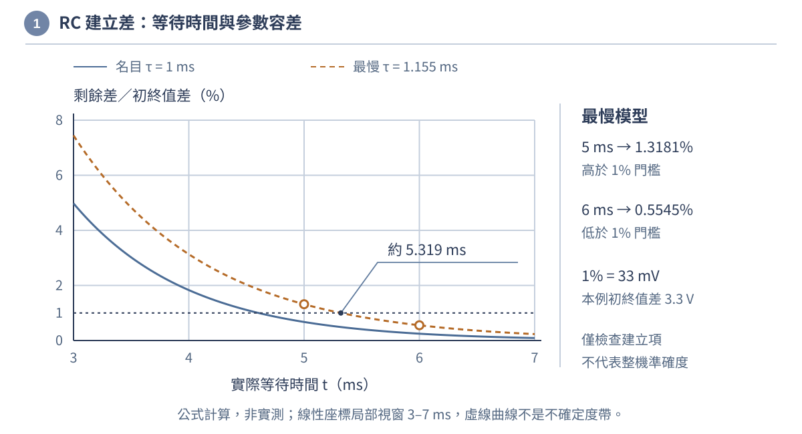

圖 2-7　兩個自設參數條件下的剩餘差 $100e^{-t/\tau}$，由公式計算，非實測。為看清門檻，時間軸只畫 3–7 ms，縱軸採線性 0–8%，不是完整充電曲線；虛線曲線不是不確定度帶。1% 只限制建立項，不能當成整個記錄器的準確度。

**方案選擇。** 6 ms 是這兩個候選中符合模型要求的選擇；最慢模型的時間下限為約 5.319 ms。這裡需要的是**實際等待時間**，而非程式中寫下的名目延遲。若時序有變動，應檢查最早讀值相對實際激勵切換的間隔是否仍足夠。

| 原型要補的證據 | 為什麼不能只用計算替代？ |
|---|---|
| 切換事件與讀值事件的共同時間基準 | 排程、通訊與觸發延遲可能讓實際等待不同於設定 |
| 電容節點的建立波形與終值判定 | 探棒負載、漏電或額外慢尾巴可能使單一 RC 模型失效 |
| 元件值、偏壓、溫度與量測不確定度紀錄 | 要確認測試涵蓋的參數範圍，以及接近門檻時如何判定 |
| 同一任務的新資料與完整電流紀錄 | 等待時間只是任務的一部分，轉換、儲存及其他耗電仍需檢查 |

**一頁判斷紀錄。** 寫明選擇 6 ms、採用最慢 $\tau=1.155\,\mathrm{ms}$、預測剩餘差約 18.299 mV，並列出上表尚未完成的量測。它與 33 mV 門檻之間的差距，不可直接當成儀器可用的標準差；還沒有建立完整誤差預算或允收規則。

本例是第一章「任務必須完成」的建模練習，不表示第一章的記錄器已選用這組 RC。若某實作真的需要至少約 5.319 ms 才能讀值，就不能假定從切換到讀值的全部流程都能塞進 2 ms；可以研究提早啟動或不同電源狀態，但必須重新畫時序、計算耗電並驗證資料有效性。每秒回報一次，也不代表每次可忽略讀值前的建立時間。

### 6.6 再交回晶片設計：取樣窗、參數界限與驗證紀錄

現在把同一種檢查帶回第 3.3 節的獨立取樣示範，不沿用剛才的毫秒級元件。10 位元、2.048 V 初始差、1 mV 建立門檻不變；名目 $R_{\mathrm{eq}}=2.5\,\mathrm{k\Omega}$、$C_H=20\,\mathrm{pF}$。另指定相容且可同時發生的上界 $R_{\max}=3.0\,\mathrm{k\Omega}$、$C_{\max}=22\,\mathrm{pF}$。它們不是統計標準差，也不是由角落名稱推得。

對正的 R、C，$\tau=RC$ 隨兩者增加，因此本模型最慢上界為 $\tau_{\max}=66\,\mathrm{ns}$，所需時間至少 $66\ln2048\approx503.225\,\mathrm{ns}$。表中的窗指**最短實際有效追蹤時間**，不是名目軟體設定。

| 參數情境 | 有效追蹤窗 | 剩餘建立差 | 對 1 mV 建立項的判斷 |
|---|---:|---:|---|
| 名目，50 ns 時間常數 | 400 ns | 0.6870 mV | 名目通過 |
| 可同時發生的最慢上界，66 ns | 400 ns | 4.7780 mV | 不通過 |
| 同一最慢上界，66 ns | 550 ns | 0.4923 mV | 給定模型與範圍內通過 |

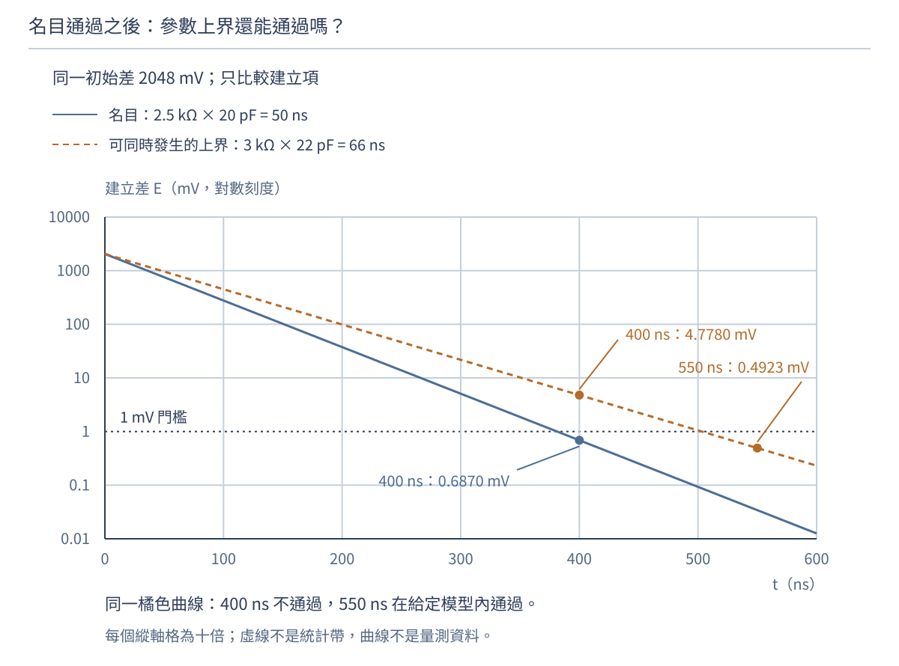

圖 2-8　兩條曲線為 $2048e^{-t/\tau}$ mV 的模型計算，不是量測或機率分布；橘虛線是可同時發生的最慢上界。縱軸採對數刻度，每格表示十倍，不可把格距讀成固定毫伏；1 mV 水平線只限制建立項。名目與最慢條件共用初始差及時間軸，三個標記對應上表。

**方案判斷與反推。** 若只能選 400 或 550 ns，應選能保證最短實際有效窗為 550 ns 的方案。不能把 503.225 ns 向下取成 500 ns；最慢模型在 500 ns 仍剩約 1.0501 mV。若介面只能提供 400 ns，則應要求

$$
\tau_{\max}\le\frac{400\,\mathrm{ns}}{\ln2048}
\approx52.462\,\mathrm{ns},\qquad
R_{\mathrm{eq,max}}\le\frac{400\,\mathrm{ns}}{22\,\mathrm{pF}\ln2048}
\approx2.385\,\mathrm{k\Omega}.
$$

這是帶回設計端的限制，不是已完成的修改。2.385 kΩ 是顯示用近似，真正檢查須使用未向上放寬的界限；選件與設計還應留出有依據的餘裕。降低等效電阻、調整負載或延長追蹤窗都可能改變功耗、雜訊、驅動與吞吐，必須回到完整介面要求。

| 交付紀錄 | 要留下的內容與下一步 |
|---|---|
| 規格與模型 | 初始差、1 mV 分配、R／C 邊界、版本、忽略效應；不把總 ADC 誤差算成此一項 |
| 條件與時序 | 上界相容性，追蹤開始／結束定義，最短可用窗及時序變動 |
| 模擬證據 | 名目與指定範圍內，追蹤結束前的殘差；必要時換成含寄生、開關與驅動器的模型 |
| 實體證據 | 可接觸的輸入／參考與控制事件、受控轉換結果、儀器負載及不確定度 |

不要假設可以把探棒直接接到內部保持電容；即使可探測，探棒也可能改變被測響應。[16] 從本章模型與量化定義還可看出：外部波形與有限位元輸出碼各有觀測限制，不能單憑一種資料就宣告任意小的內部誤差已被量出。本例交付的是可檢查的假設、限制與驗證計畫，尚不是 SPICE 結果、投片簽核、量產良率或整機驗收。

這便把數學接回第一章的介面責任：設計端提出條件與參數範圍，實作端保留適用模型，系統端確認真實事件與讀值。原來的 5／6 ms 任務和這個取樣任務，電路尺度不同，但都不能跳過「先定義誤差，再檢查可用時間」。

接下來把這四項檢查用在練習中，先寫出自己的計算與理由，再對照參考解答。若某題算得出數字卻說不清條件，就回到對應小節補齊模型，再繼續往下做。

## 練習與完整參考解答

**練習 1。** $2\ \mathrm{mA}$ 固定電流注入 $4\ \mathrm{nF}$ 電容達 $3\ \mathrm{\mu s}$，忽略漏電，電壓增加多少？

**解答。** 先求電荷 $\Delta Q=i\Delta t=6\times10^{-9}\ \mathrm{C}$，再求 $\Delta v=\Delta Q/C=1.5\ \mathrm{V}$。若初始電壓是 $0.4\ \mathrm{V}$，終值為 $1.9\ \mathrm{V}$；積分結果本身只是變化量。

**練習 2。** 解 $3x+y=7$、$x+2y=4$；若第二式改成 $6x+2y=14$，結果有何改變？

**解答。** 原第二式乘三減第一式得 $5y=5$，故 $y=1$、$x=2$；代回成立。修改後第二式只是第一式的兩倍，兩條限制線性相依，有無限多組解，須增加獨立條件才能唯一求解。

**練習 3。** 把 $5\times10^{15}\,\mathrm{cm^{-3}}$ 換成 $\mathrm{m^{-3}}$；把 $8\times10^{11}\,\mathrm{cm^{-2}}$ 換成 $\mathrm{m^{-2}}$。兩者能直接比較誰「摻得比較多」嗎？

**解答。** 分別為 $5\times10^{21}\,\mathrm{m^{-3}}$ 與 $8\times10^{15}\,\mathrm{m^{-2}}$。它們是體積濃度與面密度，物理量不同，沒有厚度或剖面等資訊不能直接比較。

**練習 4。** 一個面內均勻的剖面，在前 0.1 µm 濃度為 $10^{17}\,\mathrm{cm^{-3}}$，接著 0.1 µm 為 $3\times10^{17}\,\mathrm{cm^{-3}}$，其餘為零。求面劑量，並與算例 A 比較。

**解答。** 每段厚度為 $10^{-5}\,\mathrm{cm}$，故 $D=10^{17}\times10^{-5}+3\times10^{17}\times10^{-5}=4\times10^{12}\,\mathrm{cm^{-2}}$。面劑量與算例 A 相同，但深度分布不同；相同積分值不代表相同峰值、接面或電性。

**練習 5。** 沿算例 C，電容初值改成 1.0 V，源仍為 3.3 V、時間常數仍為 1 ms。1 ms 後的電壓是多少？「完成改變的 90%」時又是多少？

**解答。** $v(1\,\mathrm{ms})=3.3+(1.0-3.3)e^{-1}\approx2.454\,\mathrm V$。完成 90% 改變時為 $1.0+0.9(3.3-1.0)=3.07\,\mathrm V$，時間仍為 $2.303\,\mathrm{ms}$；不是直接取 $0.9\times3.3=2.97\,\mathrm V$。

**練習 6。** 若名目 $\tau=1\,\mathrm{ms}$，要求剩餘初始差不超過 0.1%，至少等多久？「等五個時間常數就一定夠」是否成立？

**解答。** $t\ge-\tau\ln0.001=6.908\,\mathrm{ms}$。五個時間常數仍剩 $e^{-5}\approx0.674\%$，大於 0.1%；是否足夠取決於誤差規格，且參數容差也要納入。

**練習 7。** 電流在 0、0.5、2 ms 的取樣值為 0、2、0 mA。用相鄰線性插值估計電荷；能否直接使用等間隔公式？

**解答。** 兩段平均電流均為 1 mA，但寬度分別為 0.5、1.5 ms，所以合計 $1\times0.5+1\times1.5=2\,\mathrm{\mu C}$。間隔不同，須逐段使用；若點間有未取到的尖峰，真實電荷仍可能不同。

**練習 8。** $x+y=2$、$2x+2y=5$ 有幾組解？能否因為兩式兩未知而直接求唯一解？

**解答。** 第一式乘二應得到 $2x+2y=4$，與第二式矛盾，因此無解。方程的獨立性與右側相容性都要檢查；改用更高精度計算不會讓 4 等於 5。

**練習 9。** 固定 $\rho,L$，截面積減少 10%。求精確與一階近似的 $R/R_0$，並以精確值為分母算近似的相對誤差。

**解答。** 精確為 $1/0.9=1.111111$，一階式為 $1-(-0.1)=1.1$，相對誤差 $(1.1-1.111111)/1.111111=-1\%$。電阻上升但近似低估；百分比的分母必須交代。

**練習 10。** 若電阻率、長度與面積的相對標準不確定度均為 1%，且彼此不相關，一階相對標準不確定度是多少？若改說每個參數的最大容許差均為 ±1%，能否用相同數字當最大界限？

**解答。** 不相關的標準不確定度為 $\sqrt3\times1\%\approx1.732\%$。最大容許差是不同概念：一階最壞估計約 3%；若各最不利端點可同時發生，精確最大比值 $1.01^2/0.99\approx1.030404$，即 +3.0404%。不能把平方和開根號當作無條件的最大誤差；若輸入相關，第一個答案也要改。

**練習 11。** 相鄰電壓樣本雜訊獨立、各有 0.5 mV 標準差，取樣間隔 50 µs。兩點差分斜率的雜訊標準差是多少？若兩點都含相同的固定 +2 mV 偏移，它是否也按這個公式相加？

**解答。** $\sqrt2(0.5\times10^{-3})/(50\times10^{-6})\approx14.14\,\mathrm{V/s}$。完全相同的固定偏移在兩點相減時抵消；它不是兩個獨立的隨機誤差。若偏移隨時間變化，或時間戳有不確定度，則需另建模。

**練習 12。** 已知電流量測有固定 +10 µA 偏移，積分 100 ms 後估計電荷會多多少？這能否藉由「積分會平滑」忽略？

**解答。** 多出 $\delta Q=10\,\mathrm{\mu A}\times0.1\,\mathrm s=1\,\mathrm{\mu C}$。平滑視覺或隨機雜訊平均不會自動消除固定偏移；須校正或將偏移納入不確定度。

**練習 13。** 沿第 3.3 節的取樣教具，把位元數改成 11，但跨度2.048 V、滿跨度初始差及時間常數50 ns不變，仍只分配半LSB給建立差。門檻與所需時間是多少？400 ns夠嗎？

**解答。** 量化間隔為1 mV，建立門檻為0.5 mV；所需時間 $50\ln4096\approx415.888\,\mathrm{ns}$，比10位元多 $50\ln2\approx34.657\,\mathrm{ns}$。400 ns時的殘差仍為0.6870 mV，故不能通過新的建立項要求。更多位元並沒有加快原電路，也不代表總準確度已提高。

**練習 14。** 沿第 6.6 節，若10位元案例只能保證400 ns有效追蹤窗、電容上界仍22 pF，如何反推等效電阻上界？把精確界限向上四捨五入後當硬限制是否安全？

**解答。** 先求 $\tau_{\max}\le400/\ln2048\approx52.4616\,\mathrm{ns}$，再除以22 pF，得到 $R_{\mathrm{eq,max}}\le2.38462\,\mathrm{k\Omega}$。這是整個指定充電路徑的等效值，不只是外接電阻。顯示為2.385 kΩ不能當作嚴格保證界限，向上放寬可能讓極限點超規；實際設計還要檢查模型及其他性能，不能僅換一顆電阻就宣告完成。

**練習 15。** 最慢時間常數66 ns的10位元案例，設定追蹤550 ns，但已知最短實際有效窗可能少50 ns。能沿用表中0.4923 mV宣告通過嗎？

**解答。** 不能。應用最短實際窗500 ns，殘差 $2048e^{-500/66}\approx1.0501\,\mathrm{mV}$，大於1 mV。因此這份設定無法保證要求，不表示每次轉換都失敗。需要調整時間或參數並驗證實際窗；保持／轉換時間不能補回已結束的追蹤。

**練習 16。** 某報告說：「R最多偏高20%、C最多偏高10%，做RSS後較小，所以400 ns可通過；外部腳位已穩定且一個PVT角落通過，因此整顆ADC保證準確。」指出至少三個問題，並寫出下一步證據。

**解答。** 第一，兩個百分比是容許上界，不是互不相關的標準不確定度，不能任意RSS。第二，本例可同時發生的66 ns模型在400 ns仍差4.7780 mV，超過建立門檻。第三，外部腳位不等於內部保持節點，一個角落也不代表全部指定條件、失配或未建模效應。第四，建立項不能取代其他ADC誤差。下一步應核對模型與版本、相容參數範圍和最短追蹤窗，補相關模擬，再依可觀測性設計帶儀器條件的量測；不虛構內部節點已被直接測到。

## 單元回顧與下一步

練習中的濃度換算、電荷累積與等待時間，看似是不同題型，卻都需要先定義量、選擇關係式，再檢查結果。以下把這些工具收回同一條解題路徑，而不把它們留成各自獨立的公式。

時間常數不是「完全充滿時間」：一個時間常數達約 $63.2\%$，五個達約 $99.33\%$。工程上的穩定時間須指定容許誤差。膜厚對時間的斜率是成長速率、靜態 I–V 曲線在工作點的斜率是小訊號電導、電路節點電壓則由矩陣求解。數學把量測、物理與設計接成一個可反覆檢驗的流程。

本章走過的是同一條工程流程：先定義量與單位，觀察變化與累積，再用守恆式預測讀值；當節點變多、資料離散或參數不確定時，分別加入矩陣、數值近似與靈敏度。沒有把所有數學問題化成同一個公式，但每個工具都知道自己回答哪個問題。

下一章轉向正弦訊號與複數相量，處理幅度、相位及交流阻抗；一般交流導納可能含虛部且隨頻率改變，不能只由靜態斜率決定。第 4、5 章再展開電路求解、暫態與濾波。此刻先確認自己能完整寫出一個小模型的假設、推導、答案與限制，再往後連接。

取樣示範還留下另一個設計取捨：若為了更快建立而改動 R、C，對持續變動訊號的幅度與相位又有什麼影響？第三章正是把「一次切換後等多久」轉向「不同頻率如何通過」的工具；它不是另起一組無關公式，也不把本章單極點教具當成所有訊號鏈的完整模型。

## 參考資料與延伸閱讀

以下保留原有 NIST、MIT 來源，另補已查讀的精準段落。圖解、數據及工程案例均為本教材另行設計；引用不代表原作者背書，也不宣稱已讀完所有課程或課本。

1. [NIST SP 330，Section 2](https://www.nist.gov/pml/special-publication-330/sp-330-section-2)：§2.1、§2.3.3，量、單位及無因次量。
2. [MIT 18.03，Spring 2010 講義入口](https://ocw.mit.edu/courses/18-03-differential-equations-spring-2010/pages/lecture-notes/)：保留原微分方程延伸閱讀入口；本章具體 RC 式另對照 [7]。
3. [MIT 18.06，Spring 2010](https://ocw.mit.edu/courses/18-06-linear-algebra-spring-2010/)：保留原線性代數課程入口；解的分類另對照 [8]。
4. [NIST SP 330，Section 3](https://www.nist.gov/pml/special-publication-330/sp-330-section-3)：SI 前綴表及含前綴單位的乘冪；表示量值的規則可延伸讀 [Section 5](https://www.nist.gov/pml/special-publication-330/sp-330-section-5) §5.2、§5.4.7。
5. [MIT 18.01，Lecture 1：Derivatives, Slope, Velocity, and Rate of Change](https://ocw.mit.edu/courses/18-01-single-variable-calculus-fall-2006/lec1.pdf)：印刷頁 1–2、6–7，差商、切線斜率與瞬時變化率。
6. [MIT 18.01，Lecture 19：First Fundamental Theorem of Calculus](https://ocw.mit.edu/courses/18-01-single-variable-calculus-fall-2006/817a2c46ddc23e2efda247a79ddeed34_lec19.pdf)：印刷頁 1–3，變化率的積分與淨變化；不是本章半導體剖面案例的原出處。
7. [Stanford ENGR 40M：Transient response of RC and RL circuits](https://web.stanford.edu/class/archive/engr/engr40m.1178/slides/transient.pdf)：Chuan-Zheng Lee，2017-07-26，PDF 頁 1–2 的 RC 初值、終值、時間常數與響應；本章僅用 RC 部分，不照搬所有電路的簡化求法。
8. [MIT 18.06SC：Solving Ax = b: row reduced form R](https://ocw.mit.edu/courses/18-06sc-linear-algebra-fall-2011/f5a74578196a8afc2fd2ba8581acb17f_MIT18_06SCF11_Ses1.8sum.pdf)：頁 1–3，解的相容性、一般解與秩。
9. [MIT 18.335J：Week 2，Lecture 5 — Condition Numbers](https://ocw.mit.edu/courses/18-335j-introduction-to-numerical-methods-spring-2019/pages/week-2/)：該講 Summary 的條件性與浮點誤差區分；本章不推導完整數值線性代數。
10. [NIST TN 1297：Appendix A，Law of Propagation of Uncertainty](https://www.nist.gov/pml/nist-technical-note-1297/nist-tn-1297-appendix-law-propagation-uncertainty)：A.1–A.5，尤其 A.3、式 A-3 的一階傳播與協方差；本章差分及電阻例由此自行推導。
11. [Microchip：ADC Acquisition Time](https://developerhelp.microchip.com/xwiki/bin/view/products/data-converters/adc-specs/acquisition-time/)：SAR取樣建立與Conversion Time段落；不採一般化源阻抗數字作所有元件的規則，實際時序依資料表。
12. [Alan Walsh／Analog Devices：Front-End Amplifier and RC Filter Design for a Precision SAR ADC](https://www.analog.com/en/resources/analog-dialogue/articles/front-end-amp-and-rc-filter-design.html)：Selecting a Suitable RC Filter及多工步階；原文PDF第1–3頁。半LSB推導與表中1-LSB條件不同，不混用；本章電路與數字另設。
13. [JKU：Design of Complex Integrated Circuits](https://iic-jku.github.io/design-complex-ic/dcic.html)：第4.3.2、10.1–10.3節，材料／幾何電阻、匹配、角落與寄生；不當成特定PDK操作或所有製程的容差規範。
14. [Cadence：Monte Carlo，Global／Local與Process／Mismatch](https://community.cadence.com/cadence_technology_forums/f/custom-ic-design/20466/monte-carlo-simulation-global-local-vs-local-and-process-vs-mismatch/1365107)：Andrew Beckett的Process、Mismatch、All與模型限制回覆；是官方工具說明，不取代所用PDK定義。
15. [NIST TN 1297 §4](https://www.nist.gov/pml/nist-technical-note-1297/nist-tn-1297-4-type-b-evaluation-standard-uncertainty)及[§5](https://www.nist.gov/pml/nist-technical-note-1297/nist-tn-1297-5-combined-standard-uncertainty)：§4.1–4.7、§5.1–5.2，界限、分布假設、標準不確定度與合成；連同[10]使用，不把RSS當無條件最大誤差。
16. [Tektronix：ABCs of Probes Primer](https://www.tek.com/en/documents/whitepaper/abcs-probes-primer)：§4–5的訊號源阻抗、負載與上升時間；不將10–90%上升時間等同半LSB建立時間，不假設內部保持節點可直接探測。

---

# 第 03 章　複數、相量與頻域

## 學習目標與先備知識

本章讓你能把正弦訊號轉成相量，使用複數阻抗解交流電路，區分峰值、有效值與平均功率，並閱讀振幅和相位響應。先備知識是三角函數、微分，以及第02章的單位觀念。全章採工程慣例 $j^2=-1$，避免與電流 $i$ 混淆。

第02章從「接上電源後要等多久」出發，練習把變化率、守恆與容差放進同一個模型。本章換一個問題：如果輸入不是只跳一次，而是不斷振盪，輸出會縮小多少、落後多少？我們仍以相同的 RC 拓撲，改看不同頻率的穩態反應。第02章算例 C 的 $RC=1\ \mathrm{ms}$；本章主例採 $RC=100\ \mathrm{\mu s}$，請勿把兩章數字混用。

第02章另有奈秒級 SAR 取樣案例，只在有效追蹤窗內使用簡化模型；它的開關會改變連接，不能直接當成永遠接通的線性時不變濾波器。本章先完成連續時間的幅相工具，再把它帶到兩個獨立產業問題：版圖寄生及探棒負載是否吃掉前端的幅相餘裕？封裝供電路徑在不同頻率下能否維持晶片端電壓？數值都是自設，並不是前兩章記錄器已選定的元件。

讀完後，不只要會按計算機，也要能交出下列可檢查的成果。

| 能力 | 本章檢核證據 |
|---|---|
| 把時間波形與相量互換 | 寫出頻率、峰值／有效值、相位基準與重建式 |
| 從物理定律建立阻抗 | 解釋正負虛部，而不只背誦三個式子 |
| 核對電壓、電流與功率 | 同時通過相量 KVL、單位及能量檢查 |
| 讀懂頻率響應 | 區分振幅比、功率比、相位與時間延遲 |
| 提出有限度的工程選擇 | 比較候選、容差角落、量測方法與尚缺證據 |
| 把前端幅相要求反推成寄生預算 | 第8.3.1節區分設計、寄生後與量測載入；練習13、14 |
| 將晶片電壓擾動要求轉成供電路徑阻抗 | 第8.3.2節用同頻RMS預算比較兩個電感；練習15、16 |

本章在產業流程中扮演「設計分析工具」：收到頻率、激勵、端點及幅相／電壓要求，交出可重算的模型、參數限制和驗證條件。它不取代完整類比IC、訊號完整性或電源完整性課程；先學會區分要傳遞的訊號和不希望出現的供電擾動，後續才有辦法選正確模型。

## 1. 先把「訊號要留下來」寫成規格

### 1.1 同一個電路，兩個頻率要求

假設感測前端在 $1\ \mathrm{kHz}$ 有需要保留的正弦分量，同時在 $10\ \mathrm{kHz}$ 有要壓低的干擾。先研究最簡單的串聯 RC：輸出取電容兩端，電阻固定 $R=1\ \mathrm{k\Omega}$，電容候選為 $47$、$100$、$220\ \mathrm{nF}$。這是自設教學案例，不是某產品的公開規格或實測結果。

| 需求編號 | 本次要判定的量 | 門檻與條件 |
|---|---|---|
| F01 | $1\ \mathrm{kHz}$ 的電壓振幅比 $|V_o/V_i|$ | 至少 $0.80$ |
| F02 | $10\ \mathrm{kHz}$ 的電壓振幅比 $|V_o/V_i|$ | 至多 $0.20$ |
| M01 | 初始計算模型 | 理想電壓源、理想 R/C、輸出沒有額外負載、正弦穩態 |
| T01 | 後續容差檢查 | $R$ 為標稱值的 $\pm5\%$，$C$ 為 $\pm10\%$，允許各自極端同時出現 |

這裡的「留下八成」是電壓振幅，不是功率，也沒有指定相位上限；若應用還在意波形形狀或控制迴路穩定性，就必須增加相應規格。只檢查兩個頻率點，也不能直接宣布整個通帶與阻帶都合格。

### 1.2 先約定符號，才開始計算

| 符號／慣例 | 本章意思 | 容易混淆之處 |
|---|---|---|
| $v(t),i(t)$ | 實際瞬時電壓、電流 | 可以為正或負，不等於振幅 |
| $V_p,I_p$ | 純正弦的非負峰值 | 不直接代入有效值功率式 |
| $\widetilde V,\widetilde I$ | 有效值相量 | 隱含指定的共同頻率 |
| $\omega=2\pi f$ | 角頻率，rad/s | 代入元件式不能漏掉 $2\pi$ |
| $e^{j\omega t}$ | 全章時間慣例 | 相位為正表示相對餘弦基準超前 |
| 被動符號慣例 | 電流流入標示為正的電壓端 | 負載吸收功率為正 |
| $H(j\omega)=\widetilde V_o/\widetilde V_i$ | 該頻率的複數電壓增益 | 大小與角度都要保留 |

目前還無法比較三顆電容，因為「振幅加上相位」需要兩個數字。接下來先把它們收進一個複數；這不是額外增加數學負擔，而是避免在每條電路方程重寫三角函數。

## 2. 複數先解決幾何，再解決運算

### 2.1 直角座標、極座標與象限

複數保留兩個互相垂直的分量。$z=a+jb$ 的大小為 $|z|=\sqrt{a^2+b^2}$，角度為 $\arg z=\operatorname{atan2}(b,a)$。必須用能判斷象限的方法求角度，因為只用 $\tan^{-1}(b/a)$ 會把第三象限誤當第一象限。直角形式適合加減，極座標形式 $|z|e^{j\phi}$ 適合乘除。

例如 $3+j4=5\angle53.13^\circ$，但 $-3-j4=5\angle(-126.87^\circ)$；兩者的 $b/a$ 同為 $4/3$，方向卻相反。角度可以加減整數倍的 $360^\circ$ 而不改變同一向量。零複數的大小是零，但角度沒有唯一意義。程式的 atan2 常回傳弧度，轉成度數要乘 $180/\pi$。[1]

圖 3-1　以相同座標尺度比較 $3+j4$ 與 $-3-j4$。橫、縱分量共同決定方向，不能只靠兩者的比值。這是數學幾何圖，座標不代表電路實體的位置。

### 2.2 共軛、乘除與不該相加的大小

複共軛把虛部反號：$z^*=a-jb$，因此 $zz^*=a^2+b^2=|z|^2$。這個關係讓複數除法可以回到實數分母。例如

$$
\frac{1}{1+jx}=\frac{1-jx}{1+x^2},\qquad x\in\mathbb R.
$$

乘法在極座標中是大小相乘、角度相加；除法是大小相除、角度相減，分母不得為零。加法則應先回到直角形式：$3+j4$ 的大小是 $5$，不是 $3+4=7$。除非兩個向量同方向，通常不能把大小直接相加當作和的大小。

**短判讀。** $1/(1+j)$ 的角度應是正還是負？因為取倒數要把角度反號，答案為 $-45^\circ$；直角形式 $(1-j)/2$ 也證實虛部為負。這正是稍後 RC 輸出落後的代數來源。

幾何與運算已齊備，但向量本身還不是電壓。下一節指定旋轉速度和取實部的方法，才把複數連回示波器上可見的波形。

## 3. 從時間波形到有效值相量

### 3.1 把共同的時間變化提出來

Euler 關係 $e^{j\theta}=\cos\theta+j\sin\theta$ 把正弦訊號寫成旋轉向量的實部。對 $v(t)=V_p\cos(\omega t+\phi)$，微分只需乘 $j\omega$，不用反覆展開三角恆等式。複數並不表示儀器會讀到「虛構電壓」，實際波形仍是實數。[MIT 18.03：複數與複指數](https://ocw.mit.edu/courses/18-03-differential-equations-spring-2010/pages/lecture-notes/)

更完整地說，令 $\widehat V=V_pe^{j\phi}$ 為峰值複振幅，則

$$
v(t)=\operatorname{Re}\{\widehat V e^{j\omega t}\},\qquad
\frac{dv}{dt}=\operatorname{Re}\{j\omega\widehat V e^{j\omega t}\}.
$$

微分對複振幅的作用是乘上 $j\omega$：大小乘 $\omega$，相位增加 $90^\circ$。真正的時間微分仍發生在 $e^{j\omega t}$；不是說一個不隨時間改變的相量常數，其普通微分不為零。MIT 的微分方程教材以複指數建立正弦特解，並另外處理齊次解；這也是穩態和暫態不能混為一談的原因。[2]

### 3.2 有效值相量如何重建波形

有效值（RMS）是把瞬時值平方、取平均後再開平方；本節先使用純正弦的「峰值除以根號二」，第5.1節再推導它與熱功率的關係。

本章以有效值定義相量：$\widetilde V=(V_p/\sqrt2)e^{j\phi}$，重建波形為 $v(t)=\sqrt2\operatorname{Re}\{\widetilde V e^{j\omega t}\}$。峰值相量也能使用，但平均功率公式會多一個 $1/2$。解題前寫明慣例，遠比事後猜測是否差一倍可靠。

例如 $\widetilde V=1\angle30^\circ\ \mathrm V$、$f=1\ \mathrm{kHz}$，代表

$$
v(t)=\sqrt2\cos(2\pi\,1000t+30^\circ)\ \mathrm V.
$$

其峰值為 $1.4142\ \mathrm V$，週期為 $1\ \mathrm{ms}$，且 $v(0)=\sqrt2\cos30^\circ=1.2247\ \mathrm V$。相對於同頻率零相位餘弦，波峰提前 $30^\circ/360^\circ$ 個週期，即 $83.33\ \mathrm{\mu s}$。相量長度為 $1\ \mathrm V$，圖中時間波形的峰值卻是 $\sqrt2\ \mathrm V$，這個差別必須明寫。

圖 3-2　左圖使用有效值相量，右圖使用瞬時電壓，不能把兩者的長度刻度直接等同。波形由明示公式計算；藍色訊號相對虛線基準超前 $30^\circ$，不是實測截圖。

### 3.3 哪些訊號可以共用一個相量

同頻率訊號相加時，共同的 $e^{j\omega t}$ 可以提出，所以相量能直接相加。例如 $3\sqrt2\cos\omega t+4\sqrt2\cos(\omega t+90^\circ)$ 對應 $3+j4=5\angle53.13^\circ$，合成波形的有效值為 $5$，不是 $7$。

若第二項變成 $4\sqrt2\cos(2\omega t)$，就沒有共同的旋轉速度，不能再用 $3+j4$ 表示整個波形。在整數個基頻週期內，這兩項的交叉積平均為零，因此總有效值仍可算為 $\sqrt{3^2+4^2}=5$；這是頻率分量的正交性，不是它們能合成同一相量。分頻疊加的原理見[7]；此例可自行用積化和差驗算 $T=2\pi/\omega$ 時，$T^{-1}\int_0^T\cos\omega t\cos2\omega t\,dt=0$。

我們現在能把「微分」轉成「乘 $j\omega$」。因此下一步不用憑空記住阻抗，而是把第02章已用過的元件定律逐一轉換。

## 4. 從元件定律建立阻抗模型

### 4.1 R、L、C 的相位從哪裡來

電阻滿足 $v=Ri$，所以 $Z_R=R$。電感滿足 $v=Ldi/dt$，故 $Z_L=j\omega L$；電容滿足 $i=Cdv/dt$，因此

$$
Z_C=\frac{1}{j\omega C}=-\frac{j}{\omega C}.
$$

電感的正虛部表示電壓超前電流，電容的負虛部表示電流超前電壓。負虛部不代表負電阻或產生能量；理想電抗元件只是週期性儲存與交還能量。阻抗單位為歐姆，導納 $Y=1/Z$ 的單位為西門子。[MIT 6.002：正弦穩態與阻抗模型](https://ocw.mit.edu/courses/6-002-circuits-and-electronics-spring-2007/pages/lecture-notes/)

| 理想元件 | 時間域定律 | 相量域阻抗，$\omega>0$ | 以電流作參考 |
|---|---|---|---|
| 電阻 | $v=Ri$ | $R$ | 電壓與電流同相 |
| 電感 | $v=L\,di/dt$ | $j\omega L$ | 電壓超前 $90^\circ$ |
| 電容 | $i=C\,dv/dt$ | $-j/(\omega C)$ | 電壓落後 $90^\circ$ |

以電容為例，$\widetilde I=j\omega C\widetilde V$，故電流先比電壓超前 $90^\circ$；反過來求 $Z=\widetilde V/\widetilde I$，角度就是 $-90^\circ$。若換用 $e^{-j\omega t}$，整套符號要一致改寫，不能只改其中一個元件。[3]

**算例 A：先檢查量級。** $L=10\ \mathrm{mH}$、$f=1\ \mathrm{kHz}$ 時，$Z_L=j62.83\ \Omega$；$C=100\ \mathrm{nF}$ 在同頻率時，$Z_C=-j1591.55\ \Omega$。兩者虛部不是同號，且相同頻率不代表阻抗大小接近。$\omega L$ 與 $1/(\omega C)$ 的單位都必須是 $\Omega$。

### 4.2 阻抗不是每一種情況都能直接代入

相量法描述線性、時不變系統的單頻正弦穩態，通常省略開機暫態。非線性元件若產生諧波，就需要小訊號線性化、諧波平衡或時間域分析。高頻下寄生效應會改變阻抗；電容未必永遠呈電容性，超過自諧振頻率可能呈電感性。

還要確認有界的正弦穩態確實存在，且暫態已衰減或已另行處理。理想無損 LC 在共振激勵下可能沒有有界穩態，不能把出現無限大或零分母的相量結果當作可量測的有限電壓。對非線性元件，小訊號線性化只適用於指定工作點附近、振幅足夠小的擾動；大幅切換不能直接套同一個線性模型。

**先看實體元件的模型會在哪裡失效。** 若忽略漏電與介電吸收，僅以串聯電容、等效串聯電阻 ESR 及等效串聯電感 ESL 表示一顆電容，則 $Z=R_{\mathrm{ESR}}+j[\omega L_{\mathrm{ESL}}-1/(\omega C)]$。在這個模型內，自諧振頻率 $f_{\mathrm{SR}}=1/(2\pi\sqrt{L_{\mathrm{ESL}}C})$ 讓虛部相消，阻抗大小仍為正的ESR；超過該頻率後呈感性。這不是說所有真電容都能用一組固定RLC涵蓋任意頻帶，安裝與回流幾何也會改變有效電感。後面討論晶片供電時，便不能只用「電容量較大」推斷高頻阻抗一定較小。[12][14]

$\omega=0$ 的直流需另看穩態與初始條件：理想電容在直流穩態不持續導通，理想電感的穩態壓降為零；這不代表剛接電時可以忽略電容原有電壓或電感原有電流。導納適合並聯相加，阻抗適合串聯相加，但「串聯／並聯」必須先由真正的節點連接判斷，不能只看圖形排在一起。

### 4.3 虛部和儲能，實部和損耗

理想電感儲能 $W_L=Li^2/2$，理想電容儲能 $W_C=Cv^2/2$。瞬時功率可以一段時間流入、一段時間流出；完整週期平均為零，不表示每個時刻都沒有能量交換。真實電感的繞線電阻、電容的介電損耗或等效串聯電阻，會讓平均損耗不再為零。

因此，光知道阻抗的角度還不足以選電源或導線。下一節把剛才的電壓、電流相量轉成能量與負擔，釐清「電流很大但平均做功不多」如何同時成立。

## 5. 有效值、平均功率與複功率

### 5.1 為什麼先平方，再平均

有效值定義為一個週期內平方平均的平方根。對純正弦波，它等於峰值除以 $\sqrt2$；對方波、脈衝或有直流偏壓的訊號，不能直接套這個比例。負載平均功率是瞬時功率 $v(t)i(t)$ 的平均，和電壓平均值乘電流平均值通常不同。

對週期為 $T$ 的實數電壓，定義

$$
V_{\mathrm{rms}}=\sqrt{\frac1T\int_{t_0}^{t_0+T}v^2(t)\,dt},\qquad
P=\frac1T\int_{t_0}^{t_0+T}v(t)i(t)\,dt.
$$

純電阻的平均熱功率為 $V_{\mathrm{rms}}^2/R$，因此 RMS 是與熱效應直接相連的量。對正弦波，$\cos^2$ 的週期平均為 $1/2$，才得到 $V_p/\sqrt2$；以零為中心、峰值為 $V_p$ 的理想方波，平方後恆為 $V_p^2$，故 RMS 等於 $V_p$。

**算例 B：直流加交流。** $v(t)=2+\sqrt2\cos\omega t\ \mathrm V$ 加在 $1\ \mathrm{k\Omega}$ 電阻上。平方展開後，交叉項平均為零，故 $V_{\mathrm{rms}}=\sqrt{4+1}=\sqrt5\ \mathrm V$，平均功率為 $5\ \mathrm{mW}$。其中直流貢獻 $4\ \mathrm{mW}$，交流貢獻 $1\ \mathrm{mW}$。若儀器能正確量測此頻率的正弦有效值，且 AC 耦合對該交流分量的衰減可忽略，則顯示約 $1\ \mathrm V$，而不是包含直流的總 RMS。

### 5.2 相位差如何留下平均功率

令電壓和電流相位差 $\phi=\phi_v-\phi_i$。用 $\cos A\cos B=[\cos(A-B)+\cos(A+B)]/2$ 展開，可得

$$
p(t)=V_{\mathrm{rms}}I_{\mathrm{rms}}
\left[\cos\phi+\cos(2\omega t+\phi_v+\phi_i)\right].
$$

第二項在完整週期的平均為零，第一項留下 $P=VI\cos\phi$。共軛正好負責取相位差，因此可把有功與無功放進同一個複數。[5]

以有效值相量，複功率為

$$
S=\widetilde V\widetilde I^{*}=P+jQ,\qquad P=V_{\mathrm{rms}}I_{\mathrm{rms}}\cos\phi.
$$

$P$ 是有功功率，單位 W；$Q$ 是無功功率，單位 var；$|S|$ 是視在功率，單位 VA。星號表示複共軛，使相位差成為電壓角度減電流角度。在被動符號慣例下，正 $P$ 表示負載吸收平均能量。理想電容與電感的 $P=0$，但仍可能讓電源和導線承受很大的有效值電流。

同時有 $Q=V_{\mathrm{rms}}I_{\mathrm{rms}}\sin\phi$，在此正弦條件下 $|S|=\sqrt{P^2+Q^2}$。感性負載電流落後，$Q>0$；容性負載電流超前，$Q<0$。把電流參考方向反轉卻不改電壓符號，會改變功率符號，不能再用原本的「吸收」敘述。

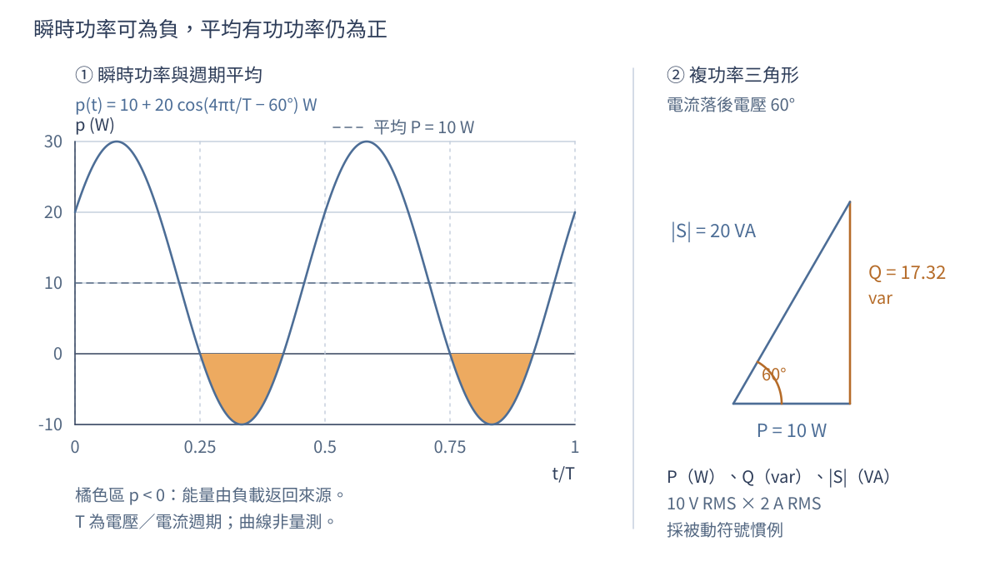

圖 3-3　自設 $10\ \mathrm{V_{rms}}$、$2\ \mathrm{A_{rms}}$、電流落後 $60^\circ$ 的計算圖。瞬時功率從 $-10$ 到 $30\ \mathrm W$，平均為 $10\ \mathrm W$；負值區間代表能量交還。右圖是複功率幾何，不是把 var 當成每秒淨耗能。

### 5.3 工程上為什麼不能只看瓦數

此例 $|S|=20\ \mathrm{VA}$，功率因數 $P/|S|=0.5$。即使平均負載功率只有 $10\ \mathrm W$，供電路徑仍需承受 $2\ \mathrm{A_{rms}}$；有電阻的導線會產生 $I_{\mathrm{rms}}^2R_{\mathrm{wire}}$ 損耗。單憑低瓦數不能判定導線、電源容量與溫升必然足夠。

對畸變波形，總功率因數仍可定義成 $P/(V_{\mathrm{rms}}I_{\mathrm{rms}})$，但通常不能只用單一相位角的餘弦表示；各諧波與量測定義需要分別處理。本章的 $S=P+jQ$ 相量運算限於共同頻率的正弦狀態，不把它擴充成未定義的全波形無功算法。

晶片供電也會遇到類似區別：路徑電阻決定一部分平均發熱，路徑電感則會讓電流變動伴隨電壓變動。即使平均損耗很小，晶片端的交流電壓擾動仍可能超規。第8.3.2節會用同一組RMS和阻抗工具算這件事，不把邏輯切換電流簡化成只有平均值。

有了幅相與能量的雙重檢查，現在回到開章電路。下一節以開章的 $100\ \mathrm{nF}$ 候選，驗算 $1\ \mathrm{kHz}$ 時的電流、元件電壓與功率，讓各工具在同一問題會合。

## 6. 逐步例題：串聯 RC 的交流電流與輸出

### 6.1 先解100 nF候選，再檢查物理方向

$1\ \mathrm{V_{rms}}$、$1\ \mathrm{kHz}$ 電源驅動 $1\ \mathrm{k\Omega}$ 與 $100\ \mathrm{nF}$ 串聯。求電流和電阻消耗功率。

以電源為相位參考，$\widetilde V_s=1\angle0^\circ\ \mathrm V$；電流由電源經電阻流向電容，兩個被動元件採壓降正方向。

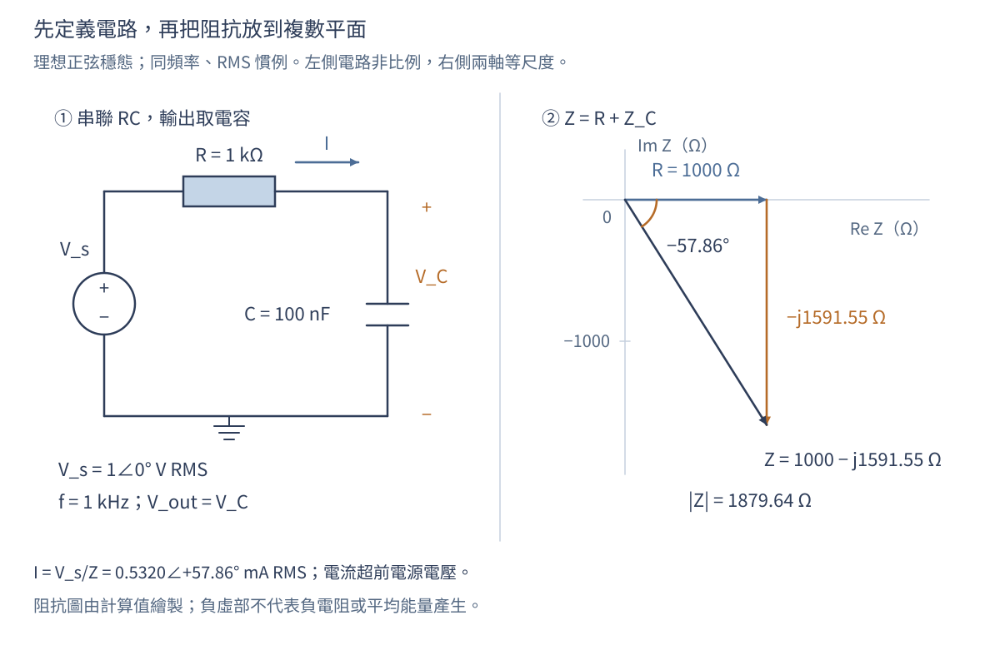

圖 3-4　左圖定義本例題的端點、電流與元件；右圖將 $R$ 與 $-X_C$ 相加。阻抗平面的刻度是 $\Omega$，不是電壓或電流。電路布局為示意，元件不按實體大小繪製。

1. $\omega=2\pi(1000)=6283\ \mathrm{rad/s}$，$X_C=1/(\omega C)=1591.55\ \Omega$。
2. 總阻抗 $Z=1000-j1591.55\ \Omega$，大小 $1879.64\ \Omega$，相位 $-57.86^\circ$。
3. $\widetilde I=1/Z=0.5320\angle57.86^\circ\ \mathrm{mA}$；電流超前電源電壓，與電容性負載一致。
4. $P=I_{\mathrm{rms}}^2R=0.2830\ \mathrm{mW}$。也可用 $VI\cos57.86^\circ$ 驗算。電流峰值為 $0.7524\ \mathrm{mA}$，不應再拿峰值直接代入 $I^2R$ 求平均功率。

先看方向再看小數：總阻抗虛部為負，電流角度為正，與電流超前電壓一致。若算成 $-57.86^\circ$，最先查倒數的角度符號；若電流大到安培量級，先查 $\mathrm{nF}$ 和 $\mathrm{k\Omega}$ 的換算。

### 6.2 電壓必須用向量相加

把電流寫成直角形式：

$$
\widetilde I=(0.283043+j0.450477)\ \mathrm{mA}.
$$

因此 $\widetilde V_R=(0.283043+j0.450477)\ \mathrm V=0.532018\angle57.858^\circ\ \mathrm V$；而

$$
\widetilde V_C=(0.716957-j0.450477)\ \mathrm V
=0.846733\angle(-32.142^\circ)\ \mathrm V.
$$

兩者相加為 $1+j0\ \mathrm V$，符合電壓迴路定律。可是大小相加為 $0.532018+0.846733=1.378751\ \mathrm V$，不等於電源的 $1\ \mathrm V$；差異不是能量不守恆，而是把不同方向向量錯當成同一直線長度。

圖 3-5　電壓相量首尾相接。橘色電容電壓從藍色電阻電壓的終點出發；向量可以平移，方向和大小不變。合向量在實軸上，不能把兩個幅值直接相加。

功率也可獨立驗算：電源供給此負載的複功率為 $\widetilde V_s\widetilde I^*=(0.283043-j0.450477)\ \mathrm{mVA}$。實部和電阻耗散一致，負無功則和電容性負載一致。理想電容吸收的平均功率為零，不應把 $0.450477$ 當成另一項熱損耗。

### 6.3 從一組輸出，整理出對所有頻率的公式

相量電路仍可使用節點法和分壓法。例如串聯 RC、輸出取電容時，$H(j\omega)=1/(1+j\omega RC)$。頻率低時電容阻抗大，輸出接近輸入；頻率高時電容阻抗小，輸出被壓低。這個物理檢查應在算數字以前完成。

分壓式的推導是 $\widetilde V_C/\widetilde V_s=Z_C/(R+Z_C)$，分子分母同乘 $j\omega C$ 後得到 $1/(1+j\omega RC)$。令 $x=\omega RC$，用第2節的共軛技巧即可拆成

$$
H(j\omega)=\frac{1-jx}{1+x^2},\quad
|H|=\frac1{\sqrt{1+x^2}},\quad
\arg H=-\tan^{-1}x,\qquad x\ge0.
$$

電流超前電源 $57.858^\circ$，但輸出電容電壓落後電源 $32.142^\circ$，兩者並不矛盾：電容電壓還比電流落後 $90^\circ$。寫「電路相位」太含糊，應寫出比較的兩個量。

單一頻率已驗算完畢，現在只要改變 $x=\omega RC$，便能追蹤不同頻率的輸出。下一節用這個無因次量建立頻率響應，再回到三顆電容的選擇。

## 7. 把單頻算例展開成頻率響應

### 7.1 截止頻率、分貝與相位各回答什麼

改變輸入頻率，每次計算增益與相位，就得到頻率響應。分貝振幅增益為 $20\log_{10}|H|$；功率比則使用 $10\log_{10}(P_o/P_i)$。若兩端阻抗不同，電壓比的20倍對數不能直接解讀成傳輸功率增益，必須先把電壓換算為功率。

令 $\omega RC=1$，得到 $f_c=1/(2\pi RC)$。對這個無負載一階低通，$|H(f_c)|=1/\sqrt2$，電壓增益為 $-3.0103\ \mathrm{dB}$，相位為 $-45^\circ$。本章 $R=1\ \mathrm{k\Omega}$、$C=100\ \mathrm{nF}$ 的 $f_c=1591.55\ \mathrm{Hz}$。這是相對低頻電壓增益的截止定義；不能不看端點阻抗就說電源輸入功率有一半送到電容。[4][6]

| 無因次頻率 $x=f/f_c$ | $|H|$ | $20\log_{10}|H|$ | 相位 |
|---|---:|---:|---:|
| $0.1$ | $0.995037$ | $-0.0432\ \mathrm{dB}$ | $-5.7106^\circ$ |
| $1$ | $0.707107$ | $-3.0103\ \mathrm{dB}$ | $-45^\circ$ |
| $10$ | $0.099504$ | $-20.0432\ \mathrm{dB}$ | $-84.2894^\circ$ |

當 $x\gg1$，$|H|\approx1/x$，頻率乘十約多衰減 $20\ \mathrm{dB}$；這是高頻漸近趨勢，不是全頻段都恰好符合的直線。對純電阻端點 $R_i,R_o$，以兩端有效值大小計算，功率比為 $(V_{o,\mathrm{rms}}/V_{i,\mathrm{rms}})^2R_i/R_o=|H|^2R_i/R_o$，因此功率增益須在電壓增益 $20\log_{10}|H|$ 上再加 $10\log_{10}(R_i/R_o)$。[6]

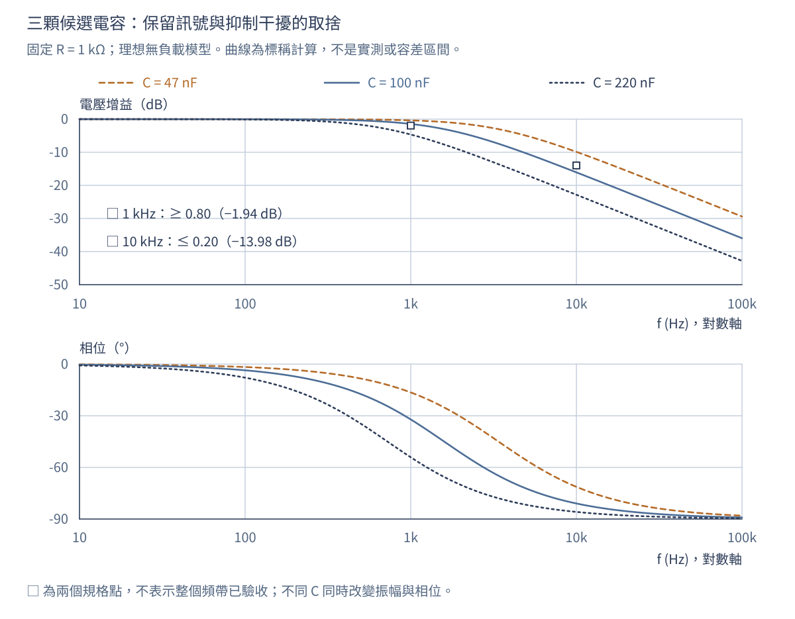

圖 3-6　固定 $R=1\ \mathrm{k\Omega}$，比較 $C=47/100/220\ \mathrm{nF}$ 的理想無負載模型。上圖是電壓增益 dB，下圖是相位；線型與標籤共同區分候選。規格符號只代表 $1$ 和 $10\ \mathrm{kHz}$ 的兩點要求，曲線不是實測，也未包含容差區間。

### 7.2 相位落後不一定是整個波形延後

相位不能只看正負號。$-90^\circ$ 代表在所採時間慣例下落後四分之一週期；將 $-180^\circ$ 顯示成 $180^\circ$ 只是角度包覆。多頻率訊號可在線性、時不變系統的穩態響應中分解，分別乘各自的 $H(j\omega)$ 再相加，但不能把所有頻率塞進同一個相量。

採 $e^{j\omega t}$，令該頻率的輸出相對輸入之相位差為 $\phi_H=\arg H=\arg\widetilde V_o-\arg\widetilde V_i$，其等效相位延遲可寫成

$$
\tau_\phi(\omega)=-\frac{\phi_H(\omega)}{\omega}.
$$

這裡 $\phi_H$ 必須用弧度，而且僅由單頻相位只能決定到整數個週期的歧義。以 $100\ \mathrm{nF}$ 案例，$1\ \mathrm{kHz}$ 的 $-32.142^\circ$ 對應約 $89.28\ \mathrm{\mu s}$；$10\ \mathrm{kHz}$ 的 $-80.957^\circ$ 卻對應約 $22.49\ \mathrm{\mu s}$。兩個分量沒有共同的時間位移，不能把整個寬頻輸入簡稱為「延遲 $89.28\ \mathrm{\mu s}$」。

若希望一個頻帶內的波形近似不失真地平移，需要該頻帶增益近似固定，且相位近似 $\phi_H=-\omega\tau$。進一步描述窄頻包絡時會用群延遲 $\tau_g=-d\phi_H/d\omega$，需對連續展開的相位微分；它與 $\tau_\phi$ 不必相同。只有群延遲平坦，也不能補救明顯的幅度失真。[8]

### 7.3 多頻率逐項處理，不是選一個代表頻率

**算例 C：想留下來的訊號和干擾。** 令輸入為

$$
v_i(t)=\sqrt2\cos(2\pi\,1000t)+0.2\sqrt2\cos(2\pi\,10000t)\ \mathrm V.
$$

前者為 $1\ \mathrm{V_{rms}}$，後者為 $0.2\ \mathrm{V_{rms}}$。對 $100\ \mathrm{nF}$ 案例，穩態輸出為

$$
v_o(t)=0.846733\sqrt2\cos(2\pi\,1000t-32.142^\circ)
+0.0314353\sqrt2\cos(2\pi\,10000t-80.957^\circ)\ \mathrm V.
$$

干擾振幅變小，但有用訊號也被衰減且移相。輸出兩項有效值的比為約 $0.03713$，不能把 $|H(10\ \mathrm{kHz})|=0.15718$ 誤稱為輸出總干擾比例，因為還要納入輸入比例和有用訊號的增益。任意多頻率不一定有共同有限週期；本例頻率是整數倍，才方便用 $1\ \mathrm{ms}$ 的整數倍視窗計算週期平均。[7]

現在已知如何同時閱讀振幅與相位。最後一節把曲線壓縮成可簽名核對的方案表，並檢查元件偏差和量測接法會不會推翻結論。

## 8. 從標稱解答走向工程判斷

### 8.1 先比較候選，再檢查最不利角落

| 電容候選 | $|H(1\ \mathrm{kHz})|$ | $|H(10\ \mathrm{kHz})|$ | 標稱判定 |
|---|---:|---:|---|
| $47\ \mathrm{nF}$ | $0.95906$ | $0.32074$ | F01通過；F02不通過 |
| $100\ \mathrm{nF}$ | $0.84673$ | $0.15718$ | 兩點均通過 |
| $220\ \mathrm{nF}$ | $0.58613$ | $0.07215$ | F01不通過；F02通過 |

電容變大，對所有非零頻率的衰減都變強；不是越大就越好。令 $\tau=RC$，直接把兩個門檻代入 $|H|$，也可得到可行區間：

$$
\frac{\sqrt{0.20^{-2}-1}}{2\pi\,10000}\le\tau
\le\frac{\sqrt{0.80^{-2}-1}}{2\pi\,1000},
$$

也就是 $77.97\le\tau/(\mathrm{\mu s})\le119.37$。三個標稱值分別為 $47$、$100$、$220\ \mathrm{\mu s}$，只有中間候選落在區間內。

對 $100\ \mathrm{nF}$ 候選，容差給出 $\tau_{\min}=(100\ \mathrm{\mu s})(0.95)(0.90)=85.5\ \mathrm{\mu s}$，$\tau_{\max}=(100\ \mathrm{\mu s})(1.05)(1.10)=115.5\ \mathrm{\mu s}$。固定頻率下，$|H|$ 隨 $\tau$ 增加而下降，所以：

| 需求 | 最不利角落 | 計算結果 | 與門檻的關係 |
|---|---|---:|---|
| F01，保留訊號 | $\tau_{\max}$ | $|H(1\ \mathrm{kHz})|=0.80934$ | 仍高於 $0.80$ |
| F02，壓低干擾 | $\tau_{\min}$ | $|H(10\ \mathrm{kHz})|=0.18300$ | 仍低於 $0.20$ |

這是參數有界且角落允許同時發生的最不利分析，不是常態分布、蒙地卡羅良率或 $95\%$ 信賴區間。此模型下可以選 $100\ \mathrm{nF}$ 進入量測；但 F01 留給模型外效應的餘裕只有約 $0.00934$，還不能宣布實體產品驗收通過。

### 8.2 源阻抗、負載與量測基準要一起畫出來

圖 3-7　上圖為本章標稱模型；下圖加入訊號源電阻 $R_s$ 與負載 $R_L$。$V_s$ 是源內部理想電壓，$V_i$ 是實際輸入端，$V_o$ 是輸出端。示波器探棒也可能加入電阻與電容負載；「高輸入阻抗」不等於全頻率完全不影響電路。

若負載可先近似為純電阻，令 $Z_p=(1/R_L+j\omega C)^{-1}$，則

$$
\frac{\widetilde V_o}{\widetilde V_s}=\frac{Z_p}{R_s+R+Z_p},
\qquad
\frac{\widetilde V_o}{\widetilde V_i}=\frac{Z_p}{R+Z_p}.
$$

兩個增益的分母不同。訊號源面板設定不一定等於負載實際得到的電壓，因此宜量取實際輸入、輸出端點，不先把面板值當成 $\widetilde V_i$。輸出探棒的電容可在簡化模型中和 $C$ 並聯；輸入端探棒、接線寄生或頻率相依的源阻抗，則需把其實際接法納入模型，不能一概只加在輸出。

### 8.3 量測是檢查模型，不是把數字填進答案

| 工作 | 要記錄的證據 | 判讀重點 |
|---|---|---|
| 定義測試 | 頻率、輸入振幅、R/C實測值、接地與端點 | 是否仍在假設範圍，是否改變待測電路 |
| 取得穩態 | 等待與擷取視窗、週期數 | 不把啟動暫態混入振幅與相位 |
| 同時量兩端 | $V_{i,\mathrm{rms}}$、$V_{o,\mathrm{rms}}$、相位差 | 同一頻率、同一振幅慣例、相同時間基準 |
| 查量測鏈 | 探棒倍率、輸入阻抗、頻寬、通道時延 | 確認量到的是電路，而非通道差異 |
| 對照規格 | F01/F02結果及不確定度 | 門檻附近應定義決策規則，不只看顯示末位 |
| 留存異常 | 原始波形與接法、重測條件 | 不能只刪除不符合預期的點 |

**判讀活動：只改電容能解釋嗎？** 假設同一頻率量到 $|H|=0.81$、相位 $-10^\circ$，量測誤差小到不足以解釋下列差距。對本章理想單極、低頻增益為1的 RC 模型，$\phi=-\tan^{-1}x$，所以必有 $|H|=\cos\phi$。$-10^\circ$ 預測的大小應為 $0.98481$，不是 $0.81$；反過來，$0.81$ 預測相位約 $-35.90^\circ$。只改 $\tau$ 不能同時吻合兩者。

下一步不是立即宣布元件壞了，而是檢查源／負載造成的低頻增益、量測基準、通道時延與額外極點，再增加頻率點辨識原因。一個不符合的點能否定這個理想模型與誤差假設的組合，卻不能唯一指出哪個元件故障。

上述檢查不只適用於實驗桌上的RC。下面把「端點、模型、幅相與證據」帶到兩個半導體設計交接；兩案互相獨立，也不沿用F01/F02的千赫茲電容。

#### 8.3.1 產業案例一：從幅相規格反推寄生電容預算

第一章已說明版圖連接相同不代表性能相同。現在以一個固定偏壓附近的連續時間類比節點，算出寄生負載如何影響性能。把驅動端暫時表示成理想小訊號電壓源 $\widetilde V_s$ 與固定串聯電阻 $R_s=2\,\mathrm{k\Omega}$；輸出節點對共同交流參考的原有電容為 $C_0=20\,\mathrm{pF}$。這是指定的簡化等效，不是聲稱所有晶片驅動器的輸出阻抗都為2 kΩ或與頻率無關。

另設兩種狀態：實作後同節點多了 $C_{\mathrm{par}}=5\,\mathrm{pF}$；量測可接觸的測試節點時，再接上等效輸入電容 $C_p=10\,\mathrm{pF}$ 的探棒。此例忽略探棒電阻、接地電感及驅動器其他動態，且三個電容確實跨在同一對交流節點，才可寫成 $C_\Sigma=C_0+C_{\mathrm{par}}+C_p$。耦合到其他活動節點的電容不能照此直接相加，也不預設每個內部節點都能接探棒。寄生後分析與探棒負載的概念分別見[9]、[10]；本例電容值另行指定。

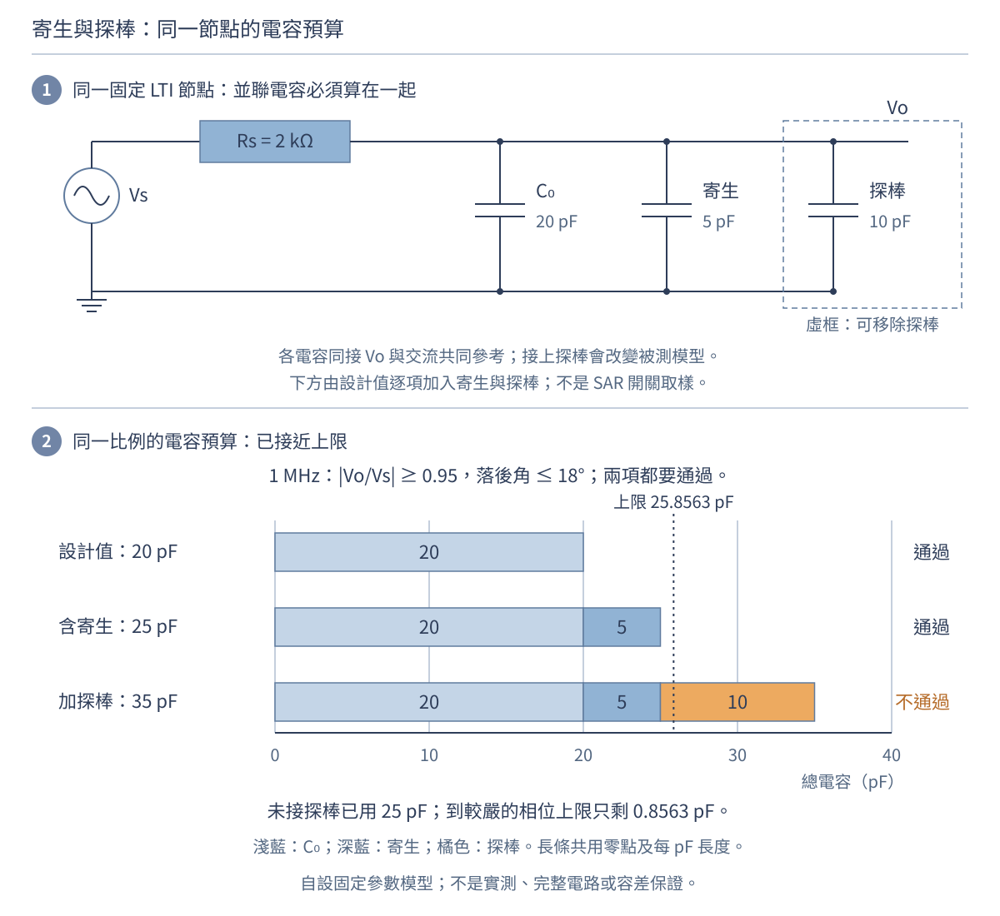

圖 3-8　同節點的負載電容才可合併；20、25、35 pF是三個不同配置，不是製程分布。圖中的上限由本例的1 MHz相位要求反推，預算條共用比例；探棒加入後改變被測電路。這不是SAR取樣開關圖、實際版圖或量測證據。

本例要求在1 MHz，源到該節點的振幅比至少0.95、相位落後不超過18°。依同一分壓推導，有 $H=\widetilde V_o/\widetilde V_s=1/(1+j\omega R_sC_\Sigma)$。因此，設計、寄生後及量測載入的結果分別為：

| 配置 | 總電容／時間常數 | 1 MHz振幅比／相位 | 10 MHz振幅比 | 對1 MHz兩項要求的判斷 |
|---|---:|---:|---:|---|
| 簡化設計模型 | 20 pF／40 ns | 0.96984／−14.1078° | 0.36970 | 通過此模型判據 |
| 加入同節點寄生 | 25 pF／50 ns | 0.95403／−17.4406° | 0.30331 | 仍通過，但餘裕變小 |
| 再接上探棒 | 35 pF／70 ns | 0.91537／−23.7410° | 0.22171 | 測試配置不通過 |

10 MHz欄沒有另設通過門檻，只用來觀察取捨：電容增加會壓低該分量，卻也讓1 MHz的有用訊號衰減更多、落後更多。不能只看到高頻變小就宣布設計改善，也不能把「有衰減」直接等同已滿足取樣防混疊需求。

設計者還可從要求反推允許的負載，而不等到畫完版圖才看曲線：

$$
C_\Sigma\le\frac{\sqrt{0.95^{-2}-1}}{2\pi(1\,\mathrm{MHz})R_s}
\approx26.15585\,\mathrm{pF},\qquad
C_\Sigma\le\frac{\tan18^\circ}{2\pi(1\,\mathrm{MHz})R_s}
\approx25.85629\,\mathrm{pF}.
$$

兩者須同時成立，相位條件較嚴。相對原20 pF，新增同節點電容預算約5.85629 pF；若已用5 pF，剩約0.85629 pF，不能再把10 pF探棒當成沒有影響。顯示的小數是近似，檢查界限應用未取整式；這裡尚未納入 $R_s$、元件與寄生的允許範圍，不能把剩餘量宣稱為已保證的製造或量測餘裕。

**與第二章建立時間的連接。** 對本例這個連接始終不變、源在步階後保持常值的單極點模型，以非零初始差為基準，剩餘差降至其1%的建立時間仍為 $t_{1\%}=R_sC_\Sigma\ln100$；三個配置依序約184.207、230.259及322.362 ns。若初始已達終值，就沒有這項建立等待。較低的截止頻率伴隨較長建立時間，來自同一個時間常數；這項對應不能直接延伸到拓撲週期切換的完整SAR前端。[11]可延伸閱讀實際取樣前端中頻寬與建立的取捨，不能拿其切換負載或產品條件替代本例固定拓撲。

可交付給下一位工程師的是「在指定偏壓、端點與 $R_s$ 模型下，總負載不得大於兩個界限中較小者」，連同適用頻帶與未知項；額外設計餘裕須另行分配。實作後應以適用的寄生模型及條件範圍重新分析；量測則須保存探棒與接地配置，必要時使用較低負載的可觀測方式。拿到0.91537的讀值，首先應核對測試配置，不是立刻要求製造端修改製程。

#### 8.3.2 產業案例二：封裝供電不能只看直流電阻

剛才希望輸入訊號能傳到輸出；這個案例則希望負載電流變動不要讓晶片供電變動太大。先定義一個獨立的單頻小訊號模型：理想供電源的交流分量為零，供電至負載的完整去回路徑以 $R=20\,\mathrm{m\Omega}$ 與等效迴路電感 $L$ 串聯表示，負載的正弦電流擾動有效值為 $I_{\mathrm{ac,rms}}=0.1\,\mathrm A$。比較 $L=1$ 與 $0.5\,\mathrm{nH}$，不是比較兩個特定封裝產品。

將路徑電流方向定為源流向負載，路徑壓降為 $\widetilde V_{\mathrm{drop}}=Z_{\mathrm{path}}\widetilde I$；因源的交流電壓固定為零，負載端電壓擾動則為 $\widetilde v_{\mathrm{rail}}=-Z_{\mathrm{path}}\widetilde I$。兩者大小相同，角度相差180°，不能一邊寫壓降的相位、一邊當成晶片供電的相位。

自設要求為：**每次所檢查的單一正弦分量**造成的負載端電壓擾動不超過 $5\,\mathrm{mV_{rms}}$。由此得

$$
Z_{\mathrm{path}}=R+j\omega L,\qquad
|Z_{\mathrm{path}}|=\sqrt{R^2+(\omega L)^2},\qquad
|Z_{\mathrm{path}}|\le Z_{\mathrm{budget}}
=\frac{5\,\mathrm{mV_{rms}}}{0.1\,\mathrm{A_{rms}}}
=50\,\mathrm{m\Omega}.
$$

這裡分子、分母都採同一頻率的RMS；分母不是整顆晶片的平均直流電流。電壓除電流轉成阻抗的預算方法，可用來追蹤設計限制，但真實產品仍須先分配穩壓誤差、直流壓降、交流擾動及其他容許差，不能把本例50 mΩ當通用業界標準。[12][13]的產品方法以其指定的擾動／步階電流及容許差定義預算，並不等同本文自行設定的單頻RMS判據。

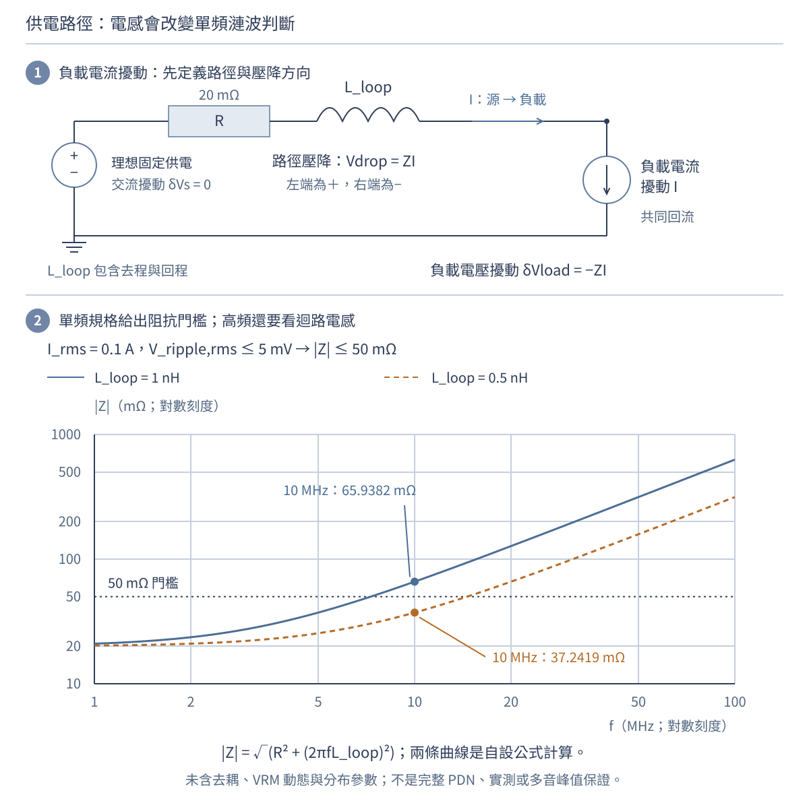

圖 3-9　電感代表所選去回迴路的等效值，不只是畫面上單獨一根導線。雙對數曲線依給定串聯RL計算，1–100 MHz僅是教學掃描範圍，不證明真實封裝在全段均適用集總模型。50 mΩ線只對本例單頻RMS預算成立；沒有畫去耦電容、穩壓器動態或分布參數網路。

| 頻率 | 1 nH：阻抗／電壓擾動RMS | 0.5 nH：阻抗／電壓擾動RMS | 本例判斷 |
|---|---:|---:|---|
| 1 MHz | 20.9637 mΩ／2.0964 mV | 20.2452 mΩ／2.0245 mV | 兩者通過 |
| 10 MHz | 65.9382 mΩ／6.5938 mV | 37.2419 mΩ／3.7242 mV | 只有0.5 nH通過 |
| 100 MHz | 628.6368 mΩ／62.8637 mV | 314.7952 mΩ／31.4795 mV | 兩者不通過 |

同樣的20 mΩ直流電阻，無法告訴你哪個候選能通過10 MHz。兩案在相同0.1 A交流有效值下，電阻的這一項平均損耗都是 $I_{\mathrm{ac,rms}}^2R=0.2\,\mathrm{mW}$，卻有不同電壓擾動；此數值也未包含直流電流造成的熱損耗。這正是第5節所說的「低瓦數不代表所有電氣要求都滿足」。

若只問10 MHz這個判據，還可反推

$$
L\le\frac{\sqrt{Z_{\mathrm{budget}}^2-R^2}}{2\pi f}
=\frac{\sqrt{(0.050\,\Omega)^2-(0.020\,\Omega)^2}}{2\pi(10\,\mathrm{MHz})}
\approx0.72934\,\mathrm{nH}.
$$

這個式子需 $Z_{\mathrm{budget}}\gt R$ 才有正的電感預算；如果光電阻已超過門檻，降低電感也救不了此模型。不能把100 MHz不通過解讀成「加任意大電容就一定好」：第4.2節的ESR／ESL、安裝迴路和多支路共振都可能重要。真實電源分配網路（PDN）還包含穩壓器、板、封裝、晶粒內供電與去耦，需明確指定觀察端口、回流參考與工作狀態。[12][14]

| 設計交付 | 此例能提供 | 仍要補的證據 |
|---|---|---|
| 類比前端 | 指定模型下的總電容上限、幅相與建立時間 | 偏壓／製程／溫度範圍、寄生後模型與性能 |
| 封裝／供電路徑 | 指定單頻電流下的阻抗及等效L限制 | 完整去回幾何、端口模型、去耦與穩壓器條件 |
| 系統量測 | 要比較的端點、頻率、RMS定義與配置 | 探棒負載、校正、時基、頻寬及不確定度 |

**先停一下。** 若兩個不同頻率各自都低於5 mV RMS，能保證合成波形任何時刻都小於5 mV嗎？不能；單頻預算不是多音峰值保證。要按各頻率的複數響應重建波形；正交條件下可合成均方值，但峰值還與相位有關，練習16會算出具體差別。

### 8.4 本章決策與下一章的入口

本次可提交的結論是：「在 M01 與 T01 的假設內，$100\ \mathrm{nF}$ 候選滿足 F01/F02；應量取實際輸入輸出與相位，確認源、負載及量測不確定度是否耗盡餘裕。」這句話同時交代選擇、依據和限制，比單寫「答案是100 nF」完整。

新增兩案也遵守相同交付方式：前端例交出帶端點／偏壓條件的電容限制；供電例交出帶頻率／電流定義的阻抗限制。它們是設計分析與下一步驗證的輸入，不是實際寄生提取、投片簽核或封裝資格認證。原F01/F02案例的選擇仍保留，三份任務不混用參數。

到了真正多節點網路，分壓法不一定夠用，但本章的 $Z_R,Z_L,Z_C$ 不必重學。第04章將用節點法、迴路法及等效電路，把這些阻抗放進可系統求解的網路；第05章再把暫態與濾波規格放回同一幅圖。

## 練習與完整參考解答

先自行解題，再用單位、極限、符號及守恆逐項驗算。練習1、2保留原題；3–12依序補上表示法、能量、頻率與工程判斷。

練習13–16接續兩個產業案例，檢查寄生預算、觀測造成的改變、封裝電感限制及多頻率證據。

**練習1。** $z_1=3+j4$、$z_2=1-j2$，求和與乘積。

**解答。** 和為 $4+j2$。乘積展開為 $3-j6+j4-8j^2=11-j2$。$|z_1|=5$、$|z_2|=\sqrt5$，乘積大小應為 $5\sqrt5$；$\sqrt{11^2+(-2)^2}=\sqrt{125}$ 相符。

**練習2。** 正弦電壓為 $10\ \mathrm{V_{rms}}$，電流 $2\ \mathrm{A_{rms}}$ 並落後 $60^\circ$。求有功、無功及視在功率。

**解答。** $P=10(2)\cos60^\circ=10\ \mathrm{W}$；$Q=20\sin60^\circ=17.32\ \mathrm{var}$，為感性正值；$|S|=20\ \mathrm{VA}$。驗算 $P^2+Q^2=|S|^2$。功率因數為0.5，並不表示電壓只剩一半。

**練習3。** 將 $-3-j4$ 化為極座標，並求其共軛與倒數。

**解答。** 大小為 $5$，角度為 $-126.870^\circ$，也可寫 $233.130^\circ$。共軛是 $-3+j4$；倒數為 $(-3+j4)/25=-0.12+j0.16=0.2\angle126.870^\circ$。乘回原數應得1。若用普通反正切得到 $53.130^\circ$，即漏判第三象限。

**練習4。** $\widetilde V=1\angle30^\circ\ \mathrm V$、$f=1\ \mathrm{kHz}$，寫出時間波形、$v(0)$、峰值與相對零相位餘弦的波峰提前量。

**解答。** $v(t)=\sqrt2\cos(2\pi1000t+30^\circ)\ \mathrm V$；$v(0)=1.224745\ \mathrm V$，峰值 $1.414214\ \mathrm V$。週期1 ms，波峰提前 $(30/360)(1\ \mathrm{ms})=83.333\ \mathrm{\mu s}$。這是同頻率參考間的比較，不表示訊號超越因果性。

**練習5。** 比較 $3\sqrt2\cos\omega t+4\sqrt2\cos(\omega t+90^\circ)$ 與 $3\sqrt2\cos\omega t+4\sqrt2\cos2\omega t$。各自 RMS 為何？能否都用 $5\angle53.13^\circ$ 表示？

**解答。** 第一式同頻，可用相量 $3+j4=5\angle53.13^\circ$，RMS為5。第二式在完整基頻週期內兩頻率正交，均方值 $9+16=25$，RMS同為5；但不是單一正弦，不能用該相量表示。RMS相同不代表時間波形相同。

**練習6。** $f=1\ \mathrm{kHz}$ 時，$L=10\ \mathrm{mH}$ 與 $C=100\ \mathrm{nF}$ 的阻抗各為何？若分別接上 $1\angle0^\circ\ \mathrm{V_{rms}}$，電流相位如何？

**解答。** $\omega=6283.185\ \mathrm{rad/s}$，$Z_L=j62.8319\ \Omega$、$Z_C=-j1591.549\ \Omega$。電感電流為 $15.9155\angle(-90^\circ)\ \mathrm{mA}$；電容電流為 $0.628319\angle90^\circ\ \mathrm{mA}$。兩元件是分別接電源，不是先串接；理想元件平均功率皆零，但 RMS電流不為零。

**練習7。** $v(t)=2+\sqrt2\cos\omega t\ \mathrm V$ 驅動 $1\ \mathrm{k\Omega}$，求總 RMS、平均功率及 AC耦合 RMS讀值；為何不能用電壓平均值計算全部熱功率？

**解答。** $v^2=4+4\sqrt2\cos\omega t+2\cos^2\omega t$，平均為5，故總 RMS為 $\sqrt5=2.236068\ \mathrm V$、功率5 mW。理想AC耦合只保留交流，RMS為1 V。平均電壓為2 V，只算 $2^2/R$ 會得到4 mW，漏掉交流的1 mW。

**練習8。** 重算第6節的 $\widetilde V_R$、$\widetilde V_C$ 與負載複功率，並列出兩項獨立驗算。

**解答。** $\widetilde I=(0.283043+j0.450477)\ \mathrm{mA}$。乘 $R$ 得 $\widetilde V_R=0.283043+j0.450477\ \mathrm V$；乘 $Z_C$ 得 $\widetilde V_C=0.716957-j0.450477\ \mathrm V$。第一項驗算是兩電壓相加為 $1+j0\ \mathrm V$。第二項是 $S=\widetilde V_s\widetilde I^*=0.283043-j0.450477\ \mathrm{mVA}$ 的實部等於 $I_{\mathrm{rms}}^2R=0.283043\ \mathrm{mW}$，且負無功符合容性負載。

**練習9。** 某兩個純電阻端點，電壓 RMS比 $V_o/V_i=2$，$R_i=50\ \Omega$、$R_o=200\ \Omega$。電壓增益與功率比各為多少 dB？

**解答。** 電壓增益為 $20\log_{10}2=6.0206\ \mathrm{dB}$；功率比為 $4(50/200)=1$，所以功率比為 $0\ \mathrm{dB}$。電壓放大不必然代表同數值的功率增益。題目只描述兩個純電阻端點的電壓與耗散比，不主張這是一個無源電壓放大器。

**練習10。** $1\ \mathrm{kHz}$ 的相位差為 $-30^\circ$，求等效相位延遲。若另一頻率的延遲不同，還能否把整個波形說成固定延後？

**解答。** $\tau_\phi=-(-\pi/6)/(2\pi1000)=83.333\ \mathrm{\mu s}$，單頻相位仍有整數倍1 ms的歧義。若頻帶內各頻率不對應共同的線性相位，不能宣稱整體固定平移；還須檢查振幅在該頻帶是否近似固定，才能討論近似無失真。

**練習11。** 對開章三顆候選電容完成標稱篩選，再檢查 $R\pm5\%$、$C\pm10\%$ 下的 $100\ \mathrm{nF}$。列出最不利方向與驗收限制。

**解答。** 代入 $|H|=[1+(2\pi fRC)^2]^{-1/2}$，三顆在1 kHz分別為 $0.95906/0.84673/0.58613$，在10 kHz為 $0.32074/0.15718/0.07215$；僅100 nF標稱兩點通過。其 $\tau$ 範圍為85.5–115.5 μs。F01取最大 $\tau$，最小增益 $0.80934\ge0.80$；F02取最小 $\tau$，最大增益 $0.18300\le0.20$。這只是理想無負載模型加上指定參數界限的通過，不包含源阻抗、探棒、寄生、溫漂及量測不確定度，也不是良率估計。

**練習12。** 已知量測誤差不足以解釋差距，$|H|=0.81$、$\arg H=-10^\circ$ 能否只調整理想 RC 的 $\tau$ 同時吻合？提出下一個有辨識力的測試。

**解答。** 理想單極、低頻增益1的模型滿足 $|H|=\cos\phi$；相位 $-10^\circ$ 應對應 $0.984808$，而大小0.81應對應約 $-35.90^\circ$。因此單改 $\tau$ 不足。可同時量取實際輸入輸出，先測低頻增益是否接近1，再掃描多個頻率的幅相，並交換或校正量測通道檢查通道差異。這些測試用來區分負載分壓、額外動態和量測偏差，不是直接把偏差歸罪於電容。

**練習13。** 沿第8.3.1節，固定 $R_s=2\,\mathrm{k\Omega}$，要求1 MHz振幅比至少0.95且相位落後不超過18°。哪個條件限制較嚴？原20 pF加上5 pF後，還能直接再接10 pF探棒並沿用原通過結論嗎？

**解答。** 振幅條件給 $C_\Sigma\le26.15585\,\mathrm{pF}$，相位條件給 $C_\Sigma\le25.85629\,\mathrm{pF}$，後者較嚴。25 pF狀態只剩約0.85629 pF，加入10 pF變35 pF，幅相約0.91537／−23.7410°，兩項都不通過。數字為顯示近似，嚴格界限須使用原式；此例尚未給製程或溫度範圍，不能將差額當成完整可靠裕量。

**練習14。** 同一類比節點，未接探棒的模型為25 pF，接探棒後為35 pF。有人測得約0.915的1 MHz振幅比，據此認定未接探棒的產品也一定不合格。推論缺少什麼？若剩餘差要降至非零初始差的1%，兩個配置的建立時間又差多少？

**解答。** 測試改變了負載，量到的不是原25 pF模型；應記錄端點與探棒條件、比較含負載模型，必要時採較低負載且可實現的觀測方式，不能直接宣告原產品合格或不合格。固定拓撲下，兩個時間常數為50與70 ns，1%建立時間分別 $50\ln100\approx230.259\,\mathrm{ns}$、$70\ln100\approx322.362\,\mathrm{ns}$，相差約92.103 ns。這不是內部SAR取樣窗或任何探棒的通用校正量。

**練習15。** 沿第8.3.2節，在10 MHz要求0.1 A RMS負載擾動造成的電壓不超過5 mV RMS，路徑電阻20 mΩ。求L上限，判斷0.5 nH是否通過；如果電阻本身為60 mΩ，單把L減成零能通過嗎？

**解答。** 阻抗預算為50 mΩ，因此 $L\le\sqrt{0.05^2-0.02^2}/(2\pi10^7)\approx0.72934\,\mathrm{nH}$。0.5 nH在10 MHz給37.2419 mΩ及3.7242 mV RMS，在指定模型內通過。若R為60 mΩ，即使L=0仍造成6 mV RMS，不通過。相同公式不能把負的根號硬當成可用電感值；所有界限均限於這個頻率及模型。

**練習16。** 採0.5 nH、20 mΩ路徑。若負載同時含1 MHz及10 MHz、各0.1 A RMS的正弦擾動，兩個電壓分量各自低於5 mV RMS，能否宣告任何瞬間都不超過5 mV？請區分總RMS與峰值上界。

**解答。** 在此線性模型的穩態，兩個電壓有效值約2.02452及3.72419 mV；在整數個1 µs共同週期上，正交性給總RMS約 $\sqrt{2.02452^2+3.72419^2}=4.239\,\mathrm{mV}$。但峰值可用 $\sqrt2(2.02452+3.72419)\approx8.130\,\mathrm{mV}$ 作上界，實際峰值仍取決於相位，不能把這個上界當成必然出現的值。原本每個分量的5 mV RMS判據不保證新提出的5 mV瞬時峰值；需取得相位並重建波形，也不能把平均直流電流代入各頻率的分母。

## 常見誤解與工程連結

相量角度是相對參考，不是時間本身；在本章時間慣例下，等效相位延遲為相位的負值除以角頻率（弧度／rad·s⁻¹），而且需注意整週期歧義。有效值也不是所有波形都等於峰值除以根號二。阻抗量測、射頻匹配、電源功率因數與晶片交流小訊號分析，都依賴同一組數學工具。

本章的自我檢查順序可以濃縮成六問：頻率相同嗎？峰值與RMS一致嗎？角度的參考相同嗎？元件模型有效嗎？向量及功率能守恆嗎？規格與量測是否比較同一端點？這六問將跟著我們進入第04章，從簡單分壓走向完整電路網路。

## 參考資料與延伸閱讀

以下資料支持物理與數學原理；本章工程需求、數值案例、表格、原七張向量圖及新增兩張圖解另行設計。不同教材可能使用峰值相量、$i$ 作虛數符號或正的「落後角」；本文已統一成有效值、$j$ 與 $e^{j\omega t}$，不能直接混接公式。

1. MIT 18.03, *Class 6: Complex Exponential*, 2010，PDF頁1–4。複數、Euler關係及共軛。[公開講義](https://ocw.mit.edu/courses/18-03-differential-equations-spring-2010/863ef679a1924d20a267d6dec8251250_MIT18_03S10_c06.pdf)
2. MIT 18.03, *Class 7: Exponential and Sinusoidal Input and Output*, 2010，PDF頁1–4。正弦特解、相位與時間及暫態區分。[公開講義](https://ocw.mit.edu/courses/18-03-differential-equations-spring-2010/79c78a34f2f1b8b0470b6426de9c34f0_MIT18_03S10_c07.pdf)
3. Anant Agarwal、Jeffrey Lang，MIT 6.002, *Lecture 17: The Impedance Model*，講義標示Fall 2000，收錄於Spring 2007課程，PDF頁2–9。相量與阻抗；來源複振幅非本文RMS慣例。[公開講義](https://ocw.mit.edu/courses/6-002-circuits-and-electronics-spring-2007/66adf4d4611a57b949efa1b00a842a46_6002_l17.pdf)
4. MIT 6.002, *Lecture 18: Filters*，講義標示Fall 2000，收錄於Spring 2007課程，PDF頁2–10、13。RC頻率響應與濾波觀念。[公開講義](https://ocw.mit.edu/courses/6-002-circuits-and-electronics-spring-2007/d4e136975654a01f7fc2c9b49196d376_6002_l18.pdf)
5. James L. Kirtley Jr., *AC Power Flow in Linear Networks*，2007，MIT 6.061 Spring 2011公開版，PDF頁2–7、10–15、17。峰值複功率公式及RMS換算。[公開講義](https://ocw.mit.edu/courses/6-061-introduction-to-electric-power-systems-spring-2011/9cf8de165233601f547b284cee5c2131_MIT6_061S11_ch2.pdf)
6. Keysight, *Useful Formulas, Conversions, and Reference Information*，查閱2026-10-25，*Concepts → Understanding Decibels* 正文公式節。電壓與功率dB及不同電阻端點的修正，不使用其快速數值表。[官方說明](https://helpfiles.keysight.com/csg/89600B/Webhelp/Subsystems/gettingstarted/content/concepts_decibels.htm)
7. Alan V. Oppenheim，MIT RES.6-007, *Lecture 7: Continuous-Time Fourier Series*，Spring 2011公開課程，講義頁7-1–7-4。LTI複指數特性與分頻疊加。[公開講義](https://ocw.mit.edu/courses/res-6-007-signals-and-systems-spring-2011/24eca8c9c36bf5931c022e17fd44dbfc_MITRES_6_007S11_lec07.pdf)
8. P. Bruschi，University of Pisa, *Analog Filter Design: Introduction*，2018課程目錄版本，PDF頁37–38。相位、波形延遲與群延遲的條件。[大學講義](https://docenti.ing.unipi.it/~a008309/mat_stud/AIF/2018/lecture_notes/Part_1.pdf)
9. Harald Pretl，JKU，*Design of Complex Integrated Circuits*，§10.3，查閱2026-10-26。版圖寄生模型及寄生後分析；不提供本例電容值。[大學教材](https://iic-jku.github.io/design-complex-ic/dcic.html)
10. Tektronix，*ABCs of Probes Primer*，§4 Signal Source Impedance、§5 Capacitive Loading／Effect on Amplitude and Phase，查閱2026-10-26。探棒與源阻抗造成的載入，不保證晶片內部節點可直接觀測。[官方教材](https://www.tek.com/en/documents/whitepaper/abcs-probes-primer)
11. Alan Walsh，*Front-End Amplifier and RC Filter Design for a Precision SAR ADC*，Analog Dialogue 46-12，2012。Selecting a Suitable RC Filter／Selecting a Suitable Amplifier；延伸閱讀頻寬、建立及切換負載限制，不將SAR等同本例固定連續時間節點。[原文](https://www.analog.com/en/resources/analog-dialogue/articles/front-end-amp-and-rc-filter-design.html)
12. Erwan Petillon，Texas Instruments，*Power Delivery Network Analysis*，SWPA222A，2012年11月，PDF頁3、7–12。完整網路、去回迴路、端口與頻率相關的阻抗要求；OMAP產品數字與係數不作通用標準。[官方技術文件](https://www.ti.com/lit/an/swpa222a/swpa222a.pdf)
13. AMD，*Versal Adaptive SoC PCB Design User Guide*，UG863 v1.12，2026-06-16，Target Impedance。步階電流及AC／DC容許差分配；與本例單頻RMS預算分開。[官方文件](https://docs.amd.com/r/en-US/ug863-versal-pcb-design/Target-Impedance)
14. Analog Devices，*MT-101: Decoupling Techniques*，Rev.0，2009年3月，頁3–4 Real Capacitors and Their Parasitics及式1。ESR／ESL與自諧振；本文串聯RLC為限定模型，未採用原圖。[官方教材](https://www.analog.com/media/en/training-seminars/tutorials/MT-101.pdf)

---

# 第 04 章　電路分析與網路定理

## 學習目標與先備知識

你將學會建立電流、電壓參考方向，用節點法分析電阻網路，以戴維寧或諾頓等效處理負載，並利用功率守恆檢查答案。先備知識是歐姆定律、聯立方程與複數運算。先從直流線性電路建立方法，再把相同結構延伸到交流阻抗。

## 一、參考方向讓守恆律可以計算

電壓是兩點之間的電位差，地只是選定的參考，不必然等於大地。畫出電流箭頭，是定義未知量的正方向；算出負值只表示實際流向相反。採被動符號慣例時，電流流入元件標示的正電壓端，$p=vi>0$ 代表吸收功率；負值代表供應功率。

在集總模型中，基爾霍夫電流定律 KCL 表示節點流入和流出的代數和為零。若有電容儲存電荷，應把電容支路的電流也列入，而不是宣稱任何位置永遠沒有電荷累積。基爾霍夫電壓定律 KVL 要求封閉迴路電壓代數和為零；當迴路穿過顯著時變磁通，需把感應電動勢明確納入模型。[MIT 6.002：集總抽象與基本電路分析](https://ocw.mit.edu/courses/6-002-circuits-and-electronics-spring-2007/pages/lecture-notes/)

## 二、節點法是可擴展的解題方法

先選一個參考節點，再為其餘節點標電壓。節點 $a$ 經電阻 $R$ 連到節點 $b$ 時，從 $a$ 流出的電流是 $(V_a-V_b)/R$。每個節點的 KCL 都是電壓的線性方程；把電阻倒數寫成導納，可以直接形成矩陣。同一支路流出一端的電流，等於流入另一端的電流。

例如節點 $v$ 經 $R_1$ 接電源 $V_s$，經 $R_2$ 接地，則 $(v-V_s)/R_1+v/R_2=0$。求得 $v=V_sR_2/(R_1+R_2)$，也就是分壓式。分壓式是簡單網路的解。若負載也接在節點上，它會多提供一條電流路徑，無負載分壓就不再適用。

兩個非接地節點之間若有理想電壓源，可把它們合成超節點，再增加電壓差限制。受控源則必須保留控制量關係。例如電壓控制電流源 $i=g_mv$ 的單位要求 $g_m$ 為安培每伏特；它是放大器小訊號模型的常見構件。

## 三、等效電路保留端口行為

具有適當端口特性的線性雙端網路，可用戴維寧電壓源 $V_{\mathrm{th}}$ 串聯 $R_{\mathrm{th}}$ 表示。開路端電壓就是 $V_{\mathrm{th}}$；接入負載後會因內部電阻降壓。諾頓等效使用 $I_N=V_{\mathrm{th}}/R_{\mathrm{th}}$ 電流源與同值並聯電阻，兩者描述同一條端口直線。[MIT 6.002 第3講：疊加、戴維寧與諾頓](https://ocw.mit.edu/courses/6-002-circuits-and-electronics-spring-2007/resources/6002_l3/)

求等效電阻時，獨立理想電壓源歸零後短路、獨立理想電流源歸零後開路。受控源不能直接關掉，因為它屬於網路行為的一部分；應在端口加測試源，求 $R_{\mathrm{th}}=V_{\mathrm{test}}/I_{\mathrm{test}}$。實際電源關機不一定等於理論中的電源歸零，真實關機電路可能包含保護開關。

## 四、疊加與最大功率各有使用條件

線性電路中，各獨立源造成的電壓或電流可以分別計算後相加。功率不能直接疊加，因為 $p=i^2R$ 含平方，兩個電流相加後還有交叉項。正確程序是先求總電流，再求功率。非線性電路也不能直接套線性疊加，除非先建立有效的小訊號線性模型。

對正值實數 $R_{\mathrm{th}}$，負載功率為

$$
P_L=\frac{V_{\mathrm{th}}^2R_L}{(R_{\mathrm{th}}+R_L)^2}.
$$

對 $R_L$ 微分可知，在 $R_L=R_{\mathrm{th}}$ 時功率最大，但此時等效內部電阻也消耗同樣功率，這個等效源電路的效率只有50%。電池供電通常重視效率而非最大功率，因此負載阻抗常遠大於內阻。交流最大功率傳輸則是共軛匹配，不能只比阻抗大小。

## 模型假設與適用範圍

本章假設互連可視為理想導線，無需處理傳播延遲，元件線性且參數固定。理想電壓源可供應任意電流只是數學假設；真實電源有電流限制、輸出阻抗與頻寬。端口等效不能用來推斷內部每個元件的功耗或溫度。

## 逐步例題：負載如何改變分壓

$12\ \mathrm{V}$ 電源經 $R_1=2\ \mathrm{k\Omega}$ 接輸出節點，$R_2=4\ \mathrm{k\Omega}$ 從輸出接地；再接 $R_L=4\ \mathrm{k\Omega}$ 負載。

1. 無負載時 $V_{\mathrm{th}}=12(4)/(2+4)=8\ \mathrm{V}$。
2. 電源歸零後 $R_{\mathrm{th}}=R_1\parallel R_2=1.333\ \mathrm{k\Omega}$。
3. 負載電壓為 $8(4)/(1.333+4)\approx6\ \mathrm{V}$，負載電流 $1.5\ \mathrm{mA}$。
4. $P_L=6^2/4000=9\ \mathrm{mW}$。驗算：$R_2\parallel R_L=2\ \mathrm{k\Omega}$，與 $R_1$ 對半分壓。
5. 原電源電流為 $3\ \mathrm{mA}$，供電功率36 mW；$R_1$ 消耗18 mW，另外兩顆各9 mW，總和相符。

## 練習與完整參考解答

**練習1。** 端口開路電壓5 V、短路電流10 mA，且已知是線性正電阻網路。接入2 kΩ負載後電流多少？

**解答。** $R_{\mathrm{th}}=5/0.01=500\ \Omega$，負載電流 $I=5/(500+2000)=2\ \mathrm{mA}$，端電壓4 V。不能直接用5 V除以負載，因為內阻也承受電壓。

**練習2。** 1 kΩ電阻中的電流由兩個獨立源分別造成1 mA與同方向2 mA，總功率為多少？

**解答。** 總電流為3 mA，功率為9 mW。若錯把1 mW與4 mW相加只得5 mW，漏掉平方展開的交叉項。若兩電流相反，總電流大小為1 mA，功率仍為正的1 mW。

## 常見誤解與工程連結

電壓表仍有有限輸入阻抗，測量高阻分壓器時可能改變待測值；把儀器當作負載即可估算。短路不等於電流必定無限大，電流取決於整個回路阻抗。感測器、電池、放大器與訊號產生器的等效內阻，決定它們能否把預期電壓送到下一級。

---

# 第 05 章　暫態與濾波器

## 學習目標與先備知識

本章把時間響應與頻率響應連在一起：從初始狀態預測 RC、RL 電路的變化，辨識二階系統的阻尼，並設計一階低通或高通濾波器。先備知識為一階微分方程、相量與等效電阻。

## 一、儲能元件使現在受到過去影響

電容儲能為 $E_C=Cv^2/2$，電感儲能為 $E_L=Li^2/2$。有限電流不能讓理想電容電壓瞬間跳變，因為 $i=C\,dv/dt$；有限電壓也不能讓理想電感電流瞬間跳變，因為 $v=L\,di/dt$。電容電流與電感電壓則可能在理想開關動作時跳變。將這兩組連續條件對調，是常見錯誤。

直流穩態中，固定電壓電容的電流為零、固定電流電感的電壓為零。因此可將理想電容視為開路、理想電感視為短路，求切換前的狀態；切換瞬間不能無條件沿用這個替代。真實電感有繞線電阻，電容有漏電，開路與短路只是所選精度下的模型。[MIT 6.002：電容、一階與二階系統](https://ocw.mit.edu/courses/6-002-circuits-and-electronics-spring-2007/pages/lecture-notes/)

## 二、一階響應由起點、終點與時間常數決定

切換後外部激勵為常值，且只有一個獨立儲能狀態、具有穩定平衡的線性電路，可整理成

$$
x(t)=x(\infty)+[x(0^+)-x(\infty)]e^{-t/\tau}.
$$

對 RC，$x$ 是電容電壓且 $\tau=R_{\mathrm{seen}}C$；對 RL，$x$ 是電感電流且 $\tau=L/R_{\mathrm{seen}}$。$R_{\mathrm{seen}}$ 是從儲能元件端口看出去的等效電阻，不一定是最近的一顆電阻。有受控源時仍需測試源法。

初始狀態決定需要消退多少，電路參數決定消退多快。若要求殘留誤差小於初始誤差的 $\epsilon$，則 $t\ge-\tau\ln\epsilon$。1%需要 $4.605\tau$；五倍時間常數是方便近似，不是通用精度規格。含多個時間常數的系統不能只看一個 RC 乘積。

## 三、二階系統為何會振鈴

電感與電容能互相交換能量，電阻則耗散能量，因此二階系統可能來回擺動。標準分母為 $s^2+2\zeta\omega_n s+\omega_n^2$。$\omega_n$ 是自然角頻率，$\zeta$ 是無因次阻尼比。對串聯 RLC，有 $\omega_n=1/\sqrt{LC}$、$\zeta=(R/2)\sqrt{C/L}$。

當 $0<\zeta<1$ 時為欠阻尼，響應包含衰減振盪，$\omega_d=\omega_n\sqrt{1-\zeta^2}$；$\zeta=1$ 為臨界阻尼；$\zeta>1$ 為過阻尼。二階低通在特定條件下的超越量與阻尼有關，但不同輸出位置、零點或輸入波形可能改變峰值，不能只看分母就套所有階躍公式。[MIT 18.03：阻尼與振動](https://ocw.mit.edu/courses/18-03-differential-equations-spring-2010/pages/lecture-notes/)

## 四、濾波器是同一套方程的頻域描述

串聯 RC、輸出取電容得到低通：

$$
H_{\mathrm{LP}}(s)=\frac{1}{1+sRC},\qquad f_c=\frac{1}{2\pi RC}.
$$

低頻增益接近一；在 $f_c$，振幅為 $1/\sqrt2$，約−3.01 dB，相位−45°。遠高於截止頻率時，每十倍頻率約衰減20 dB。若輸出改取電阻，得到高通 $H_{\mathrm{HP}}(s)=sRC/(1+sRC)$，壓低直流與慢變化，並不是只允許某一條高頻訊號通過。

降低頻寬可減少一部分高頻雜訊，也會增加建立時間。串接兩個相同 RC，若中間沒有緩衝，後級會負載前級，總響應通常不是兩個獨立轉移函數的簡單相乘。設計必須把訊號源和接收端阻抗一起納入。

## 模型假設與適用範圍

本章假設元件線性且時不變，切換後拓撲固定。理想無損 LC 可永久振盪，但真實系統有損耗。主動濾波雖可有增益，也受放大器頻寬、擺幅與穩定度限制。極快邊緣另需檢查互連傳播與探棒負載。

## 逐步例題：濾波與讀值速度的取捨

$R=10\ \mathrm{k\Omega}$、$C=10\ \mathrm{nF}$ 的 RC 低通，輸入從0 V跳到2 V。

1. $\tau=10^4\times10^{-8}=100\ \mathrm{\mu s}$。
2. $f_c=1/(2\pi\tau)=1591.55\ \mathrm{Hz}$。
3. 誤差小於1%所需時間約 $4.605\tau=460.5\ \mathrm{\mu s}$，此時輸出達1.98 V。
4. 在10 kHz，$\omega\tau=2\pi$，所以 $|H|=1/\sqrt{1+(2\pi)^2}=0.1572$，約−16.07 dB。
5. 增益無單位，截止頻率是秒的倒數；同一 RC 同時決定時間域速度與頻域衰減。

## 練習與完整參考解答

**練習1。** 10 mH電感串聯總電阻20 Ω，接上5 V直流，初始電流為零。求時間常數及1 ms的電流。

**解答。** $\tau=L/R=0.5\ \mathrm{ms}$，最終電流0.25 A。因此 $i(1\ \mathrm{ms})=0.25(1-e^{-2})=0.2162\ \mathrm{A}$。初始電流仍為零，不是開關閉合就達0.25 A。

**練習2。** 串聯 RLC 中 $L=1\ \mathrm{mH}$、$C=1\ \mathrm{\mu F}$、$R=20\ \Omega$，判斷阻尼型態。

**解答。** $\omega_n=31623\ \mathrm{rad/s}$，$\zeta=0.3162<1$，為欠阻尼；$\omega_d=30000\ \mathrm{rad/s}$，約4.775 kHz。臨界電阻 $2\sqrt{L/C}=63.25\ \Omega$，比目前值大。

## 常見誤解與工程連結

截止頻率不是輸出突然歸零的界線，而是依增益規格定義的參考點。看到振鈴不表示一定不穩定：衰減振鈴可以穩定，振幅持續增長則不同。ADC前端、電源去耦、數位邊緣與封裝寄生，都能用本章方法初判；實測前還要加入探棒電容。

---

# 第 06 章　訊號、系統與取樣

## 學習目標與先備知識

本章建立連續時間與離散時間的共同語言，理解線性時不變系統、卷積、傅立葉表示、取樣與量化。先備知識是積分、複數及 RC 濾波器。完成後應能判斷量測鏈的混疊風險，並估算 ADC 的理想解析度。

## 一、先分清訊號與系統

訊號是隨時間或其他自變數改變的量，例如電壓 $x(t)$ 或序列 $x[n]$。系統是把輸入變成輸出的規則。連續時間不等於類比精度無限，離散時間也不等於振幅已量化；取樣先離散化時間，量化才把振幅映射到有限碼值。

若 $T\{ax_1+bx_2\}=aT\{x_1\}+bT\{x_2\}$，系統具有線性；若輸入延遲後，輸出只產生相同延遲，便具有時不變性。固定元件的 RC 小訊號模型符合兩者；削波器不線性，參數隨時間切換的電路通常不時不變。用這兩項測試分類，能避免將公式套到不適合的情境。[MIT 6.003：訊號與系統](https://ocw.mit.edu/courses/6-003-signals-and-systems-fall-2011/)

因果系統的當下輸出不能依賴未來輸入；穩定需另行定義。BIBO穩定表示任何有界輸入都產生有界輸出。穩定不等於沒有振盪，因果也不自動保證穩定。

## 二、脈衝響應為何能代表線性系統

可把輸入看成不同時刻的微小脈衝相加。線性使輸出能相加；時不變使延遲脈衝的輸出就是同樣延遲的 $h(t)$。零初始狀態輸出為

$$
y(t)=\int_{-\infty}^{\infty}x(\tau)h(t-\tau)\,d\tau.
$$

這個運算稱為卷積。$h(t-\tau)$ 把過去輸入依其對現在的影響加權。RC低通有 $h(t)=e^{-t/\tau_c}u(t)/\tau_c$，較久以前的輸入權重較小。脈衝響應的單位須讓積分後輸出單位正確。

離散卷積為 $y[n]=\sum_kx[k]h[n-k]$。二點平均器 $y[n]=(x[n]+x[n-1])/2$ 抑制快速交替樣本，但同時引入延遲並改變邊緣，不是無條件消除雜訊。對絕對可積分的連續 $h$ 或絕對可加總的離散 $h$，可得到BIBO穩定性。

## 三、頻域描述不同變化尺度

以赫茲為變數時，傅立葉轉換為 $X(f)=\int x(t)e^{-j2\pi ft}dt$。LTI系統的卷積在頻域成為 $Y(f)=H(f)X(f)$，所以濾波是對不同頻率施加不同增益與相位。這與單頻相量一致，但同時處理許多頻率。

實際觀察時間有限，相當於時間窗截取，頻譜可能出現洩漏。資料長度 $N$、取樣率 $f_s$ 對應DFT頻格間距 $\Delta f=f_s/N$；補零能把曲線畫得更細，卻不增加原始觀察時間，不能憑空分開原本無法解析的頻率。增加取樣率與延長觀察時間解決的是不同問題。[MIT 6.003：傅立葉與取樣講義](https://ocw.mit.edu/courses/6-003-signals-and-systems-fall-2011/pages/lecture-notes/)

## 四、混疊是資訊重疊

取樣間隔 $T_s$ 對應 $f_s=1/T_s$。對嚴格限制在 $|f|<B$ 的低通信號，理想重建需要 $f_s>2B$ 並配合理想重建。取樣會使頻譜以 $f_s$ 為間隔重複；重複影像若重疊，不同類比頻率可產生同一串樣本，稱為混疊。[MIT 6.003 第21講：取樣](https://ocw.mit.edu/courses/6-003-signals-and-systems-fall-2011/resources/mit6_003f11_lec21/)

實際濾波器沒有無限陡峭的截止，通常要保留取樣裕量，在ADC前使用類比抗混疊濾波器。混疊發生後，數位濾波無法判斷同一碼流原本來自低頻訊號或高頻干擾。恰好取樣在正弦波特定相位，也說明設在理論界線可能失去資訊。

## 五、量化另有自己的誤差

理想 $N$ 位元均勻ADC在滿量程跨度 $V_{\mathrm{FS}}$ 下，碼寬約為 $\Delta=V_{\mathrm{FS}}/2^N$。未過載的四捨五入量化，誤差通常在半個碼寬內。若可近似為均勻且與輸入不相關，其有效值為 $\Delta/\sqrt{12}$；小幅週期訊號、缺乏抖動或碼型相關時，這個雜訊假設未必成立。

位元數不等於準確度。參考電壓、偏移、增益誤差、非線性、前端雜訊與時脈抖動，都可能比理想碼寬更重要。先指定訊號範圍與頻寬，再決定解析度與取樣率。

## 模型假設與適用範圍

卷積採LTI、零初始狀態模型；有初始儲能時須加零輸入響應。取樣定理假設明確頻寬限制，本章採低通情境，不展開帶通取樣。量化估計不代表特定晶片性能。

## 逐步例題：量測鏈的兩種限制

以8 kS/s、12位元ADC量測跨度3.3 V的訊號。未濾掉的6 kHz正弦干擾會出現在哪裡？

1. Nyquist頻率是4 kHz，6 kHz超出低通取樣可唯一辨識範圍。
2. 對實值正弦波，$|6000-8000|=2000\ \mathrm{Hz}$，干擾折回2 kHz。
3. 碼寬 $\Delta=3.3/4096=0.8057\ \mathrm{mV}$。
4. 均勻不相關誤差模型給 $\Delta/\sqrt{12}=0.2326\ \mathrm{mV_{rms}}$。提高位元數不會修復混疊，兩者是不同限制。

## 練習與完整參考解答

**練習1。** $x[0]=2$、$x[1]=4$，其他為零；$h[0]=h[1]=1/2$，其他為零。求卷積。

**解答。** $y[0]=1$、$y[1]=3$、$y[2]=2$，其他為零。輸出總和6與輸入相同，因為 $h$ 的總和為一。

**練習2。** 用20 kS/s取得2000點，資料區塊時長與頻格間距各是多少？補零到8000點是否讓真正解析能力增加四倍？

**解答。** 時長 $N/f_s=0.1\ \mathrm{s}$，頻格間距10 Hz。補零後顯示頻格為2.5 Hz，但原量測時間仍是0.1 s，沒有新增資訊，不能說真實分辨能力增加四倍。

## 常見誤解與工程連結

數位資料不是天生乾淨或正確；它會保留前端飽和、混疊與偏差。半導體量測、振動監測、音訊、雷達與生醫感測，都需要共同檢查類比頻寬、取樣率、觀察時間及量化範圍，而不是只追求最大取樣率。

---

# 第 07 章　電磁場、互連與傳輸線

## 學習目標與先備知識

本章把電路中的電容、電感與實際空間中的電場、磁場連接起來，說明何時可以用集總模型、何時必須追蹤傳播與反射。完成後應能估算儲能、線路延遲與端接反射。先備知識為微積分、相量、電壓電流及電路暫態。

## 一、電路元件背後是場與邊界

電場對電荷施力，磁場與電流和變動電場相關。Maxwell 方程將電荷、電流及場的空間與時間變化連在一起。在線性、各向同性且局部的材料模型中，可寫 $\mathbf D=\varepsilon\mathbf E$、$\mathbf B=\mu\mathbf H$；材料若有方向性、色散或非線性，便不能只用固定純量代表。

靜電情況有 $\mathbf E=-\nabla V$。電壓差是電場沿路徑積分的結果，不是導線裡某種物質的濃度。隨時間變動的磁通會產生感應電場，此時必須注意路徑與迴路，不能任意把所有空間位置都當作同一個理想節點。位移電流項則讓介電層兩側的充電與電流連續性一致；它不要求自由電子穿過理想絕緣層。

## 二、儲能、寄生與回流路徑

忽略邊緣場的平行板電容為 $C=\varepsilon A/d$，儲能為 $U_E=CV^2/2$。理想線性電感儲能為 $U_H=LI^2/2$。這些元件模型把分布在空間中的能量濃縮成少數參數；板面積、間距與磁場迴路改變，參數也跟著改變。

寄生不是額外出現的神祕零件，而是簡化電路圖省略的幾何作用。晶片接點、封裝導線、PCB 導體與回流平面都可能帶來寄生。電流必須形成閉合路徑，分析高速訊號時要同時追蹤去程與回程；回流跨越平面缺口，可能增加迴路電感並耦合到其他電路。

由 $v_L=L\,di/dt$ 可知，平均電流不大仍可能因快速邊緣產生顯著電壓。去耦電容需要低電感連接才能在高頻有效；只增加電容量，不一定能解決遠處負載的瞬態供電問題。

## 三、從集總模型轉向分布模型

若訊號傳遍結構所需時間遠小於相關變動時間，集總近似通常合理。當單程延遲 $t_d$ 與上升時間 $t_r$ 相近，線路不同位置就不能視為同一瞬時電位。常以 $t_d\gtrsim t_r/6$ 作初步檢查，但這只是依容許誤差而變的經驗準則，不是普遍界線。

低損耗、近似均勻的傳輸線可用每單位長度的 $L'$、$C'$ 描述：

$$
Z_0\approx\sqrt{L'/C'},\qquad v_p\approx\frac1{\sqrt{L'C'}},\qquad t_d=\ell/v_p.
$$

特性阻抗不是用直流電表量到的導線電阻，而是行進波電壓與電流的比例。有損、頻散或不均勻互連需要更完整模型。判斷高速效應應看邊緣頻譜，不能只看時鐘重複頻率。

## 四、端接決定反射

在實數特性阻抗的理想線路上，負載電壓反射係數為 $\Gamma_L=(Z_L-Z_0)/(Z_L+Z_0)$。匹配負載反射為零，開路為 $+1$，短路為 $-1$。負載當下的電壓是入射與反射電壓相加；電流反射方向則不同，不能把電壓公式直接照抄成電流。

源端也有反射係數。反射波返回源端後，若源阻抗不匹配，還會再往負載傳播。因此階躍波形可能呈現多段變化，需依往返延遲與端點反射逐次追蹤。實際損耗、上升時間及多分支會讓理想階梯變形。

## 逐步例題：匹配源端與不匹配負載

教學假設：理想階躍源 2 V，源電阻 50 Ω，無損線路 $Z_0=50\ \Omega$，長 0.10 m，傳播速度 $1.5\times10^8\ \mathrm{m/s}$，負載 100 Ω。

1. 發射時線路呈現 $Z_0$，入射電壓為 $2\times50/(50+50)=1\ \mathrm V$。
2. 單程延遲為 $0.10/(1.5\times10^8)=0.667\ \mathrm{ns}$。
3. 負載反射係數為 $(100-50)/(100+50)=1/3$。
4. 波抵達後，負載電壓為 $1(1+1/3)=1.333\ \mathrm V$。
5. 反射返回源端時被匹配源阻抗吸收，不再產生後續反射。結果也符合穩態分壓 $2\times100/(50+100)$。

## 練習與參考解答

**練習 1。** 平行板面積 1 mm²、間距 1 μm、相對介電常數 4，求電容。取 $\varepsilon_0=8.854\times10^{-12}\ \mathrm{F/m}$。

**解答。** $C=4\varepsilon_0(10^{-6})/(10^{-6})=35.42\ \mathrm{pF}$。結果忽略邊緣場；若間距與板寬相近，需重新評估幾何模型。

**練習 2。** 50 Ω 線路接 25 Ω 負載，反射電壓及反射功率比例為何？

**解答。** $\Gamma=-1/3$，反射電壓反相；在此實數阻抗與理想參考條件下，反射功率比例為 $|\Gamma|^2=1/9$。負號不表示功率為負。

## 模型限制與延伸學習

本章線路例題採均勻、無損、單一傳播模式與純電阻端接。真正高速板需加入損耗、過孔、連接器、回流與串擾；電磁模擬也需驗證材料與邊界設定。封裝與高速數位設計將繼續使用這些觀念。

- [MIT 6.013 電磁學教材章節](https://ocw.mit.edu/courses/6-013-electromagnetics-and-applications-spring-2009/pages/readings/)。
- [MIT 6.013：TEM 傳輸線章節](https://ocw.mit.edu/courses/6-013-electromagnetics-and-applications-spring-2009/resources/mit6_013s09_chap07/)。

---

# 第 08 章　晶體、能帶與載子統計

## 學習目標與先備知識

本章由晶格與電子允許態建立能帶觀念，分辨能隙、佔據機率、電子與電洞，並連結吸收光子與電性傳輸。先備知識為原子、基本能量、指數函數及波動。本章不假設讀者已修完整量子力學，但會明確區分模型與日常比喻。

## 一、晶體結構如何影響電子

矽的鑽石結構中，每個原子與四個近鄰形成鍵結。週期性的原子與電位使電子允許能量形成能帶，而不是孤立原子的單組離散能階。真實晶體還含缺陷、表面、摻雜與應變；這些擾動可能改變局部態或散射，不能把理想週期模型當成全部材料行為。

能帶圖通常以能量為縱軸，橫軸可能是位置，也可能是波向量。前者用來看接面電位彎曲，後者用來看能量色散與動量關係，兩者意義不同。看到一條彎曲線前，必須先辨認座標軸；接面中的能帶彎曲不是原子真的被畫成曲線。

## 二、能隙、態密度與佔據

價帶頂與導帶底之間的能量差為能隙 $E_g=E_C-E_V$。能隙內在理想體材料中沒有對應的延伸帶態，但缺陷可能引入局部態。導電性除了看能隙，也要看有哪些態、多少被佔據，以及載子能如何運動。

熱平衡電子對單一允許態的 Fermi–Dirac 佔據機率為

$$
f(E)=\frac1{1+\exp[(E-E_F)/(k_BT)]}.
$$

$E_F$ 是費米能階；在此分布中 $f(E_F)=1/2$，但若該能量沒有允許態，不能說那裡真的有半顆電子。總載子數要把態密度與佔據機率相乘後積分。當 $E-E_F$ 足夠大，可用 $f\approx\exp[-(E-E_F)/(k_BT)]$，這是非簡併近似，不適用任意高摻雜或任意能量。

## 三、電洞與有效質量

接近填滿的價帶若少了一個電子，其集體傳輸可用帶正電的電洞描述。電洞不是正電子，也不是晶格中缺了一個原子的空位。電子與電洞是對不同佔據狀況方便且可計算的描述方式，載子濃度與可移動性共同決定導電。

能帶曲率決定載子對外力的動態響應。在簡單一維、接近拋物線帶邊的模型中，$1/m^*=(1/\hbar^2)d^2E/dk^2$。有效質量不是電子本身的真空質量被改寫，而是把晶體環境作用納入等效運動模型。不同方向、不同能谷與不同用途的有效質量可能不同，不能把某個數字無條件套用到所有計算。

散射限制動量維持時間，影響遷移率；晶格振動、離化雜質與界面粗糙等都可能參與。材料導電性因此不只由「有多少載子」決定，也由它們在結構中如何移動決定。

## 四、直接與間接能隙

若導帶最低點與價帶最高點位於相同波向量，光學躍遷較容易同時符合能量與晶體動量條件，稱直接能隙。間接能隙材料通常需聲子等參與動量平衡，不能只憑光子能量足夠就推定有相同吸收或發光效率。

以下 $\lambda$ 指真空波長。光子能量為 $E_\gamma=hc/\lambda$，以常用近似單位可寫 $E_\gamma[\mathrm{eV}]\approx1240/\lambda[\mathrm{nm}]$。它適合檢查能量尺度，但真正吸收係數還受躍遷機率、材料厚度、溫度與缺陷影響。發光元件也需考慮非輻射復合與光取出，不能只看能隙大小。

## 逐步例題：光子能量與近似誤差

教學材料假設 $E_g=1.50\ \mathrm{eV}$，忽略激子及其他細節。

1. 對應能量尺度的波長為 $1240/1.50=826.7\ \mathrm{nm}$。
2. 650 nm 光子的能量為 1.908 eV，高於指定能隙；1000 nm 為 1.24 eV，低於能隙。
3. 這能判斷簡單帶間吸收的能量門檻，不能直接給吸收效率；次能隙缺陷吸收也不在此簡化模型內。
4. 在 $E-E_F=3k_BT$ 處，精確佔據機率為 $1/(1+e^3)=0.04743$。Boltzmann 近似為 $e^{-3}=0.04979$，相對精確值高約 4.98%。「三倍熱能就完全精確」並不成立。

## 練習與參考解答

**練習 1。** 若採矽能隙 1.12 eV 的教學值，對應光子波長約多少？能否據此宣稱矽是高效率 LED 材料？

**解答。** 約 $1240/1.12=1107\ \mathrm{nm}$。不能；矽的間接能隙及非輻射機制等影響發光效率，能量條件只是必要考量之一。

**練習 2。** 若費米能階上移，在同一能量且溫度不變時，電子佔據機率如何變化？

**解答。** $E-E_F$ 變小，指數分母項減少，因此佔據機率增加。這不代表每個能量都有允許態，也不表示材料能隙必然改變。

## 適用範圍與來源

本章採熱平衡與簡單能帶模型；極高摻雜、強電場、非平衡光激發及奈米侷限需額外處理。材料參數必須附溫度與模型，後續接面與 MOS 章節將使用相同統計觀念。

- [Chenming Hu／UC Berkeley：電子、電洞與半導體能帶](https://www.chu.berkeley.edu/wp-content/uploads/2020/01/Chenming-Hu_ch1-3.pdf)。
- [MIT 6.012：半導體材料與載子統計](https://ocw.mit.edu/courses/6-012-microelectronic-devices-and-circuits-spring-2009/resources/mit6_012s09_lec02/)。
- [NIST：定義 SI 的基本常數](https://www.nist.gov/si-redefinition/meet-constants)。

---

# 第 09 章　摻雜、漂移、擴散與復合

## 學習目標與先備知識

本章由電中性與載子統計求濃度，再把濃度、電場與空間梯度轉成電流，理解生命期及擴散長度的意義。先備知識為能帶、電場、微分與單位換算。完成後應能判斷模型假設並避免混用 cm 與 m。

## 一、摻雜改變載子，不任意增加淨電荷

施體在適當條件下提供電子，受體形成可用電洞。離化後的摻雜離子固定在晶格附近，可移動載子則參與導電。均勻體材料在電中性近似下滿足 $n+N_A^-=p+N_D^+$。施體與受體同時存在時有補償效應，不能把兩者相加當成自由電子濃度。

熱平衡、非簡併條件下有 $np=n_i^2$。若摻雜完全離化且 $N_D-N_A\gg n_i$，可用 $n\approx N_D-N_A$、$p\approx n_i^2/n$。低溫凍結、高濃度簡併或強注入時，這些近似可能失效。外加光照或注入後的非平衡電子電洞乘積，也不能強制等於熱平衡值。

## 二、漂移電流與電子速度方向不同

低電場下電子平均漂移速度為 $v_n=-\mu_nE$，電洞為 $v_p=\mu_pE$。因電子帶負電，電子的傳統電流方向反而與電場同向。兩種載子共同形成導電率 $\sigma=q(n\mu_n+p\mu_p)$，電阻率為 $\rho=1/\sigma$。

遷移率是速度對電場的比例，在指定材料、溫度與散射條件下才有意義。高場速度可能趨於飽和，不能將 $v=\mu E$ 外推到任意電場。重摻雜雖增加載子，也可能增加雜質散射而降低遷移率，因此電阻率不一定與摻雜濃度嚴格成反比。

## 三、濃度梯度造成擴散

載子的隨機運動會使高濃度區向低濃度區產生淨粒子通量。轉為傳統電流後，一維漂移擴散式為

$$
J_n=qn\mu_nE+qD_n\frac{dn}{dx},\qquad
J_p=qp\mu_pE-qD_p\frac{dp}{dx}.
$$

電子與電洞擴散項符號不同，原因是電荷符號不同，不是兩種粒子都往相反濃度方向移動。在熱平衡、非簡併且適當局部模型下，Einstein 關係為 $D/\mu=k_BT/q=V_T$。300 K 的教學近似取 $V_T=25.85\ \mathrm{mV}$。

漂移與擴散可以同時存在且互相抵消。PN 接面在熱平衡時沒有淨電流，不表示內部完全沒有載子運動；而是兩種傳輸作用達到平衡。這是下一章內建電場的核心。

## 四、生成、復合與連續方程

載子數除了被輸運，也會因生成與復合改變。以電子傳統電流定義，一維連續方程為 $\partial n/\partial t=(1/q)\partial J_n/\partial x+G-R$。電洞的電流散度符號相反。方程的意義是局部數量變化等於流入流出與生成消耗之和，不是新的獨立電荷來源。

在低注入、固定有效生命期的簡化模型中，過量載子可近似指數衰減。擴散與復合共同形成特徵長度 $L_n=\sqrt{D_n\tau_n}$。這不是所有電子都走到同一距離才復合，而是統計分布的尺度。缺陷、表面、注入濃度及溫度都可能改變有效生命期。

## 逐步例題：補償摻雜與電阻率

教學假設：300 K，完全離化且非簡併，$N_D=2\times10^{16}$、$N_A=5\times10^{15}$、$n_i=10^{10}$，濃度皆以 cm⁻³ 表示，$\mu_n=1000\ \mathrm{cm^2/(V\,s)}$。

1. 淨施體濃度為 $1.5\times10^{16}\ \mathrm{cm^{-3}}$，故 $n$ 近似此值。
2. $p=10^{20}/(1.5\times10^{16})=6.67\times10^3\ \mathrm{cm^{-3}}$，電洞導電在本例可忽略。
3. 取 $q=1.602\times10^{-19}\ \mathrm C$，$\sigma\approx qn\mu_n=2.403\ \mathrm{S/cm}$。
4. $\rho\approx0.4161\ \Omega\,\mathrm{cm}$。若要換成 SI，為 $0.004161\ \Omega\,\mathrm m$，不能只改標籤而不換數值。

## 練習與參考解答

**練習 1。** $\mu_n=1200\ \mathrm{cm^2/(V\,s)}$、$\tau_n=1\ \mathrm{\mu s}$，300 K 時求 $D_n$ 與 $L_n$。

**解答。** $D_n=1200(0.02585)=31.02\ \mathrm{cm^2/s}$；$L_n=\sqrt{31.02\times10^{-6}}=0.00557\ \mathrm{cm}=55.7\ \mathrm{\mu m}$。

**練習 2。** 電子濃度沿正 x 方向在 10 μm 內由 $2\times10^{15}$ 降至 $10^{15}\ \mathrm{cm^{-3}}$，線性梯度、$D_n=25\ \mathrm{cm^2/s}$ 且無電場，求電流密度。

**解答。** 10 μm 為 $10^{-3}$ cm，梯度為 $-10^{18}\ \mathrm{cm^{-4}}$。$J_n=qD_n(dn/dx)=-4.005\ \mathrm{A/cm^2}$。電子粒子往正 x 擴散，但傳統電流往負 x。

## 模型限制與來源

低場、非簡併、熱平衡、完全離化與低注入是不同假設，不能因其中一項成立就推論全部成立。實際元件還有接觸、表面與多維電場；求解時應同時滿足電位、電荷與連續方程及邊界條件。

- [MIT 6.012：載子濃度與材料模型](https://ocw.mit.edu/courses/6-012-microelectronic-devices-and-circuits-spring-2009/resources/mit6_012s09_lec02/)。
- [MIT 6.012：漂移、擴散與電流密度講義](https://ocw.mit.edu/courses/6-012-microelectronic-devices-and-circuits-spring-2009/4692cf463514c4f47d8629fab7d41c15_MIT6_012S09_lec03.pdf)。

---

# 第 10 章　PN 接面與二極體

## 學習目標與先備知識

本章說明 PN 接面如何形成內建電位，估算耗盡區與接面電容，理解順向注入、反向漏電及崩潰，並區分大訊號與小訊號模型。先備知識為能帶、載子統計與漂移擴散。

## 一、擴散如何建立內部電場

N 區的電子和 P 區的電洞沿濃度梯度向對側擴散並復合。原本由可移動載子補償的摻雜離子因此暴露：N 側留下正施體離子，P 側留下負受體離子，電場由 N 側指向 P 側，逐漸抵抗擴散。

平衡時漂移與擴散電流互相抵消，但兩種機制並未停止。耗盡區表示可移動載子相對少，不是沒有電荷；固定離子正是電場來源。平衡費米能階一致，能帶邊緣則隨位置彎曲。在非簡併、完全離化的突變接面模型中，內建電位為 $V_{bi}=V_T\ln(N_AN_D/n_i^2)$。這是內部電位差，不是一顆可從外端免費取電的電池；外部量測必須包括接觸電位及整個平衡系統。

## 二、耗盡近似與接面電容

假設耗盡區外電中性、區內忽略可移動載子，由 Poisson 方程及電荷平衡得 $N_Ax_p=N_Dx_n$，故耗盡區較多伸入輕摻雜側。總寬度為

$$
W=x_p+x_n=\sqrt{\frac{2\varepsilon_s}{q}\left(\frac1{N_A}+\frac1{N_D}\right)(V_{bi}-V_A)}.
$$

定義 P 端相對 N 端正電壓為 $V_A>0$：順偏降低障壁、縮小耗盡區；逆偏 $V_A=-V_R$ 則增大寬度。強順向注入下耗盡近似會失效，不能將此式外推至任意電壓。理想突變接面的最大電場約為 $2(V_{bi}-V_A)/W$。

電荷隨偏壓變動形成小訊號電容 $C_j=\varepsilon_sA/W$，反向電壓增加使電容降低。變容二極體利用這種特性；真實摻雜分布、邊緣場與寄生結構仍會影響結果。

## 三、順向注入與動態電阻

順向偏壓降低障壁，電子與電洞較容易注入對側，成為少數載子後擴散、復合。理想擴散電流為 $I=I_S[e^{V_D/V_T}-1]$；經驗模型常把分母改成 $n_dV_T$，其中 $n_d$ 為理想因子。$I_S$ 受面積、摻雜、生命期及溫度影響，並非普遍常數。

「矽二極體 0.7 V 導通」只是在部分電流範圍的粗略近似，沒有硬門檻。高電流時串聯電阻使曲線偏離指數。偏壓附近的小訊號動態電阻為 $r_d\approx n_dV_T/I_D$，前提是 $I_D\gg I_S$；它與直流比值 $V_D/I_D$ 不同。

順向少數載子儲存也形成擴散電容。從導通轉向截止時，需要移除儲存電荷，造成反向恢復。這會影響高速開關與整流損耗，不能只用直流壓降挑選元件。

## 四、漏電與崩潰

反向偏壓仍有熱產生、表面與缺陷相關電流。強電場可能引起穿隧或雪崩倍增，兩種機制不同，也可能共存。設計作穩壓用途的元件可在指定條件下利用崩潰，但仍需限制電流與功率；其他接面可能因此發熱損壞。

Schottky 接面由金屬與半導體形成，不能直接當成 PN 接面。它具有不同壓降、漏電、電容及多數載子傳輸特性。比較整流器時應同時看耐壓、溫度、導通與切換損耗，而不是只選壓降最小者。

## 逐步例題：寬度與電容

採一維平面、突變矽接面，300 K、完全離化且非簡併，$N_A=N_D=10^{16}\ \mathrm{cm^{-3}}$、$n_i=10^{10}\ \mathrm{cm^{-3}}$、$\varepsilon_s=1.036\times10^{-12}\ \mathrm{F/cm}$，面積為 100 μm × 100 μm。

1. $V_{bi}=0.02585\ln(10^{32}/10^{20})=0.7143\ \mathrm V$。
2. $W=4.298\times10^{-5}\ \mathrm{cm}=0.4298\ \mathrm{\mu m}$；兩側各約 0.2149 μm。
3. 面積為 $10^{-4}\ \mathrm{cm^2}$，所以 $C_j=\varepsilon_sA/W=2.410\ \mathrm{pF}$。
4. 加 5 V 反偏，寬度乘以 $\sqrt{(0.7143+5)/0.7143}\approx2.828$，得到約 1.216 μm，電容降至 0.852 pF。

## 練習與參考解答

**練習 1。** 300 K、理想因子一，1 mA 及 10 mA 偏壓的動態電阻各多少？

**解答。** 分別為 $0.02585/0.001=25.85\ \Omega$ 及 2.585 Ω。這是局部斜率，不表示總直流壓降為 25.85 mV。

**練習 2。** 指數區電流增加十倍需多少電壓？理想因子二時呢？

**解答。** $\Delta V=n_dV_T\ln10$，分別為 59.52 mV 及 119.0 mV。高電流串聯電阻主導時不再遵循此比例。

## 模型限制與來源

本章未納入邊緣、缺陷、強注入與串聯電阻的完整耦合。耗盡不等於無電荷，反向截止也不等於零漏電；這些區分適用於 ESD、光電二極體、太陽能電池與 CMOS 寄生接面。

- [MIT 6.012：平衡接面與空間電荷](https://ocw.mit.edu/courses/6-012-microelectronic-devices-and-circuits-spring-2009/resources/mit6_012s09_lec04/)。
- [Chenming Hu／UC Berkeley：PN 與金屬半導體接面](https://www.chu.berkeley.edu/wp-content/uploads/2020/01/Chenming-Hu_ch4-1.pdf)。

---

# 第 11 章　雙極性接面電晶體

## 學習目標與先備知識

本章說明 BJT 如何利用少數載子跨越薄基極形成電流，判斷工作區、建立偏壓及小訊號模型，並理解溫度與儲存電荷的影響。先備知識為 PN 接面、載子擴散、KCL 與微分斜率。

## 一、三個區域共享載子輸運

NPN 由射極、基極與集極構成。典型正向主動操作中，BE 接面順偏、BC 接面逆偏。重摻雜射極將電子注入薄 P 型基極；若基極夠薄且復合不強，大部分電子可擴散到 BC 耗盡區，再被電場掃入集極。

基極電流包含基極復合的補充與基極向射極注入的電洞等成分。射極與集極的摻雜及尺寸通常不對稱，因此交換端點不保有相同增益及耐壓。兩顆離散二極體背靠背連接，沒有共享薄基極的輸運，也不能取代 BJT。

以流入集極、基極及流出射極的正電流量定義，有 $I_E=I_C+I_B$。定義 $\beta=I_C/I_B$、$\alpha=I_C/I_E$，則 $\alpha=\beta/(\beta+1)$。即使 $\alpha$ 接近一，$\beta$ 仍可有大幅相對變動，設計不宜依賴單一典型增益值。

## 二、工作區須與外部電路自洽

正向主動區適合放大，BE 順偏、BC 逆偏。飽和區兩個接面都順偏，集極電流受電源與負載限制，不能再只用 $I_C=\beta I_B$ 決定。截止仍有漏電；反向主動雖在概念上交換兩端角色，性能通常不同。

BJT 飽和常是導通開關狀態，MOSFET 飽和卻常用於類比電流源；同一名詞不代表相同端點條件。理想正向主動區有 $I_C=I_Se^{V_{BE}/V_T}$，因此可用電壓控制的物理模型理解；$I_C=\beta I_B$ 是另一個實用端點關係，不表示 $V_{BE}$ 不重要或 $\beta$ 固定。

## 三、工作點決定增量模型

將 $V_{BE}=V_{BE,Q}+v_{be}$，在偏壓附近微分得 $i_c\approx g_mv_{be}$，其中

$$
g_m=\frac{I_{C,Q}}{V_T},\qquad r_\pi=\frac{\beta}{g_m}.
$$

跨導單位為 S，描述微小電壓造成的集極電流變化。$r_\pi$ 是輸入增量電阻，不是基極對地永遠固定的電阻。若輸入與 $V_T$ 相比不夠小，指數曲率導致失真，必須回到大訊號模型。

集極反偏增大可能縮窄有效基極，使電流隨 $V_{CE}$ 增加，稱 Early 效應。簡化輸出電阻 $r_o\approx V_A/I_C$。射極交流接地且忽略退化時，共射增益約為 $-g_m(R_C\parallel R_L\parallel r_o)$；負號表示反相，不是負耗能。

## 四、偏壓穩定、溫度與儲存電荷

射極加電阻後，電流上升使射極電位增加；基極電壓固定時，$V_{BE}$ 下降，抑制原變化。這種局部負回授可降低對增益及部分溫度變化的敏感度，但消耗電壓裕量且降低交流增益。

深飽和會儲存較多少數載子，關斷時要先移除，因而延遲。增加基極驅動可能降低導通壓降，卻讓關斷更慢；高速模型還需接面及擴散電容。溫度同時影響 $I_S$、$V_T$、漏電與增益，固定 $V_{BE}$ 並不固定電流，熱設計與額定安全工作區都需檢查。

## 逐步例題：射極電阻偏壓

教學假設：基極由理想 1.70 V 源固定，$R_E=1\ \mathrm{k\Omega}$，$R_C=2\ \mathrm{k\Omega}$ 接 5 V，取 $V_{BE}=0.70\ \mathrm V$、$\beta=100$，忽略 Early 效應。

1. $V_E=1.00\ \mathrm V$，故 $I_E=1.00\ \mathrm{mA}$。
2. $I_C=100I_E/101=0.9901\ \mathrm{mA}$，$I_B=9.901\ \mathrm{\mu A}$。
3. $V_C=5-I_CR_C=3.0198\ \mathrm V$，$V_{CE}=2.0198\ \mathrm V$。
4. $V_C>V_B$，BC 逆偏，主動區假設自洽。
5. 300 K 下，$g_m=0.9901/25.85=0.03830\ \mathrm S$。這只是偏壓附近的斜率。

## 練習與參考解答

**練習 1。** 300 K、$I_C=0.5\ \mathrm{mA}$、$\beta=150$，求 $g_m$ 與 $r_\pi$。

**解答。** $g_m=19.34\ \mathrm{mS}$，$r_\pi=150/0.01934=7.755\ \mathrm{k\Omega}$。若電流減半且增益固定，跨導減半、輸入增量電阻加倍。

**練習 2。** 射極接地、集極經 1 kΩ 接 5 V，基極電流 100 μA。用 $\beta=100$ 是否仍在主動區？若指定飽和壓降 0.2 V，電流約多少？

**解答。** 主動模型預測 10 mA，但負載僅允許約 5 mA 以下，假設不成立。指定飽和近似得到 $(5-0.2)/1000=4.8\ \mathrm{mA}$，強迫增益為 48。0.2 V 是題目條件，不是普遍常數。

## 模型限制與來源

小訊號模型只適用未跨工作區的微小擺幅。實際離散元件的二次崩潰、安全工作區及最大額定須查資料表，不能由理想式推定。BJT 仍適用於類比基準、低雜訊、RF 與 BiCMOS，重點是需求與可用跨導、匹配及速度。

- [Chenming Hu／UC Berkeley：雙極性電晶體](https://www.chu.berkeley.edu/wp-content/uploads/2020/01/Chenming-Hu_ch8-2.pdf)。
- [MIT 6.012：元件與放大器講義](https://ocw.mit.edu/courses/6-012-microelectronic-devices-and-circuits-spring-2009/pages/lecture-notes/)。

---

# 第 12 章　MOS 電容與 MOSFET

## 學習目標與先備知識

本章從表面電位控制理解累積、耗盡與反轉，建立長通道 MOSFET 電流模型，判斷操作區並求跨導。先備知識為靜電場、載子統計、PN 接面及電容。以下以 P 型基板 NMOS 為主；PMOS 須轉換端點電壓及電流符號。

## 一、閘極先改變表面電荷

MOS 由閘極、介電層及半導體構成。理想介電層不提供直流導電通道，但閘極電壓可重新分布表面電荷。P 型基板在足夠負的閘壓下吸引電洞形成累積；增加電壓排開電洞，形成含固定負受體離子的耗盡區；再增加電壓，使表面電子濃度提高，進入反轉。

反轉不是永久改變摻雜，而是改變可移動載子分布。閘極電壓也不是全落在介電層上，它分配於功函數差、介電層電位降及半導體表面電位。固定電荷與界面陷阱會改變相同外加電壓所對應的表面狀態。

## 二、臨界電壓與電容

單位面積介電層電容 $C_{\mathrm{ox}}=\varepsilon_{\mathrm{ox}}/t_{\mathrm{ox}}$。令 $\phi_F=V_T\ln(N_A/n_i)>0$，簡單均勻摻雜模型以表面電位約 $2\phi_F$ 為強反轉參考。零基體偏壓下，

$$
V_{\mathrm{TH}}=V_{\mathrm{FB}}+2\phi_F+
\frac{\sqrt{2q\varepsilon_sN_A(2\phi_F)}}{C_{\mathrm{ox}}}.
$$

$V_{\mathrm{FB}}$ 為平帶電壓。耗盡電荷增加或面電容減小，就需更大閘壓。NMOS 源基反偏增加通常使臨界電壓提高，稱基體效應。真實電流不會在門檻以下變零，次臨界區仍有擴散電流；不同萃取方法也可能得到不同門檻數值。

MOS 電容 C–V 的反轉響應與量測頻率相關，因少數載子可能無法及時跟上。高低頻曲線不同，不表示介電層幾何厚度改變；界面陷阱、串聯電阻與量測模型也須納入。

## 三、通道電荷與橫向電場

源端提供載子，源汲電壓提供橫向驅動。長通道、強反轉及漸變通道近似下，$Q_i(x)\approx-C_{\mathrm{ox}}[V_{GS}-V_{\mathrm{TH}}-V(x)]$。靠近高電位汲端時反轉電荷較少，不能將通道當成均勻固定電阻。

將局部漂移電流積分，得到三極區關係：

$$
I_D=\mu_nC_{\mathrm{ox}}\frac WL
\left[(V_{GS}-V_{\mathrm{TH}})V_{DS}-\frac{V_{DS}^2}{2}\right].
$$

適用於 $V_{GS}>V_{\mathrm{TH}}$、$0\le V_{DS}<V_{OV}$，其中 $V_{OV}=V_{GS}-V_{\mathrm{TH}}$。當 $V_{DS}$ 很小，可忽略平方項，通道近似電阻，導通能力隨過驅電壓及 $W/L$ 增加。

## 四、夾止不等於斷路

理想長通道在 $V_{DS}\ge V_{OV}$ 時，汲端附近反轉電荷趨近零，稱夾止。載子仍能穿越高電場區被收集，因此電流不會停止。忽略通道長度調變，

$$
I_{D,\mathrm{sat}}=\frac12\mu_nC_{\mathrm{ox}}\frac WL V_{OV}^2,
\qquad g_m=\frac{2I_D}{V_{OV}}.
$$

有限範圍內可用 $(1+\lambda V_{DS})$ 描述電流隨汲壓增加，得到有限輸出電阻。跨導是局部斜率；閘極漏電小不代表不需驅動能量，切換仍要充放電容。CMOS 用互補元件降低部分穩態電流，但動態充放電、短路電流與漏電都需考慮。

## 逐步例題：先判區域

教學 NMOS：$\mu_nC_{\mathrm{ox}}=200\ \mathrm{\mu A/V^2}$、$W/L=10$、$V_{\mathrm{TH}}=0.4\ \mathrm V$，$V_{GS}=1.2\ \mathrm V$、$V_{DS}=1.0\ \mathrm V$，忽略通道長度調變。

1. $V_{OV}=0.8\ \mathrm V$，因 $V_{DS}\ge V_{OV}$，採飽和模型。
2. $\beta_n=\mu_nC_{\mathrm{ox}}W/L=2\ \mathrm{mA/V^2}$。
3. $I_D=\tfrac12(2)(0.8)^2=0.64\ \mathrm{mA}$。
4. $g_m=2I_D/V_{OV}=1.6\ \mathrm{mS}$。10 mV 的微小閘壓變動，線性估算電流變動約 16 μA，仍須保持在相同工作區。

## 練習與參考解答

**練習 1。** 同元件改為 $V_{DS}=0.1\ \mathrm V$，求電流。

**解答。** 因 $0.1<0.8$，用三極區式：$I_D=2[0.8(0.1)-0.1^2/2]=0.15\ \mathrm{mA}$。套飽和式會忽略源汲電壓條件。

**練習 2。** 固定面電容 5 fF/μm²、面積 2 μm²，1 ns 內均勻改變閘壓 1 V，電荷與平均電流多少？

**解答。** $C=10\ \mathrm{fF}$，$\Delta Q=10\ \mathrm{fC}$，平均電流 10 μA。真實閘電容隨偏壓變動，且有閘汲耦合，這只是固定電容近似。

## 模型限制與來源

做元件量測時，應先固定基體與源極的參考，再分別掃描閘壓與汲壓。由一條曲線擷取跨導，需說明差分步長及雜訊；將不同偏壓或溫度的導數混在一起，會失去工作點模型的意義。這也是手算模型與實測資料比較時最先要核對的條件。

電流式假設長通道、強反轉、固定遷移率、準靜態與漸變通道，未納入高場速度飽和、量子限制、短通道及串聯電阻。門檻電壓不是功率元件額定導通驅動電壓；增加寬度也會增加電容與面積。精密設計應用製程校準模型。

- [Chenming Hu／UC Berkeley：MOS 電容](https://www.chu.berkeley.edu/wp-content/uploads/2020/01/Chenming-Hu_ch5-1.pdf)。
- [Chenming Hu／UC Berkeley：MOSFET](https://www.chu.berkeley.edu/wp-content/uploads/2020/01/Chenming-Hu_ch6-1.pdf)。
- [MIT 6.012 元件講義](https://ocw.mit.edu/courses/6-012-microelectronic-devices-and-circuits-spring-2009/pages/lecture-notes/)。

---

# 第 13 章　短通道、FinFET／GAA 與功率元件

## 學習目標與先備知識

本章辨認長通道模型失效的原因，說明多閘極與高介電常數材料的作用，並區分邏輯與功率元件的目標。先備知識為 MOS 電容、MOSFET、PN 接面與電場。學習重點是改善哪項限制、付出什麼代價，而不只背誦結構名稱。

## 一、微縮後多個端點共同控制障壁

通道縮短後，源汲極電場對通道障壁的影響增加，閘極不再能獨立控制載子注入。汲壓提高導致源端障壁降低，稱 DIBL，常表現為較高漏電及表觀門檻變動。橫向高場使速度偏離 $\mu E$，平方律也不再精確。

串聯電阻消耗外部端點電壓；極薄通道的量子限制改變電荷分布；接觸、界面與幾何變異則改變電性。它們是不同機制，不能用單一修正係數取代全部物理。節點名稱也不等於所有實體尺寸，不能直接代入電場方程。

次臨界擺幅 $S=dV_{GS}/d\log_{10}I_D$ 表示電流增加十倍所需閘壓。在傳統熱發射、準靜態 MOS 模型中，$S=nV_T\ln10$、$n\ge1$，300 K 的理想值約 59.5 mV/dec。此限制針對指定傳輸機制，不是所有開關元件的普遍定律。

## 二、多側閘極改善靜電控制

常見三閘極 FinFET 將通道做成薄鰭，使閘極從頂部及側面控制，降低汲極干擾源端障壁的程度。鰭高與鰭數調整驅動能力，但鰭數是離散選項，幾何變異仍重要。GAA 進一步環繞通道，可採奈米線或奈米片，提供不同寬度與堆疊選擇。

包覆增加也帶來通道釋放、內側間隔物、閘極填充及機械穩定的製程要求。更多閘極面不自動等於電路更快：接觸電阻、寄生電容、變異與互連仍可能主導延遲。比較元件應固定或明示供電、漏電、負載、面積與溫度，否則導通電流數字難以公平解讀。

## 三、EOT 與實體厚度不同

若只靠減薄 SiO₂ 增加面電容，穿隧漏電與可靠度會成為限制。高介電常數材料可在較厚實體膜下提供相同電容。理想單層的等效氧化層厚度為

$$
\mathrm{EOT}=t_{\mathrm{high-k}}\frac{\kappa_{\mathrm{SiO_2}}}{\kappa_{\mathrm{high-k}}}.
$$

串聯多層時，各層 EOT 貢獻相加。EOT 相同不代表漏電、界面陷阱、散射或可靠度相同；能帶障壁、缺陷與金屬功函數都需一起考慮。電容等效只是比較的一個維度。

## 四、功率元件重視關閉時的耐壓

功率元件要承受較高電壓並傳輸大電流。垂直功率 MOSFET 常以較厚、輕摻雜漂移區支撐耐壓，卻也增加電阻。不能把邏輯電晶體放大面積就當成高壓元件。SiC、GaN 的較高臨界電場提供不同耐壓與漂移區設計空間，但界面、驅動、成本與封裝仍影響系統。

GaN HEMT 也不能直接當作矽 MOSFET，SiC 總導通電阻則包含通道、接觸及漂移區等成分。材料優勢不表示每一部分都更小。以下 $I_{\mathrm{rms}}$ 指完整切換週期內、已包含占空比的電晶體通道電流有效值。初估導通損耗為 $I_{\mathrm{rms}}^2R_{\mathrm{DS(on)}}$，切換損耗為 $(E_{on}+E_{off})f_s$，兩者參數須對應實際溫度、電壓與驅動條件。

對 0↔$V_g$ 的驅動且 $Q_g$ 對應實際閘壓軌跡，閘極驅動功率約 $Q_gV_gf_s$，主要分布在驅動路徑，不能全部當作晶粒發熱。高壓實作還需安全工作區、過衝、寄生迴路與隔離防護，本章數字只用於模型訓練。

## 逐步例題：導通電阻不是唯一損耗

教學開關在指定工作條件下 $I_{\mathrm{rms}}=10\ \mathrm A$、$R_{\mathrm{DS(on)}}=40\ \mathrm{m\Omega}$，$E_{on}+E_{off}=30\ \mathrm{\mu J}$、$f_s=100\ \mathrm{kHz}$；實際散熱路徑有效熱阻為 10 K/W，忽略其他晶粒損耗。

1. 導通損耗為 $10^2(0.040)=4.0\ \mathrm W$。
2. 切換損耗為 $30\times10^{-6}\times10^5=3.0\ \mathrm W$。
3. 合計 7 W，穩態溫升估計 70 K，環境 40°C 時約 110°C。
4. 需迭代電阻與切換能量的溫度變化。若另給 $Q_g=30\ \mathrm{nC}$、$V_g=10\ \mathrm V$，驅動功率為 0.03 W，屬系統損耗但不全在晶粒。

## 練習與參考解答

**練習 1。** 相對介電常數 20、厚度 5 nm 的理想介質，取 SiO₂ 常數 3.9，求 EOT。再串聯 0.5 nm SiO₂ 呢？

**解答。** 單層為 $5(3.9/20)=0.975\ \mathrm{nm}$；加界面層後為 1.475 nm。兩者都不是高介電層本身的實體厚度。

**練習 2。** 300 K、$n=1.4$ 的傳統 MOS 次臨界區，閘壓增加 0.25 V，電流約增加幾倍？

**解答。** $S=1.4(25.85\ \mathrm{mV})\ln10=83.33\ \mathrm{mV/dec}$。增加約 3 decade，電流約千倍；整段偏壓需保持相同次臨界斜率。

## 模型範圍與來源

上述模型供機制比較，不代表特定製程或料號。邏輯重視密度與延遲，功率轉換重視耐壓、熱與損耗，感測可能重視界面與雜訊；先定義任務，才能比較材料與結構。

- [Chenming Hu／UC Berkeley：微縮與漏電](https://www.chu.berkeley.edu/wp-content/uploads/2020/01/Chenming-Hu_ch7.pdf)。
- [Chenming Hu／UC Berkeley：MOSFET 與閘極控制](https://www.chu.berkeley.edu/wp-content/uploads/2020/01/Chenming-Hu_ch6-1.pdf)。
- [Infineon：SiC MOSFET 結構與電阻組成](https://www.infineon.com/dgdl/Infineon-High-performance_SiC_MOSFET_technology_for_power_electronics_design-Article-v01_00-EN.pdf?fileId=5546d4626e651a41016e889ccd0d1c5e)。

---

# 第 14 章　晶體成長與基板工程

## 學習目標與先備知識

本章從電阻率、晶向、缺陷與表面幾何提出基板規格，使用分凝模型解釋晶棒頭尾的摻雜差異，並比較塊材矽、磊晶矽與絕緣層上覆矽。先備知識是原子鍵結、載子濃度與電阻率，以及指數運算。

基板提供晶格模板、機械支撐、散熱路徑與部分電流路徑。功率元件的漂移區、射頻元件的寄生耦合、影像感測器的少數載子壽命，都會把基板品質轉換成電路性能。因此只寫「矽晶圓」不足以定義規格。

## 1. 從晶格到規格

矽的鑽石立方晶格具有方向性。晶面以米勒指數 $(hkl)$ 表示，方向以 $[uvw]$ 表示，兩者是不同幾何對象。晶向會影響表面排列、遷移率、蝕刻及機械破裂。定位記號協助設備辨識方向，但微影精細層間對準仍依靠專用標記，不能只靠缺口。

雜質越少越好不是完整目標。硼、磷等是刻意加入的功能成分；金屬污染、氧與碳須依產品管理。金屬可能形成深能階，增加復合或漏電；氧析出物可能損傷元件區，也可能用於捕捉污染。規格應區分總含量、分布、化學狀態及電性活性。

對均勻、非簡併、充分游離的 n 型材料，忽略電洞導電：

$$
\rho\approx\frac{1}{q\mu_n n}.
$$

若電阻率用 Ω·cm，遷移率便用 cm²/(V·s)，濃度用 cm⁻³。遷移率受摻雜、溫度及散射影響，固定遷移率只適合有限範圍。

## 2. 長晶中的熱傳與分凝

Czochralski 法以晶種引導熔體凝固。固液界面形狀取決於熱如何離開晶體及熔體如何帶來物質；拉速、旋轉、加熱分布與對流互相耦合。磁場輔助長晶可調整導電熔體流動，不能簡化成磁場直接讓晶體更純。

區熔法採不同熔融與支撐方式，可提供較低氧含量等條件，但尺寸、成本與生產限制不同。選擇應由電阻率、氧含量和元件需求回推。[SUMCO：Production Processes](https://www.sumcosi.com/english/products/process/)

分凝係數 $k=C_s/C_l$ 表示界面固、液相平衡溶質濃度比。$k<1$ 時部分溶質留在液相，熔體逐漸富集。理想 Scheil 模型假設液相完全混合、固相無擴散且 $k$ 固定：

$$
C_s(f)=kC_0(1-f)^{k-1}.
$$

$f$ 是凝固比例，$C_0$ 是起始濃度。[期刊中的一般 Scheil 凝固模型與假設](https://link.springer.com/article/10.1007/s11669-014-0343-5) 支持此模型形式，不代表矽量產參數。即使投料均勻，晶棒沿長度仍可能有濃度梯度。有限混合、界面形狀等會造成偏差，不能把 $f$ 接近1時的發散當成真實無限濃度。

## 3. 從晶棒到可製造表面

切片與整形建立厚度和外形，損傷去除及拋光處理表層缺陷和粗糙度。總厚度變異、整片彎曲、局部平坦度不是同一指標：兩面可能近乎平行卻整片彎曲，全片平均平整也不代表局部在焦深內。自由放置與吸盤固定量測不能直接比較。

磊晶延續基板晶格，可分別設計表層與基體摻雜，例如支撐基板提供低電阻、表層負責耐壓。SOI 在有源矽與支撐基板間加入埋氧層，降低部分寄生耦合，同時改變散熱及浮體效應。選基板是在選一組電性、熱與機械邊界條件。

粗糙度也須附量測尺度。小面積 AFM 的均方根粗糙度與跨曝光區平坦度回答不同問題；前者關係介面與鍵合，後者關係夾持與對焦。只有平均厚度和一個粗糙度數字，無法完整描述可加工性。

## 4. 缺陷必須放回熱歷程判斷

點缺陷有空缺與自間隙原子，線缺陷有差排，另有堆疊錯誤、析出物及微粒。危害取決於位置及後續歷程，不能只按數量比較。長晶分布可被氧化、退火與磊晶改變，驗收需配合製程後電性。

少數載子壽命下降可能惡化暗電流；高電阻基板表面若形成寄生導電層，也可能失去預期射頻隔離。材料、寄生與追溯必須一起判讀。[MIT 6.774：晶體成長、污染捕捉與量測課程](https://ocw.mit.edu/courses/6-774-physics-of-microfabrication-front-end-processing-fall-2004/pages/calendar/)

## 逐步例題：晶棒前後的電阻率

教學設定 $C_0=10^{16}\ \mathrm{cm^{-3}}$、$k=0.40$，摻雜全部游離且無補償，$\mu_n=1000\ \mathrm{cm^2/(V\,s)}$。

1. 起始凝固 $C_s(0)=4.0\times10^{15}\ \mathrm{cm^{-3}}$。
2. 凝固比例 $f=0.5$ 時新形成固相的 $C_s(0.5)=0.4C_0(0.5)^{-0.6}=6.06\times10^{15}\ \mathrm{cm^{-3}}$。
3. 取 $q=1.602\times10^{-19}\ \mathrm C$，起始電阻率約1.56 Ω·cm，凝固比例 $f=0.5$ 時約1.03 Ω·cm。
4. 濃度增加約52%，電阻率降低約34%，不是相同百分比。

若實測相反，先查位置、載子型別、補償及遷移率假設，再考慮模型失效。這不是特定摻雜元素的量產參數。

## 習題與參考解答

**習題1。** n 型基板 $\rho=5.0\ \Omega\mathrm{cm}$，$\mu_n=1250\ \mathrm{cm^2/(V\,s)}$，忽略電洞與補償，求濃度。遷移率低20%時反算結果如何？

**解答。** $n=9.99\times10^{14}\ \mathrm{cm^{-3}}$。遷移率降為1000時，維持相同電阻率需 $1.25\times10^{15}\ \mathrm{cm^{-3}}$，高25%，不是20%。

**習題2。** 兩片平均厚度與電阻率相同，一片自由放置時較彎，能斷定曝光良率較差嗎？

**解答。** 不能。需查固定後局部平坦度、背面微粒、焦深、形變套刻與實際缺陷；自由彎曲是風險訊號，不是失效證明。

## 常見誤解與模型範圍

單晶不等於無缺陷，磊晶也不修補所有底層問題。大晶圓增加幾何位置，但單顆成本還受設備、邊緣損失、良率及產量影響。電阻率式使用實際自由載子濃度與相應遷移率，忽略電洞導電；將摻雜濃度直接當成載子濃度的例題另假設完全游離且無補償。Scheil 模型忽略固相擴散及不完全混合，只適合趨勢分析，不替代長晶配方或驗收規格。

---

# 第 15 章　微影與圖形轉移

## 學習目標與先備知識

本章把微影視為從設計到實體邊界的誤差傳遞鏈，使用解析度與焦深解釋取捨，區分尺寸、套刻和邊緣位置誤差，並判斷應修正曝光、光阻或蝕刻。先備知識為波動光學、統計、薄膜與幾何。

設計多邊形不會原封不動出現在晶圓上。光罩、繞射、光阻反應和後續蝕刻都改變邊界。工程目標是讓接點重疊、相鄰線隔離，且在全片與長期生產中持續成立。

## 1. 解析度與焦深的牽制

週期圖形可分解成空間頻率。有限收光角度使部分高頻資訊消失，邊界變平滑。常用尺度模型為

$$
CD\approx k_1\frac{\lambda}{NA},\qquad DOF\approx k_2\frac{\lambda}{NA^2},\qquad NA=n\sin\theta.
$$

係數包含圖形、照明、光阻與品質判定；焦深還須確認完整範圍或半範圍慣例。這不是適用所有圖形的萬用公式。解析度與焦深的教學推導可見 [Harvard CNS：Photolithography](https://cns1.rc.fas.harvard.edu/facilities/docs/2014%20Nanofabrication%20Summer%20School%20-%20Photolithography.pdf)。[ASML：Rayleigh criterion](https://www.asml.com/en/technology/lithography-principles/rayleigh-criterion)

提高 NA 有助縮小特徵，卻更快縮小焦深。背面微粒、起伏和應力形變會變成成像問題。縮短波長也需要相容的光學、光罩、環境與光阻。EUV採反射光學，DUV曝光系統使用透射光學元件；各圖層依成本、尺寸與需求選設備。[ASML：Lenses and mirrors](https://www.asml.com/en/technology/lithography-principles/lenses-and-mirrors)

## 2. 光阻把光強分布轉成邊界

光強是連續分布，顯影卻希望得到留下或移除的圖形。吸收光子後的反應，以及化學放大型光阻的後續反應和擴散，共同決定結果；劑量、厚度、烘烤及基底反射都重要。

劑量增加不保證線寬朝固定方向改變，方向取決於正負光阻、圖形極性，以及量測線或孔。需建立局部劑量—尺寸響應後才補償；跨過非線性區，原斜率可能失效。相同名義劑量搭配不同材料也不必然等效。

小體積內光子與分子數有限，存在統計波動。降低劑量有利產能，卻可能增加缺孔、橋接和粗糙；反應擴散可平滑擾動，也可能損失解析度。選材須共同看解析度、粗糙度、靈敏度和耐蝕刻性。

## 3. 製程視窗比單一最佳點重要

以焦距與劑量建立實驗矩陣，檢查尺寸、輪廓和缺陷，全部合格的區域才是視窗。平均尺寸即使命中目標，位於視窗邊緣也可能因小漂移失效。

光學鄰近修正預先調整光罩，補償密集、孤立和線端等幾何環境差異。多重圖形化分解一次曝光的負擔，但新增對準、間隔物與蝕刻也帶來誤差。薄光阻未必能承受深蝕刻，硬遮罩則可分開承擔成像與保護功能。若顯影後合格、蝕刻後偏移，直接調曝光可能只是讓上下游誤差互相抵消。

電子束直寫適合某些局部高解析原型，但有寫入時間、充電和鄰近效應；奈米壓印需管理模板缺陷、脫模及殘留層。方法不能只按最小線寬排名。

## 4. 套刻與邊緣位置誤差

套刻描述圖層相對位置，單層尺寸則屬CD問題。若一維邊緣位置 $E=O+CD/2$：

$$
\sigma_E^2=\sigma_O^2+\frac{\sigma_{CD}^2}{4}+\operatorname{Cov}(O,CD).
$$

不相關（協方差為零）時可略去此項；獨立是充分條件。最壞情況界限與標準差不能混用均方根合成。實際接點還有兩側邊界和局部粗糙，平均套刻值不代表每個接點都有裕量。

圖形轉為金屬時，蝕刻路線需保留遮罩；剝離路線需避免金屬連續覆蓋形成橋接。應從完成後的截面倒推光阻輪廓，不是所有清楚可見的圖形都適合後加工。

## 逐步例題：提高數值孔徑的代價

教學設定 $\lambda=193\ \mathrm{nm}$、$k_1=0.30$、$k_2=0.50$，比較NA為1.00及1.35。

1. NA=1.00時，CD=57.9 nm、DOF=96.5 nm。
2. NA=1.35時，CD=42.9 nm、DOF=52.9 nm。
3. 尺寸尺度縮小約25.9%，焦深減少約45.1%，需同步改善平坦度與對焦。
4. 若 $\sigma_O=2.0$ nm、$\sigma_{CD}=3.0$ nm且獨立，$\sigma_E=\sqrt{4+2.25}=2.5$ nm。標準差不是最大誤差。

這些係數只是教學設定，真實改變NA後未必保持固定，不能當成設備能力承諾。

## 習題與參考解答

**習題1。** NA提高10%，其餘固定，CD與DOF變多少？

**解答。** CD比為 $1/1.1=0.909$，DOF比為 $1/1.1^2=0.826$，分別縮小約9.1%與17.4%。

**習題2。** 顯影後50 nm、蝕刻後46 nm，目標是蝕刻後50 nm，能否直接把顯影目標改成54 nm？

**解答。** 若所有相關幾何與時間內偏差穩定為−4 nm，補償可是一種方案；但一組資料不足。需比較密集、孤立、線端、孔、位置和腔體。若原因為設備漂移，應先恢復穩定，再評估偏置。

## 常見誤解與模型範圍

局部缺孔而平均CD正常時，應查焦距、污染、位置與隨機缺陷，不能直接調整全片劑量。重工也可能消耗材料或改變表面，須依驗證流程。波長不等於最小線寬，節點名稱不等於閘長；尺度式不包含完整向量光學、光罩三維與隨機光阻反應，須以製程視窗及電性驗證。

---

# 第 16 章　薄膜、氧化與表面反應

## 學習目標與先備知識

本章從反應與傳輸解釋成膜，使用氧化及ALD簡化模型估算厚度，區分保形性、填孔及介面品質。先備知識是化學鍵結、濃度梯度、電容與應力。例題為教學假設，不是操作條件。

薄膜可以是介質、導線、阻障、保護或暫時遮罩。厚度相同的膜可能因密度、缺陷、成分和應力而有不同電性。選方法前須先定義功能及可接受的失效模式。

## 1. 反應與傳輸是串聯限制

簡化CVD中，反應物由主氣流抵達表面，吸附、反應，副產物再離開。若氣相傳輸係數 $h_g$ 與表面一階反應係數 $k_s$ 都以長度／時間定義：

$$
J=\frac{C_g}{1/h_g+1/k_s}.
$$

$C_g$ 為氣相粒子體積濃度，$J$ 為粒子／（面積·時間）的通量，不是 nm/s。若一個抵達並反應的粒子對應一個成膜單位，厚度速率為 $dx/dt=J/N_f$，$N_f$ 為膜內相應單位的數密度；其他化學計量須加轉換因子。[MIT 6.152J：CVD 傳輸與反應模型](https://ocw.mit.edu/courses/6-152j-micro-nano-processing-technology-fall-2005/cad5227ddbdf120be10a0c372f2ccedd_cvd.pdf)

$k_s\ll h_g$ 時反應較慢，溫度通常較重要；$h_g\ll k_s$ 時供料不足，再提高反應速率未必有效，氣流、腔體與沿途消耗更重要。相同反應物在不同設備因此未必得到相同結果。

深孔入口會先消耗反應物，底部可能缺料；延長時間未必完全消除差異。PVD常具有方向性，受遮蔽影響；CVD可能改善覆蓋，但不是每種CVD都保形。電漿可降低部分溫度需求，同時可能造成充電、離子損傷和殘留，低溫不等於全面高品質。

## 2. 氧化同時生成膜與消耗矽

氧化劑穿過既有膜，到矽／氧化層介面反應。薄膜時介面反應可能重要，厚膜時傳輸路徑增加。Deal–Grove模型為

$$
x^2+Ax=B(t+\tau).
$$

$A$ 為長度，$B$ 為長度平方／時間，$\tau$ 表示起始膜的等效時間。$x\ll A$ 近似線性，$x\gg A$ 時近似 $x\approx\sqrt{B(t+\tau)}$，另有 $t\gg\tau$ 才可簡化為 $\sqrt t$ 尺度。超薄膜需要另外檢查模型。[MIT 6.774：Deal–Grove 模型講解](https://ocw.mit.edu/courses/6-774-physics-of-microfabrication-front-end-processing-fall-2004/1A13piOIKUnE98sIA6U6hTYxikIBbXgxG_transcript.pdf)

依密度與化學計量，緻密二氧化矽成長會消耗約0.44倍氧化層厚度的矽，其餘向外延伸。這影響幾何及應力；曲面、重摻雜和超薄條件不能直接沿用平面參數。速率隨厚度下降可能是傳輸阻力增加，不代表設備故障。

## 3. ALD的核心是表面飽和

ALD分時引入反應物，表面可反應位置耗盡後該半反應趨停，再由另一半反應重建表面狀態。穩定循環時 $x\approx Ng$，$g$ 是每循環生長量。[ASM：Atomic Layer Deposition](https://www.asm.com/our-technology-products/ald)

每循環不必形成完整原子平面。官能基、分子體積、反應機率及成核延遲都會影響 $g$。上表面飽和也不代表深孔底部已供料充分，需用深度方向量測確認。

磊晶描述新膜與下層的晶格關係，不是某種設備名稱。異質磊晶的晶格差可能先由彈性應變容納，厚度增加後再藉差排等釋放，將力學、能帶與傳輸連在一起，並非越厚越好。

## 4. 保形性、電性與機械性共同驗收

保形性比較頂部、側壁和底部厚度；填孔關心是否連續填滿。側壁向內成長可能使入口先閉合而留空洞，因此保形不等於無空洞填充。

平行板電容 $C=\varepsilon_0\varepsilon_r A/t$。高介電常數容許相同電容下採較厚實體膜，但能障、介面陷阱與缺陷仍影響漏電。低介電材料可降低互連電容，卻可能更脆弱。材料是否合適取決於位置與功能。

內應力會造成彎曲、破裂或剝離，需一起看正負、大小、厚度和熱膨脹差。多層平均應力相抵不保證每一介面安全；懸臂梁還受厚度方向應力梯度影響，只量全片平均應力不能預測釋放形狀。

## 逐步例題：氧化與循環成長

設定平面氧化 $A=0.10\ \mu\mathrm m$、$B=0.010\ \mu\mathrm m^2/\mathrm h$，起始厚度零。

1. 到0.10 μm，$t=(0.10^2+0.10\times0.10)/0.010=2.0$ h。
2. 到0.20 μm，$t=(0.20^2+0.10\times0.20)/0.010=6.0$ h。
3. 厚度加倍、總時間三倍，從第一厚度再長到第二厚度須額外4 h。
4. 另一個理想ALD模型若 $g=0.10$ nm/cycle，8 nm需80循環；前5循環完全不成長則需85循環。真實成核常是漸進，不能無條件套整數延遲。

## 習題與參考解答

**習題1。** 面積、介電常數固定，膜厚10.0增加至10.5 nm，電容變多少？

**解答。** $C_2/C_1=10/10.5=0.95238$，降低4.76%。厚度增5%、電容降5%只是一階近似。

**習題2。** 40 nm寬直槽，兩側各沉積12 nm，剩餘多寬？每側再長8 nm是否保證無空洞？

**解答。** 剩16 nm；再各8 nm會使理想入口閉合，但深度、形貌、供料及局部成長可能先封口，所以不保證無空洞，需截面驗證。

## 常見誤解與模型範圍

橢偏厚度正常而漏電增加，可能是光學模型錯誤、缺陷、局部薄點或介面污染，須搭配電性與成分。高介電材料的串聯低介電介面層可能主導等效厚度。各模型分別假設穩態一階反應、傳統平面氧化、穩定循環或理想平行板；三維和新材料需更細模型，不將例題當化學配方。

---

# 第 17 章　蝕刻、電漿與選擇比

## 學習目標與先備知識

本章區分選擇性與方向性，使用速率及厚度預算判斷遮罩和停止層是否足夠，解釋高深寬比形貌差異。先備知識是電場、反應、通量、薄膜與幾何。本章不提供反應氣體配比或設備操作設定。

蝕刻是受幾何限制的材料移除。既要移除目標，也要保留介面、遮罩和鄰近結構，這些目標未必能同時最大化。只報每分鐘多少奈米，無法判斷流程是否可用。

## 1. 選擇性與方向性回答不同問題

目標材料A與保護材料B的選擇比為

$$
S_{A/B}=R_A/R_B.
$$

名稱須寫兩種材料，對光阻高不代表對下層也高。選擇比會隨表面、溫度及反應條件變化，不是永久材料常數。

方向性可用教學指標 $\mathcal A=1-R_{lat}/R_{vert}$ 描述，接近1表示側向速率遠低於垂直速率。但此指標不描述微溝、彎曲或晶向效應，不能代替截面。

濕蝕刻不一定等向：某些矽濕蝕刻因晶面反應速率不同形成斜面。乾蝕刻也不必垂直，遠端電漿或中性物種主導的移除可有強側向作用。應依反應和輸送機制判斷形狀。

## 2. 電漿提供反應物與方向性粒子

電漿含電子、離子、中性分子與自由基。電子吸收能量促進解離與游離，表面附近鞘層則影響離子入射的能量和方向。自由基可透過反應移除材料，離子轟擊可促進反應、移除鈍化層或直接濺射。

反應性離子蝕刻可讓側壁受鈍化保護，而近垂直離子協助底部移除。提高離子能量可能改善底部反應，也可能損傷晶格、侵蝕遮罩或降低選擇比。須區分電漿生成與基板偏壓的功能，功率更高不是普遍改善方向。[MIT 6.152J：Dry Etching](https://ocw.mit.edu/courses/6-152j-micro-nano-processing-technology-fall-2005/59b9f31d836355a3380aa156925508bc_lecture17.pdf)

腔壁與累積沉積物會改變自由基損失或反應，所以保養後須依驗證程序確認狀態，不能只看配方數字相同。設備感測器只觀察部分系統，仍需連到晶圓結果。

## 3. 深孔內的輸送改變局部結果

深寬比是深度除以開口寬度。深孔內反應物須抵底、副產物須排出，離子受散射與充電影響。開口縮小或孔深增加時，底部通量可下降，形成深寬比相依蝕刻；密集與孤立圖形的局部供料消耗也不同。

局部充電可改變離子軌跡，遮罩消耗也使入口尺寸隨時間變化。最終輪廓是整段歷程的結果，只量終點深度不能知道中途是否造成介面損傷。

原子層蝕刻分離表面改質與移除，用接近自限的反應控制去除量，但仍須考慮每循環速率、飽和、均勻性與產能。三維輪廓及選擇比的研究背景可見 [JVST B 42, 041501（2024）：Future of plasma etching for microelectronics](https://cpseg.eecs.umich.edu/pub/articles/JVSTB_42_041501_2024.pdf)。

## 4. 終點判定需要材料預算

光學放射或干涉可提供材料轉換線索，但被觀察區不一定代表最慢位置。厚度與速率不均勻時，最快清除區已暴露下層，最慢區仍需加工。

過蝕刻需同時涵蓋最慢清除時間及下層容許損失。遮罩從開始就被消耗，停止層只在目標清除後開始暴露，時間起點不同。電性損傷也可能在停止層穿透前發生，所以厚度合格不等於漏電或可靠度合格。

## 逐步例題：遮罩與停止層預算

教學設定目標膜240 nm、速率80 nm/min，對遮罩選擇比4、對停止層20，忽略不均勻，過蝕刻為清除時間20%。

1. 清除時間240/80=3.0 min，過蝕刻0.60 min，總時間3.60 min。
2. 遮罩速率20 nm/min，消耗72 nm；若要殘留20 nm，初始至少92 nm，尚未加其他裕量。
3. 停止層速率4 nm/min，只暴露0.60 min，損失2.4 nm。
4. 某區若提早0.30 min清除，暴露0.90 min，損失增至3.6 nm。平均厚度不代表最危險位置。

## 習題與參考解答

**習題1。** 總加工相當於移除720 nm目標材料，遮罩初始100 nm、須殘留20 nm，最低選擇比多少？

**解答。** 可消耗80 nm，故 $S\ge720/80=9$。只保證固定速率模型的厚度條件，仍須不均勻、形貌與損傷驗證。

**習題2。** 深孔比淺孔底部慢，同材料、同腔體，是否反應常數一定不同？

**解答。** 不一定。供料、排氣、散射、充電和鈍化都可造成有效速率不同。應以深寬比及密度對照，加上輪廓和時間演變，分辨輸送與反應。

## 常見誤解與模型範圍

環狀電阻異常不會唯一指出原因，應疊合厚度、深度、缺陷、電性及腔體資料。高選擇比不等於停止層完全不耗損，終點訊號也不保證每孔已清。平面控片速率可能無法代表產品，固定速率預算只適合初步定位，不替代三維圖形、跨位置及電性驗證。

---

# 第 18 章　摻雜、離子佈植與熱預算

## 學習目標與先備知識

本章區分劑量、濃度、活化與接面深度，建立佈植分布及擴散的簡化模型，並用熱預算說明不同步驟如何共同改變元件。先備知識為載子濃度、積分、擴散與基本材料概念。例題只用於學理，不是可直接操作的製程配方。

## 一、劑量與濃度不是同一個量

面劑量 $Q$ 是單位面積注入的粒子數，體濃度 $C(x)$ 是單位體積的粒子數，兩者由 $Q=\int C(x)dx$ 連結。劑量相同、分布較寬時，峰值濃度可以較低；濃度最高處也不等於電性接面位置。

理想單一電荷態離子束的粒子數由 $It/(zq)$ 估算，再除以受照面積得到劑量。實際系統需處理束流量測、掃描、面積、電荷態與中性粒子等條件，不能只依處理時間推定劑量。佈植能量主要影響穿透尺度，但晶向通道效應、散射與材料堆疊也會改變分布。

若表面遠離主要分布且忽略通道尾端，可用投影射程 $R_p$ 與標準差 $\Delta R_p$ 近似：

$$
C(x)\approx\frac{Q}{\sqrt{2\pi}\Delta R_p}
\exp\left[-\frac{(x-R_p)^2}{2\Delta R_p^2}\right].
$$

這是近似高斯模型，不應無條件用於極淺分布、複雜多層或明顯非對稱尾端。[MIT 6.152J：擴散與離子佈植](https://ocw.mit.edu/courses/6-152j-micro-nano-processing-technology-fall-2005/fa6170fba10bd1341251791563a18fc2_lecture6.pdf)

## 二、化學摻雜不等於電性活化

佈植會引入晶格損傷，摻雜原子也不一定處於可提供載子的替位位置。退火可修復部分損傷並促進活化，同時又可能造成擴散、團簇變化及缺陷演化。因此化學分析量到的總濃度，不能直接等同自由載子濃度。

片電阻反映整段導電分布及遷移率，相反型別背景中的接面位置，須依電性活化的施體與受體淨濃度換號判斷；只有相應假設成立時，才可用輪廓與背景濃度交會估算。兩者可以同時改變，也可以其中一項較敏感。評估摻雜製程需合併化學深度、電性與缺陷證據，而非只以單一峰值濃度判定成功。

## 三、擴散與熱預算

Fick 通量為 $F=-D\partial C/\partial x$。若 $D$ 均勻且不依濃度，連續方程給 $\partial C/\partial t=D\partial^2C/\partial x^2$。真實半導體擴散可能與點缺陷、濃度及電荷態耦合，甚至出現暫態增強擴散；固定 $D$ 是有限範圍的近似。

對時間變動但空間均勻的 $D[T(t)]$，定義 $\Theta=\int D[T(t)]dt$，其單位為長度平方。自由擴散的單方向變異數增加 $2\Theta$，因此特徵展寬為 $\sqrt{2\Theta}$。這不是直接等於接面深度；接面還受原始輪廓及背景濃度影響。

熱預算須累計整條流程，不只看某次退火峰值。較短高溫與較長低溫可能有不同活化、擴散與缺陷效果；不能只用平均溫度取代非線性的溫度依賴。

## 四、整合上的取捨

較高活化可降低部分電阻，但更深的擴散可能破壞短通道控制。接觸形成需要合適表面與濃度，後續熱步驟又可能改變先前完成的分布。製程整合因此要明確記錄每一層允許的熱與電性窗口。

若片電阻突然降低，不一定只有活化改善，也可能是濃度、厚度、漏電路徑或量測條件改變。應檢查同批對照及獨立量測。離子佈植設備介紹可理解束流與材料處理的分工，但特定設備能力不能當作所有製程的固定保證。[Applied Materials：Ion Implantation](https://www.appliedmaterials.com/us/en/semiconductor/products/processes/implant.html)

## 逐步例題：累積熱預算

教學假設第一段 $D_1=10^{-14}\ \mathrm{cm^2/s}$、100 s；第二段 $D_2=4\times10^{-14}\ \mathrm{cm^2/s}$、25 s。忽略升降溫及其他步驟。

1. $\Theta=D_1t_1+D_2t_2=2\times10^{-12}\ \mathrm{cm^2}$。
2. 特徵展寬 $\sqrt{2\Theta}=2\times10^{-6}\ \mathrm{cm}=20\ \mathrm{nm}$。
3. 原高斯標準差若為 15 nm，終值為 $\sqrt{15^2+20^2}=25\ \mathrm{nm}$。
4. 劑量守恆下，寬度增加會降低峰值；若發生逸失、偏析或反應，不能再只用守恆高斯展寬解釋。

## 練習與參考解答

**練習 1。** $Q=2\times10^{13}\ \mathrm{cm^{-2}}$，高斯標準差 20 nm，忽略表面截斷，峰值多少？

**解答。** 20 nm 為 $2\times10^{-6}$ cm，峰值 $Q/(\sqrt{2\pi}\sigma)=3.99\times10^{18}\ \mathrm{cm^{-3}}$。它是化學濃度模型，不能直接宣稱完全活化。

**練習 2。** 固定擴散係數下，擴散新增的特徵展寬 $\sqrt{2Dt}$ 分別為 10 nm 與 30 nm，對應總時間之比為何？

**解答。** 因長度與時間平方根成正比，對應總時間為九倍；從前一狀態再增加的時間則為原時間八倍。若溫度或擴散機制變動，此比例不再能直接使用。

## 模型限制與工程連結

本章忽略多維擴散、濃度依賴、缺陷耦合及界面偏析。工程上必須分清總濃度、活化濃度、電阻與接面幾何；模型輸出的每一個量都應對應到真正可量測的定義。

---

# 第 19 章　清洗、表面與化學機械平坦化

## 學習目標與先備知識

本章區分污染類型與表面需求，理解清洗、乾燥及 CMP 如何影響後續加工，並估算移除速率與毛細壓力。先備知識是表面、力、壓力、薄膜與電阻。涉及化學品的實作必須依合格實驗室規程；本章不提供可直接操作的混酸或蝕洗配方。

## 一、乾淨必須對應後續功能

污染可包含微粒、金屬、有機殘留與不希望存在的氧化層。不同污染需要不同去除機制，去掉一類可能改變另一種表面特性。例如去除氧化層會改變表面終止與再氧化行為；強烈去除顆粒的作用也可能損傷脆弱細線。

清洗規格不能只寫「沒有髒東西」，應定義可接受缺陷尺寸、金屬背景、表面化學、粗糙度與後續接觸或沉積要求。平均量測正常仍可能有局部殘留；表面外觀乾淨也不等於低電性污染。

等待時間可能讓表面再氧化、吸附或變乾。超過等待時間不一定可以簡單重洗，因重複清洗本身會消耗材料或改變表面；需依已驗證的復原流程決定。MIT 的表面清潔與污染控制材料提供此類因果關係的學理背景。[MIT 6.774：清洗與污染控制逐字稿](https://ocw.mit.edu/courses/6-774-physics-of-microfabrication-front-end-processing-fall-2004/1RhMlsWln7tVtc_3WeIdSblNinAm7UP8N_transcript.pdf)

## 二、乾燥也能造成結構失效

液氣界面的表面張力會產生毛細壓力。一般 Young–Laplace 關係為 $\Delta P=\gamma(1/R_1+1/R_2)$，正負依曲率方向定義。以半徑 $r$ 的圓形毛細管與準靜態球面彎月面為例，壓差量值為 $|2\gamma\cos\theta/r|$，其中 $\gamma$ 是表面張力、$\theta$ 是接觸角；不能將 $r$ 當任意溝槽的曲率尺度。[MIT 18.357：毛細與曲率模型](https://ocw.mit.edu/courses/18-357-interfacial-phenomena-fall-2010/58223f940add94dffda4a4ae7dfccaa4_MIT18_357F10_Lecture8.pdf)

微小間距使毛細作用相對顯著，乾燥可能拉倒高深寬比結構或造成黏附。這連結到 MEMS 的結構釋放與防沾黏設計。改液體、表面或乾燥路徑須同時考慮材料相容性與安全，不能只追求較快乾燥。

## 三、CMP 結合表面反應與機械移除

CMP 以化學作用形成較易移除的表面，再由墊與磨粒等機械作用移除材料。局部經驗模型常寫移除速率 $R=KPv$，其中 $P$ 是壓力、$v$ 是相對速度、$K$ 彙整材料、漿料與墊的條件。這是限定窗口的 Preston 型關係，不是任意壓力速度下的普遍線性定律。[MIT／Boning：CMP 形貌與模型](https://boning.mit.edu/wp-content/uploads/2022/11/MIT-IntCMPSymp-Dec2000-ver4db.pdf) 中的速率關係支持此處模型。

墊狀態、漿料輸送、溫度、圖形密度與設備區域差異都會改變實際速率。全片平均移除量合格，不保證每處都已清除，也不保證停止層損失可接受。終點訊號要與片內分布及過研磨窗口一起解讀。

## 四、凹陷、侵蝕與後續電性

金屬線內局部凹陷通常稱 dishing；圖形區整體因密度與材料差異產生的高度降低常稱 erosion。兩者影響幾何與後續互連，不能只用單一平均粗糙度描述。填充圖形可改善部分密度效應，但也增加寄生電容與版圖限制。

CMP 後還需要清除顆粒與殘留，否則後續薄膜、接觸與可靠度可能受影響。若線厚減少而電阻變高，應分辨幾何減少、表面化學、材料電阻率及量測影響；一張缺陷圖未必能直接定位全部根因。CMP 的化學機械與平坦化概念另見 [MIT 6.777J 第 3 講](https://ocw.mit.edu/courses/6-777j-design-and-fabrication-of-microelectromechanical-devices-spring-2007/6f533cbf3074f26dad3b2e819442dfc5_07lecture03.pdf)。

## 逐步例題：線性窗口內的移除估算

教學假設在已校準的小範圍內，壓力 20 kPa、速度 0.5 m/s 時速率為 100 nm/min，需要移除 250 nm。

1. 理想時間為 $250/100=2.5\ \mathrm{min}$。
2. 若只將壓力提高至 22 kPa，且 $K,v$ 不變，預估速率 110 nm/min。
3. 時間變為 $250/110=2.27\ \mathrm{min}$，但實際仍需確認均勻度、缺陷與停止層損失。
4. 另一個幾何例子：金屬寬與電阻率固定，厚度從 100 nm 減至 90 nm，電阻比為 $100/90=1.111$，增加約 11.1%，不是只有 10%。

## 練習與參考解答

**練習 1。** 在上述圓形毛細管模型中，取 $\gamma=0.072\ \mathrm{N/m}$、$\theta=0$、$r=100\ \mathrm{nm}$，毛細壓力多少？

**解答。** $\Delta P=2(0.072)/(100\times10^{-9})=1.44\ \mathrm{MPa}$。半徑減半時，模型預測 2.88 MPa；此為曲率模型，非所有幾何的精確壓力。

**練習 2。** 終點訊號顯示主要金屬已清除，是否能立即認定全片無殘留且沒有過研磨？

**解答。** 不能。終點訊號具有空間與材料敏感度限制，需配合分布量測、圖形密度與停止層結果。增加時間可能清除最慢區，卻使較快區損失過大，必須存在共同允收窗口。

## 模型限制與工程連結

速率式、毛細式與電阻比例均為指定條件下的近似。清洗、乾燥、CMP 與量測不是互不相關的站點，而是共同決定表面狀態與下一層可製造性。追溯時應保存等待、重洗及耗材狀態，不只保存主要設備名稱。

---

# 第 20 章　CMOS 整合、接觸與多層互連

## 學習目標與先備知識

本章把獨立製程模組串成元件與互連流程，理解 FEOL、MOL、BEOL 的分工及相互限制，並估算細線電阻、電流密度與 RC 尺度。先備知識為 MOS、薄膜、蝕刻、摻雜及基本電路。

## 一、整合要求每一站留下可接續的狀態

FEOL 主要形成元件及隔離；MOL 通常連接元件端點到局部互連；BEOL 建立多層金屬與介電網路。不同組織的邊界命名可能不同，BEOL 也不能直接等同封裝。閱讀流程時應確認實際層與功能，不只背縮寫。

每個模組既有輸入條件，也有輸出契約：幾何、材料、表面、熱預算與缺陷必須符合下一站需求。單站速率最快不一定讓整體最好；例如較強清洗改善接觸，可能同時損傷介電層；較高退火改善活化，卻使既有接面展寬。

元件流程的先後與具體結構相關。隔離、井區、閘極、源汲及接觸可能採不同整合策略，不能把一張概略流程當作所有節點的固定配方。真正整合需版本控制與跨模組量測，證明整條鏈都在允收範圍。

## 二、互連不只是零電阻導線

簡單均勻導體 $R=\rho L/(wt)$，電流密度 $J=I/(wt)$。線路越窄，截面減少使電阻上升；在奈米尺度，表面與晶界散射可能使有效電阻率也變大，不能永遠使用塊材常數。

阻障與襯層防止擴散、促進黏著或成核，卻會占用導電截面。接觸與通孔還有界面、收縮與幾何電阻；很多小電阻串聯後可成為整體瓶頸。只提高電晶體驅動能力，可能無法改善由互連限制的路徑。

互連的電容包含相鄰線、上下層及基板耦合。$RC$ 是時間尺度，不等於任意網路的精確傳播延遲；分布網路、驅動器與負載決定具體係數。高速線還需傳輸線與回流模型，不能把所有問題都壓成一個電容。[Stanford EE371：互連、襯層與尺寸效應](https://web.stanford.edu/class/archive/ee/ee371/ee371.1066/lectures/lect_09_1up.pdf) 提供相關物理模型。

## 三、圖形化與填充的材料限制

某些金屬可直接圖形化，另一些更適合先在介電層形成溝槽與通孔，再填入金屬並平坦化的鑲嵌方式。選擇由材料可蝕刻性、填充、缺陷、界面與成本共同決定。深窄空間可能出現空洞或接縫，平均膜厚不能保證完整導通。

替代金屬與半鑲嵌等研究旨在減少細線阻力或整合限制，但展示某個間距的低電阻不等於已證明整套產品可靠度。比較技術需保留線尺寸、材料堆疊、量測方式與製程條件。[imec：細間距 Ru 線與 semi-damascene 研究](https://www.imec-int.com/en/press/imec-demonstrates-16nm-pitch-ru-lines-record-low-resistance-obtained-using-semi-damascene)

## 四、測試結構把整合問題變成可量測量

Kelvin 結構可分離部分導線及接觸影響；通孔鏈放大稀少開路的觀察機會；梳狀結構可檢查相鄰線漏電或短路。測試結構提供代表性證據，但其幾何與產品不完全相同，不能只因測試結構正常就排除產品局部缺陷。

整合窗口需要同時滿足電阻、漏電、幾何與可靠度。某個平均數改善而分布尾端惡化，可能仍降低可用良率。應保存晶圓位置、批次、腔體與配方版本，將跨站變化連到實際失效特徵。

## 逐步例題：襯層占用截面

教學線長 10 μm、寬 40 nm、高 80 nm，指定有效電阻率 $3\times10^{-8}\ \Omega\,\mathrm m$。

1. 未扣襯層時截面為 3200 nm²，$R=93.75\ \Omega$。
2. 若假設四周各有 3 nm 且忽略其導電貢獻，主導體截面為 $34\times74=2516\ \mathrm{nm^2}$。
3. 電阻成為 $119.24\ \Omega$，增加約 27.2%。四周同厚是本題幾何假設，並非所有互連實際結構。
4. 若負載電容為 5 fF，簡單 RC 尺度分別約 0.469 ps 與 0.596 ps；不是整條實際路徑的精確延遲。

## 練習與參考解答

**練習 1。** 長度與電阻率固定，寬、高都縮至原本 80%，電阻與同電流下的電流密度各變多少？

**解答。** 截面變成 0.64 倍，兩者均為 $1/0.64=1.5625$ 倍。真實材料尺寸效應可能使電阻增加更多。

**練習 2。** 兩個理想 20 Ω 通孔並聯，電阻多少？能否說失效機率一定減半？

**解答。** 電阻為 10 Ω；失效機率需看故障事件、相關性與允許電流，不能由電阻比例推出。共同污染可能同時影響兩個通孔。

## 模型限制與來源

電阻算例採均勻截面與指定電阻率，忽略界面、溫度及電流擁擠。流程整合需回到具體結構、製程與統計，而不是用單站優化取代整體驗證。

- [MIT 6.774：前端加工與整合課程範圍](https://ocw.mit.edu/courses/6-774-physics-of-microfabrication-front-end-processing-fall-2004/pages/calendar/)。此頁用於課程脈絡，非所有互連公式的推導來源。
- [MIT 6.013：導體與電磁模型教材](https://ocw.mit.edu/courses/6-013-electromagnetics-and-applications-spring-2009/pages/readings/)。

---

# 第 21 章　SRAM、DRAM、NAND 與新型記憶體

## 學習目標與先備知識

本章由儲存狀態推導讀寫需求，區分速度、密度、保持與耐寫，並連結陣列、控制器與系統頻寬。先備知識為 CMOS、電容、電荷守恆及數位邏輯。核心問題是用什麼狀態表示資訊、如何改變，以及如何可靠辨識。

## 一、SRAM 用正回授維持狀態

典型 6T SRAM 由交叉耦合反相器與存取電晶體構成。供電存在時維持互補節點，字元線接通單元與位元線以讀寫。它不需像傳統 DRAM 週期刷新，但仍需供電，有漏電與保持限制。

讀取連接位元線會擾動內部狀態；寫入又希望存取路徑足夠強，能翻轉原狀態。尺寸配置因此要兼顧讀取穩定、可寫入與保持。降壓可減少部分切換能量，卻壓縮雜訊裕量，使變異更重要。[Stanford EE371：SRAM 穩定與可寫入取捨](https://web.stanford.edu/class/archive/ee/ee371/ee371.1066/lectures/lect_15.2up.pdf)。

SRAM 常用於快取，但快取表現還依賴命中率、映射、區塊及替換策略。單元快速不表示每次程式存取都一樣快。[MIT 6.004：快取與記憶階層](https://ocw.mit.edu/courses/6-004-computation-structures-spring-2017/pages/c14/c14s1/)

## 二、DRAM 讀取小電荷差

傳統 1T1C DRAM 用電容狀態儲存資料，讀取時與預充位元線共享電荷，再由感測放大器辨識並恢復。讀取會擾動原狀態，恢復是操作的一部分。若忽略寄生及瞬態，

$$
V_f=\frac{C_cV_c+C_bV_b}{C_c+C_b},\qquad
\Delta V_b=\frac{C_c}{C_c+C_b}(V_c-V_b).
$$

單元電容縮小而位元線負載不減，訊號就變小。高深寬比電容、高介電材料與感測器偏移要一起考慮。保持時間受漏電、溫度與單元差異影響，不能只由平均電容推算；刷新消耗時間與能量，也不能由理想共享式直接設定。[Berkeley：DRAM 電荷共享與恢復](https://people.eecs.berkeley.edu/~pattrsn/294/lec2.html)。

## 三、NAND 將電荷轉成臨界電壓分布

NAND 以儲存電荷改變元件臨界特性，讀取判斷分布相對參考電壓的位置。若可靠區分 $M$ 個狀態，理想容量為 $\log_2M$ 位元。增加狀態數提高密度，也縮小間隔，增加程式化、校驗及錯誤更正需求。

寫入、抹除、讀擾與保持造成分布變化，耐寫與保持必須附溫度、時間及工作負載。3D NAND 沿垂直方向排列單元，涉及深孔、保形薄膜、層間變異與連接。層數不等於可用容量，還要扣除周邊、備援與管理空間。

控制器處理位址映射、垃圾回收、磨耗平均與壞區塊；少量應用寫入可能造成更多底層寫入。非揮發不等於永久保存或不限次寫入。Cai 等人的期刊綜述整理 NAND 錯誤機制、控制器管理與恢復方法。[Proceedings of the IEEE 綜述作者公開版，2017](https://pdl.cmu.edu/PDL-FTP/NVM/08013174.pdf)，DOI 10.1109/JPROC.2017.2713127。

## 四、新型單元與封裝層級要分開

MRAM 使用磁性狀態，PCM 使用材料相態，電阻式記憶體使用可切換電阻，鐵電記憶體使用極化。這些是機制家族，速度、保持、寫入能量及耐寫仍依具體實作，不可概括成同一組數值。[CMU／Mutlu：新型記憶體講義](https://users.ece.cmu.edu/~omutlu/pub/onur-ACACES2013-Lecture3b-emerging-and-hybrid-memory-technologies-afterlecture.pdf) 支持 PCM、STT-MRAM 與可變電阻的機制介紹，不把歷史性能數字當作現況。

HBM 主要描述 DRAM 與寬介面堆疊整合，不是與 DRAM 平行的新儲存機制。增加平行通道可提高頻寬，但需要供電、散熱、接合與已知良晶粒。頻寬、延遲與容量是不同指標；錯誤更正與備援改善可用性，也不能無限制補償製程或保持問題。

## 逐步例題：DRAM 讀取訊號

教學條件：$C_c=25\ \mathrm{fF}$、$C_b=250\ \mathrm{fF}$、$V_{DD}=1\ \mathrm V$，位元線預充 0.50 V。

1. 單元存 1 V 時，$V_f=(25\times1+250\times0.5)/275=0.54545\ \mathrm V$。
2. 讀取差僅 45.45 mV，遠小於供電。
3. 單元衰減到 0.80 V 時，差值降為 $25(0.80-0.50)/275=27.27\ \mathrm{mV}$。
4. 若教學感測器要求至少 20 mV，則 $V_c-V_b\ge0.020(275/25)=0.22\ \mathrm V$，即 $V_c\ge0.72\ \mathrm V$。未含雜訊與時序，不能直接用於商用刷新設定。

## 練習與參考解答

**練習 1。** 16 個可辨識狀態有幾位元？固定兩端中心間距，從 4 狀態到 16 狀態，等距中心間隔如何改變？

**解答。** $\log_2 16=4$ 位元。間隔由 $W/3$ 變成 $W/15$，縮至五分之一；真實分布及保留區間不一定等距。

**練習 2。** 1024 條資料線，每條每秒傳 2 Gbit，忽略協定損失，頻寬多少？

**解答。** $1024\times2\times10^9/8=256\times10^9$ byte/s，即十進位 256 GB/s。這是吞吐量，不是單次存取延遲，後者還包含列操作、排隊與控制。

## 模型限制與工程連結

電荷共享忽略動態與寄生，容量式假設狀態可可靠區分。資料記錄器失敗時要查實際寫入量、掉電、溫度與錯誤紀錄，不只看剩餘容量。修補後通過率也應搭配修補前資料，才看得見製程裕量是否縮小。

---

# 第 22 章　量測、檢測與實驗設計

## 學習目標與先備知識

本章定義被測量，區分重複性與偏差，合成簡單不確定度，並用二因子實驗辨認主效應及交互作用。先備知識為平均、標準差、微分與線性模型。小數位多不保證準確，量測設計應先問要做什麼決策。

## 一、同一個名稱可能代表不同被測量

量測估計厚度、線寬或電阻等量，檢測則尋找異常並分類。平均厚度正常不排除局部針孔，缺陷數增加也不表示每個缺陷都致命。兩者可共用工具，但輸出與漏失風險不同。

線寬可能指頂部、底部或指定高度的邊界；不同訊號與演算法定義也不同。未統一被測量，就可能把定義差異誤認製程漂移。光學膜厚擬合依賴折射率、粗糙層與堆疊模型，殘差小也不保證參數唯一。

方法選擇需考慮解析度、深度、破壞性、產能及代表性。截面影像很局部且製樣可能改變樣品；散射量測需要逆模型；四點探針降低部分接觸影響，但仍需幾何與邊界修正。

## 二、不確定度不是最大誤差保證

重複性描述相同條件下變異，再現性涉及不同設備、操作者或條件。系統偏差可讓所有結果同方向移動；重複測量不會自動修正錯誤校正。對平滑模型 $y=f(x_1,\ldots,x_m)$，一階傳播為

$$
u_c^2(y)=\sum_i\left(\frac{\partial f}{\partial x_i}\right)^2u_i^2
+2\sum_{i<j}\frac{\partial f}{\partial x_i}\frac{\partial f}{\partial x_j}\operatorname{Cov}(x_i,x_j).
$$

不相關時可略去協方差項。擴充不確定度 $U=ku_c$ 須報告涵蓋因子；$k=2$ 是否約為 95% 取決於分布與自由度，並非永遠精確。溯源要求有記錄的校正鏈，每層仍有不確定度；校正證書不自動涵蓋不同材料、量程或環境。[NIST：Measurement Uncertainty](https://www.nist.gov/itl/sed/topic-areas/measurement-uncertainty)

## 三、抽樣必須保留資料層級

晶圓資料有批次、晶圓、位置及重複量測等層級。同一點量一百次不是一百片獨立晶圓；估計批次穩定度需涵蓋不同時間批次，檢查邊緣問題則需納入邊緣位置。選點應預先定義，不能只挑看起來最正常或最異常的地方。

跨工具比較需使用代表性樣本，檢查偏差是否隨尺寸、位置與材料變化。固定差值有時可校正，斜率或非線性不同卻不能只減常數。兩工具高度相關也不表示一致：其中一台永遠高 1 nm，相關係數仍可接近一。

## 四、因子設計辨認交互作用

一次只改一個因子可能漏掉交互作用。二水準二因子可寫 $y=\beta_0+\beta_Ax_A+\beta_Bx_B+\beta_{AB}x_Ax_B+\varepsilon$，其中編碼值為 ±1。完整組合分離主效應與交互作用；獨立重複估計隨機誤差，隨機化減少時間混雜，區組則管理已知干擾。

若條件 A 全在上午、B 全在下午，時間與處理便混在一起。同晶圓位置共享處理，也不等於獨立製程重複。先識別可被隨機分派的實驗單位，再決定分析。[NIST：二水準完整因子設計](https://www.itl.nist.gov/div898/handbook/pri/section3/pri3331.htm)

## 逐步例題：主效應與交互作用

自訂厚度資料，單位 nm：$(A-,B-)=96$、$(A+,B-)=104$、$(A-,B+)=98$、$(A+,B+)=114$。

1. 總平均 $\beta_0=103$。
2. A 高平均減低平均為 12，因此 $\beta_A=6$。
3. B 主效應為 6，因此 $\beta_B=3$。
4. 交互作用效應為 $(96+114)/2-(104+98)/2=4$，因此 $\beta_{AB}=2$。
5. B 低時提高 A 增加 8 nm，B 高時卻增加 16 nm，故單一 A 效果不足以描述所有條件。沒有獨立誤差估計時，不能只憑四值宣稱統計顯著。

## 習題與參考解答

**習題 1。** 不相關的重複性標準不確定度 0.20 nm、校正項 0.30 nm，求 $u_c$ 與 $k=2$ 的 $U$。

**解答。** $u_c=\sqrt{0.2^2+0.3^2}=0.361\ \mathrm{nm}$，$U=0.721\ \mathrm{nm}$。它不是結果絕不超出的硬界限。

**習題 2。** 兩片晶圓各量 50 點，一片用配方 A、一片用 B，可當 100 個製程實驗嗎？

**解答。** 不可。處理單位是晶圓，配方與晶圓個體混雜。位置資料能描述片內變異，不能取代跨晶圓重複；需增加獨立晶圓並合理分派。

## 模型限制與工程連結

一階傳播適合小變異與局部平滑模型，強非線性可能需模擬。二水準設計不足以單獨識別曲率，也不能在未測範圍任意外推。完整量測報告應保存定義、選點、校正、原始資料與模型版本。[NIST：量測程序特性](https://www.nist.gov/publications/nistsematech-engineering-statistics-handbook-chapter-2-measurement-process)

---

# 第 23 章　機率統計、良率與資料判讀

## 學習目標與先備知識

本章定義良率分母與條件，使用二項及 Poisson 模型，正確理解能力指標，並辨認群聚與混雜。先備知識為機率、平均、變異數與指數函數。良率不是脫離測試電壓、溫度、規格及修補規則的固定屬性。

## 一、先定義分母與流程位置

晶圓存活率以片為單位，晶粒電測以晶粒為單位，封裝測試可能只包含已篩選的良粒。若各階段是同群產品銜接的條件機率，整體比例可依鏈式法則相乘；這不要求獨立，但分母與條件必須一致。只抽特定高性能產品的通過率，不能乘到所有投入數。

重工、重測、修補及分級會改變分母，應同時保留首次通過與最終處置。每顆獨立且通過率固定為 $p$ 時，通過數是二項分布；樣本比例的標準誤近似 $\sqrt{\hat p(1-\hat p)/n}$。小樣本或接近零一時應使用適當區間；同片相關會讓獨立模型低估不確定度。

## 二、Poisson 模型與有效面積

若致命缺陷在面積上均勻獨立，平均密度為 $D_0$，有效敏感面積為 $A$，事件平均數 $\lambda=AD_0$，零致命缺陷機率為 $Y_0=e^{-AD_0}$。這不是把每個可見微粒都視為致命；影響取決於位置、尺寸、圖形及修補。

群聚、版圖弱點、曝光重複圖樣與邊緣失效都可能偏離均勻 Poisson。相同平均密度可同時有較多乾淨區及少數嚴重區。拆小晶粒的決策還需封裝、連接與測試成本，不能只看指數式。[NIST：Poisson 分布](https://www.itl.nist.gov/div898/handbook/eda/section3/eda366j.htm)

## 三、穩定不等於有能力

規格界限來自產品功能，管制界限來自製程行為。製程可能穩定卻持續產生過多不合格品，也可能出現異常漂移但暫時仍在規格內。對穩定且符合分布假設的製程，

$$
C_p=\frac{USL-LSL}{6\sigma},\qquad
C_{pk}=\min\left(\frac{USL-\mu}{3\sigma},\frac{\mu-LSL}{3\sigma}\right).
$$

$C_p$ 描述寬度，$C_{pk}$ 加入偏心。標準差如何估計、是否混入腔體差異及長期漂移，都影響數值。混合分布、偏態及量測截斷下，不應直接用常態尾端換算極低不良率；能力摘要不能取代時間圖與失效分析。[NIST：Process Capability](https://www.itl.nist.gov/div898/handbook/pmc/section1/pmc16.htm)

## 四、共通性不是因果證據

異常集中某腔體值得調查，但也可能是難做產品只派到該腔體。比較需控制產品、版本、時間與材料。晶圓環狀、條帶或群聚是線索，不是唯一根因標籤；應與履歷、量測及失效分析對齊。

同時搜尋很多參數會出現偶然相關，探索結果要用獨立批次或預先定義實驗確認。產品組合改變也可能讓各產品都進步、總體良率卻下降。分析要報告效果量與不確定度，而不只顯著與否。

## 逐步例題：面積與條件良率

教學假設有效面積 0.50 cm²、致命密度 0.20 cm⁻²，滿足均勻獨立模型。

1. $\lambda=0.10$，$Y_0=e^{-0.10}=0.9048$。
2. 面積加倍時 $Y_0=e^{-0.20}=0.8187$，不是減半。
3. 假設每投入單位成本都為 100 元，只比較良率項，合格品攤提分別為 110.52 與 122.14 元；實際不同面積的投入成本未必相同。
4. 另一組條件良率：以投入晶粒位置為同一統計單位，流程後保留比例 0.98、保留者電測通過 0.90、被封裝良粒最終通過 0.99，總比例為 0.87318。分母須銜接；每片晶粒數不同時，不能把未加權晶圓存活率直接當晶粒保留比例。

## 習題與參考解答

**習題 1。** 穩定常態製程 $LSL=95$、$USL=105$、$\mu=102$、$\sigma=1$，求能力指標。

**解答。** $C_p=10/6=1.667$，$C_{pk}=\min(3/3,7/3)=1$。均值移至 100 且變異不變，$C_{pk}=1.667$，$C_p$ 不變；實際調整也可能改變變異。

**習題 2。** 300 個獨立代表樣本全部通過，單側 95% 不良率上界多少？

**解答。** 由 $(1-p)^{300}=0.05$，得 $p_U=1-0.05^{1/300}=0.00994$，約 0.994%。$3/n$ 是大樣本近似，不良率點估計零不等於風險零。

## 模型限制與工程連結

二項要求獨立同機率，Poisson 良率要求指定事件的空間假設，能力分析需要穩定及適當分布。報告應附時間範圍、分母、修補、抽樣與測試條件；未通過假設檢查時，計算得再精細也不會自動可靠。

---

# 第 24 章　製程控制、MES 與智慧製造

## 學習目標與先備知識

本章區分監測、回饋及生產執行，計算簡單平滑與批次補償，並設計可追溯、可恢復的資料流程。先備知識為統計、線性模型、控制及資料表。製造系統同時管理物理與資訊狀態，通訊成功不等於製程成功。

## 一、監測與控制回答不同問題

SPC 用時間排列的結果辨認異常，FDC 使用設備訊號偵測故障，批次間控制依量測調整下一次條件。溫度曲線正常不保證厚度正常；厚度正常也可能是控制器正補償設備惡化。只看單一層級容易遺漏問題。

管制界限需有代表性基準，不能每次異常就重新放寬。混合不同產品腔體可能讓界限過寬，多條規則同用則增加誤報。對慢漂移可用 EWMA：

$$
z_t=\lambda y_t+(1-\lambda)z_{t-1},\qquad0<\lambda\le1.
$$

小 $\lambda$ 保留較多歷史，大值較快回應新數據。但 EWMA 只是統計量，不會自動修正製程；控制還需模型、調整律及限制。[NIST：EWMA 管制圖](https://www.itl.nist.gov/div898/handbook/pmc/section3/pmc324.htm)

## 二、補償要考慮增益、延遲與邊界

局部模型 $y=a+bu+d$ 中，$u$ 是調整量，$d$ 是偏移。已知增益可由誤差估補償，但量測延遲、產品切換或增益變化可能讓過快控制造成震盪。觀察到偏差不代表應立刻全額修正。

需定義參數範圍、單次最大調整、缺測時行為與停止條件。調到邊界仍不達標，應查設備材料，不是無限放寬控制權限。補償量本身也是健康訊號：輸出正常而時間一直增加，可能代表速率下降，不能只監看產品平均。

## 三、MES 保存身分、狀態與履歷

MES 管理材料、路徑及執行履歷；設備自動化處理命令事件；配方管理保留核准版本；搬運與派工管理位置順序。實際分工可不同，但責任與狀態對齊必須清楚。進站需核對材料、設備資格、配方版本及限制，出站需記錄實際腔體、時間、量測與警報。

只記可被修改的配方名稱不能重建過去，應保存版本或不可變設定。SECS-II 描述訊息內容，GEM 定義設備通訊與行為模型，HSMS 提供常見傳輸方式；三者不是同義詞，也不是完整 MES。[SEMI：通訊標準介紹](https://www.semi.org/en/standards-watch-2022-Sept/intro-to-semi-communication-standards)

逾時表示尚未取得確定結果，不表示設備沒做。重送可能重複加工，需操作識別、狀態查詢及重複事件處理。網路中斷後應先核對實體位置與設備記錄，再補登、續做或隔離，不能直接重新開始不可逆製程。

## 四、智慧製造先驗證資料可用性

虛擬量測用設備特徵預測產品結果，仍需真實量測校驗。新材料、保養或新腔體可能超出模型適用域，需警示與回退。相鄰同批晶圓分散到訓練與測試集可能洩漏，使用結果發生後才知道的變數也無法支援事前預測。

依用途採時間、批次或設備分組驗證，並檢查時區、時鐘、單位、重複識別與版本關聯。再複雜的模型也不能補救混亂的樣品身分。小型研究實驗同樣應把樣品、加工、量測及分析版本串起來。

## 逐步例題：平滑與補償

教學目標 100 nm，$z_0=100$、$\lambda=0.25$，連續量得 104、104 nm。

1. $z_1=0.25(104)+0.75(100)=101$ nm。
2. $z_2=0.25(104)+0.75(101)=101.75$ nm，反映持續偏移而非立即跳至新值。
3. 另假設製程增益 2 nm/s、原時間 50 s，輸出高 4 nm，全額補償為 $\Delta u=-4/2=-2$ s，新時間 48 s。
4. 半額補償調至 49 s，在模型不變時預期仍高 2 nm。兩例用途不同，不能未設計就直接把 EWMA 當控制律。

## 習題與參考解答

**習題 1。** 第三次量測回到 100 nm，$z_3$ 為何？

**解答。** $z_3=0.25(100)+0.75(101.75)=101.3125$ nm。歷史仍被保留，單筆恢復不等於全部狀態已恢復，需配合物理證據。

**習題 2。** 模型隨機切分誤差小，新月份卻變差，提出兩種驗證方向。

**解答。** 檢查同批資料洩漏，改用整批或時間切分；再依保養、材料、腔體分層查漂移，與新量測比較。另核對單位及標籤時間，不能直接歸因模型不夠複雜。

## 模型限制與工程連結

此 EWMA 未建立完整警報界限，補償只是假設局部固定增益。自動化仍會受規則過期、感測器漂移與模型失效影響，應具版本、觀測、代表性測試與可執行回退，而不是把沒有警報當成品質保證。

---

# 第 25 章　可靠度、失效物理與工程變更

## 學習目標與先備知識

本章區分初始良率與時間失效，使用壽命分布和加速模型作有限估算，並由證據規劃變更。先備知識為機率、指數、電場與材料擴散。可靠度規格必須含任務時間、溫度、電壓、循環及允許退化，不只寫壽命很長。

## 一、可靠度與危險率

失效時間為 $T_f$，$F(t)=P(T_f\le t)$，可靠度 $R(t)=1-F(t)$。危險率 $h(t)=f(t)/R(t)$ 是已存活到 $t$ 後，下一短時間內失效的條件速率，單位為時間倒數，不是累積失效百分比。

指數分布的危險率固定，Weibull 可描述不同時間趨勢：

$$
R(t)=\exp[-(t/\eta)^\beta],\qquad
h(t)=\frac{\beta}{\eta}(t/\eta)^{\beta-1}.
$$

$\eta$ 是尺度，$\beta$ 是形狀；$\beta>1$ 表示危險率隨時間增加，但不能只靠形狀參數判定材料機制。少量資料可同時符合多種分布，外推尾端卻差很大。[NIST：壽命分布選擇](https://www.itl.nist.gov/div898/handbook/apr/section2/apr21.htm)

測試結束未失效者是右設限，提供至少存活至該時刻的資訊，不可刪掉或當成結束時失效。不同機制混合也需合理處理，否則擬合參數會失去清楚物理意義。

## 二、失效物理決定加速方式

介電層長期電場可能累積缺陷並形成導電路徑；偏壓溫度不穩定性改變電晶體參數；熱載子涉及高場；電遷移涉及原子輸運與空洞。封裝還有疲勞、剝離與濕度作用，各機制不共用單一加速因子。BTI 的電壓、溫度與工作負載關係可參考 [Stanford 作者公開 IEEE TCAD 論文](https://web.stanford.edu/~boyd/papers/pdf/self_tuning_max_lifetime.pdf) 的導論與模型。

提高溫度或電壓可縮短試驗，卻可能改變主導機制。目標是更快觀察同一機制，不是單純把樣品弄壞。電遷移常以壽命尺度正比 $J^{-n}\exp[E_a/(k_BT)]$ 作經驗模型，其中 $J$ 是電流密度、$n$ 是經驗指數；它不是第 16 章的粒子通量。指數、活化能與幾何需校準，不能從其他材料直接移植。[NIST：電遷移與 Black 模型](https://www.itl.nist.gov/div898/handbook/apr/section1/apr153.htm)。

失效分析宜先確認可重現電性、定位，再選非破壞或破壞工具。太早剝層可能破壞證據；看見空洞也需判斷是原始缺陷、演化或製樣產物，並與良品對照。

## 三、Arrhenius 外推的條件

同一機制若壽命尺度 $t_f=A\exp[E_a/(k_BT)]$，較低使用溫度 $T_u$ 與較高試驗溫度 $T_s$ 間有

$$
AF=\frac{t_u}{t_s}=\exp\left[\frac{E_a}{k_B}\left(\frac1{T_u}-\frac1{T_s}\right)\right].
$$

溫度用 K，能量單位一致。這是壽命尺度比，不表示產品所有機制同速加速。需比較多應力下的失效特徵、模型適配及外推範圍；單一高溫零失效試驗不能同時辨認活化能及壽命分布。[NIST：Arrhenius 模型](https://itl.nist.gov/div898/handbook/apr/section1/apr151.htm)

## 四、工程變更也是假說驗證

變更要指出改善機制與可能副作用。例如清洗降低接觸電阻，也可能影響表面與介電膜；加厚金屬改變電流承載，同時改變應力、CMP 及寄生。應有基準、對照、代表性產品及預先定義的功能和可靠度判準。

同時改多項時須能分辨因子，或承認只能驗證整體方案。核准後保存舊版本，追蹤導入批次，避免混入同一基準。異常隔離與根因判定不同：可以先控制風險，放行或重工仍需證據；恢復生產後也要確認對策持續有效。

## 逐步例題：加速時間不是保證壽命

教學假設同一機制 $E_a=0.70\ \mathrm{eV}$，$k_B=8.6173\times10^{-5}\ \mathrm{eV/K}$，使用 85°C，試驗 125°C。

1. 絕對溫度為 358.15 K 與 398.15 K。
2. 指數項 $[0.70/(8.6173\times10^{-5})][1/358.15-1/398.15]\approx2.279$。
3. $AF\approx9.76$，試驗 1000 h 對應此模型使用條件的約 9760 h 時間尺度。
4. 不代表每個樣品都保證活到該時刻，也不是整體產品保固；還需失效時間、樣本數、設限、分布與其他機制資料。

## 習題與參考解答

**習題 1。** Weibull $\eta=1000\ \mathrm h$、$\beta=2$，求 500 h 的可靠度及累積失效 10% 時間。

**解答。** $R(500)=e^{-0.25}=0.7788$。$R=0.90$ 時 $t=1000\sqrt{-\ln0.90}=324.6\ \mathrm h$，尺度不是保證壽命。

**習題 2。** 十個樣品測到 500 h，兩個在 200、400 h 失效，可把平均壽命叫 300 h 嗎？

**解答。** 不可，八個設限樣品至少已存活 500 h，刪掉會偏低。需能處理設限的分析，並報告小樣本與外推不確定性。

## 模型限制與工程連結

Weibull 不自動找根因，Arrhenius 需機制一致，電遷移式需材料及幾何校準。初始良率提高但壓力後漏電惡化並不矛盾，可能同時改善一項缺陷又傷害另一介面；功能、製程與可靠度證據必須共同判斷。

---

# 第 26 章　類比電路、工作點與小訊號

## 學習目標與先備知識

本章將非線性元件在工作點附近線性化，估算增益、輸出電阻及頻寬，並辨認負載與擺幅限制。先備知識為 MOS、BJT、節點分析、微分及 RC。學習重點是每個交流模型都必須建立在可成立的直流偏壓上。

## 一、工作點不是可省略的前置步驟

輸入分成直流與微小變化，輸出也如此。以 MOS 為例，局部增量式為 $i_d=g_mv_{gs}+g_ov_{ds}+g_{mb}v_{bs}$，其中各參數是工作點上的偏導數，$r_o=1/g_o$。忽略某項前應確認端點是否固定及影響是否足夠小。

長通道、強反轉飽和模型可用 $g_m=2I_D/V_{OV}$，但短通道或弱反轉不能不加檢查地沿用。小訊號圖中的受控源不是額外電源，輸出能量仍來自偏壓供應。線性化也不表示元件從此線性，輸入過大或跨區就需重算。

## 二、增益與負載是一體兩面

源極為交流地的共源級，中頻增益近似 $A_v=-g_m(R_D\parallel r_o\parallel R_L)$。負載越小等效電阻越低，增益下降；忽略負載計算的高增益可能在接上後級時消失。輸出電阻影響驅動能力，不能只用空載電壓增益評價放大器。

源極隨耦器常用作緩衝，電壓增益接近但通常小於一，優點是較低輸出阻抗。它仍需要偏壓、裕量及足夠驅動電流，不是理想無耗能導線。前後級的共模與輸出範圍也要相容，交流耦合則額外引入低頻極點。

## 三、退化與回授降低參數敏感度

簡化共源級加入未旁路源極電阻，忽略 $r_o$ 與基體效應時，增益約 $-g_mR_D/(1+g_mR_S)$。電流增大提高源電位，減少有效閘源變化，形成局部負回授。代價是增益降低，且源極電阻的直流壓降會額外消耗電壓裕量，收益則包括較小參數敏感度與較佳線性。

回授不會消除全部誤差。電阻本身有容差、雜訊及溫漂，高頻寄生會改變回授相位。若旁路電容使 $R_S$ 的交流效果隨頻率改變，增益也會隨頻率變化，不能用單一中頻式涵蓋整個頻帶。

## 四、頻寬與可用擺幅

電容與節點電阻形成極點。反相增益跨接的閘汲電容可在適當條件下用 Miller 近似增加輸入等效電容：$C_{in}\approx C_{gs}+C_{gd}(1-A_v)$。這是特定增益模型下的近似，非任何頻率都固定。

探棒與後級都會增加負載電容，量測因此可能改變被測物。總頻寬不一定由某一個輸出 RC 決定，還需看輸入、內部與耦合極點。輸出擺幅則受電源軌與元件工作區限制，即使線性增益很大，也不能產生超過可用裕量的波形。

## 逐步例題：先偏壓，再增益與極點

教學共源級：$V_{DD}=3.3\ \mathrm V$、$I_D=0.5\ \mathrm{mA}$、$V_{OV}=0.25\ \mathrm V$、$R_D=3.3\ \mathrm{k\Omega}$、$r_o=40\ \mathrm{k\Omega}$，10 kΩ 負載只作交流耦合，源極交流接地。

1. 汲極直流電壓為 $3.3-0.5\times3.3=1.65\ \mathrm V$；仍須確保源極電位使飽和成立。
2. $g_m=4\ \mathrm{mS}$，等效負載 $2336.28\ \Omega$。
3. 增益約 $-9.345$，10 mV 峰值輸入得到約 93.5 mV 峰值輸出。
4. 若該節點總電容 20 pF，單一輸出極點約 $1/(2\pi RC)=3.406\ \mathrm{MHz}$，不代表總頻寬必然如此。
5. 200 mV 峰值輸入的線性預測為 1.87 V 峰值，已超過此偏壓可用擺幅，必須考慮失真與截波。

## 練習與參考解答

**練習 1。** 取 $g_m=4$ mS、$R_D=3.3$ kΩ、$R_S=500$ Ω，忽略其他效應，增益多少？跨導加 10% 呢？

**解答。** 原增益 $-13.2/3=-4.4$；新值 $-14.52/3.2=-4.5375$，量值只增約 3.13%，顯示退化降低敏感度。

**練習 2。** 例題輸出電容加倍，直流工作點與該極點如何改變？

**解答。** 理想電容直流開路，工作點不變；極點約減半至 1.703 MHz。真實負載若伴隨漏電或電阻，直流也可能改變。

## 模型限制與來源

本章估算為小訊號、中頻或單極點近似，未保證穩定、雜訊及大訊號規格。類比設計要將工作點、增益、擺幅、頻寬與負載共同驗證。

- [MIT 6.012：元件與放大器講義](https://ocw.mit.edu/courses/6-012-microelectronic-devices-and-circuits-fall-2005/pages/lecture-notes/)。
- [TI Precision Labs：類比電路訓練](https://www.ti.com/video/series/precision-labs.html)。
- 延伸課本：[Sedra 等，Microelectronic Circuits，第八版](https://learninglink.oup.com/access/sedra8e/sedra8e)；已核書目，未據此聲稱通讀全書。

---

# 第 27 章　運算放大器、回授與穩定度

## 學習目標與先備知識

本章區分理想運放與真實限制，估算有限開迴路增益、頻寬、轉換速率與偏移，並說明穩定性。先備知識為小訊號、阻抗與頻率響應。虛短不是元件天性，而是特定閉迴路條件下的結果。

## 一、虛短需要成立條件

運放開迴路可寫 $v_o=A(v_+-v_-)$。當負回授穩定、開迴路增益夠大且輸入輸出均未超出範圍，兩輸入電壓差才很小。若輸出飽和、共模超限、回授方向錯誤或動態不穩，就不能強制令 $v_+=v_-$。

輸入電流近似零也只是適當模型。真實偏置電流經來源電阻產生電壓誤差，輸入失調則像小差動訊號被放大。選擇運放要同時查供電、共模、輸出負載與擺幅，不能只看理想閉迴路倍率。

## 二、訊號增益與雜訊增益

非反相架構 $\beta=R_g/(R_f+R_g)$，有限增益下 $H=A/(1+A\beta)$，理想值為 $1/\beta$。反相架構的訊號增益為 $-R_f/R_{in}$，但輸入端失調所見的雜訊增益為 $1+R_f/R_{in}$。兩個增益用途不同，不能將反相倍率直接拿來估失調或單極點頻寬。

電阻熱雜訊、運放電壓及電流雜訊會經不同路徑傳遞，需在指定頻帶內積分。增加電阻可減少部分負載電流，卻提高熱雜訊及偏置電流誤差，也增加與寄生電容的時間常數。

## 三、頻寬與轉換速率限制不同

單主極點電壓回授運放可用閉迴路頻寬約 GBW/雜訊增益作初估；多極點或電流回授架構不能無條件沿用。這是小訊號限制。大振幅正弦還需 $SR\ge2\pi fV_p$，否則輸出最大斜率不足，產生失真，即使頻率低於小訊號頻寬也可能失敗。

容性負載、輸入寄生及回授網路改變極點零點。輸出串聯隔離電阻常是可選方法之一，但會影響負載誤差及回授位置，必須依具體架構分析，不能把某顆電阻當成所有振盪的通用解方。

## 四、迴路增益與相位裕度

迴路增益 $T=A\beta$ 在量值一附近的相位，決定負回授是否接近正回授條件。對適用的單一交越分析，$PM=180^\circ+\angle T$。相位裕度是穩定性線索，不直接等同任意系統的超越量保證；多交越、右半平面極點或延遲需更完整方法。

穩定度要包含實際負載、接線及去耦。模擬需用適用的模型，量測則避免探棒電容改變迴路。看到振鈴要分辨欠阻尼、探棒回路或供電擾動，而不直接斷言晶片本身故障。

## 逐步例題：三個不同限制

教學非反相放大器 $R_g=10$ kΩ、$R_f=90$ kΩ，直流 $A=10^5$，GBW=10 MHz、SR=5 V/μs，所需輸出 2 V 峰值且供電允許。

1. $\beta=0.1$，有限增益 $H=100000/10001=9.9990$，相對理想值誤差約 0.01%。
2. 單主極點近似頻寬為 1 MHz。
3. 100 kHz、2 V 峰值所需 SR 約 1.257 V/μs，可通過此項；500 kHz 則需 6.283 V/μs，超出。
4. 若迴路單位交越相位為 −125°，相位裕度為 55°；仍需檢查其他交越及完整架構。

## 練習與參考解答

**練習 1。** 反相電路 $R_{in}=2$ kΩ、$R_f=18$ kΩ，失調 200 μV，訊號倍率及理想輸出失調多少？

**解答。** 訊號倍率 −9，雜訊增益 10，輸出失調量值約 2 mV，未含偏置電流等其他誤差。

**練習 2。** SR=1 V/μs，輸出峰值 0.5 V，正弦頻率上限初估多少？

**解答。** $f\le SR/(2\pi V_p)=318.3$ kHz。這只檢查斜率，還需小訊號頻寬、失真及擺幅條件。

## 模型限制與來源

實驗時可先用小振幅掃頻確認增益，再固定頻率增加振幅，區分頻寬衰減與轉換速率失真。兩個測試的自變量不同，能幫助判斷是線性動態限制還是大訊號限制；每次仍要保留輸入與輸出波形。

理想回授公式不能替代資料表操作範圍。設計報告應分開列直流誤差、隨機雜訊、小訊號頻寬、大訊號 SR 與穩定度，避免用單一「精度」概括。

- [TI Precision Labs](https://www.ti.com/video/series/precision-labs.html)。
- [TI：運放回授與穩定性技術說明](https://www.ti.com/document-viewer/lit/html/SSZT273/GUID-35325469-4DAE-49C6-84D9-2A4C55512BEF)。
- 延伸課本：[Microelectronic Circuits，第八版](https://learninglink.oup.com/access/sedra8e/sedra8e)。

---

# 第 28 章　CMOS 邏輯、延遲與功耗

## 學習目標與先備知識

本章將布林邏輯連到實體 CMOS 網路，區分邏輯值與電壓範圍，估算切換功率及延遲。先備知識為 MOS、電容、RC 與基本邏輯。數位系統使用離散符號，但實體節點仍是連續電壓與電流。

## 一、邏輯電位是一段容許範圍

接收端以 $V_{IL}$、$V_{IH}$ 定義可靠低與高的界限，輸出端以 $V_{OL}$、$V_{OH}$ 描述保證範圍。簡化雜訊裕量 $NM_L=V_{IL}-V_{OL}$、$NM_H=V_{OH}-V_{IH}$，須在相容供電與負載條件下比較。

介於低高保證範圍之間的電壓不是第三個可靠邏輯值，而是不能保證辨識的區域。輸入過慢可能讓上下拉同時導通較久；輸入浮接、不同電壓域或上電順序也可能破壞假設。數位資料表的端口電流與絕對最大額定不能省略。

## 二、互補網路實現布林函數

靜態 CMOS 用 NMOS 下拉與 PMOS 上拉網路，在理想穩態讓輸出連到一側。二輸入 NAND 的 NMOS 串聯、PMOS 並聯；NOR 則 NMOS 並聯、PMOS 串聯。串並關係對應輸入條件，但實際電阻、內部節點與電容讓不同輸入轉換具有不同延遲。

加大電晶體可提高驅動，卻增加本級與前級負載；把每個元件都加大不必然讓整條路徑更快。扇出、線長、負載與輸入斜率必須一起考慮。邏輯化簡減少閘數，也可能改變深度與配線，不一定直接降低最差延遲。

## 三、切換能量與活動率

理想電容由零充至 $V$ 時，電源提供 $CV^2$ 能量，其中一半暫存電容、另一半在充電路徑耗散；放電時儲能再被耗散。若 $\alpha$ 定義為每週期平均 0→1 次數，動態功率為

$$
P_{dyn}=\alpha C_LV_{DD}^2f.
$$

這裡不能把定義為「所有翻轉次數」的另一種活動率直接代入，否則可能差二倍。實際還有短路電流、漏電、時鐘與內部節點功率。降壓降低充放電能量，但同時降低驅動能力及雜訊裕量，必須重新驗證時序。

## 四、延遲、毛刺與時鐘

單一一階 RC 輸出跨過 50% 的時間約 $0.69R_{eq}C_L$。這是估算尺度，不是完整標準元件庫模型；輸入斜率、方向、負載、堆疊及製程角都會改變延遲。不同路徑抵達時間不同會造成毛刺，短暫翻轉也消耗能量。

時鐘是高活動的大網路。時鐘閘控需使用可避免毛刺的架構與時序檢查，不能隨便用一般 AND 閘把非同步使能與時鐘相乘。關閉時鐘也不自動解決跨時脈、喚醒及狀態保持，功耗策略必須與功能驗證整合。

## 逐步例題：功率與單節點延遲

教學條件 $V=1.2$ V、$C_L=30$ fF、$f=200$ MHz、$\alpha=0.15$，等效驅動電阻 2 kΩ。

1. 動態功率為 $0.15(30\times10^{-15})(1.2)^2(200\times10^6)=1.296$ μW。
2. 50% 延遲尺度約 $0.69(2000)(30\times10^{-15})=41.4$ ps。
3. 電容加倍時，兩者在此固定參數模型下都加倍。
4. 供電降至 1.0 V，能量比例為 $(1/1.2)^2=0.6944$，但不能假設驅動電阻仍相同，延遲必須重算。

## 練習與參考解答

**練習 1。** $V_{OL}=0.1$ V、$V_{IL}=0.35$ V、$V_{IH}=0.8$ V、$V_{OH}=1.1$ V，求雜訊裕量。

**解答。** 低裕量 0.25 V、高裕量 0.30 V；這是指定靜態條件的界限，不直接保證任意高速雜訊脈衝都可容忍。

**練習 2。** 時鐘頻率減半，但每週期 0→1 活動率加倍，其餘不變，動態功率如何？完成工作能量呢？

**解答。** $\alpha f$ 不變，模型功率不變。工作能量還要乘完成時間，不能只從頻率推定；若任務所需時間改變，能量亦改變。

## 模型限制與來源

驗證時可比較靜止輸入、固定翻轉與隨機資料三種模式，將漏電、時鐘與資料活動分開觀察。若平均電流隨模式改變，需先確認活動率、頻率與負載是否一致，再判斷模型缺少了哪一種耗能。

理想 CMOS 靜態功率為零的說法不適用真實漏電與周邊。可用邏輯模擬驗功能，但時序、電氣與功耗需不同模型及證據。

- [MIT 6.004：數位計算結構](https://ocw.mit.edu/courses/6-004-computation-structures-spring-2017/)。
- [MIT 6.012：CMOS 元件與電路](https://ocw.mit.edu/courses/6-012-microelectronic-devices-and-circuits-fall-2005/pages/lecture-notes/)。
- 延伸課本：[Rabaey 等，Digital Integrated Circuits，第二版](https://www.pearson.com/en-us/subject-catalog/p/Rabaey-Digital-Integrated-Circuits-2nd-Edition/P200000003473)。

---

# 第 29 章　HDL、同步時序與跨時脈

## 學習目標與先備知識

本章將 HDL 視為硬體描述，建立 setup、hold 與時鐘偏斜的關係，並理解亞穩態及跨時脈協定。先備知識為邏輯、正反器、暫存器與延遲。程式能模擬不代表已得到可安全運作的實體電路。

## 一、HDL 描述並行結構

不同硬體區塊同時存在，不像一般程式逐行只用同一運算資源。時序程序常用非阻塞賦值描述在時鐘邊緣取樣後更新，組合邏輯常用阻塞賦值並完整覆蓋所有輸出路徑。這是實用編碼規範，仍需理解語言排程與工具支援。

組合分支漏賦值可能推導出鎖存器；位元寬度與有無符號影響運算。兩個八位元無號數相加可能需要九位元，不能等溢位後再猜。模擬中的 X 可暴露未初始化或多驅動，但真實硬體不會提供一個可被當作第三邏輯值處理的 X 電壓。

## 二、setup 與 hold 檢查不同路徑

定義時鐘偏斜 $s=t_{capture}-t_{launch}$，正值表示捕捉時鐘較晚。簡化 setup 條件為

$$
t_{cq,max}+t_{comb,max}+t_{setup}+u_{setup}\le T+s.
$$

同一定義下，hold 條件為

$$
t_{cq,min}+t_{comb,min}\ge t_{hold}+s+u_{hold}.
$$

較晚捕捉有利 setup，卻可能不利 hold。降低時鐘頻率通常改善 setup，但不直接修好同邊緣 hold。真實工具還考慮時鐘不確定度、路徑關係與角落；限制檔必須反映真正環境。

把路徑設成 false path 只改分析，不會改善物理電路。多週期限制也需有協定保證，不能只是讓紅字消失。時序收斂要同時檢查功能假設與實體延遲。

## 三、亞穩態只能降低風險

非同步訊號靠近取樣邊緣變動，可能使正反器進入暫時未定狀態。兩級同步器提供額外解析時間，可大幅降低下游遇到未解析狀態的機率，但不是零風險保證。失效率與時鐘、資料變動率、解析時間及元件特性相關。

兩級同步器適合特定單一位元的保持狀態，不保證捕捉短於目的時鐘週期的脈衝，也不保證多位元同時一致。多位元匯流排各自同步可能混合新舊位元，產生未曾存在的數值。[Ginosar：Metastability and Synchronizers 教學論文](https://webee.technion.ac.il/~ran/papers/Metastability-and-Synchronizers.IEEEDToct2011.pdf)

## 四、CDC 必須用協定傳遞事件與資料

事件可用脈衝延展、切換位元或請求確認等方式，取決於是否允許丟失與事件速率。多位元資料可在穩定窗口配合握手，串流則常用非同步 FIFO。Gray 指標可降低多位元轉換風險，但仍需正確同步、時序與實體偏斜限制，不能只因採 Gray 就省略 CDC 審查。

重置也跨越時序邊界。常見非同步拉入、同步解除策略，須配合各時鐘域及 recovery/removal 要求。驗證應包括停止時鐘、重置順序、滿空邊界及背壓，不只正常資料流。

## 逐步例題：setup 裕量

教學條件 $T=10$ ns、$t_{cq}=0.7$ ns、組合最長 7.6 ns、setup 0.5 ns、不確定度 0.3 ns，捕捉較晚 0.2 ns。

1. 需求時間為 $0.7+7.6+0.5+0.3=9.1$ ns。
2. 可用時間為 10.2 ns，裕量 1.1 ns。
3. 配線額外增加 1.5 ns 後，裕量變 −0.4 ns。
4. 其他條件不變時，最小週期需 10.4 ns，最高頻率約 96.15 MHz。這只檢查此路徑，非全晶片頻率保證。

## 練習與參考解答

**練習 1。** 最短 $t_{cq}=0.1$ ns、組合 0.05 ns、hold 0.1 ns、正偏斜 0.15 ns，忽略不確定度，裕量多少？降頻有效嗎？

**解答。** 裕量 $0.1+0.05-0.1-0.15=-0.1$ ns，違反 hold。式中沒有週期，降頻不直接解決，需調整最短路徑或時鐘關係。

**練習 2。** 四 ns 非同步脈衝送往週期十 ns 時鐘的兩級同步器，保證看到嗎？八位元 127→128 各自同步呢？

**解答。** 脈衝可能完全落在兩個邊緣之間而漏掉。127→128 有多位元同時轉換，獨立同步可能讀到混合值，需使用事件或資料協定。

## 模型限制與來源

簡化時序式未取代 STA 與 CDC 工具；工具也需要正確限制與設計意圖。邏輯、時序、亞穩態與協定完整性應分開驗證。

- [MIT 6.004](https://ocw.mit.edu/courses/6-004-computation-structures-spring-2017/)。
- [Altera：Metastability Analysis](https://resources.altera.com/quartushelp/current/mapIdTopics/sth1413172172690.htm)。
- [IEEE：Ginosar 2011 論文書目](https://ieeexplore.ieee.org/document/6028533/)。

---

# 第 30 章　ADC、DAC、取樣與雜訊預算

## 學習目標與先備知識

本章區分解析度與準確度，估算量化誤差、ADC 擷取時間及動態指標，並理解類比與數位邊界。先備知識為取樣、RC、頻譜與標準差。轉換器位元數不等於整個系統可相信的有效位元。

## 一、碼寬與靜態誤差

理想 N 位元、量程 $V_{FS}$ 的碼寬為 $q=V_{FS}/2^N$。偏移改變零點，增益誤差改變斜率，DNL 描述相鄰碼寬偏離理想，INL 描述相對指定參考直線的偏離。INL 的端點或最佳擬合定義不同，數字可能不同，必須閱讀規格方法。

DAC 也有碼寬、線性與建立時間。多個位元同時轉換可能產生毛刺，輸出負載與濾波決定實際波形。電流輸出 DAC 需要合適介面，不能假設任意負載下都直接提供理想電壓。參考源誤差會成為比例誤差，不能靠增加位元數消除。

## 二、取樣前必須建立與限頻

SAR ADC 常有切換取樣電容，來源阻抗與電容形成建立限制。單一 RC、滿量程階躍且要求殘差小於半碼時，$e^{-t_{acq}/RC}\le2^{-(N+1)}$，故 $t_{acq}\ge(N+1)RC\ln2$。這只包含指定 RC，真實開關、驅動器及內部限制仍需查器件文件。

擷取時間與轉換時間不同，控制器太快切換通道可能讀到尚未建立的電壓。類比抗混疊濾波必須在取樣前；數位濾波不能把已折疊到基頻的干擾辨認回原頻率。多通道還需考慮前一通道殘留及來源差異。[Microchip：Signal Impedance and Acquisition Time](https://developerhelp.microchip.com/xwiki/bin/view/products/data-converters/adc-specs/acquisition-time/)

## 三、量化雜訊與 ENOB 的條件

把量化誤差近似為均勻分布且與訊號不相關，rms 為 $q/\sqrt{12}$。理想滿刻度正弦、整個 Nyquist 頻帶內，SNR 約為 $6.02N+1.76$ dB。小振幅、相干量化、過取樣及其他頻帶定義下，不能直接照用。

ENOB 常由 $(SINAD-1.76)/6.02$ 定義，包含指定動態測試中的雜訊與失真，不是直流絕對準確度。只有不相關的 rms 雜訊可平方和相加，系統偏移與有界誤差不能任意塞入相同公式。[ADI MT-001：量化與訊雜比推導](https://www.analog.com/media/en/training-seminars/tutorials/MT-001.pdf)

## 四、時間與接地也是類比規格

正弦輸入的取樣時間抖動可造成電壓誤差，簡化限制 $SNR_j\approx-20\log_{10}(2\pi f_{in}\sigma_t)$。輸入頻率越高，對同樣時間抖動越敏感。這需要合適的隨機抖動與波形假設，不能代表所有相位雜訊形態。

參考與供電回流、數位切換耦合及佈線都影響結果。類比與數位接地策略需追蹤實際回流，不能任意切割平面讓訊號跨越缺口。原理圖理想地相同，實體卻有阻抗。[ADI MT-031：轉換器接地](https://www.analog.com/MT-031)

## 逐步例題：解析度不代表已建立

教學 ADC 12 位元、3.3 V，來源總電阻 5 kΩ、取樣電容 20 pF。

1. 碼寬為 0.805664 mV，理想量化 rms 為 0.232575 mV。
2. $RC=100$ ns，半碼建立時間至少 $13\ln2\times100=901.1$ ns。
3. 若只有 0.2 μs，滿量程階躍殘差為 $3.3e^{-2}=0.447$ V，遠大於半碼。
4. 其他不相關 rms 雜訊為 0.4 mV 時，總量約 $\sqrt{0.2326^2+0.4^2}=0.4627$ mV。參考源 0.1% 的比例誤差在滿刻度可達 3.3 mV，屬不同誤差項。

## 練習與參考解答

**練習 1。** 7 kHz 正弦以 10 kS/s 取樣，在第一 Nyquist 區看到什麼頻率？

**解答。** 折疊至 $|7-10|=3$ kHz；若未先類比濾除，之後無法只靠數位低通分辨它與真正 3 kHz 訊號。

**練習 2。** 指定滿刻度正弦測得 SINAD=62 dB，ENOB 多少？

**解答。** $(62-1.76)/6.02=10.01$ 位元。需附輸入頻率、取樣率及頻帶，不可稱直流誤差必在十位元以內。

## 模型限制與工程連結

實驗可先用低阻抗穩定來源，逐步改變擷取時間，再加入已知來源電阻觀察碼值。若延長擷取後偏差消失，支持建立不足的假說，但仍應排除參考源及時鐘模式同時改變。測試記錄需保留原始碼，而不只保存經平均後的結果。

算例採理想量化與單一建立常數。系統報告應分開列量程、碼寬、靜態誤差、動態頻帶、雜訊、建立與時序；超規範的資料不能因已變成整數就被當作有效量測。

---

# 第 31 章　電源、功率轉換與熱設計

## 學習目標與先備知識

本章比較線性穩壓與切換轉換，推導理想 Buck 的工作比與電感漣波，並建立損耗及熱路徑觀念。先備知識為電感、電容、能量守恆及開關。學生實作限於合格隔離、低電壓且受限能量環境；本章不是市電或高壓操作指南。

## 一、先定義負載與供電條件

電源規格需含輸入範圍、輸出電壓、平均與峰值電流、暫態、漣波、啟動及異常。平均電流足夠不代表能支援短脈衝；反向電流、過壓與掉電也可能傷害負載。穩壓器、保護、儲能與佈線共同形成系統。

忽略靜態電流的 LDO，損耗約 $(V_{in}-V_o)I_o$，效率約 $V_o/V_{in}$。優點可能包括結構及特定條件下的雜訊，但大壓差大電流會發熱；壓差不足則離開正常調節。不能只根據額定輸出電流判斷可用性。

## 二、Buck 從電感伏秒平衡推導

理想連續導通 Buck 在導通時電感電壓為 $V_{in}-V_o$，關閉續流時為 $-V_o$。穩態一週期電流回到原值，故

$$
D(V_{in}-V_o)+(1-D)(-V_o)=0,\qquad V_o=DV_{in}.
$$

這是假設理想開關、穩態與 CCM 的關係，不是任意負載都成立。效率不能直接當成此式乘數來代表所有損耗；非理想壓降與控制工作比需重新求解。電感峰對峰漣波為 $\Delta I_L=(V_{in}-V_o)D/(Lf_s)$。

## 三、輸出漣波、控制與損耗

理想三角形電容電流可估電容項漣波 $\Delta V_C\approx\Delta I_L/(8f_sC)$，ESR 項約 $\Delta I_L\cdot ESR$。兩項相位與波形不同，簡單相加是保守尺度估算，未包含高頻尖峰、佈線及控制響應。

電晶體與電感導通損耗涉及 rms 電流平方乘電阻；切換損耗、閘極驅動、磁芯及控制電流也需加入。提高頻率可縮小儲能元件，卻可能增加切換損耗。死區避免直通，但也可能增加續流損失；選擇必須回到實際器件與波形。

## 四、熱與保護不能只看典型值

單熱阻穩態模型 $T_j\approx T_a+P\theta$ 需對應實際散熱條件。資料表 $\theta_{JA}$ 與測試板、氣流及安裝有關，不是永久固定常數。短脈衝需熱容量，重複脈衝可能累積；多熱源也彼此耦合。

限流、短路、過熱與欠壓保護有反應時間及操作範圍，不表示所有誤接都安全。示波器接地夾可能連保護接地，不可任意接到開關節點，更不能拔保護接地使儀器浮接。量測方法須符合儀器手冊及實驗室規程。

## 逐步例題：12 V 降至 3.3 V

教學 Buck 輸出 1 A、500 kHz、電感 10 μH，採理想 CCM。

1. $D=3.3/12=0.275$。
2. $\Delta I_L=8.7(0.275)/(10\times10^{-6}\times500000)=0.4785$ A。
3. 電感峰值 1.239 A、谷值 0.761 A，符合此例連續導通。
4. $C=22$ μF、ESR=10 mΩ 時，電容漣波約 5.44 mV、ESR 約 4.79 mV，粗略總尺度 10.2 mV，未含尖峰。
5. 若實測整體效率 90%，輸入功率約 3.667 W、總損耗 0.367 W，分布於多個元件；同條件理想 LDO 損耗則 8.7 W，效率 27.5%。

## 練習與參考解答

**練習 1。** 電感改 20 μH，其餘理想條件固定，漣波與峰值多少？

**解答。** 漣波減半為 0.23925 A，峰值 1.1196 A。仍要比較新電感電阻、飽和電流及暫態，不是電感越大必然越好。

**練習 2。** LDO 由 5 V 降至 3.3 V、輸出 0.2 A，忽略靜態電流，損耗及效率多少？

**解答。** 損耗 $1.7(0.2)=0.34$ W，效率 66%。熱可否接受取決於封裝、板與環境，不能只看功率數字。

## 模型限制與來源

輸出穩態電壓正常，不代表負載突然增加時仍正常。可在安全低壓平台以已知負載階躍量測下陷、超越與恢復時間，並同步觀察輸入電壓，避免把供電線掉壓誤認成控制迴路問題。量測漣波時使用短回流連接並記錄頻寬設定；長地夾形成的感應迴路可能產生不存在於實際負載端的尖峰。最後以輸入、輸出平均功率檢查效率，功率量測需考慮非正弦波形及電壓電流的同步，而不是只把兩個不相關平均讀值相乘。

- [TI SLVA477：Buck 功率級計算](https://www.ti.com/lit/an/slva477b/slva477b.pdf)。
- [TI：封裝熱參數的正確用途](https://www.ti.com/lit/an/spra953d/spra953d.pdf)。
- [Tektronix：探棒量測基礎](https://www.tek.com/en/documents/whitepaper/abcs-probes-primer)。
- 延伸課本：[Erickson、Maksimović，Fundamentals of Power Electronics，第三版](https://link.springer.com/book/10.1007/978-3-030-43881-4)。課本書目已核對，未聲稱通讀。

---

# 第 32 章　微控制器、韌體與資料完整性

## 學習目標與先備知識

本章把周邊、CPU、DMA 及通訊視為並行系統，建立時序與緩衝預算，並設計能辨認資料遺漏的韌體。先備知識為程式、位元、ADC 與基本數位時序。會顯示數字不等於資料正確，還須知道它何時取得、是否完整與用哪個校正版本。

## 一、周邊會獨立運作

計時器、ADC、UART 與 DMA 不只在 CPU 執行某一行時工作。啟動命令後應依硬體狀態判斷完成，不能用任意延遲假裝同步。初始化次序、時鐘來源、重置、腳位與勘誤都可能影響行為。

暫存器可能有讀取清除、寫一清除等副作用，不能把所有欄位當普通記憶體讀改寫。中斷服務程式也應有有界執行時間，將耗時工作移到合適上下文，並明確處理錯誤狀態。

## 二、volatile 不等於同步機制

volatile 可影響編譯器對存取的處理，但不自動提供原子性、跨核心排序或快取一致性。共享資料需考慮型別寬度、CPU 保證、中斷及並行存取。DMA 與快取共存時，可能需要乾淨化、失效或不可快取區，具體方法依架構與晶片手冊。

記憶體屏障處理特定順序需求，也不能取代所有鎖或擁有權協定。較可靠的設計明確定義誰正在寫哪個緩衝、何時轉交及何時可重用，而不只加一個修飾字。[Arm：Memory Barriers](https://support.arm.com/documentation/107565/0101/Memory-system/Memory-barriers?lang=en)

## 三、硬體定時與資料緩衝

若取樣時刻重要，可用計時器觸發 ADC，再以 DMA 搬資料，減少軟體排程抖動。仍要確認擷取時間、轉換完成與 DMA 路徑不衝突。雙緩衝需要在填滿另一區之前處理完本區，應以最壞時間而非平均時間評估。

環形緩衝需定義滿時策略：丟新、丟舊、停止或回壓，各有用途。任何丟失都應計數並帶狀態，不能靜默覆蓋後仍宣稱連續資料。傳輸平均速率足夠，也可能因主機停頓或中斷延遲溢位。

時間戳需定義取樣、DMA 完成或封包送出時刻。固定取樣週期可由硬體計數推導時間，但仍要處理時鐘誤差與回捲。不同裝置之間的時間比較還需同步與不確定度。

## 四、異常與持久資料

校正資訊應保存版本、長度、有效範圍與完整性檢查。掉電時覆寫唯一副本可能留下半筆資料，可用雙版本與最後提交標記等策略，但必須核對 Flash 的原子寫入、擦除與掉電保證，CRC 本身不讓寫入變原子。

看門狗應監看必要工作的健康進度，而不是在無條件中斷裡一直餵狗。錯誤記錄可包含重置原因、溢位計數、校正版本與最近操作，協助區分電源、通訊、周邊與程式問題。恢復策略須避免重複執行不可逆外部動作。

## 逐步例題：串列頻寬與緩衝

自訂資料每秒 1000 筆、每筆 16 bytes，UART 使用 8N1，未另加封包欄位。

1. 資料率為 16000 byte/s；8N1 每 byte 需 10 bit，線上至少 160000 bit/s。
2. 115200 bit/s 不足；230400 bit/s 的理想有效容量為 23040 byte/s，仍需留封包及排程餘裕。
3. 傳輸因背壓完全暫停 0.2 s，至少累積 3200 bytes；假設停頓開始時為空或尚有至少 3200 bytes 空間，4096-byte 緩衝可涵蓋這段，但不保證更長停頓。普通無流控 UART 的主機停止讀取不必然停止發送，溢位可能發生在接收端，必須另檢查端到端路徑。
4. 每 100 筆一區塊需 100 ms；若最壞處理時間 30 ms，理想上留下 70 ms 給其他延遲，仍須計入搶占與傳輸。

## 練習與參考解答

**練習 1。** 32 位元無號微秒計數器多久回捲？

**解答。** $2^{32}\ \mathrm{\mu s}=4294.967296$ s，約 71.58 min。模數相減可處理特定時間差，但須限制觀察間隔，不能在多次回捲後憑兩個值恢復完整時間。

**練習 2。** 上例 4096 bytes 空緩衝在傳輸完全停住時，理想多久填滿？

**解答。** $4096/16000=0.256$ s。實際可用容量可能少於配置值，且應在滿前保留操作餘裕。

## 模型限制與來源

速率計算未含協定額外資料，並行細節依架構而定。實驗應刻意暫停接收、觸發重置及造成超量程，確認問題能被標記，而不是只展示正常曲線。

- [Microchip：ADC 擷取時間](https://developerhelp.microchip.com/xwiki/bin/view/products/data-converters/adc-specs/acquisition-time/)。
- [MIT 6.004：計算結構與系統觀念](https://ocw.mit.edu/courses/6-004-computation-structures-spring-2017/)。

---

# 第 33 章　測試、DFT 與可觀測性

## 學習目標與先備知識

本章建立可控制性、可觀測性與故障模型，區分設計驗證及製造測試，並估算掃描時間及條件逃逸率。先備知識為組合邏輯、正反器、機率與電性量測。測試通過是對已施加條件的證據，不是對所有可能情況的證明。

## 一、不同測試回答不同問題

設計驗證檢查設計是否符合規格，常用模擬、形式方法與原型；製造測試在實物中找缺陷或超規。可靠度試驗關心時間應力，系統級測試接近應用整合。通過其中一項不代表其他問題都已解決。

製程測試結構監看電晶體、接觸及互連，產品測試則刺激實際功能。代表性結構正常仍可能有局部產品缺陷，產品功能正常也不保證長期可靠度。計畫應明定對象、條件、失效定義與用途。

探針污染、接觸電阻、供電壓降或測試座磨耗也會誤判良品。重接後通過是線索，但一直重測到過可能掩蓋間歇故障，需預先訂定規則與次數並保留首次結果。

## 二、DFT 讓內部狀態可接近

若內部節點很難設定，結果也不會傳至外部，故障便難以觀測。掃描鏈把暫存器串成移位路徑，在測試模式裝入狀態、擷取反應再移出。這需要測試使能、時鐘、跨域串接、未知值及功率管理，不只是多接一條線。

掃描活動可能高於一般功能模式，造成供電下陷及過熱，必須避免刺激引發不合理誤拒。ATPG 依模型產生向量，例如卡住故障、轉換故障及路徑延遲。模型讓計算可行，真實缺陷卻可能有類比、溫度及模式相依行為，因此覆蓋率需明示模型與分母。

[Synopsys TestMAX ATPG 官方頁](https://www.synopsys.com/implementation-and-signoff/test-automation/testmax-atpg.html) 列出多種故障模型與移位、擷取階段的功耗管理；產品功能介紹不代表所有工具都有相同能力。

## 三、晶片與板級測試邊界

邊界掃描在 I/O 附近提供控制與擷取，便於探針難以到達的板級連接測試。IEEE 1149.1 定義相關存取埠與結構，具體能力仍需讀裝置文件與 BSDL。有 JTAG 不表示所有類比或高速功能都充分可測。[IEEE 1149.1 工作組](https://grouper.ieee.org/groups/1149/1/index.html)

記憶體可用內建自測及備援修補，類比則需偏移、增益、雜訊與動態測試。測試點可能增加寄生負載，可觀測性與正常效能也有取捨。壓縮簽章節省輸出，但資訊可能混疊，不能假設完全沒有漏失。

## 四、追溯與覆蓋率的解讀

結果應可回到晶圓座標、產品版本、測試程式、設備、溫度與重測狀態。不同版本的 bin 編號可能定義不同，座標方向錯誤也可能造成挑選錯配。良率變化前先確認資料定義，才能區分製程、接觸或程式問題。

故障覆蓋率不是出貨不良率。前者分母是模型中的故障集合，後者取決於實際缺陷發生、檢出與誤拒。把兩者直接替換會產生無依據的品質保證。[Auburn University：Faults, Testing & Test Generation](https://eng.auburn.edu/~nelson/courses/elec5250_6250/slides/Test_ATPG.pdf) 第 24 頁定義模型故障覆蓋率，第 33 頁例子則顯示不同覆蓋率分母不可混用。

## 逐步例題：時間與逃逸

教學電路有 1024 個掃描暫存器，分四條等長平行鏈，每條 256 級，1000 組向量、10 MHz 掃描時鐘，每組擷取兩週期，允許前組輸出與後組輸入重疊。

1. 主體時間約 $1000(256+2)/10^7=25.8$ ms，另有首尾、模式切換與通訊成本。
2. 單鏈需較長移位，但四鏈也要通道或壓縮資源，並非免費加速。
3. 另一獨立模型：來料缺陷 $p=0.01$、實際缺陷檢出 $d=0.98$、良品誤拒 $r=0.001$。
4. 出貨不良比例為 $p(1-d)/[p(1-d)+(1-p)(1-r)]$，約 $0.0002/0.98921=202.18$ ppm。$d$ 必須來自代表性實際缺陷資料，不能以 ATPG 覆蓋率直接代入。

## 練習與參考解答

**練習 1。** 卡住故障覆蓋 99%，可宣稱出貨 1% 不良嗎？

**解答。** 不可，模型集合與實際缺陷族群不同，還缺發生率、其他測試及誤拒資料。需先明確模型與品質指標的對應證據。

**練習 2。** 掃描時鐘提高到 20 MHz，理想時間多少？還要驗什麼？

**解答。** 主體約 12.9 ms，仍需驗掃描時序、設備能力、供電、功耗及接觸。誤拒增加時，總成本不一定降低。

## 模型限制與工程連結

時間式忽略固定開銷，機率式假設指定族群與條件穩定。學生可列三種假想故障並設計可區分的觀測結果，檢查正常功能演示是否真的具有診斷能力。

- [NIST：不良比例檢驗](https://itl.nist.gov/div898/handbook/prc/section2/prc24.htm)。

---

# 第 34 章　封裝、Chiplet、散熱與訊號完整性

## 學習目標與先備知識

本章把封裝視為晶片與系統共同設計的一環，比較打線、覆晶與異質整合，估算熱及寄生電感，並說明多晶粒測試需求。先備知識為寄生電路、能量守恆、機率及熱膨脹。封裝並非最後加上的外殼，而是電、熱、機械與測試介面。

## 一、連接形式決定系統邊界

晶粒接點要與電路板、電源、散熱器及環境互動。封裝提供支撐與保護，同時引入電阻、電感、電容及應力。選擇需考慮接點數、回流、電流容量、熱路徑、組裝與維修，不能只看尺寸。

打線以細線連晶粒焊墊與載體，長度與迴路形狀影響寄生；覆晶透過凸塊等面陣列連接縮短部分互連。底填、空洞、翹曲及膨脹差會共同影響可靠度，線短不表示所有性能都較佳。

扇出利用重布線把接點延伸到晶粒外，中介層、橋接與垂直互連提供其他密度及成本選項。2.5D、3D 是架構分類，不是固定製程配方。縮小接點提高對準、清潔與平坦度要求，也不會消除熱與機械限制。

## 二、Chiplet 需要完整介面契約

將運算、記憶體與 I/O 分開製造，可使用適合的製程，但增加晶粒間的供電、訊號、時鐘、協定、韌體與測試需求。兩顆晶粒各自正常，接起來仍可能不符合頻寬與延遲。

標準化介面有助互通，具體版本、封裝及通道能力仍須驗證。UCIe 的公開資料可作架構入口，不能把符合某個名稱當成所有元件即插即用。[UCIe 官方資源](https://www.uciexpress.org/ucie-resources)

多晶粒成本取決於可用良粒、組裝良率與修復能力。封裝前測試仍有殘餘逃逸，堆疊後某些節點更難接近，因此測試存取與備援要提早規劃。若用獨立機率相乘，需承認共用污染、翹曲或供電可能造成相關失效。

## 三、熱路徑與電流回路

穩態單熱阻模型 $T_j\approx T_a+P\theta_{JA}$ 需對應實際配置。資料表值依測試板、氣流及安裝，不能當永久材料常數；$\Psi_{JT}$ 等特性參數也不能任意當熱阻串並聯。[TI：封裝熱參數](https://www.ti.com/lit/an/spra953d/spra953d.pdf)

堆疊晶粒有熱耦合與局部熱點，平均溫度不足以描述所有位置。暫態需要熱容量，重複脈衝可能累積。供電寄生則有 $\Delta V=L\,di/dt$，平均電流不大仍可能有顯著地彈跳或下陷。去耦需要短而低電感的回路，遠處大電容不能保證高頻有效。

## 四、架構比較要用共同條件

更多接點不自動等於可用頻寬，編碼、協定、錯誤重傳與功率都有限制。傳輸線判斷看邊緣時間及延遲，而非只看時鐘。機械比較則需材料、尺寸、溫度循環與接合，不能只用單一膨脹係數排名。

實際測得的封裝表面溫度不是接面溫度，需匹配量測方式與熱模型。架構評估宜同列頻寬、功率、溫度、接點、尺寸、已知良粒及測試成本，避免只優化某一項而隱藏其餘限制。

## 逐步例題：三種獨立估算

下列均為教學假設，彼此獨立。

1. 晶片 2 W，實際板級驗證的有效熱阻 25 K/W，環境 45°C，穩態約 95°C；改為 3 W 則約 120°C，需比較允許值與不確定度。
2. 路徑 1 nH，電流在 1 ns 增加 0.2 A，感應電壓量值約 0.2 V，對低壓核心可能很大。
3. 四顆已測晶粒各有 99.5% 的條件合格機率，組裝成功 98%，假設獨立且任一失敗即報廢，總成功率 $0.995^4(0.98)=96.05\%$。
4. 上述 99.5% 是篩選後真正合格的條件機率，不是未篩選晶圓良率。可修復或相關失效時須重建模型。

## 練習與參考解答

**練習 1。** 30 mm 互連、速度 $1.5\times10^8$ m/s，單程延遲多少？100 ps 上升時間可只視為集總電容嗎？

**解答。** 延遲 200 ps，大於上升時間，應考慮傳輸線、端接與反射，不能因重複頻率低就忽略。

**練習 2。** 2 W、45°C 環境，有效熱阻由 25 降至 15 K/W，估算降溫多少？

**解答。** 從 95°C 降至 75°C，差 20°C。兩個熱阻都須對應實際配置及相容工作條件。

## 模型限制與來源

簡化熱與機率式供架構比較，不等同實物資格驗證。封裝專題可從共同規格表比較兩架構，將電磁、熱傳、材料、製程及數位系統連在一起。

- [Open Compute Project：Chiplet Systems](https://www.opencompute.org/projects/server/open-chiplet-economy/chiplet-systems/)。

---

# 第 35 章　射頻、光電與感測器概論

## 學習目標與先備知識

本章以增益、雜訊、動態範圍及介面連結 RF、光電與感測，區分匹配和低頻緩衝，估算級聯雜訊及光電讀出。先備知識為交流、對數、回授與波動。微弱訊號系統不只要放大目標，也需避免背景與干擾先使前端失效。

## 一、射頻要追蹤波與功率

傳播時間不可忽略時，電壓電流沿線分布，端點不匹配產生反射。實數特性阻抗 $Z_0$ 接負載 $Z_L$ 時，$\Gamma=(Z_L-Z_0)/(Z_L+Z_0)$。匹配表示此邊界無反射，不表示沒有線路或器件損耗。

低頻電壓感測常希望高輸入阻抗避免負載，射頻則可能需要匹配、低雜訊及穩定度共同設計，不能使用單一「阻抗越高越好」規則。S 參數描述線性網路的入射及反射波，$S_{11}$ 看輸入反射、$S_{21}$ 看正向傳輸，須指定參考阻抗、頻率、偏壓與校正平面。

小訊號增益不能保證大訊號線性。強干擾可能引發壓縮、互調或阻塞，即使目標很弱仍接收失敗。混頻搬移頻率也可能讓不同輸入頻帶落入相同輸出，濾波與頻率規劃必須在系統層處理。

## 二、前級雜訊限制整體

雜訊因數 $F=SNR_{in}/SNR_{out}$，雜訊指數 $NF=10\log_{10}F$。在各級匹配、指定參考溫度且在線性區的簡化級聯條件下，兩級有

$$
F_{total}=F_1+\frac{F_2-1}{G_1}.
$$

$G_1$ 是線性功率增益，不能填 dB。前級低雜訊增益降低後級影響，卻可能更早被強干擾壓縮。前置濾波能擋干擾但引入損耗，位置與損耗要納入預算。[Keysight：RF System Design Basics](https://jp.em.keysight.com/tmo/AEM/System_Simulation_Portal/5992-0197EN.pdf)

熱雜訊、相位雜訊與互調來源不同，不能把全部誤差都當成能平均掉的白雜訊。量測應保留頻譜與工作條件，不只報一個總 rms 值。

## 三、光電流需要合適讀出

線性區光電二極體可用 $I_{ph}=\mathcal RP_{opt}$，響應度單位 A/W，隨波長、材料與偏壓變化。暗電流、背景光及接面電容都影響讀出，光源開啟後的總電流不一定全是目標。

跨阻放大器低頻理想變化為 $\Delta V_o=-I_{ph}R_f$。感測器與輸入電容改變雜訊增益，可能影響穩定度；回授電容常用於補償，也限制頻寬。較大 $R_f$ 提高輸出，但同時改變熱雜訊、建立時間與可用動態範圍。[ADI：跨阻放大器穩定度](https://www.analog.com/en/resources/technical-articles/stabilize-transimpedance-amplifier-circuit-design.html)

## 四、靈敏度與選擇性不同

感測器可能輸出電阻、電容、電荷或頻率。電阻橋需激勵與差動讀出，電容感測關心寄生，壓電元件通常不適合當穩定直流電壓源。靈敏度是輸出對待測量的斜率，選擇性是區分目標與其他刺激的能力。

對溫度敏感的化學感測器，斜率很大不代表化學辨識良好。解析度、重複性、準確度與偵測極限也不同；需定義頻帶、樣本、基線及判定方法，不能只以最小顯示數字宣稱性能。

## 逐步例題：兩種前端預算

第一個案例：前級功率增益 10 dB、NF=2 dB，後級 NF=6 dB。

1. 轉線性得 $G_1=10$、$F_1=1.585$、$F_2=3.981$。
2. $F_{total}=1.585+(3.981-1)/10=1.883$，總 NF 約 2.75 dB，不是兩級相加的 8 dB。

第二案例：響應度 0.45 A/W、目標光 2 μW、回授 220 kΩ，偏壓允許此輸出方向。

1. 目標電流 0.9 μA，輸出變化量值 0.198 V。
2. 背景若另產生 8 μA，直流位移量值 1.76 V，可能耗盡擺幅。目標小不代表前端不會飽和，需先保留背景範圍。

## 練習與參考解答

**練習 1。** 50 Ω 線接 100 Ω 負載，反射比例多少？

**解答。** 電壓 $\Gamma=1/3$，功率比例 $|\Gamma|^2=1/9$，約 11.1%，假設理想參考平面及無其他反射。

**練習 2。** 希望 0.9 μA 目標產生 0.45 V，理想回授電阻多少？

**解答。** 500 kΩ；還需查背景飽和、漏電、熱雜訊、穩定度與頻寬，不能只驗直流比例。

## 模型限制與工程連結

實驗可先以已知電流或電阻模擬感測器，確認讀出，再接真正元件，分開介面與物理轉換問題。上述例題是理想線性尺度，不代表器件實測。

- [ADI：High Speed Design Techniques，第 3 節](https://www.analog.com/media/en/training-seminars/design-handbooks/high-speed-design-tech-sect3.pdf)。

---

# 第 36 章　工程實驗與量測方法

## 學習目標與先備知識

本章將量測轉為可重現的工程證據，辨認儀器負載、頻寬與觸發限制，估算不確定度並建立紀錄。先備知識為電路、統計與基本微分。以下皆為低風險教學模型，不能直接套到不明電壓或能量的設備。

## 一、先定義被測量與接線

穩態、尖峰、平均功率、上升時間及低頻雜訊需要不同儀器條件。萬用表穩定不證明沒有瞬降，示波器看到尖峰也需排除探棒迴路。模型必須包括待測物、接線、探棒、儀器及分析。

有限輸入電阻會分壓，電流表負擔電壓改變回路，探棒電容改變高速節點。四線電阻量測分開激勵與感測，降低引線壓降影響，仍有接觸、熱電勢與自熱。接線前要確認範圍、參考地及端口限制。

桌上示波器地夾可能與保護接地相連，不是任意浮接端點。需依手冊選用符合規格的差動或隔離方式；不能移除保護接地作為解法。

## 二、頻寬、取樣與觸發分別限制證據

類比頻寬限制進入取樣器的頻率，取樣率限制離散化，記錄長度決定觀察時間。頻寬不足讓邊緣變慢，取樣不足產生混疊，記錄過短可能漏掉罕見事件，三者不能互相替代。

對某些一階或近似高斯響應，可用 $t_r\approx0.35/BW$ 初估；此處 $t_r$ 為 10%–90% 上升時間，BW 為 −3 dB 頻寬，係數與合成方式依頻率響應而變。探棒與示波器需視為整套系統，不能總用平方和套所有被動探棒。[Tektronix：ABCs of Probes](https://www.tek.com/en/documents/whitepaper/abcs-probes-primer)

觸發選擇決定哪些事件進畫面。正常邊緣觸發可能漏窄脈衝，平均擷取可能洗掉不重複異常。先定義失效，如電源低於某值多久，再選條件；截圖應有刻度、衰減及頻寬設定。

## 三、誤差與不確定度

誤差是結果與參考真值之差，真值通常不能完全知道；不確定度描述依可用資訊對結果分散的量化。重複性不能揭露所有偏差，校正也不表示任何環境都無誤差。

Type A 與 B 是評估方法分類，不是隨機與系統誤差的簡單對應。前者常由統計，後者由規格、證書與其他資訊。小變化、輸入不相關時，$u_c^2(y)=\sum_i(\partial f/\partial x_i)^2u^2(x_i)$；相關時加協方差。擴充值 $U=ku_c$ 應附涵蓋因子與分布假設，$k=2$ 不永遠精確等於 95%。[NIST Technical Note 1297](https://www.nist.gov/pml/nist-technical-note-1297)

## 四、資料清理也需要理由

小數位多是顯示解析度，不等於準確。異常值不能因不好看就刪除，需預先規則、可辨認原因及原始資料；離群點可能正是間歇失效。校正用過的資料也不能全部再當獨立驗證。

完整紀錄包括接線、設備與校正狀態、環境、操作順序、原始數據、分析程式版本及不確定度。若他人只能看到最後曲線而不能重建處理，結果就難以查核。

## 逐步例題：負載與平均值不確定度

教學來源開路 1.000 V、來源電阻 100 kΩ，電表輸入 10 MΩ。

1. 讀值 $1\times10/(10+0.100)=0.99010$ V，低約 9.90 mV，即 0.990%。
2. 儀器即使準確，也可能準確讀到已被它改變的電路。

另一獨立案例：排除明顯負載後，25 次獨立量測的樣本標準差 0.50 mV，校正標準不確定度 0.20 mV，兩項不相關。

1. 平均值 Type A 為 $0.50/\sqrt{25}=0.10$ mV。
2. $u_c=\sqrt{0.10^2+0.20^2}=0.2236$ mV；採 $k=2$ 得 $U=0.4472$ mV。
3. 增至 100 次，Type A 降至 0.05 mV，合成仍有 0.2062 mV。校正項主導，繼續重測收益有限。

## 練習與參考解答

**練習 1。** 誤差均勻分布於 ±0.30 mV，標準不確定度多少？

**解答。** 矩形半寬 $a$ 的標準差為 $a/\sqrt3$，故 0.1732 mV。最大界限不能直接當成一倍標準差。

**練習 2。** 重複讀值有強時間相關，還能直接用 $s/\sqrt n$ 宣稱改善嗎？

**解答。** 不可直接沿用獨立公式；需分析漂移、自相關及有效樣本數。重複觀察同一慢變偏差不創造等量獨立資訊。

## 模型限制與來源

一階合成與獨立平均有適用條件，量測安全需實際設備規範。這些能力適用電子實驗、製程、品質與研究，不只是報告格式。

- [NIST：Measurement Process Characterization](https://www.nist.gov/publications/nistsematech-engineering-statistics-handbook-chapter-2-measurement-process)。
- 延伸課本：[Horowitz、Hill，The Art of Electronics，第三版](https://artofelectronics.net/)，核對作者書目，未聲稱通讀。

---

# 第 37 章　專題一：從感測器到可追溯數位資料

## 學習目標與先備知識

本專題整合放大、濾波、ADC、韌體與校正，讓資料能說明量程、時間、版本與有效狀態。先備知識為第 26–32、36 章。以下是自訂規格及虛構線性感測器，不代表任何商品性能，實作需換成真實器件規格。

## 一、先寫驗收條件

需求為 0–100°C、關心頻帶不超過 1 Hz、每秒輸出 20 筆，並能辨認斷線、飽和與通訊遺漏。暫定校正後穩態最大誤差 ±0.3°C，隨機雜訊另以指定頻帶標準差報告；兩指標不能混用。

虛構輸出 $V_s=0.5+0.01T$，單位 V 與 °C，範圍 0.5–1.5 V。放大倍率決定量程利用，濾波決定雜訊延遲，韌體決定時間與遺漏可見度。驗收分直流、動態與異常：未參與校正的參考點驗殘差，可控波形驗響應，斷線與停收驗錯誤處理。

## 二、類比鏈需保留裕量與測試點

非反相增益二可把輸出變成 1–3 V，接 3.3 V ADC。仍需核對感測器容差、共模、輸出擺幅與啟動，不可只看理想上下限。低讀值可能是低溫、斷線或供電故障，需診斷路徑建立可區分條件。

先採 10 Hz 一階類比低通，在 1 Hz 的幅度約 0.995，衰減約 0.5%。是否足以抗混疊卻取決於頻外干擾，不是通帶通過就算完成。放大前後及 ADC 端保留適當測試點，可逐段注入已知電壓；高阻節點的測試導線也要避免額外寄生。

## 三、資料鏈與校正須可追溯

以計時器每秒取樣 200 次，再經明確數位濾波降至每秒 20 筆。10 點移動平均有延遲與非理想阻帶，需列入設計，不是通用抗混疊濾波器。每筆帶區塊序號、時間戳、可追溯原始碼、校正版本及狀態。

兩點校正 $T=aC+b$ 後固定係數，再用未參與擬合的點驗證。曲線殘差可能來自非線性、熱平衡、自熱或參考，增加模型階數前先排查。係數與感測器身分、量程及條件一起保存，不覆蓋唯一原始資料。

## 四、誤差預算與驗證策略

分開感測器、參考、放大器、ADC、參考電壓與重複性。對有界誤差可先保守加總，對有依據的不相關標準不確定度才平方和。未定義指標，不能只說總誤差達標。

保留一組未用於調參的驗證資料，並在可控條件下暫停接收、造成超量程與斷線。若資料仍顯示平滑曲線但沒有異常標記，系統可能只是掩蓋失敗，而非真正可靠。

## 逐步例題：刻意找出不合規處

12 位元 ADC、3.3 V、增益二，總擷取電阻 2 kΩ、取樣電容 20 pF。

1. 碼寬 0.8057 mV，ADC 端斜率 20 mV/°C，故每碼 0.0403°C、理想半碼 0.0201°C。
2. $RC=40$ ns，半碼建立時間至少 $13\ln2(40)=360.4$ ns。1 μs 在此模型有餘裕，仍需核對器件其他限制。
3. 假設 199 Hz、20 mV 峰值干擾位於增益後、低通之前，通過 10 Hz 一階低通剩約 $20/\sqrt{1+19.9^2}=1.004$ mV。
4. 200 S/s 將其折至 1 Hz，等效約 0.0502°C。若允許 0.020°C，目前不達標，需增加類比抑制、減少耦合或改取樣架構，不能靠事後平均冒充已解決。

## 練習與參考解答

**練習 1。** 20°C 碼值 1700，80°C 碼值 3200；獨立 50°C 驗證值為 2455，求換算與殘差。

**解答。** $a=60/1500=0.04$ °C/code，$b=-48$°C。驗證值 50.2°C，殘差 +0.2°C；還需參考不確定度。此為獨立校正資料範例，不要求恰與理想轉換式一致。

**練習 2。** 每秒 200 筆、16 bytes，115200 bit/s、8N1，理論負載多少？

**解答。** 3200 byte/s 需 32000 bit/s，約 27.8%。仍要加封包與主機停頓，平均容量足夠不保證無溢位。

## 交付與來源

提交需求表、電路、參數理由、誤差預算、原始資料、係數、韌體版本與異常注入結果。真實溫度實驗要確認與參考達相同熱平衡，過渡過程不當穩態誤差。

- [Microchip：ADC 擷取模型](https://developerhelp.microchip.com/xwiki/bin/view/products/data-converters/adc-specs/acquisition-time/)。
- [NIST TN1297](https://www.nist.gov/pml/nist-technical-note-1297)。
- [MIT 6.111：數位系統實驗](https://ocw.mit.edu/courses/6-111-introductory-digital-systems-laboratory-spring-2006/)。

---

# 第 38 章　專題二：良率異常診斷

## 學習目標與先備知識

本專題由數據形成可驗證假說，練習分母、比例管制圖、分層及有對照的確認實驗。先備知識為機率、製程及第 33、36 章。全部案例與數值為自創教學資料，不是真實工廠事件。

## 一、先確認兩個良率能否比較

假設最終良率從 98% 降至 94%。先核對產品、修訂、測試程式、溫度與分級規格，分母是否含重測、工程樣品或未完成產品。同晶粒測三次不是三顆獨立產品，不能直接併成通過率。

資料至少保留唯一識別、批次、晶圓、座標、測試時間、設備、介面、版本、溫度及首次與重測結果。缺欄位須標缺漏，不猜造追溯鏈；加工時間與入庫時間也不同。Bin 可能是第一失敗分類或版本相依，需回到原始測項與界限。

## 二、描述分布而不急著宣布根因

依時間、位置、設備、材料及測項分層。邊緣或環狀圖樣可縮小範圍，但可能來自加工、溫度或接觸等不同機制。若設備 A 只處理較困難產品，設備比較就混入產品效應；完全沒有交叉樣本時，統計模型也不能創造對照。

固定樣本數、獨立 Bernoulli 近似下，不良比例管制上界為 $UCL=p_0+3\sqrt{p_0(1-p_0)/n}$，下界同理且截於零。樣本數不同需改界限，群聚相關可能使模型低估變異。管制界限不是客戶規格。[NIST：比例管制圖](https://www.itl.nist.gov/div898/handbook/pmc/section3/pmc332.htm)

## 三、競爭假說要有可區分預測

先列產品漏電增加、接觸阻抗偏移、程式界限改變等假說。若換介面改變結果，支持接觸方向；若原始分布相同但分類改變，查判定；若獨立儀器也重現異常，則增加元件問題的支持。任何單一結果仍要考慮替代解釋。

選正常及異常區域樣本，保留原狀、隨機分派並交錯順序，避免時間漂移與組別混雜。同晶粒前後測須保留配對，重測可能造成損傷或恢復也需記錄。只把新結果當獨立資料會浪費或誤解資訊。

## 四、修正後還需獨立確認

確認根因後驗修正是否降低失敗、影響其他規格，以及能否跨批次時間維持。平均恢復不足，還需分布尾端與故障特徵。結論分成已確認、支持未證實與已排除，避免將初猜寫成定論。

同時搜尋大量分組容易找到偶然顯著，應區分探索及驗證，報告效果量、區間及多重比較。沒有顯著也不等於工程影響小，可能只是資料不足。

## 逐步例題：異常偵測與比例比較

穩定參考 $p_0=0.02$，每批 500 顆，暫採獨立模型。

1. 標準差 $\sqrt{0.02(0.98)/500}=0.006261$。
2. 上界 0.03878，約 3.88%。新批 30/500 失敗為 6%，超界值得查，但不指出根因。

另兩組獨立可比樣本，A 為 40/500、B 為 10/500。

1. 不良率差六個百分點。相同比例虛無假設下，合併 $\hat p=50/1000=0.05$。
2. 差值標準誤 $\sqrt{0.05(0.95)(1/500+1/500)}=0.01378$，標準化差約 4.35。
3. 模型成立且比較預先指定時，支持兩比例不同；仍非設備造成缺陷的因果證據。群聚、產品差異與挑最極端分組都會改變解讀。

## 練習與參考解答

**練習 1。** 修正後 300 顆獨立代表樣本零失敗，單側 95% 不良上界？

**解答。** $1-0.05^{1/300}=0.00994$，約 0.994%，不是零風險；相關樣本不適用這個簡單界限。

**練習 2。** 同一百顆前後測，86 顆兩次過、10 顆失敗轉過、2 顆過轉失敗、2 顆都失敗，改善多少？

**解答。** 通過由 88 至 96，改善八個百分點。應分析配對，尤其十二顆不一致者，不能當兩獨立比例；新增兩顆失敗也需調查。

## 交付與來源

提交資料字典、分母、缺漏及重測規則、分層圖、假說、確認實驗與修正後結果。明確回答看到了什麼、仍不知道什麼及下一個最有辨識力的測試。

- [NIST：不良比例檢驗](https://itl.nist.gov/div898/handbook/prc/section2/prc24.htm)。
- [NIST：量測程序特性](https://www.nist.gov/publications/nistsematech-engineering-statistics-handbook-chapter-2-measurement-process)。

---

# 第 39 章　科系課程地圖與兩學期學習計畫

## 學習目標與先備知識

本章將半導體、電子與電機知識安排成學習路徑，依職能辨識先備並用作品評估進度。假設具高中代數與物理、每週另有八小時；缺微積分、程式或電路者需增加預備期。這是自學規劃，不是任何大學正式學程，也不等同學位訓練。

## 一、科系名稱不是固定邊界

電機可能涵蓋能源、控制、通訊與電路；電子可能集中元件、IC 與系統；半導體課程可能設於電機、材料、物理或專門學程。選課應讀內容、先備及實驗資源，而非只依系名。

共同底層包括數學、物理、程式與工程分析。微積分支援電荷與動態，線性代數支援電路與擬合，微分方程與複數支援暫態頻響，機率支援雜訊與變異。這些是反覆使用的工具，不是修過就放下的通識。

ETH 官方概覽從電路、數位、訊號、電磁與元件延伸通訊、能源及光子；Cambridge 工程先提供廣基礎再深化。本章借此確認共同能力與分流關係，不照搬其課表。[ETH EEIT 課程概覽](https://ethz.ch/en/studies/bachelor/bachelors-degree-programmes/engineering-sciences/electrical-engineering-and-information-technology.html)、[Cambridge 電機電子課程](https://elec.eng.cam.ac.uk/our-triple-mission/educate/undergraduate-courses/)

## 二、依先備關係選深化路線

元件製程路線需物理、電磁、材料與固態，再學載子、接面、MOS、薄膜與整合；也需統計、量測及化學安全，閱讀不能替代實驗室訓練。看見公式若不能解釋邊界條件，應補物理而不只背曲線。

電路 IC 路線從電路電子學進入類比、數位、混合訊號與版圖。類比依賴回授、雜訊與寄生，數位依賴 HDL、時序、驗證與計算機組織，兩者都需理解製程變異、供電與封裝。

系統路線由訊號、程式與電路進入嵌入式、控制、通訊、電力電子或感測。微奈米生醫還需機械、流體、表面化學與生物，可接本書後段。選方向是決定何處要推導及驗證更深，不是放棄所有其他領域。

## 三、第一學期：模型能用才算學會

每學期十八週，每週三小時讀與推導、兩小時解題、兩小時模擬或低壓實驗、一小時整理錯誤。以下時數只是規劃，依能力調整。

| 週次 | 重心 | 可檢查成果 |
|---|---|---|
| 1–3 | 單位、數學、電路 | 量綱檢查與節點分析 |
| 4–6 | 能帶、載子、接面 | 自行解釋的能帶圖及條件表 |
| 7–9 | MOS 與製程模組 | 加工如何影響電性 |
| 10–12 | 整合、統計、量測 | 有分母及不確定度的分析 |
| 13–15 | 小訊號與回授 | 手算、模擬、量測比較 |
| 16–18 | 整理評量 | 放大器或低通完整報告 |

每次用公式都要說出變數、單位、忽略條件及條件改變的預測。模擬不同時，先查工作點、負載與模型，保留錯誤及修正理由，而不是只保存最後成功圖。

## 四、第二學期：建立可驗證系統

前半完成數位資料鏈，後半選第 37 或 38 章深化，範圍以可取得設備及時間為限。

| 週次 | 重心 | 可檢查成果 |
|---|---|---|
| 1–3 | CMOS、HDL、同步 | 有測試及時序限制的狀態機 |
| 4–6 | ADC、取樣、雜訊 | 誤差與頻帶預算 |
| 7–9 | MCU、韌體、電源 | 有時間戳及遺漏計數的記錄器 |
| 10–12 | 測試、封裝、可靠度 | 三個失效假說與驗證方法 |
| 13–15 | 感測或良率專題 | 原始資料、中期結果與問題 |
| 16–18 | 獨立驗證 | 可重現成品、限制與後續 |

至少保留一組未用於調參的驗證資料。未達標時說明哪項、證據與改善成本；清楚失敗分析仍有價值。事後把規格改到包住結果而不記錄，則失去驗證意義。

## 逐步評量案例：由問題反推能力缺口

假設能寫 ADC 韌體與顯示數值，但取樣率改變時平均值不同。

1. 先解釋擷取與轉換差異，不會則補混合訊號。
2. 建立來源阻抗、電容與半碼模型，不會則補 RC 與誤差。
3. 確認輸入及參考是否改變，不會則補量測供電。
4. 確認遺漏、溢位與完成狀態，不會則補並行與周邊。
5. 再查器件勘誤與進階驅動，以獨立實驗區分原因。能力缺口比流行課名更有指引作用。

## 練習與參考解答

**練習 1。** 兩學期各十八週、每週八小時，總時數及扣兩成重做後的主計畫時間？

**解答。** 288 小時，扣除後 230.4 小時。這只是投入預算，不是大學學程等價證明。

**練習 2。** 低功耗無線感測器宜先串哪些能力？

**解答。** 感測介面與校正、取樣濾波、MCU 事件資料、電源能量，再深化通訊與 RF；同時保留測試。若要自製射頻 IC，需更深入電磁與 RF 電路，專題範圍完全不同。

## 交付與延伸

看懂解答不等於能獨立解題，成品會動不等於可信驗證。作品集可包含元件電路模型、系統專題與資料診斷，各附需求、假設、原始資料及限制，讓學習成果能被具體討論。

- [MIT 6.012：元件與電路](https://ocw.mit.edu/courses/6-012-microelectronic-devices-and-circuits-fall-2005/pages/lecture-notes/)。
- [MIT 6.004：計算結構](https://ocw.mit.edu/courses/6-004-computation-structures-spring-2017/)。

---

# 第 40 章　整合設計審查：效能、能耗、良率與成本

## 學習目標與先備知識

本章把前面的元件、電路、製程與測試串成一份可審查的設計提案。先備是CMOS動態功耗、機率與條件良率、測試涵蓋率、封裝熱阻。讀完應能建立成本分母、區分證據與假設、識別性能改善是否把代價轉移到別處，並提出具有停止條件的驗證計畫。

## 1. 指標必須連到同一個工作負載

考慮一顆用於電池供電感測節點的晶片：類比前端取得訊號，ADC轉成數位資料，處理器做濾波，記憶體保存結果，無線模組傳輸。若只比較處理器峰值時脈，可能選到運算很快卻頻繁等資料的架構；若只比較待機電流，又可能忽略每次通訊的能耗。

合理的比較單位是「完成相同任務需要多少時間、能量與成本」。例如一次任務固定包含1024筆樣本、指定的濾波算法、相同精度與封包長度。每項候選方案使用相同輸入分布及錯誤允許率，才能把數字放在同一張表上。

熱與供電也需要共同邊界。功率較小但面積更小的晶片，局部功率密度未必較低；增加核心數卻保持同樣封裝，供電網與散熱可能先達極限。平均功率用來估能量，瞬間電流則用來評估供電壓降，兩者不能互相代替。

## 2. 算例一：降電壓的收益需要時序證據

自設某邏輯區塊的有效切換電容 $C=20\,\mathrm{pF}$，每週期發生0到1切換的活動因子 $\alpha=0.2$。在 $V=0.8\,\mathrm{V}$、$f=100\,\mathrm{MHz}$ 下，忽略短路與漏電功率，

$$
P_{dyn}=\alpha CV^2f=0.256\,\mathrm{mW}.
$$

假設改為0.7 V且仍可在120 MHz正確運作，計算得到 $0.2352\,\mathrm{mW}$。功率比為 $0.91875$，每週期動態能量比則為 $(0.7/0.8)^2=0.765625$。兩個比值不同，因第二方案每秒做更多週期。

最重要的假設不是電容的小數位，而是「低電壓仍能達120 MHz」。降低電壓通常削弱驅動能力，這項條件必須以適當製程角落、電壓、溫度、負載與老化範圍的時序分析證明。算式只回答在假設成立時的能量，不會證明假設成立。實際總功率還包括漏電、時脈網、記憶體、I/O和電源轉換損耗。

## 3. 成本分母是可交付的良品

晶圓上排得下多少晶粒，是幾何問題；其中多少符合規格，是良率問題；最終有多少通過封裝與出貨測試，是整條供應鏈問題。製造成本除以總晶粒數，會低估可交付晶片的平均成本。反過來，直接把某個製程的典型缺陷密度視為所有產品的良率，也忽略了面積、缺陷敏感度、冗餘與參數失效。

作為教學模型，將隨機致命缺陷視為均勻且獨立的Poisson過程，晶粒面積為 $A$、缺陷密度為 $D_0$，則隨機缺陷良率 $Y_d=e^{-AD_0}$。這不包含空間群聚、系統性版圖缺陷、時序不達標或測試誤判。它有助於看出面積增加的非線性代價，不能直接用來預測特定晶圓廠報價。[1]

## 4. 算例二：封裝與測試怎麼進入成本

以下數值全部是假想教學資料。每片晶圓有600顆可用幾何位置，晶粒面積 $A=0.4\,\mathrm{cm^2}$，$D_0=0.3\,\mathrm{cm^{-2}}$，晶圓成本5000貨幣單位。假設晶圓測試完美識別好晶粒，只封裝通過的晶粒，每顆投入封裝的封裝及終測成本1.5；封裝成功率0.98，成功封裝後最終通過率0.99。

首先 $AD_0=0.12$ 無單位，$Y_d=e^{-0.12}\approx0.88692$，每片晶圓期望有532.152顆通過。後段聯合條件良率為 $0.98\times0.99=0.9702$，可交付數期望為516.294顆。非整數代表多片晶圓的期望平均，不是把一顆實體晶粒切成小數。

每顆交付成本為

$$
C_{good}=\frac{5000+1.5(600Y_d)}{600Y_d(0.98)(0.99)}
\approx11.230.
$$

若誤用 $5000/600+1.5=9.833$，會遺漏失敗晶粒已花掉的成本。若晶圓測試漏掉壞晶粒，額外封裝消耗還會增加；若誤殺好晶粒，分母縮小。測試時間延長可能降低漏檢，也可能提高單顆測試成本，不能只追求某一個百分比。

## 5. 三份證據如何支持設計審查

第一份是需求矩陣：每個規格都列出使用條件、通過門檻與驗證方法。第二份是模型矩陣：列出估算用了哪些參數、來源、適用範圍與不確定性。第三份是風險矩陣：列出尚未驗證的假設、失敗後果與最便宜的辨識實驗。矩陣不需要很大，但每個結論必須能找到支持它的資料。

例如一個ADC在室溫下平均誤差很小，仍不能支持全溫度範圍的精度承諾。下一步可以先做少量元件的溫度掃描，以判斷偏移漂移是否需要校正。若原先用來校正的資料又拿來驗證校正模型，結果會過度樂觀；驗證集應在一開始就保留。量測不確定性也要與規格容差比較，否則「測到合格」可能缺乏足夠區分能力。[2]

## 6. 決策不是把所有指標相加

有些條件是硬門檻，例如最大電壓、資料遺失上限及可接受接面溫度；有些是可取捨目標，例如成本與能量。先淘汰不符合硬門檻的方案，再比較剩下方案是否存在Pareto優劣：若方案A在所有重要指標都不差於B，且至少一項更好，B通常缺乏選擇理由；若各有優勢，就需要明確優先順序。

設計審查的結論應能被推翻：說明哪些新證據會促使你改選方案，下一輪量測能縮小哪個不確定性，以及什麼條件下停止投入。承認模型的適用邊界，使決策更可驗證，而不是削弱專業性。

## 練習與參考解答

**練習1。** 其他條件固定，晶粒面積由0.4降到0.3 cm²，暫時仍假設每片600個位置，只比較隨機缺陷良率的改善。

**解答。** 新良率 $e^{-0.09}=0.91393$，絕對增加約2.70個百分點，相對增加約3.05%。這刻意固定晶粒數，只隔離面積對缺陷敏感度的影響；真實縮小面積通常也會改變每片晶圓排版數，因此不能把這個比較當完整成本估算。

**練習2。** 方案A每任務2 mJ、時間8 ms；B每任務1.6 mJ、時間12 ms；規格要求10 ms內完成。應選哪個？若規格放寬到15 ms呢？

**解答。** 10 ms硬限制下B不合格，不能用節能抵銷超時。15 ms限制下兩者都合格，若以每任務能量為主要目標則B較好，仍須比較待機、成本、熱與誤差。硬門檻和偏好權重必須分開。

## 參考資料與延伸閱讀

1. [NIST/SEMATECH e-Handbook：Poisson distribution](https://www.itl.nist.gov/div898/handbook/eda/section3/eda366j.htm)：機率模型背景；本章良率與成本數據是自設模型。
2. [NIST Technical Note 1297：Measurement uncertainty](https://www.nist.gov/pml/nist-technical-note-1297)：量測結果、不確定性與報告原則。

---

# 第41章 微機電：從結構力學到可讀出的訊號

## 學習目標與先備知識

本章把彈簧、懸臂梁、電容與製程公差連在一起。讀完後，應能由尺寸估算剛性、辨認靜態與動態量測的差異，並解釋為何機械結構做小後不能只照比例縮小宏觀設計。先備知識是牛頓定律、電容、二階微分方程及微影與蝕刻的基本概念。

微機電系統（MEMS）不是把電路旁邊放一片會動的材料就完成了。結構要能製造、釋放、封裝，位移要能轉成可分辨的電訊號，材料與電子電路還要在相容的溫度及環境下工作。加速度計量測的不是「加速度電流」，而是慣性力造成的位移，再由讀出電路推回加速度。每一層轉換都引入自己的假設與誤差。

## 1. 尺寸縮小，哪些效應會改變權重？

令所有線性尺寸同時乘上比例 $s$，幾何相似結構的體積與質量約乘上 $s^3$，表面積則乘上 $s^2$。表面積與體積比因而與 $1/s$ 成正比。這說明界面、污染與表面作用在小結構中容易變得重要，但不能因此斷言「微尺度永遠由表面力主宰」；還要比較實際力的大小、間距、材料與環境。

考慮長方形懸臂梁：長度 $L$、寬度 $w$、厚度 $t$，末端受到垂直小力 $F$。在線性彈性、細長梁、小撓度及理想固定端下：

$$
I_b=\frac{wt^3}{12},\qquad \delta=\frac{FL^3}{3EI_b},\qquad k=\frac{F}{\delta}=\frac{Ewt^3}{4L^3}
$$

$E$ 是沿彎曲方向採用的楊氏模數，$I_b$ 是截面二次矩，不是電流。剛性對厚度為三次方、對長度為反三次方，這比單純記住「梁薄就軟」更有設計價值。矽具有晶向相依的彈性；若只是拿單一 $E$ 值做初估，就必須把它列為有效材料參數，不可宣稱適用所有晶向。梁力學與等效彈簧的教學脈絡可參見 [MIT 6.777J Lecture 7：Structures](https://ocw.mit.edu/courses/6-777j-design-and-fabrication-of-microelectromechanical-devices-spring-2007/80ed1dbb9e2320d5cf83f35ea55f51bf_07lecture07split.pdf)。

## 2. 從靜態剛性走向動態感測

把主要模態化為單自由度系統，可寫成：

$$
m_{\mathrm{eff}}\ddot{x}+b\dot{x}+kx=F(t),\qquad \omega_n=\sqrt{\frac{k}{m_{\mathrm{eff}}}},\qquad Q=\frac{m_{\mathrm{eff}}\omega_n}{b}
$$

這裡的有效質量由模態形狀和座標定義決定，不能無條件等於整根梁的總質量。在遠低於共振、且外力變化緩慢時，可以近似 $x=F/k$。接近共振時，振幅與相位都依頻率而變；高 $Q$ 可增強窄頻響應，卻也讓暫態衰減變慢，並不等於所有感測器都應追求最大 $Q$。

對質塊式加速度計，準靜態慣性力大小為 $ma$，所以位移大小約為 $ma/k$。降低剛性可增加位移，但也降低固有頻率並縮小可承受的位移範圍。若機械止擋距離固定，靈敏度、頻寬與量程就互相牽制。真實器件還需檢查阻尼隨氣壓的變化、橫向耦合、溫漂及封裝應力。

## 3. 電容讀出與靜電回授

忽略邊緣場的平行板電容為 $C=\varepsilon A/(g-x)$，其中 $x$ 朝縮小間距方向為正。當 $|x|\ll g$：

$$
\Delta C\approx\frac{\varepsilon A}{g^2}x
$$

縮小間距能提高位移靈敏度，卻使顆粒、黏附與加工偏差更難容忍。電容讀出通常須處理寄生電容、偏壓與放大器雜訊，差動結構可抑制部分共模影響，但不會自動消除不匹配。

定電壓驅動下，靜電力可由 $F_e=(V^2/2)(dC/dx)$ 求得。對「線性彈簧＋理想平行板＋定電壓＋準靜態」模型，穩定平衡在位移達初始間隙三分之一時失去穩定性，稱為拉入。這不是所有 MEMS 結構通用的位移上限；梳狀電極、定電荷控制、非線性彈簧與閉迴路控制都會改變問題。工程上必須先說清楚控制變數，再討論穩定性。

## 4. 製程與封裝也是力學邊界條件

表面微加工利用薄膜與犧牲層形成可動部件；體型微加工直接利用基板的部分體積；SOI 可提供受控的結構層厚度。選哪一條路不只看線寬，還要看厚度均勻性、殘留應力、蝕刻側壁與封裝方式。[MIT 2.674 微奈米工程講義](https://ocw.mit.edu/courses/2-674-micro-nano-engineering-laboratory-spring-2016/resources/lecture-notes/)把微結構、致動及微流體放在同一個工程背景中，可作為延伸學習。

釋放後的結構可能因毛細作用或其他表面作用黏住，稱為 stiction。改善方式涉及結構設計、表面工程及合格的乾燥與製程設備，不能只靠電路校正。封裝的膠材、熱膨脹差與氣密條件也會改變偏移和阻尼。因此「裸晶量得很好」不等於「封裝後仍符合規格」。本章只建立模型，不提供化學釋放或高壓操作流程。

## 5. 自設例題：厚度公差如何放大成剛性差？

設一懸臂梁採有效 $E=160\ \mathrm{GPa}$，尺寸 $L=160\ \mu\mathrm{m}$、$w=16\ \mu\mathrm{m}$、$t=2\ \mu\mathrm{m}$，末端受力 $25\ \mathrm{nN}$。

第一步統一為 SI 單位，代入上式得到 $k=1.25\ \mathrm{N/m}$。第二步求位移：$\delta=25\times10^{-9}/1.25=20\ \mathrm{nm}$。位移遠小於梁長，支持小撓度初估；但仍不能只靠這一個比值排除固定端柔性或殘留應力等誤差。

第三步檢查厚度若增加 5%，其他條件不變，剛性乘上 $1.05^3=1.157625$，增加約 15.76%；同一外力下位移降為約 $17.28\ \mathrm{nm}$。這說明厚度量測誤差可能比同百分比的寬度誤差更重要。若結構完全相同而厚度改變，質量也會改變；估算共振頻率時不可只更改剛性。

## 練習與解答

1. 上述梁長增加 10%，厚度、寬度不變，剛性與相同外力下的位移各變多少？
2. 平行板初始電容為 $0.8\ \mathrm{pF}$，間距 $2\ \mu\mathrm{m}$，位移朝閉合方向 $10\ \mathrm{nm}$。用小訊號模型估算電容變化，並與精確幾何式比較。

**解答 1：**剛性比為 $1/1.1^3=0.7513$，新剛性約 $0.9391\ \mathrm{N/m}$；位移乘上 1.331，為 $26.62\ \mathrm{nm}$。這是固定外力情況，不能直接套用至外力也隨幾何改變的設計。

**解答 2：**$\Delta C\approx C_0x/g=4.00\ \mathrm{fF}$。精確值為 $C_0[g/(g-x)-1]\approx4.020\ \mathrm{fF}$，線性近似低估約 0.5%。此比較仍未包含邊緣場及寄生電容。

## 常見誤解與工程連結

小型化不是免費增加靈敏度：位移、雜訊、可製造性和動態範圍必須一起評估。共振峰不是外部訊號本身，它包含感測器的轉移函數。跨域設計應同時交付機械圖、電極偏壓、讀出雜訊預算與封裝條件，才有辦法追蹤量測差異究竟來自哪一層。

---

# 第42章 微流體與傳輸：流得過去，不代表混得均勻

## 學習目標與先備知識

本章以守恆觀念理解微流道，區分動量、質量與熱的傳輸，並用無因次數判斷哪些效應應放入模型。先備知識為速度、壓力、微分方程與擴散。學習目標是能估算流速、停留時間及擴散時間，且不把低雷諾數直接等同於「快速混合」。

微流道可以輸送極小體積的試樣，但感測表面是否真的接觸到目標分子，還受流場、擴散、吸附、氣泡及入口條件影響。設計的核心問題不是「總共通過多少液體」，而是「多少待測物在允許時間內到達有效界面」。

## 1. 從體積流量到雷諾數

對不可壓縮流體，平均流速為 $U=Q/A$，其中 $Q$ 是體積流量、$A$ 是截面積。矩形流道常以水力直徑 $D_h=2wh/(w+h)$ 定義幾何尺度，雷諾數寫成：

$$
\mathrm{Re}=\frac{\rho U D_h}{\mu}
$$

$\rho$ 為密度，$\mu$ 為動力黏度（dynamic viscosity，單位 Pa·s）；運動黏度則為 $\nu=\mu/\rho$。Re 比較慣性與黏滯效應；小 Re 支持黏滯主導的初步判斷，但實際是否發生轉捩或不穩定，還依流道、入口、彎曲與擾動而定。「微流體一律是層流」不是定理。非牛頓流體、電滲流與氣液兩相也不能直接套用單相牛頓流體的所有結果。

穩態充分發展、無滑移的壓力驅動流，在寬度遠大於高度的矩形狹縫中可近似：

$$
\Delta p\approx R_hQ,\qquad R_h\approx\frac{12\mu L}{wh^3}
$$

這不是任意長寬比矩形管的精確式。高度的三次方意味著小幅厚度偏差會明顯改變流阻；串並聯流道可像電阻網路做初估，但只有當流阻與流量近似線性且流體條件一致時，類比才可靠。更完整的流道模型可參考 [Kirby《Micro- and Nanoscale Fluid Mechanics》官方書籍頁](https://www.cambridge.org/core/books/micro-and-nanoscale-fluid-mechanics/9E4617F4CB0B3E489DCFC291A39452FF)及其[官方試閱](https://assets.cambridge.org/97805211/19030/excerpt/9780521119030_excerpt.pdf)。

## 2. 對流帶著走，擴散跨過流線

若擴散係數 $D$ 為常數，沒有體積反應源，濃度場滿足對流—擴散方程：

$$
\frac{\partial c}{\partial t}+\mathbf{u}\cdot\nabla c=D\nabla^2c
$$

左邊的速度是局部流速，不是整條流道處處相同的平均值。界面反應可用邊界通量描述；若在液體內有反應，右邊需再加反應項。方程本身不會決定答案，還必須給入口濃度、壁面條件及初始狀態。

一維自由擴散的均方位移為 $\langle x^2\rangle=2Dt$，因此跨越距離 $\ell$ 的量級時間可估為 $t_D\sim\ell^2/(2D)$。這是量級估算，並非「到這一秒所有分子都剛好混勻」。對流時間約 $t_A=L/U$。Péclet 數 $\mathrm{Pe}=U\ell/D$ 比較特定尺度上的對流與擴散；報數值時必須註明使用哪個長度，否則同一裝置可以得到不同而各自合理的 Pe。[MIT 2.674 Lecture Notes](https://ocw.mit.edu/courses/2-674-micro-nano-engineering-laboratory-spring-2016/resources/lecture-notes/)提供微尺度流動、液滴與傳輸的課程背景。

## 3. 混合、捕捉與反應是三個不同問題

兩股液流並排進入直流道，在低 Re 下通常不會立刻橫向攪亂；分子可主要靠擴散跨越流線。增加流速雖提高供應量，卻同時縮短停留時間。是否提升感測訊號，要比較界面的需求和補給，不是只看「流得越快」。

若壁面吸附很快、液體補給很慢，表面附近會形成濃度梯度；這時體相濃度不等於表面濃度，直接把體相濃度代入反應動力學會高估速率。反之，當補給足夠、反應很慢，改善混合未必有大效果。Damköhler 數的具體定義依所比較的反應與傳輸時間而定，使用時應先寫出時間尺度，不宜只背一個沒有量綱檢查的公式。

製作流道時還需考慮材料吸附、小分子滲透、表面潤濕性與氣泡。氣泡不只減少截面，也可能隔開電極或造成壓力波動。低吸附材料不能取代空白對照；不同分析物對同一材料可能有完全不同的損失比例。

## 4. 自設例題：流道夠長，分子就能混好嗎？

設定水樣流體 $\rho=1000\ \mathrm{kg/m^3}$、$\mu=1.0\ \mathrm{mPa\,s}$，矩形流道寬 $300\ \mu\mathrm{m}$、高 $60\ \mu\mathrm{m}$、長 $5\ \mathrm{mm}$，流量 $6\ \mu\mathrm{L/min}$。待測物的擴散係數設為 $50\ \mu\mathrm{m^2/s}$，需要跨越 $30\ \mu\mathrm{m}$。

第一步換單位：$Q=10^{-10}\ \mathrm{m^3/s}$，截面積 $1.8\times10^{-8}\ \mathrm{m^2}$，因此 $U=5.56\ \mathrm{mm/s}$。水力直徑為 $100\ \mu\mathrm{m}$，故 $\mathrm{Re}\approx0.556$，屬於黏滯影響強的範圍。

第二步比較時間：平均對流停留時間約 $0.90\ \mathrm{s}$；橫向擴散量級時間 $30^2/(2\times50)=9.0\ \mathrm{s}$。兩者相差十倍，因此不能假設流經一次就已靠擴散充分跨越該距離。若以流道高度為尺度，$\mathrm{Pe}\approx6667$；這個數字不表示完全沒有擴散，只表示此尺度的對流速度相對擴散很強。

第三步提出可驗證的修改：降低流量、延長路徑或縮小需要擴散的橫向距離都可能改善接觸，但代價不同。把跨越距離縮為 $10\ \mu\mathrm{m}$，擴散量級時間變成 1 秒，與原停留時間接近；是否真正達到要求的混合度，還須由濃度剖面或示蹤實驗確認。

## 練習與解答

1. 保持原流道與流體，將流量降為 $0.6\ \mu\mathrm{L/min}$，求平均停留時間與 Re，並說明是否能宣布完全混合。
2. 在寬狹縫近似下，高度增加 10%，其餘尺寸不變，維持同一流量所需的壓差變成幾倍？若改成固定壓差，流量如何變化？

**解答 1：**速度減為十分之一，停留時間約 9 秒，Re 約 0.0556。停留時間與估算擴散時間相近，只能說混合機會增加；擴散分布有寬度，速度剖面也使不同流線的停留時間不同，不能宣布完全均勻。

**解答 2：**流阻與高度三次方成反比，固定流量時壓差比為 $1/1.1^3=0.7513$；固定壓差時流量比為 1.331。若高度變化使狹縫近似不再適用，需改用矩形截面的完整解或數值模型。

## 常見誤解與工程連結

層流不表示沒有分子混合，擴散一直存在；高流量也不表示高捕捉效率。微流體設計應交付「流量—壓差—停留時間—回收率」四組可量測資料，並在第43章的反應模型中清楚區分體相與表面濃度。

---

# 第43章 表面辨識與反應動力學：有結合，不等於量得到

## 學習目標與先備知識

本章將分子辨識拆成供應、接近、結合、解離與讀出五個環節，學會推導單一位點模型、估算達到平衡的時間，並設計可排除替代解釋的對照。先備知識為濃度、微分方程、擴散與電路校正。以下模型用於工程推理，不是生物實驗操作規範，也不代表某種受體在真實試樣中的效能保證。

半導體感測器可以對界面電荷非常敏感，但「對電荷敏感」和「對某一目標物具專一性」是不同能力。選擇性通常來自辨識層、樣品前處理和分析方法的共同作用。若非目標分子也能黏到表面，即使電晶體本身無雜訊，濃度判讀仍可能錯誤。

## 1. 最小模型：可逆的單一位點結合

考慮受體 $R$ 與分析物 $A$ 可逆形成複合物 $RA$。令 $\theta$ 為已占用位點比例，且所有位點彼此獨立、性質相同；表面附近濃度 $C$ 保持不變，沒有多層吸附、合作效應或不可逆失活。則可寫：

$$
\frac{d\theta}{dt}=k_{\mathrm{on}}C(1-\theta)-k_{\mathrm{off}}\theta
$$

$k_{\mathrm{on}}$ 單位為濃度的倒數乘時間倒數，$k_{\mathrm{off}}$ 單位為時間倒數。當使用 M 表示濃度時，$k_{\mathrm{on}}$ 必須配合使用 $\mathrm{M^{-1}s^{-1}}$。這一步若把 nM 數字直接當 M 代入，時間尺度會錯十億倍。

令導數為零，得到平衡占用率：

$$
\theta_{\mathrm{eq}}=\frac{C}{C+K_D},\qquad K_D=\frac{k_{\mathrm{off}}}{k_{\mathrm{on}}}
$$

在 $C\ll K_D$ 時，近似線性 $\theta\approx C/K_D$；在 $C\gg K_D$ 時趨近飽和，濃度繼續增加卻只帶來很小的占用率變化。低 $K_D$ 代表此模型下平衡結合較有利，但不能單靠 $K_D$ 推知反應有多快：相同的比值可以來自不同的兩個速率常數。

單一位點結合與占用率的課程推導，可核對 [MIT 20.201：Fundamentals，配體與受體交互作用](https://ocw.mit.edu/courses/20-201-mechanisms-of-drug-actions-fall-2013/c3592a216acb700b8d71a46139996985_MIT20_201F13_R1_funda.pdf)。這裡重新設定符號與算例，使用的前提仍是獨立、等價位點及固定自由濃度。

## 2. 從平衡常數走向量測時間

固定 $C$ 下，一階方程的解為：

$$
\theta(t)=\theta_{\mathrm{eq}}+[\theta(0)-\theta_{\mathrm{eq}}]e^{-t/\tau},\qquad \tau=\frac{1}{k_{\mathrm{on}}C+k_{\mathrm{off}}}
$$

若初始表面沒有占用位點，達到平衡值的 90% 約需 $\tau\ln10$。這個時間比例與電容充電相似，但物理意義不同：這裡是位點機率或平均覆蓋率，不是儲存的電荷。若移除游離分析物且表面附近也確實維持 $C\approx0$，占用率依 $e^{-k_{\mathrm{off}}t}$ 衰減；若解離後的分子重新結合，觀察到的衰減可能不再反映單純解離常數。

表面濃度不一定等於加入試管中的濃度。供應受限、樣本耗盡與邊界層都會改變它，因此「把實驗曲線配成指數」還不足以證明辨識機制正確。[Nair 與 Alam 的作者預印本](https://arxiv.org/abs/0712.0198)討論奈米生物感測中的反應、擴散與電荷屏蔽，提醒我們要把反應與讀出機制分開建模。

## 3. 界面設計：數量多，不必然有效位點多

增加表面受體密度可能提高最大結合量，但也可能增加立體阻礙、改變可接近性或讓部分受體方向不利。有效位點數不是化學分析所量得的所有固定分子數。連接層長度也有取捨：它可改善分子可接近性，卻可能讓電荷離電極更遠，影響第44章的電場耦合。

材料表面還可能吸附鹽類、蛋白質或其他基質成分。抗沾黏層降低某些非特異性作用，不代表對所有試樣都有效。研究時至少要區分空白基質、目標添加、非目標干擾及不含特定辨識層的元件。對照之間應盡量只改變一個機制；若同時改變表面電荷、粗糙度及受體密度，就無法從差異直接歸因。

早期矽奈米線研究展示了將表面功能化與電性讀出結合的概念；其特定實驗結果不能直接當成所有新感測器的規格。[Cui 等，Science 293, 1289–1292（2001），作者摘要及書目](https://pubmed.ncbi.nlm.nih.gov/11509722/)。本章的數值例題是另外設定的教學模型，並非重現該論文。

## 4. 自設例題：高親和力與快速反應是一回事嗎？

設 $k_{\mathrm{on}}=2.0\times10^5\ \mathrm{M^{-1}s^{-1}}$，$k_{\mathrm{off}}=0.005\ \mathrm{s^{-1}}$，表面濃度固定為 $50\ \mathrm{nM}$，初始占用率為零。

第一步求 $K_D=0.005/(2\times10^5)=25\ \mathrm{nM}$。第二步求平衡占用率 $50/(50+25)=2/3$。第三步求結合項 $k_{\mathrm{on}}C=0.010\ \mathrm{s^{-1}}$，故 $\tau=1/0.015=66.67\ \mathrm{s}$，達到平衡值 90% 約需 153.5 秒；此時占用率是 0.60，而不是 0.90。

若只把 $k_{\mathrm{off}}$ 減為原本十分之一，$K_D$ 下降到 $2.5\ \mathrm{nM}$，平衡占用率升為約 0.952，但時間常數反而增為約 95.24 秒。較穩定的結合可提高平衡覆蓋率，卻不保證更快抵達各自平衡值的同一百分比，清洗後回復也會更慢。這個例子說明規格應分別列出平衡靈敏度、反應時間與可重複使用性。

## 5. 從覆蓋率到電訊號還有一層模型

最簡單的校正可假設 $S=S_0+S_{\max}\theta$，但這必須由實驗檢查。不同位置的位點可能耦合不同，電荷可能被屏蔽，受體或分析物的構形也可能改變。訊號不是結合數的天然計數器。若同一覆蓋率在不同離子條件下給出不同電流，不一定代表受體失效，也可能是轉換機制改變。

實驗記錄應分別保留溫度、溶液組成、流量、接觸時間、元件偏壓與分析方式。只報一張歸一化曲線會隱藏絕對振幅與基線漂移，使跨批次比較失去依據。

## 練習與解答

1. 使用原例題的兩個速率常數，把濃度改成 $25\ \mathrm{nM}$。求平衡占用率、時間常數與達到平衡值 90% 的時間。
2. 將原本已達平衡的表面放入不含分析物且持續避免再結合的環境，600 秒後剩下原占用率的幾成？此結論需要什麼前提？

**解答 1：**平衡占用率為 0.5；$k_{\mathrm{on}}C=0.005\ \mathrm{s^{-1}}$，故 $\tau=100\ \mathrm{s}$，90% 時間約 230.3 秒。低濃度下變慢是此模型的結果，不可外推至所有多步驟生物反應。

**解答 2：**剩餘比例 $e^{-0.005\times600}=e^{-3}\approx0.0498$，約為原占用率的 4.98%。必須沒有再結合、額外不可逆脫落、受體失活或流動造成的其他訊號改變。

## 常見誤解與工程連結

結合強度、結合速度和感測訊號大小是不同參數。擬合良好只說明模型能描述資料，不代表機制已被唯一辨識。合格的工程報告應同時給出原始訊號、對照、模型殘差與參數不確定度，再討論表面機制。

---

# 第44章 BioFET 與電解液界面：從表面電位到汲極電流

## 學習目標與先備知識

本章連接 MOSFET、小訊號跨導、電解液中的離子屏蔽與表面化學。學習目標是畫出訊號的因果鏈，估算屏蔽長度，並辨認生物結合、酸鹼反應與元件漂移可能產生相似電性訊號。先備知識為 MOS 電容、跨導、溶液濃度與第43章的表面辨識。

BioFET 是利用場效電晶體讀取生物相關界面變化的一類架構。ISFET 則常用來討論離子敏感的閘極界面；兩者並不是任何裝置下都完全相同的名稱。生物辨識層、電解液、介電層與通道之間形成一個耦合系統，不能把溶液當成沒有電荷的空間。

## 1. 先畫出完整的訊號鏈

一個可供檢查的簡化順序是：目標物到達表面 → 占用或改變辨識位點 → 界面電荷或局部化學條件改變 → 有效閘極電位變化 → 通道電流改變。任何一段都可能限制最後的濃度解析能力。

在線性小訊號範圍，若有效閘極變化為 $\Delta V_{g,\mathrm{eff}}$，可近似：

$$
\Delta I_D\approx g_m\Delta V_{g,\mathrm{eff}}
$$

跨導 $g_m$ 必須是在實際工作點求得，不是資料表上一個與偏壓無關的常數。若訊號改變了遷移率、接觸電阻或陷阱占用，上式可能不再完整。量測轉移曲線的位移，有時比單一固定偏壓的電流差更有助於辨識機制，但掃描本身也可能引入遲滯及時間效應。

液體閘極通常需要穩定的參考電位。參考電極、液接界與溶液電阻都可能影響觀察結果；僅有一根金屬線並不自動成為穩定參考。實驗設計需同時記錄閘極漏電，避免把電化學反應誤當純粹場效調變。

## 2. 為什麼離子會縮短電荷的影響距離？

帶電界面附近的離子分布會重排，部分抵銷電場。對稀薄、理想電解液，在平衡與低電位線性化等條件下，Debye 長度可寫成：

$$
\lambda_D=\sqrt{\frac{\varepsilon_r\varepsilon_0 k_BT}{2N_Aq^2(1000)I}},\qquad I=\frac12\sum_i c_i z_i^2
$$

這裡 $c_i$ 和離子強度 $I$ 都以 mol/L 表示，因此換成 SI 體積濃度時有因子 1000；$z_i$ 是離子價數。若已使用 mol/m³，就不能再乘一次 1000。在約 298 K 的水、取相對介電常數約 78.5 時，得到方便的估算 $\lambda_D\approx0.304/\sqrt{I}\ \mathrm{nm}$，其中 $I$ 的數值以 M 代入。

一價鹽的鹽濃度在理想情況下等於其離子強度，但多價離子或混合緩衝液不一定如此。高濃度、狹窄幾何、強表面電位與特定吸附會使簡化模型失準。電解液雙層及電動力學背景可參見 [MIT 2.674 Electrokinetics 講義](https://ocw.mit.edu/courses/2-674-micro-nano-engineering-laboratory-spring-2016/9276d2f8e7d7045bf4d28f17d0d71f8b_MIT2_647S16_Lec5Elctroknet.pdf)。

## 3. 屏蔽不是一道硬切斷的牆

在平面、線性化 Poisson–Boltzmann 模型中，電位擾動可呈現 $\psi(d)\approx\psi(0)e^{-d/\lambda_D}$ 的形式。這表示逐漸衰減，不是距離超過一個 Debye 長度就突然歸零。真實分子有空間分布與構形，感測器也可能有奈米線、孔隙或聚合物層，因此這個指數式適合做量級推理，不是通用的 BioFET 訊號公式。

降低離子強度可能減少屏蔽，卻同時改變受體結合、溶液導電度與樣品環境。不能只為增加電訊號就假設生物反應完全不變。奈米感測的反應與屏蔽耦合，可參考 [Nair 與 Alam，Screening-Limited Response of NanoBiosensors，作者預印本](https://arxiv.org/abs/0712.0198)；該研究不是對所有 BioFET 架構的效能背書。

酸鹼敏感的氧化層還涉及表面位點的質子化與去質子化。單價離子理想 Nernst 因子在 298 K 約為 $2.303k_BT/q\approx59.1\ \mathrm{mV}$ 每十倍活度變化，但表面位點緩衝能力、電容分壓與讀出架構會決定實際輸出。不能把這個電化學尺度誤稱為所有放大後輸出或所有非平衡感測方法的絕對上限。

## 4. 自設例題：距離如何影響電流量級？

設定水溶液離子強度為 $10\ \mathrm{mM}=0.010\ \mathrm{M}$，以低電位平面近似估算距離 $d=6\ \mathrm{nm}$ 的電位耦合。未衰減的擾動設為 $5\ \mathrm{mV}$，工作點跨導為 $0.2\ \mathrm{mS}$；暫時忽略其他電容分壓。

第一步算 $\lambda_D=0.304/\sqrt{0.010}=3.04\ \mathrm{nm}$。第二步算衰減比例 $e^{-6/3.04}\approx0.139$，故有效擾動約 $0.695\ \mathrm{mV}$。第三步用跨導得到電流變化大小約 $0.139\ \mu\mathrm{A}$。電流變化的正負還取決於通道種類、偏壓與等效電位方向，不能只由「有分子結合」決定。

若讀出雜訊與漂移在同樣頻寬和時間窗下達到 $0.2\ \mu\mathrm{A}$，上述訊號量級並不足以支撐可靠區分。提高跨導可能放大訊號，但若同時增加雜訊或功耗，實際濃度解析度未必同比改善。這是連接元件設計與分析化學驗證的關鍵。

## 5. 如何避免把漂移當成生物訊號？

需要記錄加入空白溶液的響應、沒有特定辨識層的元件、非目標物及目標添加的結果，並讓溫度、pH、離子強度和時間處理盡量一致。若添加目標時也改變鹽濃度，空白就必須包含同樣的溶劑與鹽變化。只做「加入前、加入後」比較通常不能排除這些替代解釋。

還應檢查接觸漏電、基線回復、轉移曲線遲滯及不同元件間變異。早期奈米線感測研究可用於理解概念的歷史起點，但不能跳過新系統自己的校正。[Cui 等（2001）作者摘要與書目](https://pubmed.ncbi.nlm.nih.gov/11509722/)。

## 練習與解答

1. 理想一價電解液的離子強度提高四倍，Debye 長度如何變化？固定距離 $d=\lambda_{D,\mathrm{old}}$ 時，指數衰減因子如何變化？
2. 若某讀出在指定頻寬下的電流標準差為 $12\ \mathrm{nA}$，跨導為 $0.3\ \mathrm{mS}$，估算輸入等效電位標準差。它是否等於濃度偵測極限？

**解答 1：**長度減半；固定距離下因子從 $e^{-1}\approx0.368$ 變成 $e^{-2}\approx0.135$。此結果只比較簡化屏蔽模型，沒有假設生物結合量不受鹽影響。

**解答 2：**$\sigma_V=\sigma_I/g_m=40\ \mu\mathrm{V}$。它不是濃度偵測極限；還需要濃度到電位的校正斜率、背景、反應時間及判定錯誤率，見第46章。

## 常見誤解與工程連結

高跨導、低電子雜訊、強分子辨識與低偵測極限不能互相替代。BioFET 報告應同時呈現元件工作點、界面條件、空白分布與校正方法，才能讓讀者判斷改進發生在物理轉換、表面化學或統計判讀的哪一層。

---

# 第45章 電化學、光學與奈米孔：不同讀出量，如何公平比較？

## 學習目標與先備知識

本章比較電化學電流、光子與奈米孔離子電流的來源，學會把輸出量連回傳輸、反應或幾何模型。先備知識是電流、擴散、光子能量與基本雜訊。重點不是選出一種「永遠最好」的感測技術，而是判斷哪種方法能在指定試樣、時間與設備限制下提供可驗證的資訊。

不同方法所量到的物理量不同，因此不能只比較兩篇論文中的最小濃度數字。樣本體積、前處理、訊號放大、量測時間、空白及判定方式若不同，偵測極限就不是同一場比賽。

## 1. 電化學：區分電荷轉移與界面充電

電極電流可能包含法拉第反應電流，也可能包含雙電層充電。對近似定值的界面電容，充電分量約為 $i_C=C_{dl}\,dV/dt$；改變掃描速率會改變這部分電流，不能把所有電流都解釋為分析物反應。

三電極系統中，工作電極進行研究中的反應，參考電極提供電位基準，對電極承擔主要電流迴路。理想控制是工作電極相對參考電極的電位，而不是直接控制所有溶液位置的電位。溶液電阻會造成 $iR$ 降，參考電極也有適用條件。工程實作需依合格設備規範進行，不把此處概念當成化學操作指引。

對大平面電極、半無限靜止溶液、足量支持電解質、瞬間電位步進且表面反應物濃度近零等條件，擴散限制的 Cottrell 電流大小為：

$$
|i(t)|=nFAC\sqrt{\frac{D}{\pi t}}
$$

$n$ 是每分子反應轉移的電子數，$F$ 是法拉第常數，$C$ 採 mol/m³，$A$ 採 m²。這個式子預測 $t^{-1/2}$ 衰減；非常短時間的無限大極限不是真實儀器可量得的電流，雙電層、儀器頻寬及反應速率會介入。較長時間則可能受對流或有限空間影響。定義與條件可核對 [IUPAC Gold Book：Cottrell equation](https://goldbook.iupac.org/terms/view/09069/html)。

## 2. 自設例題：電流下降一定是感測器失效嗎？

設 $n=1$、$A=0.50\ \mathrm{mm^2}=5.0\times10^{-7}\ \mathrm{m^2}$、$C=0.20\ \mathrm{mol/m^3}$、$D=6.0\times10^{-10}\ \mathrm{m^2/s}$，取 $F=96485\ \mathrm{C/mol}$。注意濃度等於 $0.20\ \mathrm{mM}$，不是 $0.20\ \mathrm{M}$。

在 $t=1\ \mathrm{s}$，代入得到約 $1.33\times10^{-7}\ \mathrm{A}=0.133\ \mu\mathrm{A}$；在 4 秒時，電流約為其一半，即 $0.0667\ \mu\mathrm{A}$。如果所有假設都成立，電流下降是擴散層隨時間擴展的正常結果，不是活性一定衰退。

驗證時應檢查電流對 $t^{-1/2}$ 是否在某一時間窗內近似線性，並比較空白。若只有很窄區段符合，不應宣稱整段反應都是單一擴散機制；若強迫回歸通過原點，未扣除的常數背景會扭曲斜率；含截距回歸下，常數背景主要改變截距。

電化學阻抗則量測小振幅擾動下的頻率響應。等效電路可整理時間尺度，但不同物理結構可能產生相似阻抗，擬合一組電阻和電容不等於唯一證明某種界面機制。深入方法可延伸閱讀 [Bard、Faulkner 與 White，Electrochemical Methods，第3版，Wiley 官方書目](https://www.wiley.com/en-ca/electrochemical-methods-fundamentals-and-applications-3rd-edition-p-9781119334057)；此處僅核對書目與章節資訊，未宣稱檢閱整本受限內容。

## 3. 光學：亮度是整條效率鏈的乘積

螢光量測可拆成激發光到達、吸收、發射、收光、濾光與偵測。簡化的平均計數可寫為 $N_{det}=N_{abs}\Phi\eta$，其中 $\Phi$ 為螢光量子產率，$\eta$ 合併光學與偵測效率。它不適用於飽和、強烈再吸收或複雜多步驟光物理而不加修正。

若在固定時間內偵測到 10000 個訊號光子及 2500 個背景光子，且兩者為獨立 Poisson 計數，僅就計數雜訊而言，訊號對總計數標準差比為 $10000/\sqrt{12500}\approx89.4$。若背景是另一次獨立量測後再扣除，估計值的變異還要加上那次背景量測的變異；扣掉平均背景不等於扣掉背景雜訊。

半導體量子點的能階受材料、尺寸與界面影響，可用於光學標記或光子源。但高亮度不自動代表高選擇性或適合所有生物環境。表面包覆、閃爍、光漂白與材料相容性仍需個別評估。關於離散量子系統作為光子源的物理背景，可見 [NIST：Sources of Nonclassical Light](https://www.nist.gov/pml/productsservices/quantum-networks-nist/technologies-quantum-networks/sources-nonclassical-light)；該頁不是生物相容性驗證資料。

## 4. 奈米孔：事件波形不是分子的直接照片

奈米孔兩端施加偏壓後可形成離子電流；分子進入孔附近或穿過孔時，可能改變電流大小及持續時間。生物孔與固態孔有不同的結構、表面及穩定性問題。對理想均勻圓柱孔，若忽略入口存取電阻、表面電荷與濃度變化，孔內導電的初估為：

$$
G_{\mathrm{pore}}\approx\frac{\kappa\pi r^2}{L}
$$

$\kappa$ 是液體導電度，$r$ 為孔半徑，$L$ 為孔長。短孔的入口電阻可能很重要，不能在所有奈米孔都忽略。真實波形也受構形、停留、電滲流、表面互動與濾波頻寬影響，所以相似阻塞振幅不保證是同一種分子。相關生物孔物理化學背景可見 [Robertson、Ghimire 與 Reiner（2021），NIST 作者出版記錄](https://www.nist.gov/publications/nanopore-sensing-physical-chemical-approach)。

## 練習與解答

1. Cottrell 模型中，電極面積加倍、濃度減半，而擴散係數與時間不變，電流如何變化？這是否表示兩種實驗的雜訊也相同？
2. 理想圓柱孔設 $\kappa=1\ \mathrm{S/m}$、$r=5\ \mathrm{nm}$、$L=50\ \mathrm{nm}$。忽略存取電阻，求電導及 0.10 V 偏壓下電流。若實際串聯了正的存取電阻，估算電流會偏大還是偏小？

**解答 1：**$AC$ 的乘積不變，模型電流相同；但電容、背景、表面缺陷與放大器匹配可能改變，雜訊未必相同。

**解答 2：**$G\approx1.571\ \mathrm{nS}$，電流約 $0.1571\ \mathrm{nA}$。忽略正的串聯電阻會低估總電阻，因而高估電流。這仍只是均勻連續介質的初估，不能取代奈米孔的實測校正。

## 常見誤解與工程連結

電流、光子與事件頻率都需要由校正和模型轉成濃度。公平比較應使用同樣的樣本條件與錯誤率要求，並把所需試劑、量測時間、可攜性、校正成本及重複性列入設計決策。

---

# 第46章 感測器驗證：從漂亮曲線走向可信的量測

## 學習目標與先備知識

本章建立校正、偵測判定、重複性、選擇性與不確定度的關係。讀完應能說清楚一個偵測極限數字的假設，知道訓練與測試資料如何分開，並能寫出最低限度的驗證計畫。先備知識是線性回歸、常態與 Poisson 分布，以及本書前面章節的感測轉換模型。

以下只討論一般工程與分析量測，不提供醫療診斷準則。研究原型的分析性能不能直接當成臨床有效性或產品許可。即使是非醫療用途，驗證也必須針對實際的試樣與使用條件，而不是只針對最容易得到好結果的緩衝液。

## 1. 校正斜率、解析度與偵測極限不是同一件事

在有限線性範圍可用 $y=b+mC+\epsilon$ 描述輸出，$m$ 為校正斜率，$b$ 為截距，$\epsilon$ 包含模型未解釋的變化。斜率大表示同樣濃度變化帶來較大的輸出差，卻不保證更容易判讀；若雜訊與漂移也增加，濃度估計可能沒有改善。

高 $R^2$ 不足以證明低濃度可準確量測。寬濃度範圍中的高濃度點可能主導平方和，使低濃度偏差被掩蓋。需要檢查殘差、各濃度的變異、空白分布及獨立試樣；若變異隨濃度改變，普通最小平方法的等變異假設就需要重新評估。

偵測限不是「測過的最低濃度」，也不是「看起來有變化的一點」。IUPAC 的定義強調依程序與合理確定程度，能區分出的最小量；可核對 [IUPAC Gold Book：detection limit](https://goldbook.iupac.org/terms/view/D01629)。具體估計還要指定空白、信賴條件與校正模型。

## 2. 用判定錯誤率理解偵測限

考慮一個刻意簡化的情境：空白訊號平均值已知為 $b$，所有濃度的訊號都服從相同、已知標準差 $\sigma$ 的常態分布，校正斜率 $m>0$ 也視為已知。若只在訊號超過閾值時宣布偵測到，控制單側偽陽性率 $\alpha$ 的閾值為：

$$
y_{crit}=b+z_{1-\alpha}\sigma
$$

再要求濃度 $C_{LOD}$ 的偽陰性率為 $\beta$，則在此簡化模型中：

$$
C_{LOD}=\frac{(z_{1-\alpha}+z_{1-\beta})\sigma}{m}
$$

這是「訊號閾值」和「能以指定機率越過閾值的濃度」之間的差別。若空白平均與標準差都是小樣本估計值、校正斜率不確定或變異不固定，就不能直接把上式當成完整方法。偵測限定義與估計的討論可參考 [Analytical Methods Committee，Analyst 112, 199–204（1987）](https://pubs.rsc.org/en/content/articlehtml/1987/an/an9871200199)。

## 3. 自設例題：三倍標準差有沒有指定錯誤率？

假設 $m=0.40\ \mu\mathrm{A/nM}$，$\sigma=0.012\ \mu\mathrm{A}$，且符合上一節的理想條件。選擇單側 $\alpha=\beta=0.05$，常態分位數約為 1.645。

第一步，閾值比空白平均高 $1.645\times0.012=0.01974\ \mu\mathrm{A}$。第二步，讓目標濃度的平均值再高出相同距離，得到 $C_{LOD}=3.29\times0.012/0.40=0.0987\ \mathrm{nM}$。

常見的 $3\sigma/m$ 估算會得到 $0.0900\ \mathrm{nM}$，但它不自動等同上述兩個 5% 錯誤率條件。三倍、三點三倍或其他係數不是哪個永遠正確，而是背後的定義、估計方式及驗證條件不同。教材應先寫判定規則，再寫計算數字，避免將經驗近似誤當普遍標準。

若實際輸出標準差在低濃度處大於空白，或漂移使空白分布隨時間改變，此例結論就失效。量測時窗與濾波方式也須固定，否則「雜訊下降」可能只是多等了更久或犧牲了頻寬。

## 4. 樣本裡究竟有幾個目標？

極低濃度不能忽略取樣統計。若分子獨立、均勻分布且抽取體積代表母體，可用 Poisson 模型估算抽到的分子數，平均值 $\lambda=CN_AV$，其中濃度與體積單位要匹配。抽到零個的機率是 $e^{-\lambda}$。

例如濃度 $2\ \mathrm{aM}$、體積 $20\ \mu\mathrm{L}$，平均約 24.09 個分子。這只是進入該體積的平均總數，不是一定被捕捉或讀出的數量。若完整流程的獨立有效保留率只有 1%，簡化稀釋模型下有效平均值降到約 0.2409，零事件機率約 78.6%。電子放大器無法放大一個根本沒有到達感測區的分子。[NIST Poisson 分布說明](https://www.itl.nist.gov/div898/handbook/eda/section3/eda366j.htm)可用來核對機率公式。

此例不表示真實分子一定獨立；聚集、吸附與分裝偏差會改變模型。報告極低濃度時，應提供體積、回收率及取樣設計，不能只報儀器解析度。

## 5. 用獨立驗證防止過度樂觀

同一片元件重測十次可以估計某些短期重複性，不能取代十片獨立元件。同一批樣本切成許多相近時間窗也不等於大量獨立試樣。若使用機器學習，訓練、參數選擇與最終測試應按真正獨立的批次、元件或樣本來源分開，避免同一來源的資訊滲入兩側。

最低驗證計畫應包含：明確用途與合格標準、空白與干擾對照、多濃度校正、跨元件與跨日重複、盲化或隨機量測順序、失敗與排除準則，以及原始資料與程式版本。不能在看到結果後任意刪掉「不好看」的點，再把殘餘散布稱為系統精密度。

不確定度則要把校正、體積、溫度與重複量測等來源依模型合成。獨立時可用平方和方式，相關時還需協方差；不能一律將所有百分比直接相加或只挑最大的那一項。基本框架可參考 [NIST Technical Note 1297](https://www.nist.gov/pml/nist-technical-note-1297)。

## 練習與解答

1. 在例題所有理想條件不變下，把斜率提高兩倍、標準差也提高兩倍，指定錯誤率的濃度偵測限如何變化？
2. 某次取樣的有效事件平均數為 0.5。在 Poisson 模型下，至少觀察到一個事件的機率是多少？若要讓零事件機率不超過 5%，平均事件數至少應達多少？

**解答 1：**$\sigma/m$ 不變，所以仍是 $0.0987\ \mathrm{nM}$。單看斜率加倍不能宣稱偵測能力加倍。

**解答 2：**至少一個的機率為 $1-e^{-0.5}\approx39.35\%$。由 $e^{-\lambda}\le0.05$ 得 $\lambda\ge-\ln0.05\approx2.996$。這只是事件存在的機率，還沒有包含誤辨識、背景與儀器漏測。

## 常見誤解與全書收束

一條漂亮校正線不是產品驗證；一個極低濃度點也不是可靠偵測限。從材料、元件、電路、製程到感測器，工程的共同方法是先提出可檢驗的模型，列出假設，再以獨立量測嘗試推翻它。當證據與模型不合時，修正模型或縮小適用範圍，比替資料尋找方便的解釋更有價值。

---

# 附錄A　符號、單位與量級檢查

## 閱讀公式前先問三件事

同一個字母可能在不同學科代表不同量；下標與上下文是定義的一部分。代入前先確認物理意義、單位系統及適用條件。若章節有明確局部定義，以該章為準。本表是快速查詢，不取代推導。

## 基本常數與單位

| 符號 | 意義 | 常用值或單位 | 提醒 |
|---|---|---|---|
| $q$ | 元電荷的正值 | $1.602176634\times10^{-19}\ \mathrm{C}$ | 電子的帶電量是 $-q$ |
| $k_B$ | 波茲曼常數 | $1.380649\times10^{-23}\ \mathrm{J/K}$ | 若能量用 eV，須同步換單位 |
| $h$ | 普朗克常數 | $6.62607015\times10^{-34}\ \mathrm{J\,s}$ | 也可能在幾何題表示高度 |
| $N_A$ | 亞佛加厥常數 | $6.02214076\times10^{23}\ \mathrm{mol^{-1}}$ | 濃度乘體積後應為 mol |
| $c_0$ | 真空光速 | $299792458\ \mathrm{m/s}$ | 不是材料中的相速度 |
| $\varepsilon_0$ | 真空介電常數 | 約 $8.854\times10^{-12}\ \mathrm{F/m}$ | 此值為取整近似，非精確定義值 |
| $F$ | 法拉第常數 | 約 $96485.33\ \mathrm{C/mol}$ | 力學章節的 $F$ 則表示力 |
| $T$ | 絕對溫度 | K | 攝氏溫差與 K 溫差相同，絕對值不同 |
| $V_T$ | 熱電壓 $k_BT/q$ | 300 K 時約 25.85 mV | 不要與 MOS 臨界電壓混淆 |
| eV | 電子伏特，能量單位 | $1\ \mathrm{eV}=q\times1\ \mathrm{V}$ | 不是電壓單位 |

前五項數值是 SI 定義所固定的常數。常數與單位可核對 [NIST Fundamental Physical Constants](https://physics.nist.gov/cuu/Constants/)。計算時常用約值，但不能因此把有效位數當成材料參數的真實精度。

## 電路與元件

| 符號 | 物理量 | 常用單位 | 檢查要點 |
|---|---|---|---|
| $v(t),i(t)$ | 瞬時電壓、電流 | V、A | 先定義參考方向 |
| $R,G$ | 電阻、電導 | Ω、S | 須區分靜態 $V/I$ 與微分 $dV/dI$；同一定義下互為倒數 |
| $C,L$ | 電容、電感 | F、H | 可能依偏壓或頻率而變 |
| $Z,Y$ | 阻抗、導納 | Ω、S | 是複數，不只大小 |
| $f,\omega$ | 頻率、角頻率 | Hz、rad/s | $\omega=2\pi f$ |
| $\tau$ | 時間常數 | s | 典型 RC 為 $RC$，典型 RL 為 $L/R$；依拓撲而定 |
| $g_m$ | 小訊號跨導 | S | 是工作點附近的導數 |
| $r_o$ | 小訊號輸出電阻 | Ω | 非直流 $V/I$ 的普遍同義詞 |
| $V_{th}$ | MOS 臨界電壓 | V | 依元件與擷取定義而異 |
| $C_{ox}$ | 氧化層電容密度 | F/m² 或 F/cm² | 有時書中指總電容，務必看定義 |
| $n,p,n_i$ | 電子、電洞、本質載子濃度 | cm⁻³ 或 m⁻³ | 不可混用長度基準 |
| $N_D,N_A$ | 施體、受體濃度 | cm⁻³ 或 m⁻³ | 此處 $N_A$ 非亞佛加厥常數 |
| $\mu_n,\mu_p$ | 載子遷移率 | cm²/(V·s) 或 m²/(V·s) | 與流體動力黏度不是同一量 |
| $D_n,D_p$ | 擴散係數 | cm²/s 或 m²/s | Einstein 關係有其統計假設 |
| $E_g,E_F$ | 能隙、費米能階 | eV 或 J | 能量零點要一致 |
| $\mathbf{E}$ | 電場 | V/m | 力學中的 $E$ 可能為楊氏模數 |
| $\alpha$ | 切換活動因子 | 無因次 | 要註明計數的是何種轉換 |
| $P,E_{task}$ | 功率、每任務能量 | W、J | $1\ \mathrm{W}=1\ \mathrm{J/s}$ |

## 製造、統計與感測

| 符號 | 意義 | 常用單位 | 避免混淆 |
|---|---|---|---|
| $A,D_0,Y_d$ | 晶粒面積、缺陷密度、缺陷良率 | cm²、cm⁻²、無因次 | 指數中的 $AD_0$ 須無因次 |
| $\bar{x},s,\sigma$ | 樣本平均、樣本標準差、母體標準差 | 與量測值相同 | $s$ 是估計值 |
| $C_p,C_{pk}$ | 製程能力指標 | 無因次 | 不代表資料必然穩定或常態 |
| $u,u_c,U$ | 標準、合成、擴充不確定度 | 與被測量相同 | $U=ku_c$ 中 $k$ 是涵蓋因子 |
| $\rho,\mu,\nu$ | 流體密度、動力黏度、運動黏度 | kg/m³、Pa·s、m²/s | $\nu=\mu/\rho$ |
| $Q,U,D_h$ | 流量、平均速度、水力直徑 | m³/s、m/s、m | 此處 $Q$ 不是品質因子 |
| $D,\mathrm{Re},\mathrm{Pe}$ | 擴散係數、雷諾數、Péclet 數 | m²/s、無因次、無因次 | 無因次數要說明特徵長度 |
| $\theta$ | 位點占用率 | 無因次 | 介於 0 和 1 的最小模型 |
| $k_{on},k_{off}$ | 結合、解離速率常數 | M⁻¹s⁻¹、s⁻¹ | 濃度單位必須相容 |
| $K_D$ | 平衡解離常數 | M | 不等於反應時間 |
| $I,\lambda_D$ | 離子強度、Debye 長度 | M、m 或 nm | 此處 $I$ 不是電流 |
| $\kappa$ | 液體導電度 | S/m | 不等於電導 S |
| $m,b$ | 校正斜率、截距 | 由輸出與輸入決定 | 力學的 $m$ 則是質量 |
| $\lambda$ | Poisson 平均事件數 | 無因次 | 光學中的同字母常指波長 |

## 常用換算與自我檢查

| 換算 | 結果 |
|---|---|
| $1\ \mathrm{cm^{-3}}$ | $10^6\ \mathrm{m^{-3}}$ |
| $1\ \mathrm{cm^2/(V\,s)}$ | $10^{-4}\ \mathrm{m^2/(V\,s)}$ |
| $1\ \mathrm{\mu m^2}$ | $10^{-12}\ \mathrm{m^2}$ |
| $1\ \mathrm{L}$ | $10^{-3}\ \mathrm{m^3}$ |
| $1\ \mathrm{\mu L/min}$ | 約 $1.667\times10^{-11}\ \mathrm{m^3/s}$ |
| $1\ \mathrm{M}$ | $1\ \mathrm{mol/L}=1000\ \mathrm{mol/m^3}$ |
| $1\ \mathrm{mM}$ | $1\ \mathrm{mol/m^3}$ |
| $1\ \mathrm{mAh}$ | $3.6\ \mathrm{C}$，不是固定的能量 |

工程答案至少通過四關：量綱正確、量級合理、極限方向正確、假設與情境相符。例如面積與缺陷密度相乘必須無因次；電容充電時間應隨電阻增加而變長；當訊號斜率趨近零，從固定雜訊推回的輸入解析度不應變好。數學上能算出的值，仍可能超出模型物理範圍。

---

# 附錄B　跨學科術語速查

## 使用方式

下列是本書語境中的簡短定義，不是製程規格或國際標準的逐字轉錄。遇到縮寫先辨認所屬領域，例如 DFT 在本書的測試章表示 Design for Test，不是離散傅立葉轉換。正式報告應首次出現時寫出全名。

## 模型、數學與電路

| 術語 | 英文 | 本書中的意義 |
|---|---|---|
| 集總模型 | Lumped model | 忽略元件內部傳播延遲，以集中參數描述 |
| 工作點 | Operating point | 小訊號線性化所依據的直流或穩態條件 |
| 小訊號 | Small signal | 在指定工作點附近，允許用導數近似的擾動 |
| 相量 | Phasor | 表示同頻正弦穩態振幅與相位的複數 |
| 轉移函數 | Transfer function | 零初始條件下，線性時不變系統輸出與輸入的變換域比值 |
| 極點 | Pole | 約去可消去公因子後的轉移函數奇異點；有理式中為不可消去的分母零點 |
| 頻寬 | Bandwidth | 依指定幅度、誤差或性能準則界定的頻率範圍 |
| 混疊 | Aliasing | 取樣後不同連續時間頻率無法唯一區分 |
| 回授 | Feedback | 將輸出的一部分送回影響輸入或誤差信號 |
| 相位裕度 | Phase margin | 特定迴路交越條件下衡量距離不穩定的相位指標 |
| 共模 | Common mode | 多條訊號線共同具有的分量 |
| 差模 | Differential mode | 兩個訊號之間的差值分量 |
| 輸入等效雜訊 | Input-referred noise | 以增益或靈敏度將輸出雜訊換算回輸入端 |
| 可辨識性 | Identifiability | 資料是否足以區分不同模型或參數組合 |

## 材料與元件

| 術語 | 英文 | 本書中的意義 |
|---|---|---|
| 能帶 | Energy band | 固體中允許電子占用的能量範圍 |
| 能隙 | Band gap | 價帶與導帶間的能量間隔 |
| 費米能階 | Fermi level | 平衡統計中控制電子占據的化學勢尺度 |
| 摻雜 | Doping | 以雜質等方式調整半導體的電性 |
| 本質半導體 | Intrinsic semiconductor | 理想純淨材料中電子與電洞由本質激發決定的情況 |
| 漂移 | Drift | 載子在電場下形成的平均運動 |
| 擴散 | Diffusion | 濃度不均導致的淨傳輸 |
| 空乏區 | Depletion region | 可動載子相對減少、固定電荷顯著的區域 |
| 復合 | Recombination | 電子與電洞成對消失為可動載子的過程 |
| 遷移率 | Mobility | 低場近似下平均漂移速度與電場的比例 |
| 跨導 | Transconductance | 控制電壓小變化造成電流變化的局部比值 |
| 次臨界 | Subthreshold | MOS 元件未進入強反轉的導電範圍之一 |
| 短通道效應 | Short-channel effects | 縮短通道後，源汲極等對通道電位控制變得重要的效應 |
| FinFET | Fin field-effect transistor | 以鰭狀通道與多面閘極改善靜電控制的結構 |
| GAA | Gate-all-around | 閘極環繞通道的元件架構 |
| 崩潰 | Breakdown | 在特定電場或偏壓下電流劇增等失效或工作現象，須辨認機制 |

## 製程與積體化

| 術語 | 英文 | 本書中的意義 |
|---|---|---|
| 微影 | Lithography | 將圖形轉移至可供後續加工使用的材料層 |
| 關鍵尺寸 | Critical dimension, CD | 影響功能的重要結構尺寸 |
| 疊對 | Overlay | 不同圖形層之間的相對位置誤差 |
| 製程視窗 | Process window | 同時滿足指定品質要求的一組參數範圍 |
| 蝕刻選擇比 | Etch selectivity | 指定條件下兩種材料蝕刻速率的比值 |
| 非等向性 | Anisotropy | 性質或加工速率隨方向不同 |
| CVD | Chemical vapor deposition | 透過氣相反應在表面形成薄膜的一類方法 |
| PVD | Physical vapor deposition | 以物理方式輸送材料並形成薄膜的一類方法 |
| ALD | Atomic layer deposition | 以交替、表面受限反應逐循環成長薄膜的方法 |
| 離子植入 | Ion implantation | 用加速離子調整材料組成與摻雜分布 |
| 活化 | Activation | 使摻雜原子等進入具有所需電性作用的狀態 |
| 熱預算 | Thermal budget | 熱歷程對擴散、反應與損傷修復等效應的綜合約束 |
| CMP | Chemical mechanical planarization | 結合化學與機械作用的平坦化製程 |
| FEOL | Front end of line | 以元件形成為主的前段積體製程 |
| BEOL | Back end of line | 以晶片內多層互連為主的後段積體製程 |
| PDK | Process design kit | 連接製程與設計工具的模型、規則及相關資料 |
| 設計規則 | Design rules | 為可製造性及可靠性設定的幾何與相關約束 |
| 寄生參數 | Parasitics | 非理想但真實存在、影響功能的電阻電容電感等 |

## 品質、系統與實驗

| 術語 | 英文 | 本書中的意義 |
|---|---|---|
| 良率 | Yield | 在明確分母及判定準則下的通過比例 |
| SPC | Statistical process control | 以統計方法監視製程隨時間的變化 |
| 管制界限 | Control limits | 由製程統計模式建立的異常判定界限 |
| 規格界限 | Specification limits | 由產品或客戶要求設定的接受範圍 |
| DOE | Design of experiments | 為辨識因子與交互作用而規劃實驗的方式 |
| 追溯性 | Traceability | 能回連量測參考、批次歷程或資料來源的能力；語境需說明 |
| 不確定度 | Uncertainty | 量測值合理分散程度的量化表述 |
| DFT | Design for test | 在設計階段加入提升可測性的結構與方法 |
| Scan | Scan testing | 將內部狀態串接為可控制與觀察路徑的測試方法 |
| 時序收斂 | Timing closure | 使實作在指定條件下符合所有相關時序限制 |
| CDC | Clock-domain crossing | 訊號跨越不同時脈域所形成的同步問題 |
| 亞穩態 | Metastability | 儲存元件在特定輸入時序下短暫無法立即穩定為有效邏輯值 |
| ADC／DAC | Analog-to-digital／digital-to-analog converter | 類比與數位表示之間的轉換器 |
| ENOB | Effective number of bits | 以指定動態性能指標換算的有效位元數 |
| SI／PI | Signal／power integrity | 訊號與供電在互連及負載下保持所需品質的問題 |
| Chiplet | Chiplet | 以多顆功能晶粒整合系統的設計與封裝方式 |
| 熱阻 | Thermal resistance | 在指定邊界條件下，溫差與熱流率之比 |
| 去嵌入 | De-embedding | 以模型移除量測治具等對結果的影響 |

## 微奈米與分析量測

| 術語 | 英文 | 本書中的意義 |
|---|---|---|
| MEMS | Microelectromechanical systems | 整合微尺度機械結構與相關讀出或致動的系統 |
| 拉入 | Pull-in | 靜電作用等使某些結構失去穩定平衡的現象 |
| 黏附失效 | Stiction | 可動微結構因表面作用等黏住而不能正常運動 |
| 雷諾數 | Reynolds number | 特定尺度下慣性與黏滯效應的比較 |
| Péclet 數 | Péclet number | 特定尺度下對流與擴散的比較 |
| 邊界層 | Boundary layer | 速度、濃度或溫度在界面附近快速變化的區域 |
| Langmuir 模型 | Langmuir model | 獨立等價位點等假設下的吸附或結合描述 |
| 非特異性吸附 | Nonspecific adsorption | 非由預期辨識機制主導的表面附著 |
| Debye 長度 | Debye length | 特定平衡模型中的離子屏蔽特徵長度 |
| BioFET | Biological field-effect transistor | 利用場效讀取生物相關界面變化的感測架構 |
| 法拉第電流 | Faradaic current | 與電極電荷轉移反應相關的電流 |
| 雙電層 | Electrical double layer | 帶電界面與附近反電荷形成的結構 |
| 量子產率 | Quantum yield | 指定過程中產出事件與吸收事件數的比值 |
| 存取電阻 | Access resistance | 孔口外部電流匯聚或散開形成的電阻分量 |
| 空白 | Blank | 不含待測目標或按方法定義準備的背景樣本 |
| 基質效應 | Matrix effect | 樣本其他成分對分析結果的影響 |
| LOD | Limit of detection | 在指定程序與判定條件下可區分的最小量 |
| 偽陽性／偽陰性 | False positive／false negative | 錯誤宣布存在／錯誤未辨識存在的判定結果 |
| 回收率 | Recovery | 經完整流程後回得的目標量相對於指定加入或參考量的比例 |
| 資料洩漏 | Data leakage | 驗證資料的資訊不當進入模型訓練或選擇過程 |

## 術語核對入口

分析化學名詞可查 [IUPAC Gold Book](https://goldbook.iupac.org/)，統計與量測可查 [NIST/SEMATECH e-Handbook](https://www.itl.nist.gov/div898/handbook/)，其他術語請連同各章的具體模型與引用閱讀。不同文獻的定義可能不同，不能只依縮寫判斷兩個數值是否可比較。

---

# 附錄C　學術資料、延伸閱讀與編寫說明

## 這本教材如何使用資料

本書依學習目的重新安排章節、論述與自設例題，以可核實的大學課程、作者公開資料、期刊及官方技術文件支持概念。正文中的假設數字不是實驗結果，也不代表任何公司、學校或產品的效能。沒有取得全文的書籍或論文，不宣稱已逐頁閱讀或驗證；書目與摘要核對、公開章節查閱及完整資料閱讀是不同層級。

每章的連結優先放在所支持的概念旁或章末。本附錄整理學習入口與代表性書目，不表示任何一個來源支持全書所有敘述。引用不等於學校或作者認可本教材。外部網站可能移動、要求機構訂閱或限制自動存取；遇到此情況可依完整題名、作者及 DOI 到圖書館查找。

## 大學課程與學習脈絡

| 學校／機構 | 官方資料 | 適合用途與限制 |
|---|---|---|
| MIT | [EECS 科目目錄](https://catalog.mit.edu/subjects/6/) | 了解電路、訊號、計算與元件的課程關係；不是本書等同取得學分的聲明 |
| MIT OpenCourseWare | [開放課程入口](https://ocw.mit.edu/) | 各章另列相關課程與講義的直接連結；不同開課年度的內容可能不同 |
| UC Berkeley，Chenming Hu | [Modern Semiconductor Devices for Integrated Circuits 作者教材頁](https://www.chu.berkeley.edu/modern-semiconductor-devices-for-integrated-circuits-chenming-calvin-hu-2010/) | 半導體物理、接面、MOS 與積體元件的公開章節 |
| ETH Zürich | [SwissChips：微電子相關課程](https://swisschips.ethz.ch/education-outreach/eth-zurich-course-offerings.html) | HDL、實體設計、全客製電路與測試的課程鏈；此處查核的是課程介紹 |
| University of Cambridge | [Engineering 官方課程說明](https://www.undergraduate.study.cam.ac.uk/courses/engineering-ba-hons-meng) | 廣泛工程基礎、實驗與後續專業分流的學習脈絡 |
| 國立清華大學電機系 | [官方課程資訊](https://web.ee.nthu.edu.tw/p/405-1175-41227,c527.php?Lang=zh-tw) | 本地科系課程規劃參照；必選修與畢業規定以入學年度公告為準 |

這些課程呈現不同的組織方式，沒有唯一的全球課表。本書把共同基礎與跨域連結組合為自學路徑；課程時數、實驗深度與正式評量仍須由授課單位決定。

## 教科書：按需要查閱，不必一次讀完

1. Chenming C. Hu，*Modern Semiconductor Devices for Integrated Circuits*（2010）。[作者官方頁及章節](https://www.chu.berkeley.edu/modern-semiconductor-devices-for-integrated-circuits-chenming-calvin-hu-2010/)。適合將能帶、接面和 MOS 模型串連；公開章節可直接查閱。
2. Simon M. Sze、Yiming Li、Kwok K. Ng，*Physics of Semiconductor Devices*，第4版，Wiley（2021），ISBN 9781119618003。[出版社書目](https://www.wiley.com/en-ca/physics-of-semiconductor-devices-4th-edition-p-9781119618003)。適合進一步研究元件物理；本附錄核對作者、版本與主題，不宣稱已取得全書。
3. Brian J. Kirby，*Micro- and Nanoscale Fluid Mechanics: Transport in Microfluidic Devices*，Cambridge University Press（紙本2010），DOI 10.1017/CBO9780511760723。[出版社資料](https://www.cambridge.org/core/books/micro-and-nanoscale-fluid-mechanics/9E4617F4CB0B3E489DCFC291A39452FF)、[公開試閱](https://assets.cambridge.org/97805211/19030/excerpt/9780521119030_excerpt.pdf)。適合微流體、電動力學與傳輸；已查書目與試閱，非全書逐頁查核。
4. Allen J. Bard、Larry R. Faulkner、Henry S. White，*Electrochemical Methods: Fundamentals and Applications*，第3版，Wiley（2022），ISBN 9781119334057。[出版社書目](https://www.wiley.com/en-ca/electrochemical-methods-fundamentals-and-applications-3rd-edition-p-9781119334057)。適合電極反應、質量傳輸與電化學量測；本附錄查核書目與章節資訊。

電路、訊號、統計與製程的其他教科書及作者資料另見各章引用。延伸書籍是進一步學習入口，不是把未查閱內容當成已讀證據。

## 期刊與作者公開資料

| 文獻 | 查閱入口 | 本書使用範圍 |
|---|---|---|
| Cui, Y.; Wei, Q.; Park, H.; Lieber, C. M. “Nanowire nanosensors for highly sensitive and selective detection of biological and chemical species.” *Science* 293, 1289–1292（2001），DOI 10.1126/science.1062711 | [PubMed 作者摘要與書目](https://pubmed.ncbi.nlm.nih.gov/11509722/) | 奈米線電性讀出與表面功能化的研究背景；不重製論文圖表或把特定性能當普遍規格 |
| Nair, P. R.; Alam, M. A. “Screening-Limited Response of NanoBiosensors.” *Nano Letters* 8, 1281–1285（2008），DOI 10.1021/nl072593i | [作者預印本 arXiv:0712.0198](https://arxiv.org/abs/0712.0198) | 屏蔽與反應／傳輸的模型背景；預印本與正式版可能有編輯差異 |
| Robertson, J. W.; Ghimire, M.; Reiner, J. “Nanopore sensing: a physical-chemical approach.” *Biochimica et Biophysica Acta—Biomembranes* 1863（2021），183644，DOI 10.1016/j.bbamem.2021.183644 | [NIST 作者出版記錄與全文入口](https://www.nist.gov/publications/nanopore-sensing-physical-chemical-approach) | 生物奈米孔的物理化學背景；不能當成所有固態孔模型的驗證 |
| Analytical Methods Committee. “Recommendations for the definition, estimation and use of the detection limit.” *Analyst* 112, 199–204（1987），DOI 10.1039/AN9871200199 | [RSC 出版頁](https://pubs.rsc.org/en/content/articlehtml/1987/an/an9871200199) | 偵測限的定義與估計脈絡；本書另外以明確常態假設推導教學例題 |

其他製程、元件與電路文獻列在對應章節，應連同引用位置的限定語閱讀。論文年代較早不代表基礎模型失效，但歷史展示不能用來推論目前量產能力。

## 官方定義、統計與量測

| 資料 | 用途 |
|---|---|
| [NIST/SEMATECH e-Handbook](https://www.itl.nist.gov/div898/handbook/) | 實驗設計、統計、製程監控與能力分析；各章有細節頁連結 |
| [NIST Technical Note 1297](https://www.nist.gov/pml/nist-technical-note-1297) | 標準、合成與擴充不確定度的基本表述 |
| [NIST Fundamental Physical Constants](https://physics.nist.gov/cuu/Constants/) | 物理常數與 SI 單位核對 |
| [IUPAC Gold Book](https://goldbook.iupac.org/) | 分析與物理化學術語；正文引用指定條目 |

## 使用範圍與安全

本書是一部跨學科入門與銜接教材，不涵蓋任何一個系所的全部必修深度，也不是製程廠機密配方、危險化學操作手冊或醫療診斷指南。涉及高壓、大電流、真空、雷射、化學品或生物樣本的工作，需在合格場地、訓練與監督下依正式規範進行。

公式的數學排版由本機附帶的 KaTeX 提供；軟體的第三方授權隨資源保留。學術參考文獻的連結不會改變來源原有權利，亦不表示可任意複製其圖表、照片或全文。
